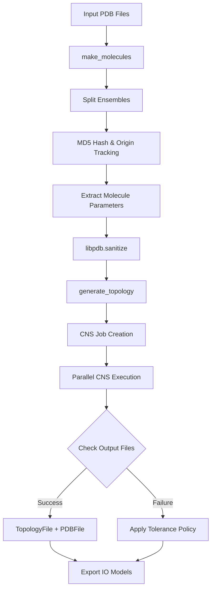
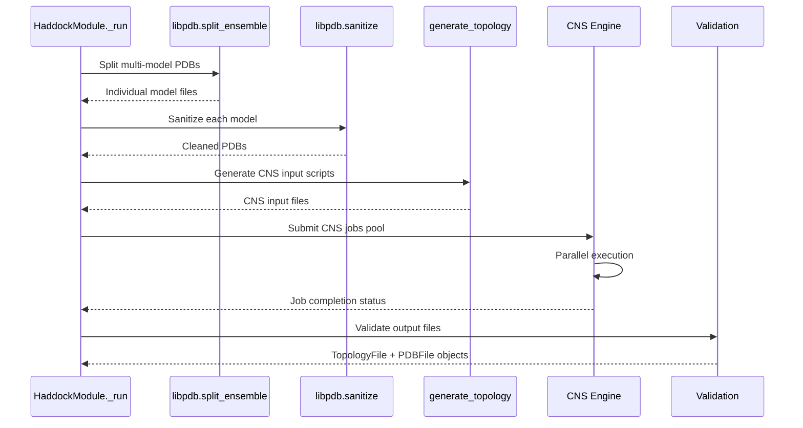

The **topoaa** module serves as the foundational preprocessing step in HADDOCK3 workflows, responsible for converting input molecular structures into CNS-compatible formats with complete atomic representations. This module generates the essential topology (.psf) and parameter files required for all downstream energy minimization and molecular dynamics calculations, making it an indispensable prerequisite for any CNS-based simulation pipeline.

**Sources**: [src/haddock/modules/topology/topoaa/__init__.py](src/haddock/modules/topology/topoaa/__init__.py#L1-L24)

## Module Architecture and Design

The topoaa module operates as a specialized CNS workflow module that inherits from the `BaseCNSModule` class, implementing a robust pipeline for topology generation with comprehensive error handling and parallel processing capabilities. The architecture follows a three-stage pattern: input preparation, CNS script generation, and parallel execution with result validation.

**Sources**: [src/haddock/modules/topology/topoaa/__init__.py](src/haddock/modules/topology/topoaa/__init__.py#L102-L103)



### Core Components

The module's execution is orchestrated by the `_run()` method which handles two distinct scenarios: as the initial workflow step (`order == 0`) where it processes raw input files, or as a downstream step where it regenerates topologies for previously generated models. This flexibility allows topology reconstruction at any workflow stage when needed.

**Sources**: [src/haddock/modules/topology/topoaa/__init__.py](src/haddock/modules/topology/topoaa/__init__.py#L174-L202)

The `generate_topology()` function serves as the CNS input generator, assembling parameter headers, input specifications, and recipe scripts into executable CNS scripts. This function prepares all necessary CNS statements including translation vectors, tensors, scatter plots, and water box definitions before combining them with the main topology generation recipe.

**Sources**: [src/haddock/modules/topology/topoaa/__init__.py](src/haddock/modules/topology/topoaa/__init__.py#L54-L98)

## Supported Molecules and Limitations

HADDOCK3's topoaa module provides extensive built-in support for standard biological macromolecules including:
- Standard amino acids (20 proteinogenic residues)
- Modified amino acids (common post-translational modifications)
- DNA and RNA nucleotides
- Common ions (Mg²⁺, Ca²⁺, Na⁺, K⁺, Zn²⁺, etc.)
- Carbohydrates and glycans

For these molecules, the module automatically handles:
- Missing heavy atom and hydrogen detection and reconstruction
- Disulfide bond identification based on distance criteria
- Chain break detection with appropriate patching
- Cyclic peptide backbone bond formation
- Cis-peptide bond identification
- Iron-sulfur cluster coordination

**Sources**: [src/haddock/modules/topology/topoaa/__init__.py](src/haddock/modules/topology/topoaa/__init__.py#L1-L24)

> [!TIP]
> **Critical limitation**: For non-standard molecules (e.g., drug-like ligands, cofactors, or novel residues), users must provide custom topology (.top) and parameter (.param) files. The module cannot generate these on-the-fly. Users should consult the [detailed list of supported molecules](https://wenmr.science.uu.nl/haddock2.4/library) to determine if external parameter files are required.

## Configuration Parameters

The topoaa module exposes a comprehensive parameter set organized into logical groups for both molecule-level and module-level control. Parameters are defined in `defaults.yaml` with expertise level indicators (easy, expert, guru) to help users navigate complexity.

**Sources**: [src/haddock/modules/topology/topoaa/defaults.yaml](src/haddock/modules/topology/topoaa/defaults.yaml#L1-L220)

### Module-Level Parameters

| Parameter | Type | Default | Expertise | Description |
|-----------|------|---------|-----------|-------------|
| `autohis` | boolean | true | easy | Automatically select histidine protonation state (HIS vs HISD/HISE) based on lowest electrostatic energy |
| `delenph` | boolean | true | easy | Remove non-polar hydrogen atoms (united atom force field optimization) |
| `log_level` | string | quiet | guru | CNS verbosity control (verbose/normal/quiet) |
| `iniseed` | integer | 917 | guru | Random seed for CNS initialization |
| `limit` | boolean | true | expert | Disable input molecule limits for analysis/scoring workflows |
| `set_bfactor` | boolean | true | expert | Override B-factors to default value of 15 |
| `tolerance` | integer | 0 | expert | Percentage of allowed failures before module failure |

**Sources**: [src/haddock/modules/topology/topoaa/defaults.yaml](src/haddock/modules/topology/topoaa/defaults.yaml#L1-L48)

### Force Field Parameters

| Parameter | Type | Default | Expertise | Description |
|-----------|------|---------|-----------|-------------|
| `ligand_param_fname` | file | '' | easy | Custom CNS parameter file for unsupported ligands |
| `ligand_top_fname` | file | '' | easy | Custom CNS topology file for unsupported ligands |

**Sources**: [src/haddock/modules/topology/topology/defaults.yaml](src/haddock/modules/topology/topoaa/defaults.yaml#L39-L48)

### Geometry Detection Parameters

| Parameter | Type | Default | Expertise | Description |
|-----------|------|---------|-----------|-------------|
| `disulphide_dist` | float | 2.20 | guru | Cutoff distance (Å) for S-S disulfide bond identification |
| `cyclicpept_dist` | float | 2.00 | guru | Cutoff distance (Å) for N-C cyclic peptide bond formation |

**Sources**: [src/haddock/modules/topology/topoaa/defaults.yaml](src/haddock/modules/topology/topoaa/defaults.yaml#L67-L80)

## Molecule-Specific Configuration

Each input molecule can receive individualized configuration through numbered parameter blocks (`mol1`, `mol2`, etc.). These parameters enable fine-grained control over protonation states, termini charges, and structural modifications.

**Sources**: [src/haddock/modules/topology/topoaa/__init__.py](src/haddock/modules/topology/topoaa/__init__.py#L224-L238)

### Histidine Protonation Control

When `autohis=false`, users must manually specify histidine protonation states:

| Parameter | Type | Default | Description |
|-----------|------|---------|-------------|
| `nhisd` | integer | 0 | Number of HISD residues (neutral, proton on ND) |
| `hisd_1`, `hisd_2`, ... | integer | .nan | Residue numbers for HISD specification |
| `nhise` | integer | 0 | Number of HISE residues (neutral, proton on NE) |
| `hise_1`, `hise_2`, ... | integer | .nan | Residue numbers for HISE specification |

**Sources**: [src/haddock/modules/topology/topoaa/defaults.yaml](src/haddock/modules/topology/topoaa/defaults.yaml#L101-L135)

### Termini Configuration

| Parameter | Type | Default | Description |
|-----------|------|---------|-------------|
| `charged_nter` | boolean | false | N-terminus: false = NH (uncharged), true = NH3⁺ (charged) |
| `charged_cter` | boolean | false | C-terminus: false = CO (uncharged), true = COO⁻ (charged) |
| `5_phosphate` | boolean | false | Nucleic acid 5' end: false = OH, true = PO₄³⁻ |

**Sources**: [src/haddock/modules/topology/topoaa/defaults.yaml](src/haddock/modules/topology/topoaa/defaults.yaml#L155-L183)

### Cyclic Peptide Specification

| Parameter | Type | Default | Description |
|-----------|------|---------|-------------|
| `cyclicpept` | boolean | false | Enable N-C cyclization when termini within `cyclicpept_dist` |

**Sources**: [src/haddock/modules/topology/topoaa/defaults.yaml](src/haddock/modules/topology/topoaa/defaults.yaml#L91-L100)

## CNS Script Integration

The module leverages a suite of specialized CNS scripts located in the `cns/` subdirectory to perform topology generation tasks. These scripts handle specific molecular transformations within the CNS environment.

**Sources**: [src/haddock/modules/topology/topoaa/cns](src/haddock/modules/topology/topoaa/cns)

### Available CNS Scripts

- **generate-topology.cns**: Main topology generation script that orchestrates all operations
- **auto-his.cns**: Histidine protonation state selection based on electrostatic energy
- **build-missing.cns**: Reconstruction of missing atoms including hydrogens
- **bondglycans.cns**: Glycan linkage specification and validation
- **check-coordinates.cns**: Coordinate validation and geometry checking
- **coval-ace-cys.cns**: Cysteine modification handling (acetylation)
- **covalheme.cns**: Heme group covalent attachment
- **dna-break.cns**: Nucleic acid chain break detection and patching
- **prot-break.cns**: Protein chain break detection and patching
- **patch-bb-cg.cns**: Backbone patching for coarse-grained models
- **patch-types-cg.cns**: Patch type definitions for coarse-grained topology

The main `generate-topology.cns` script contains critical distance thresholds for automatic feature detection:

```cns
{+ choice: true false +}
{===>} auto_break=true;

{* cutoff distance in Angstroms for identification of breaks *}
{===>} pbreak_cutoff=3.5;
{===>} pcgbreak_cutoff=8.0;
{===>} dbreak_cutoff=4.5;

{* cutoff distance in Angstroms for identification of disulphides *}
{===>} disulphide_dist=3.0;

{* cutoff distance in Angstroms for identification of cyclic peptide*}
{===>} cyclicpept_dist=2.0;
```

**Sources**: [src/haddock/modules/topology/topoaa/cns/generate-topology.cns](src/haddock/modules/topology/topoaa/cns/generate-topology.cns#L50-L75)

## Ensemble Handling and Model Tracking

The topoaa module implements sophisticated ensemble management with MD5 hashing and origin tracking to preserve model provenance throughout multi-conformation docking workflows.

**Sources**: [src/haddock/modules/topology/topoaa/__init__.py](src/haddock/modules/topology/topoaa/__init__.py#L118-L171)

### MD5 Hash Extraction

The `get_md5()` method parses REMARK lines in multi-model PDB files to extract pre-computed MD5 hashes for individual models, enabling efficient deduplication and model identification.

**Sources**: [src/haddock/modules/topology/topoaa/__init__.py](src/haddock/modules/topology/topoaa/__init__.py#L118-L141)

### Origin Tracking

The `get_ensemble_origin()` method identifies the source file for each model within an ensemble using REMARK records with the pattern `REMARK MODEL <num> FROM <filename>`. This information is preserved in the output PDB file names (e.g., `<md5_hash>_from_<model_name>_haddock.pdb`).

**Sources**: [src/haddock/modules/topology/topoaa/__init__.py](src/haddock/modules/topology/topoaa/__init__.py#L145-L171)

## Parallel Execution and Job Management

The module leverages HADDOCK3's engine system for efficient parallel processing of multiple molecules and models. Each molecule's conformations are processed as independent CNS jobs, with automatic load balancing across available computational resources.

**Sources**: [src/haddock/modules/topology/topoaa/__init__.py](src/haddock/modules/topology/topoaa/__init__.py#L254-L274)



## Output File Generation

Upon successful completion, the topoaa module generates paired output files for each input model:

- **Processed PDB**: `<model_name>_haddock.pdb` - Cleaned, hydrogen-added coordinates
- **Topology File**: `<model_name>_haddock.psf` - CNS topology with atom connectivity and charges

For ensembles with MD5 hashes or origin information, output files are renamed to preserve provenance: `<md5_hash>_from_<original_name>_haddock.pdb`.

**Sources**: [src/haddock/modules/topology/topoaa/__init__.py](src/haddock/modules/topology/topoaa/__init__.py#L276-L334)

## Error Handling and Tolerance

The module implements configurable fault tolerance through the `tolerance` parameter, which specifies the percentage of allowed failures before the entire module fails. This is particularly useful for large-scale docking workflows where occasional failures may be acceptable.

**Sources**: [src/haddock/modules/topology/topoaa/defaults.yaml](src/haddock/modules/topology/topoaa/defaults.yaml#L59-L63) and [src/haddock/modules/topology/topoaa/__init__.py](src/haddock/modules/topology/topoaa/__init__.py#L336)

## Integration with Workflows

As the foundational topology generation module, topoaa is typically positioned as the first module in HADDOCK3 workflows (`order=0`). However, it can also be used downstream to regenerate topologies for refined models when force field parameters or protonation states need adjustment.

**Sources**: [src/haddock/modules/topology/topoaa/__init__.py](src/haddock/modules/topology/topoaa/__init__.py#L174-L202)

When `limit=false`, the module accepts unlimited input molecules, enabling use with scoring and analysis modules like [emscoring](20-energy-minimization-vs-md-scoring) and [caprieval](6-haddock3-architecture-and-design-philosophy).

> [!TIP]
> **Workflow recommendation**: Always run topoaa as the first module unless you have specific requirements to regenerate topologies mid-workflow. This ensures all downstream modules operate on consistent, fully-parameterized structures with proper hydrogen placement.

## Next Steps

After successfully generating topologies with topoaa, you typically proceed to:
- **Rigid-body docking**: Explore [Rigid-Body Docking Fundamentals](13-rigid-body-docking-fundamentals) for initial sampling
- **Restrraints setup**: Learn about [Ambiguous Interaction Restraints (AIRs)](14-ambiguous-interaction-restraints-airs) to guide docking
- **Structure validation**: Review [PDB Preprocessing and Validation](11-pdb-preprocessing-and-validation) for input quality assessment
- **Advanced workflows**: Design custom protocols with [Custom Workflow Design](27-custom-workflow-design)

For non-standard molecules requiring custom topology files, refer to [Handling Non-Standard Molecules](12-handling-non-standard-molecules) for detailed parameterization guidance.