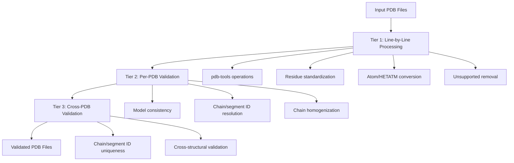
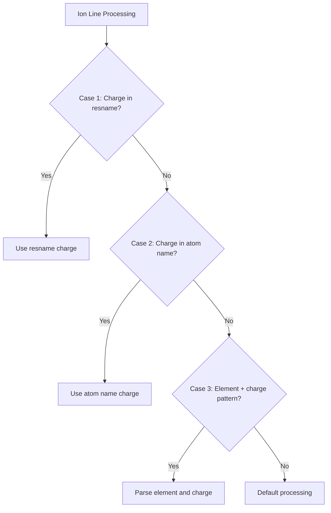
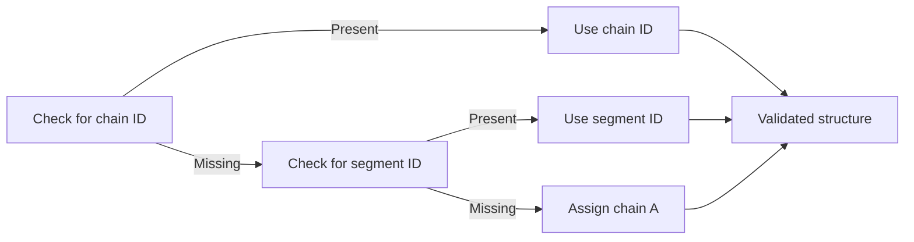
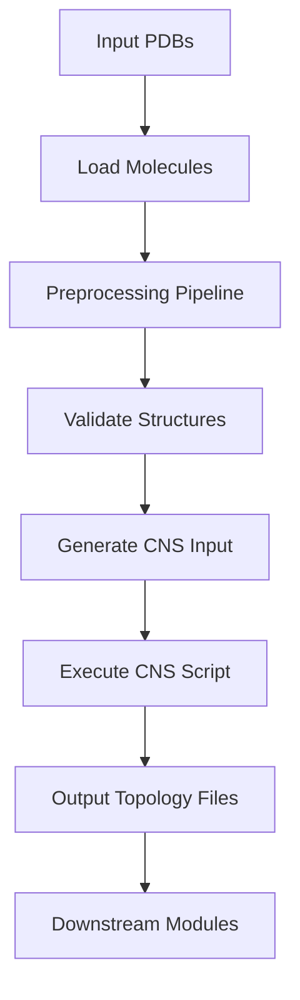

HADDOCK3 implements a comprehensive PDB preprocessing and validation pipeline that ensures input structures are compatible with the docking workflow. This system automatically detects and corrects common PDB format issues while maintaining the structural integrity required for molecular docking calculations. Understanding this preprocessing pipeline is essential for troubleshooting input preparation errors and working with non-standard molecules.

Sources: [preprocessing.py](src/haddock/gear/preprocessing.py#L1-L85), [cli_pp.py](src/haddock/clis/cli_pp.py#L1-L14)

## Preprocessing Architecture Overview

The PDB preprocessing system operates through a three-tier architecture that progressively refines and validates molecular structures. Each tier addresses specific aspects of PDB file compatibility, from atomic-level formatting to cross-structural consistency.



The preprocessing occurs automatically when molecules are loaded into the workflow, with original files preserved in the `data/` directory. This approach provides traceability while ensuring all downstream modules work with validated structures.

Sources: [preprocessing.py](src/haddock/gear/preprocessing.py#L5-L76), [topoaa/__init__.py](src/haddock/modules/topology/topoaa/__init__.py#L1-L40)

## Tier 1: Line-by-Line Processing Operations

The most intensive processing occurs at the atomic level, where each ATOM and HETATM line undergoes sequential transformations. These operations leverage the pdb-tools library while adding HADDOCK3-specific corrections.

### pdb-tools Integration

The first five operations use standard pdb-tools to establish baseline formatting:

1. **pdb_keepcoord**: Retains only coordinate-related records (ATOM, HETATM, TER, END)
2. **pdb_tidy with strict=True**: Standardizes column formatting according to PDB specifications
3. **pdb_element**: Corrects element column based on atom names
4. **pdb_selaltloc**: Selects the first alternative location when present
5. **pdb_occ with occupancy=1.00**: Sets all occupancy values to 1.0

These operations ensure consistent formatting across different PDB file sources and versions.

Sources: [preprocessing.py](src/haddock/gear/preprocessing.py#L24-L30)

### Residue Name Standardization

HADDOCK3 standardizes several non-standard residue names to their canonical forms:

| Original | Target | Rationale |
|----------|--------|-----------|
| MSE | MET | Selenomethionine to methionine |
| HSD, HSE, HID, HIE | HIS | Histidine protonation variants unified |

This standardization simplifies downstream topology generation while allowing users to specify histidine protonation states through module parameters rather than residue naming.

Sources: [preprocessing.py](src/haddock/gear/preprocessing.py#L31-L35), [defaults.yaml](src/haddock/modules/topology/topoaa/defaults.yaml#L4-L14)

### Ion Charge Correction

The `add_charges_to_ions` function handles proper charge assignment for ions through three prioritized cases:



The system prioritizes resname-encoded charges (e.g., ZN2+), then atom name charges (e.g., ZN+2), and finally element-plus-charge patterns. This hierarchical approach ensures maximum compatibility with different ion naming conventions.

Sources: [preprocessing.py](src/haddock/gear/preprocessing.py#L673-L832), [supported_molecules.py](src/haddock/core/supported_molecules.py#L100-L140)

### ATOM/HETATM Classification

HADDOCK3 enforces strict classification between ATOM and HETATM records based on supported molecule types:

| Molecule Type | Record Type | Source |
|---------------|-------------|--------|
| Standard amino acids, nucleic acids | ATOM | Supported by CNS topology files |
| Non-standard residues, ligands | HETATM | Defined in HETATM topology sets |

The preprocessing pipeline automatically converts misclassified records:
- `convert_ATOM_to_HETATM`: Reclassifies standard HETATM molecules incorrectly marked as ATOM
- `convert_HETATM_to_ATOM`: Reclassifies standard ATOM molecules incorrectly marked as HETATM

Sources: [preprocessing.py](src/haddock/gear/preprocessing.py#L36-L43), [preprocessing.py](src/haddock/gear/preprocessing.py#L832-L890)

## Tier 2: Per-PDB Structural Validation

After line-by-line processing, each PDB undergoes structural-level validation to ensure internal consistency.

### Model Consistency Check

The `models_should_have_the_same_labels` function validates that all models in multi-model PDB files have identical atom compositions. This prevents errors during ensemble docking where structural differences between models should be conformational, not compositional.

Sources: [preprocessing.py](src/haddock/gear/preprocessing.py#L1030-L1070), [test_gear_preprocessing.py](tests/test_gear_preprocessing.py#L42-L80)

### Chain and Segment ID Resolution

The `solve_no_chainID_no_segID` function handles PDB files lacking proper chain or segment identifiers:



This ensures every molecule has proper identifiers for downstream processing and restraint application.

Sources: [preprocessing.py](src/haddock/gear/preprocessing.py#L896-L940)

## Tier 3: Cross-PDB Validation

When multiple molecules are processed together, the system ensures global consistency across all input structures.

### Chain/Segment ID Uniqueness

The `correct_equal_chain_segids` function identifies and resolves conflicts where different molecules use identical chain or segment identifiers. This is critical for preventing ambiguity in restraint definitions and intermolecular interaction analysis.

The system assigns unique identifiers using an alphabetical sequence (A-Z, a-z) when conflicts are detected.

Sources: [preprocessing.py](src/haddock/gear/preprocessing.py#L976-L1028)

## Supported Molecules System

HADDOCK3 maintains a comprehensive registry of supported molecules derived from CNS topology files. This system dynamically loads supported residues from topology definitions in `src/haddock/cns/toppar/`.

### Topology File Sources

Supported molecules are categorized by their topology source:

| Category | Topology File | Examples |
|----------|---------------|----------|
| Standard proteins | protein-allhdg5-4.top | Amino acids, modified residues |
| DNA/RNA | dna-rna-allatom-hj-opls-1.3.top | Nucleic acid residues |
| Ions | ion.top | Single and multi-atom ions |
| Carbohydrates | carbohydrate.top | Sugar residues |
| Cofactors | cofactors.top | Heme, metal centers |
| Solvent | solvent-allhdg5-4.top | Water molecules |

> [!TIP]
> The `CNSTopologyResidue` class in supported_molecules.py provides a programmatic interface to residue information including name, charge, and atom composition. This is used by preprocessing to validate residue compatibility.

Sources: [supported_molecules.py](src/haddock/core/supported_molecules.py#L1-L80), [libpdb.py](src/haddock/libs/libpdb.py#L91-L100)

### Custom Topology Support

Users can extend supported molecules by providing custom topology files:

```python
# In preprocessing workflow
from haddock.libs.libpdb import get_supported_residues

custom_residues = get_supported_residues("custom_topology.top")
```

These custom residues are incorporated into the preprocessing pipeline through the `user_supported_residues` parameter.

Sources: [libpdb.py](src/haddock/libs/libpdb.py#L91-L100), [preprocessing.py](src/haddock/gear/preprocessing.py#L326-L335)

## Command-Line Preprocessing Tool

HADDOCK3 provides a standalone CLI tool (`haddock-pp`) for PDB preprocessing outside the main workflow:

```bash
# Basic usage with default suffix (_processed)
haddock-pp input1.pdb input2.pdb

# Custom output suffix
haddock-pp input.pdb --suffix _preprocessed

# Dry run to preview changes without modifying files
haddock-pp input.pdb --dry

# Specify custom topology file
haddock-pp input.pdb --topfile custom.top
```

The dry-run mode is particularly useful for understanding what preprocessing steps will be applied before committing to changes.

Sources: [cli_pp.py](src/haddock/clis/cli_pp.py#L17-L22), [cli_pp.py](src/haddock/clis/cli_pp.py#L101-L168)

## Integration with Topology Generation

The `topoaa` module integrates preprocessing with topology generation, forming the foundation of HADDOCK3 workflows. This module performs several critical functions:

1. **Missing Atom Detection**: Identifies incomplete residues
2. **Hydrogen Addition**: Adds missing hydrogen atoms based on standard geometry
3. **Topology Generation**: Creates CNS-compatible .psf files
4. **Parameter Assignment**: Associates force field parameters with each atom

The module's `generate_topology` function orchestrates these steps, creating input files for CNS execution.

Sources: [topoaa/__init__.py](src/haddock/modules/topology/topoaa/__init__.py#L65-L95)

### Module Configuration Parameters

Key topoaa parameters affecting preprocessing:

| Parameter | Default | Description |
|-----------|---------|-------------|
| `autohis` | true | Automatically determines histidine protonation |
| `delenph` | true | Removes non-polar hydrogens for efficiency |
| `mol1.cyclicpept` | false | Enables cyclic peptide detection |
| `mol1.charged_nter` | false | Sets N-terminus charge state |
| `mol1.charged_cter` | false | Sets C-terminus charge state |

These parameters can be specified per-molecule (mol1, mol2, etc.) to handle complex inputs with different requirements.

Sources: [defaults.yaml](src/haddock/modules/topology/topoaa/defaults.yaml#L1-L50)

## Validation and Error Handling

The preprocessing system includes comprehensive validation to catch issues before they affect downstream calculations.

### Common Validation Errors

| Error Type | Description | Resolution |
|------------|-------------|------------|
| `ModelsDifferError` | Models have different atom counts | Ensure structural consistency, not composition |
| `SetupError` | No coordinates kept after sanitizing | Verify supported molecules or provide custom topology |
| Chain ID conflicts | Duplicate chain/segment IDs | Let preprocessing auto-correct or manually rename |

### Testing Framework

The preprocessing pipeline is validated through comprehensive unit tests in `tests/test_gear_preprocessing.py` and integration tests in `integration_tests/test_topoaa.py`. These tests cover:

- Multiple input format handling (paths, file objects, string lists)
- Additional residue reading from custom topologies
- Model consistency checking
- Line-by-line operation validation
- End-to-end workflow integration

Sources: [test_gear_preprocessing.py](tests/test_gear_preprocessing.py#L1-L60), [test_topoaa.py](integration_tests/test_topoaa.py#L1-L70)

## Workflow Integration

PDB preprocessing occurs at the beginning of HADDOCK3 workflows, specifically during the topoaa module execution. The process flow is:



Users can skip preprocessing by setting `skip_preprocess = False` in general parameters, though this is not recommended for most use cases.

Sources: [preprocessing.py](src/haddock/gear/preprocessing.py#L70-L76), [topoaa/__init__.py](src/haddock/modules/topology/topoaa/__init__.py#L200-L250)

## Advanced Usage Patterns

### Handling Non-Standard Molecules

For molecules not supported by default topology files:

1. Obtain or create CNS topology and parameter files
2. Use `--topfile` with `haddock-pp` CLI
3. Reference custom topology in topoaa configuration via `ligand_top_fname` and `ligand_param_fname`

Sources: [defaults.yaml](src/haddock/modules/topology/topoaa/defaults.yaml#L45-L60)

### Ensemble Processing

When working with multi-model PDB files (NMR ensembles):

```bash
# Preprocess ensemble - preprocessing handles all models consistently
haddock-pp ensemble.pdb --suffix _processed

# Topoaa automatically splits ensembles for individual processing
# Each model gets separate topology and parameter files
```

The `get_ensemble_origin` function in topoaa tracks model provenance through REMARK records, maintaining traceability.

Sources: [topoaa/__init__.py](src/haddock/modules/topology/topoaa/__init__.py#L100-L140), [libpdb.py](src/haddock/libs/libpdb.py#L117-L130)

## Best Practices

1. **Always inspect preprocessing output**: Use `--dry` flag first to understand what changes will be made
2. **Verify custom topologies**: Test non-standard molecules with the CLI tool before full workflows
3. **Preserve original files**: Original PDBs are saved in `data/` for reference
4. **Check model consistency**: Ensure ensemble models differ only in conformation, not composition
5. **Review chain assignments**: Confirm chain/segment IDs match your restraint definitions

> [!TIP]
> When working with heterogeneous ensembles (e.g., antibody-antigen docking), ensure each molecule has unique chain identifiers before preprocessing. The `correct_equal_chain_segids` function handles this automatically but may assign different IDs than expected.

## Next Steps

After PDB preprocessing and validation, structures are ready for topology generation. For comprehensive understanding of how preprocessed structures feed into the docking workflow, see [Molecule Topology Generation with topoaa](10-molecule-topology-generation-with-topoaa). When working with molecules not supported by default, refer to [Handling Non-Standard Molecules](12-handling-non-standard-molecules) for detailed guidance on custom topology preparation.

For practical examples of preprocessing in action, explore the [example workflows](https://github.com/haddocking/haddock3/tree/main/examples) in the repository, particularly the `docking-protein-protein` and `docking-antibody-antigen` examples which demonstrate different preprocessing scenarios.