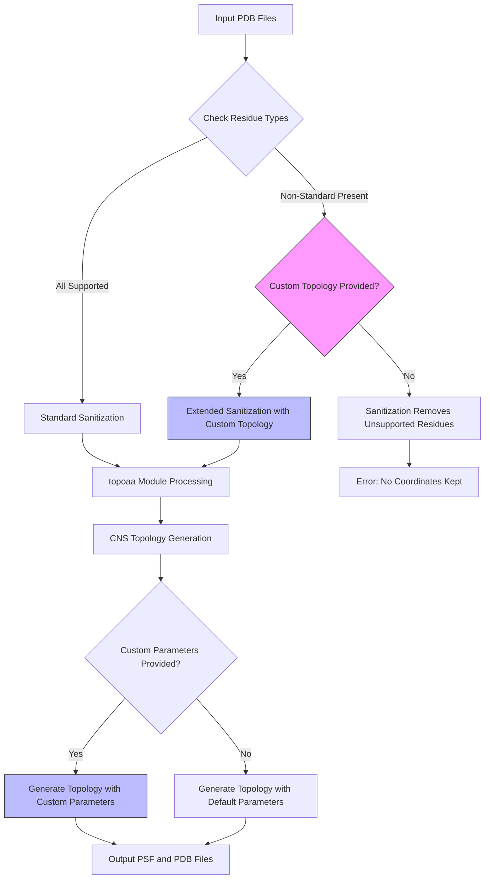
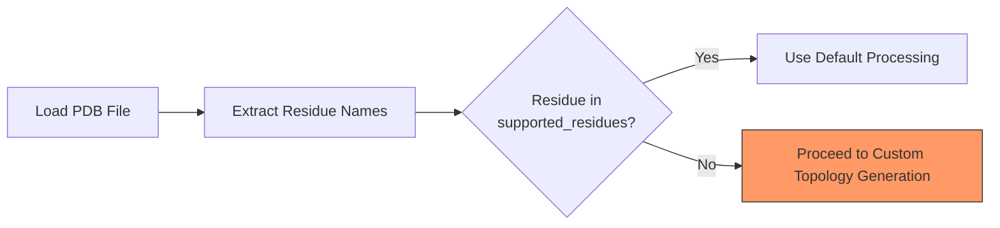

HADDOCK3 provides comprehensive support for standard biomolecules (proteins, nucleic acids, carbohydrates, ions, and cofactors) through built-in CNS topology libraries. However, many docking scenarios involve non-standard molecules—such as drug-like compounds, modified residues, or synthetic ligands—that require custom topology definitions. This documentation explains how to work with these molecules, generate required parameter files, and integrate them into HADDOCK3 workflows.

Sources: [supported_molecules.py](src/haddock/core/supported_molecules.py#L1-L60), [topoaa/__init__.py](src/haddock/modules/topology/topoaa/__init__.py#L1-L33)

## Understanding Non-Standard Molecules

Non-standard molecules in HADDOCK3 context are molecular entities not covered by the default topology library in `src/haddock/cns/toppar/`. This includes:

- **Small-molecule ligands**: Drug compounds, cofactors not in the default library
- **Modified amino acids**: Post-translational modifications beyond standard residues
- **Synthetic peptides**: Non-natural amino acids, peptidomimetics
- **Metal complexes**: Organometallic compounds not defined in ion.top
- **Novel nucleotides**: Modified DNA/RNA bases not in nucleic acid topologies

The `supported_molecules.py` module systematically parses all default `.top` files to create comprehensive residue sets. The current system supports 12 distinct molecule categories defined across multiple topology files, each serving specific molecular types.

Sources: [supported_molecules.py](src/haddock/core/supported_molecules.py#L267-L392)

## Architecture Overview

The following diagram illustrates how HADDOCK3 processes molecules, with specific handling for non-standard cases:



The architecture demonstrates the decision flow when handling non-standard molecules. The critical intervention point occurs during the sanitization phase, where custom topology files can extend the supported residue set. The `sanitize` function in `libpdb.py` implements this logic by merging default supported residues with those defined in custom topology files.

Sources: [libpdb.py](src/haddock/libs/libpdb.py#L166-L210), [topoaa/__init__.py](src/haddock/modules/topology/topoaa/__init__.py#L200-L230)

## Built-in Molecule Support

HADDOCK3 includes extensive built-in support across multiple molecular classes:

| Molecule Category | Topology File | Example Residues | Record Type |
|------------------|---------------|------------------|-------------|
| Standard Amino Acids | protein-allhdg5-4.top | ALA, GLY, ARG, etc. | ATOM |
| Modified Proteins (CG-Martini) | protein-CG-Martini.top, protein-CG-Martini-2-2.top | Martini bead types | ATOM |
| Nucleic Acids (All-atom) | dna-rna-allatom-hj-opls-1.3.top | ADE, CYT, GUA, THY, URA | ATOM |
| Nucleic Acids (CG-MARTINI) | dna-rna-CG-MARTINI-2-1p.top | Martini nucleic beads | ATOM |
| Carbohydrates | carbohydrate.top | GLC, MAN, FUC, etc. | HETATM |
| Single Ions | ion.top | NA, CL, MG, ZN, K | HETATM |
| Multi-atom Ions | ion.top | SO4, PO4, CA | HETATM |
| Hemes | hemes-allhdg.top | HEM, HEA, HEB | HETATM |
| Cofactors | cofactors.top | ATP, NAD, FAD | HETATM |
| Fragments | fragment_probes.top | Various probe molecules | HETATM |
| Solvents | solvent-allhdg5-4.top | TIP3, WAT | HETATM |
| Shape Objects | shape.top | Dummy atoms for docking | HETATM |

The system automatically determines whether residues should be stored as ATOM or HETATM records based on their classification. Residues in `supported_ATOM` include all protein, nucleic acid, and their coarse-grained variants, while everything else falls under `supported_HETATM`.

Sources: [supported_molecules.py](src/haddock/core/supported_molecules.py#L453-L496)

## Custom Topology Integration

For non-standard molecules, you must provide two CNS-format files:

### Required Files

1. **Topology File (.top)**: Defines atomic composition, charges, and connectivity
   - Contains atom definitions with names, types, masses, and charges
   - Includes bond, angle, dihedral, and improper definitions
   - Structure follows CNS RESIdue format

2. **Parameter File (.param)**: Contains force field parameters
   - Bond force constants and equilibrium values
   - Angle force constants and equilibrium values  
   - Dihedral parameters
   - Improper dihedral parameters
   - Van der Waals parameters (ε, r_min)

### Configuration Parameters

The `topoaa` module provides two key parameters for custom topology integration:

| Parameter | Type | Description | Required |
|-----------|------|-------------|----------|
| `ligand_top_fname` | file | Path to custom topology file (.top) | Yes for non-standard |
| `ligand_param_fname` | file | Path to custom parameter file (.param) | Yes for non-standard |

These parameters must be specified for each module that requires topology information (topoaa, rigidbody, flexref, etc.) when working with non-standard molecules.

Sources: [defaults.yaml](src/haddock/modules/topology/topoaa/defaults.yaml#L53-L68)

## Practical Workflow

### Step 1: Validate Your Molecule

Before generating custom topologies, verify that your molecule is truly non-standard:



The `sanitize` function automatically filters out unsupported residues. If sanitization removes all atoms from your file, this confirms the need for custom topology.

Sources: [libpdb.py](src/haddock/libs/libpdb.py#L166-L210)

### Step 2: Generate Topology Files

Use external tools to generate CNS-compatible topologies:

**Popular Options:**

1. **PRODRG**: Web-based topology generator for small molecules
2. **ACPYPE**: AnteChamber PYthon Parser interfacE for GAFF force fields
3. **CGenFF**: CHARMM General Force Field program (requires license)
4. **SwissParam**: Web server for CHARMM-compatible parameters

**Example from HADDOCK3:**

The protein-ligand docking example demonstrates dual topology approaches using both PRODRG and ACPYPE generated files:

```
examples/docking-protein-ligand/data/
├── ligand-acpype.param      # ACPYPE-generated parameters
├── ligand-acpype.top        # ACPYPE-generated topology
├── ligand-prodrg.param      # PRODRG-generated parameters
└── ligand-prodrg.top        # PRODRG-generated topology
```

Sources: [docking-protein-ligand-full.cfg](examples/docking-protein-ligand/docking-protein-ligand-full.cfg#L1-L50)

### Step 3: Configure the Workflow

Integrate the custom topology into your HADDOCK3 configuration:

```toml
[topoaa]
ligand_param_fname = "data/ligand-prodrg.param"
ligand_top_fname = "data/ligand-prodrg.top"
autohis = true
delenph = false

[rigidbody]
ligand_param_fname = "data/ligand-prodrg.param"
ligand_top_fname = "data/ligand-prodrg.top"
sampling = 1000
# ... other parameters

[flexref]
ligand_param_fname = "data/ligand-prodrg.param"
ligand_top_fname = "data/ligand-prodrg.top"
# ... other parameters
```

> [!TIP]
> The `ligand_top_fname` and `ligand_param_fname` must be specified for **every** module that generates or modifies topology information. The `topoaa` module uses these to identify and preserve non-standard residues during sanitization, while downstream modules require them for proper energy calculations.

Sources: [docking-protein-ligand-full.cfg](examples/docking-protein-ligand/docking-protein-ligand-full.cfg#L18-L62)

### Step 4: Validate Processing

Monitor your workflow for successful integration:

1. **Sanitization logs**: Verify that non-standard residues are preserved
2. **Topology generation**: Check that CNS successfully processes custom definitions
3. **Output files**: Confirm that generated .psf files contain all expected atoms

The `sanitize` function extends the `to_keep` residue list when custom topologies are provided:

```python
# From libpdb.py sanitize function
def sanitize(pdb_file_path, overwrite=True, custom_topology=None):
    to_keep = deepcopy(_to_keep)
    if custom_topology:
        custom_res_to_keep = get_supported_residues(custom_topology)
        to_keep.extend(custom_res_to_keep)
```

This mechanism ensures that residues defined in your custom topology are recognized and preserved during PDB preprocessing.

Sources: [libpdb.py](src/haddock/libs/libpdb.py#L91-L102), [libpdb.py](src/haddock/libs/libpdb.py#L166-L210)

## Advanced Scenarios

### Multiple Non-Standard Molecules

When working with multiple distinct non-standard molecules, each requires separate topology files. For example, docking a protein with two different drug compounds:

```toml
[topoaa]
ligand_top_fname = "data/compound1.top"
ligand_param_fname = "data/compound1.param"

# For molecules 2 and 3, configure separately or use different
# topology files per molecule if they require different parameters
mol2.ligand_top_fname = "data/compound2.top"
mol2.ligand_param_fname = "data/compound2.param"
```

### Modified Amino Acids

For proteins containing non-standard amino acids, you have two approaches:

1. **Add to existing topology**: Extend `protein-allhdg5-4.top` with new residue definitions
2. **Create separate topology**: Generate a dedicated .top file for the modified residue

The `read_supported_residues` function can be modified to parse additional topology files:

```python
# Add new topology file to read_supported_residues function
modified_residues_top = Path(source_path, "modified_residues.top")
supported_modified = read_residues_from_top_file(modified_residues_top)
supported_aminoacids = set(it.chain(
    _1, _2, _3, supported_modified
))
```

> [!TIP]
> When adding new residues to the built-in topology system, you must update the `read_supported_residues` function in `supported_molecules.py` to parse your new .top file. This is a more permanent solution compared to per-run custom topologies.

Sources: [supported_molecules.py](src/haddock/core/supported_molecules.py#L270-L392)

### Troubleshooting Common Issues

| Symptom | Cause | Solution |
|---------|-------|----------|
| "No coordinates kept after sanitizing" | All residues filtered as unsupported | Provide custom topology via `ligand_top_fname` |
| CNS topology generation errors | Missing bonds/angles in topology | Verify .top file contains all necessary definitions |
| Inconsistent charges | Force field mismatch | Ensure .param file uses compatible force field parameters |
| Atom name mismatches | Different naming conventions | Check PDB atom names match topology definitions |

## Self-Contained Workflows

The `read_supported_residues` function supports "self-contained" workflows where topology files reside in the run folder rather than the source code directory. The `source_path` parameter allows specification of alternative topology locations:

```python
# Function signature showing source_path parameter
def read_supported_residues(source_path: FilePath) -> tuple[dict[str, CNSTopologyResidue], ...]:
    """
    Read supported residues from a folder containing `.top` files.
    The function expects the `source_path` to have the required files.
    """
```

This enables portable workflows where all necessary topology files travel with the docking configuration rather than requiring modification of the source code distribution.

Sources: [supported_molecules.py](src/haddock/core/supported_molecules.py#L270-L310)

## Best Practices

1. **Validate topology files**: Use external validation tools to check CNS file syntax before integration
2. **Keep consistent naming**: Ensure residue names match between PDB and topology files
3. **Test incrementally**: Start with rigid-body docking before attempting refinement protocols
4. **Document modifications**: Record the source and generation method for custom topologies
5. **Version control**: Maintain custom topology files under version control with your workflow

Sources: [topoaa/__init__.py](src/haddock/modules/topology/topoaa/__init__.py#L200-L230)

## Next Steps

For comprehensive understanding of topology generation and workflow configuration:

- **[Molecule Topology Generation with topoaa](10-molecule-topology-generation-with-topoaa)** - Detailed explanation of the topoaa module's internal workings
- **[PDB Preprocessing and Validation](11-pdb-preprocessing-and-validation)** - How HADDOCK3 handles PDB files before topology generation
- **[Parameter Reference and Tuning](26-parameter-reference-and-tuning)** - Complete guide to all configurable parameters including custom topology options

For practical examples, examine:
- Protein-ligand docking workflow in `examples/docking-protein-ligand/`
- PDB sanitization implementation in `src/haddock/libs/libpdb.py`
- Topology parsing system in `src/haddock/core/supported_molecules.py`