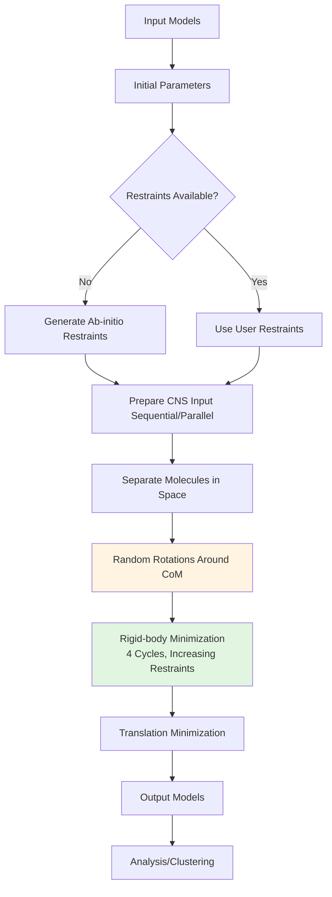

The rigid-body docking module represents the foundational sampling stage in HADDOCK3, corresponding to the classical `it0` (iteration 0) step from HADDOCK2.x. This module performs systematic exploration of interaction space by treating molecular partners as rigid bodies, executing randomized orientations followed by energy minimization where only rotational and translational degrees of freedom are available. The approach balances computational efficiency with strategic sampling, leveraging distance-based restraints to guide molecules toward biologically relevant binding orientations while maintaining internal geometry integrity throughout the docking process.

Sources: [src/haddock/modules/sampling/rigidbody/__init__.py](src/haddock/modules/sampling/rigidbody/__init__.py#L1-L30)

## Core Architectural Principles

Rigid-body docking operates on the fundamental assumption that the global conformation of each interacting partner remains unchanged during the initial sampling phase. This simplification enables exhaustive exploration of rotational and translational space without the computational burden of modeling internal flexibility. The module implements a two-stage strategy: first randomizing molecule orientations around their centers of mass, then performing rigid-body energy minimization driven by a combination of intermolecular van der Waals forces, electrostatic interactions, and user-defined distance restraints.

The rigid-body constraint explicitly freezes all internal geometric parameters including bond lengths, bond angles, and dihedral angles. By limiting degrees of freedom to six external variables (three rotational, three translational) per molecule, the algorithm efficiently samples interaction modes that would be prohibitively expensive with full flexibility. This approach is particularly well-suited for initial exploration when structural information about the bound conformation is limited, as it allows rapid generation of diverse candidate poses that can later be refined using flexible protocols.

Sources: [src/haddock/modules/sampling/rigidbody/__init__.py](src/haddock/modules/sampling/rigidbody/__init__.py#L9-L14)

## Module Architecture and Execution Flow

The rigid-body module follows a modular architecture integrating Python orchestration with CNS (Crystallography & NMR System) script execution. The HaddockModule class extends BaseCNSModule, inheriting workflow management capabilities while implementing rigid-body-specific logic for CNS job preparation and execution. The module operates through three primary phases: input preparation, CNS job execution, and result collection.

The execution begins with `prepare_cns_input_sequential` or `prepare_cns_input_parallel` methods, depending on the configured execution mode. These methods generate CNS input files for each docking trial, incorporating the molecular structures, restraint definitions, and simulation parameters. Each trial receives a unique seed value derived from `iniseed + idx` to ensure reproducible randomness across parallel executions. The CNS script `rigidbody.cns` implements the actual docking protocol, handling coordinate manipulation, energy calculation, and minimization through CNS commands.

Sources: [src/haddock/modules/sampling/rigidbody/__init__.py](src/haddock/modules/sampling/rigidbody/__init__.py#L66-L123), [src/haddock/modules/sampling/rigidbody/cns/rigidbody.cns](src/haddock/modules/sampling/rigidbody/cns/rigidbody.cns#L1-L50)

## Random Orientation Strategy

The randomization phase employs a sophisticated quaternion-based rotation algorithm to generate uniformly distributed orientations around each molecule's center of mass. The algorithm generates four random values (e1, e2, e3, e4) in the range [-1, 1] with constraints ensuring e1² + e2² < 1 and e3² + e4² < 1, then converts these to rotation matrices through quaternion mathematics. This approach provides superior uniformity compared to Euler angle-based methods and avoids gimbal lock issues.

Molecules undergo separation by approximately 10Å in random directions before rotation to prevent steric clashes during re-approach. For symmetric homomers, the same rotation is applied to all identical subunits to preserve symmetry relationships. When specific molecules are fixed (`mol_fix_origin_X = true`), the remaining molecules rotate collectively around the geometric center of the fixed components, maintaining their relative orientations to the fixed reference frame.

Sources: [src/haddock/modules/sampling/rigidbody/cns/random_rotations.cns](src/haddock/modules/sampling/rigidbody/cns/random_rotations.cns#L26-L96)

## Multi-Stage Minimization Protocol

The rigid-body minimization implements a sophisticated annealing strategy across multiple cycles, systematically increasing restraint force constants to gradually guide molecules toward restraint-satisfying conformations while avoiding local minima traps. The protocol executes four rotational minimization cycles followed by translational minimization, with restraint scales doubling after each cycle.

> [!TIP]
> The progressive increase in restraint force constants (from 1.0 to user-defined maximum values) is critical for preventing early trapping in non-physical minima. Starting with soft restraints allows molecules to find favorable van der Waals contacts before gradually tightening to satisfy distance restraints.

Each rotational minimization cycle treats individual molecule chains separately, with all other molecules held fixed. This staged approach allows each molecule to optimize its orientation relative to the static arrangement of its partners. The minimization uses 500 steps scaled by the number of molecular components, with parameters adjusted to prevent large structural displacements that could violate the rigid-body assumption.

Sources: [src/haddock/modules/sampling/rigidbody/cns/rigidbody.cns](src/haddock/modules/sampling/rigidbody/cns/rigidbody.cns#L341-L383)

## Restraint Systems and Configuration

The rigid-body module supports multiple restraint types that guide the docking process. Understanding and properly configuring these restraints is essential for successful docking outcomes, as they constitute the primary driving force beyond physical interactions.

### Distance Restraints

| Parameter | Type | Default | Range | Description |
|-----------|------|---------|-------|-------------|
| `ambig_fname` | file | '' | - | Ambiguous distance restraints file (AIRs) |
| `unambig_fname` | file | '' | - | Unambiguous distance restraints file |
| `hbond_fname` | file | '' | - | Hydrogen bond restraints file |
| `ambig_scale` | integer | 50 | 0-1000 | Force constant for ambiguous restraints |
| `unambig_scale` | integer | 50 | 0-1000 | Force constant for unambiguous restraints |
| `hbond_scale` | integer | 50 | 0-1000 | Force constant for hydrogen bond restraints |
| `randremoval` | boolean | true | - | Random removal of ambiguous restraints |
| `npart` | integer | 2 | 1-20 | Number of restraint partitions for random removal |

Ambiguous Interaction Restraints (AIRs) represent the most sophisticated guidance system, allowing definition of "active" and "passive" residues where interactions are possible. The `randremoval` parameter, when enabled, randomly discards a fraction (1/npart) of AIRs for each model, creating ensemble diversity and preventing over-constraint. This is particularly valuable when experimental data contains noise or uncertainty.

Sources: [src/haddock/modules/sampling/rigidbody/defaults.yaml](src/haddock/modules/sampling/rigidbody/defaults.yaml#L23-L112)

### Ab-initio Restraints

When experimental or bioinformatics-derived restraints are unavailable, HADDOCK3 provides automated ab-initio restraint generation through two complementary mechanisms:

**Center of Mass (CM) Restraints** (`cmrest = true`): Automatically calculates the geometric center of each molecule (using CA atoms for proteins, N1 for nucleic acids, all atoms for small ligands) and applies distance restraints between these centers. The upper distance limit derives from molecular dimensions, with `cmtight` controlling whether to use the two shortest (`cmtight = true`) or all three principal axes for size calculation. This provides gentle guidance encouraging compact assemblies without specifying interaction interfaces.

**Random AIRs** (`ranair = true`): Generates ambiguous interaction restraints from randomly selected surface patches on solvent-accessible residues. This method samples diverse interaction interfaces, enabling ab-initio docking without prior knowledge. The `nrair_X` parameters (where X is molecule index 1-14) allow restriction of random AIR generation to specific residue segments, providing partial guidance when some interface regions are known.

> [!TIP]
> Random AIRs are incompatible with user-defined distance restraints and limited to two-molecule systems. For multi-component docking, use CM restraints or provide explicit restraint definitions.

Sources: [src/haddock/modules/sampling/rigidbody/defaults.yaml](src/haddock/modules/sampling/rigidbody/defaults.yaml#L116-L167), [src/haddock/modules/sampling/rigidbody/cns/rigidbody.cns](src/haddock/modules/sampling/rigidbody/cns/rigidbody.cns#L247-L285)

### Interaction Energy Scaling

The module applies selective scaling to intermolecular interactions based on molecule types and user-defined weights. The `int_X_Y` parameters define interaction scaling factors between molecule pairs, allowing asymmetric treatment of different molecular combinations (e.g., stronger protein-protein interactions vs. protein-ligand interactions). These factors modulate both van der Waals and electrostatic energy terms during minimization.

Special handling exists for shape molecules (`mol_shape_X = true`) and dummy atoms, which have their intermolecular interactions selectively disabled to prevent spurious energy contributions during docking.

Sources: [src/haddock/modules/sampling/rigidbody/cns/scale_inter_mini.cns](src/haddock/modules/sampling/rigidbody/cns/scale_inter_mini.cns#L14-L38)

## Safety Mechanisms and Validation

The rigid-body module incorporates multiple guardrails to prevent execution with invalid configurations. The `restraints_guardrail` method performs comprehensive checks before docking begins, verifying that at least one valid restraint source exists. If no restraints (ambiguous, unambiguous, hydrogen bond, CM, random AIRs, or surface restraints) are detected, the module terminates with an informative error message guiding users toward appropriate parameter configuration.

Within the CNS script, additional validation ensures the number of distance restraints meets or exceeds the `nart` value specified for cross-validation. If insufficient restraints exist, the script automatically adjusts parameters and issues warnings. The script also validates multi-molecule symmetry configurations, disabling 180° rotations for symmetric systems that would be redundant.

Sources: [src/haddock/modules/sampling/rigidbody/__init__.py](src/haddock/modules/sampling/rigidbody/__init__.py#L172-L194), [src/haddock/modules/sampling/rigidbody/cns/rigidbody.cns](src/haddock/modules/sampling/rigidbody/cns/rigidbody.cns#L199-L227)

## Configuration Parameter Reference

The complete parameter set spans multiple functional categories, each controlling specific aspects of the docking protocol. Key parameter groups include:

### Core Docking Parameters

| Parameter | Type | Default | Expert Level | Description |
|-----------|------|---------|--------------|-------------|
| `sampling` | integer | 1000 | - | Number of models to generate |
| `iniseed` | integer | 42 | - | Initial random seed |
| `ntrials` | integer | 10 | expert | Minimization trials per model |
| `mode` | string | 'local' | easy | Execution mode (local/mpi) |
| `debug` | boolean | false | expert | Enable CNS debug output |

### Electrostatics Parameters

| Parameter | Type | Default | Range | Description |
|-----------|------|---------|-------|-------------|
| `elecflag` | boolean | false | - | Enable electrostatic interactions |
| `epsilon` | float | 10.0 | - | Dielectric constant |
| `dielec` | string | 'rdie' | rdie/cdie | Distance-dependent/constant dielectric |

Electrostatic calculations add computational overhead but can improve docking accuracy for charged systems. The default distance-dependent dielectric model (`rdie`) mimics solvent screening effects without explicit solvent representation.

Sources: [src/haddock/modules/sampling/rigidbody/defaults.yaml](src/haddock/modules/sampling/rigidbody/defaults.yaml#L1-L4497)

## Molecular Fixing and Advanced Controls

The module provides mechanisms to selectively fix molecules in their original positions during docking, enabling scenarios where one component's location is known (e.g., a membrane-embedded receptor or surface-bound protein). The `mol_fix_origin_X` parameters (where X is molecule index) control this behavior, with multiple molecules simultaneously supported.

When fixing is enabled, the module adapts its behavior in two ways: (1) non-fixed molecules undergo random rotations around the geometric center of fixed components rather than their individual centers, and (2) the 180° orientation trial (see below) is disabled to maintain the fixed reference frame. This ensures that while non-fixed molecules explore relative orientations, the overall assembly maintains the fixed component's position.

Sources: [src/haddock/modules/sampling/rigidbody/cns/rigidbody.cns](src/haddock/modules/sampling/rigidbody/cns/rigidbody.cns#L186-L193)

## 180° Rotation Strategy

For certain docking scenarios, particularly involving homodimers or symmetric complexes, the module can perform an additional 180° rotation trial to explore inverted orientations. This controlled perturbation helps escape local minima and can reveal alternative binding modes that might be missed with purely random orientations. The rotation is disabled automatically for symmetric systems where it would be redundant.

The 180° rotation is applied after initial randomization but before minimization, essentially providing a controlled systematic exploration complementing the random sampling. This hybrid strategy combines the benefits of exhaustive systematic search (for the specific 180° case) with efficient random sampling for the vast majority of orientation space.

Sources: [src/haddock/modules/sampling/rigidbody/cns/rigidbody.cns](src/haddock/modules/sampling/rigidbody/cns/rigidbody.cns#L68-L82)

## Integration with Workflow

The rigid-body module serves as the entry point for most HADDOCK3 workflows, typically following topology generation (`topoaa`) and preceding refinement stages (`flexref`, `emref`, `mdref`). Output models from rigid-body docking become input for scoring modules, where they are evaluated and ranked before proceeding to refinement of the best candidates.

The module supports workflow continuation through `previous_ambig` parameter, allowing reuse of restraint information from prior CNS modules. This enables iterative workflows where restraints are refined or updated based on intermediate results without manual file management.

For multi-step workflows, the sampling factor can be increased at the rigid-body stage to ensure adequate coverage, then reduced during refinement where the search space has been narrowed through prior scoring and selection.

Sources: [src/haddock/modules/sampling/rigidbody/__init__.py](src/haddock/modules/sampling/rigidbody/__init__.py#L196-L200)

## Practical Applications and Use Cases

Rigid-body docking finds application across diverse molecular interaction scenarios:

**Targeted Docking**: When experimental data (NMR, mutagenesis, crosslinking) provides interface information, define explicit AIRs through `ambig_fname`. The `randremoval` parameter creates ensemble diversity by selectively violating individual restraints, accommodating experimental uncertainty while maintaining overall guidance.

**Ab-initio Protein-Protein Docking**: Enable `cmrest = true` with moderate sampling (500-1000 models) for completely unguided docking. The center-of-mass restraints provide gentle guidance toward compact assemblies without interface specification.

**Protein-Ligand Docking**: Fix the protein (`mol_fix_origin_1 = true`) and enable `ranair = true` with `nrair_2` set to identify ligand regions likely involved in binding. Use `cmtight = false` to allow broader search space for small molecules.

**Multi-component Complex Assembly**: For complexes with more than two molecules, provide interaction matrices through `int_X_Y` parameters to weight specific pairwise interactions differently. Define asymmetric restraints to guide assembly when partial interface information exists.

Sources: [src/haddock/modules/sampling/rigidbody/__init__.py](src/haddock/modules/sampling/rigidbody/__init__.py#L24-L29)

## Output and Analysis

Each rigid-body docking trial generates a PDB file containing the minimized complex coordinates. The module tracks metadata including the random seed used, restraint filename, and topology information for subsequent analysis and workflow continuation.

Models are automatically registered with the workflow engine for downstream processing. Typical analysis pipelines involve:
1. Scoring models with the HADDOCK score function (`emscoring` or `mdscoring`)
2. Clustering based on interface similarity (`clustrmsd` or `clustfcc`)
3. Selecting top representatives for refinement (`seletopclusts`)
4. Flexible refinement of selected candidates (`flexref`, `mdref`)

The `seed` value stored with each model enables exact reproduction of specific docking trials for debugging or extended analysis.

Sources: [src/haddock/modules/sampling/rigidbody/__init__.py](src/haddock/modules/sampling/rigidbody/__init__.py#L74-L88)

## Performance Considerations

Rigid-body docking performance scales linearly with the number of models (`sampling` parameter) and approximately quadratically with molecular size due to pairwise interaction calculations. For large systems or extensive sampling, parallel execution via MPI (`mode = 'mpi'`) provides near-linear scaling across available processors.

Memory requirements are modest, primarily dictated by molecular structure size and restraint definition complexity. The `prepare_cns_input_parallel` method accelerates input file generation for large sampling campaigns by distributing CNS script preparation across multiple worker processes.

The module's efficiency makes it suitable for generating thousands of models on modest computational resources, establishing it as an ideal starting point for comprehensive docking campaigns.

Sources: [src/haddock/modules/sampling/rigidbody/__init__.py](src/haddock/modules/sampling/rigidbody/__init__.py#L125-L170)

## Next Steps

After completing rigid-body docking, progress through the HADDOCK3 workflow by evaluating and refining your models:

1. Score your docking models using [Energy Minimization Scoring](20-energy-minimization-vs-md-scoring) or [Molecular Dynamics Scoring](20-energy-minimization-vs-md-scoring) to identify the most promising candidates
2. Apply clustering algorithms to identify recurring binding motifs using [Clustering Algorithms (FCC and RMSD)](22-clustering-algorithms-fcc-and-rmsd)
3. Refine top-scoring models with flexible protocols using [Flexible Refinement Strategies](18-flexible-refinement-strategies)
4. For targeted docking workflows, learn how to define effective [Ambiguous Interaction Restraints (AIRs)](14-ambiguous-interaction-restraints-airs)
5. If ab-initio docking requires additional sampling power, explore [Integration with LightDock and GDock](15-integration-with-lightdock-and-gdock)

The rigid-body docking stage provides the essential foundation for these subsequent analyses, establishing a diverse set of candidate poses that represent the starting point for identifying the most biologically relevant interaction modes.
