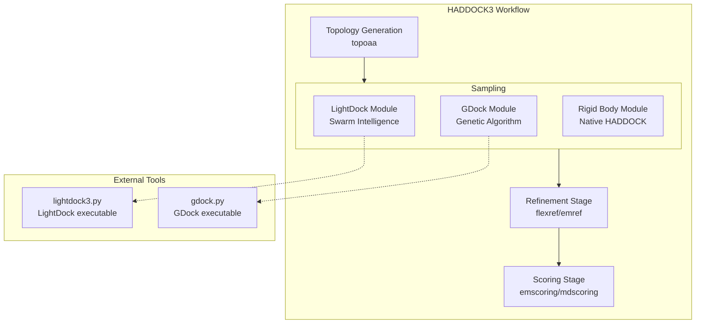
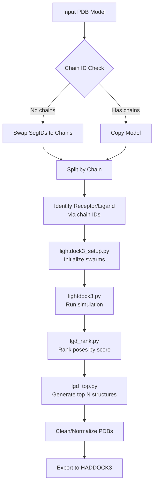
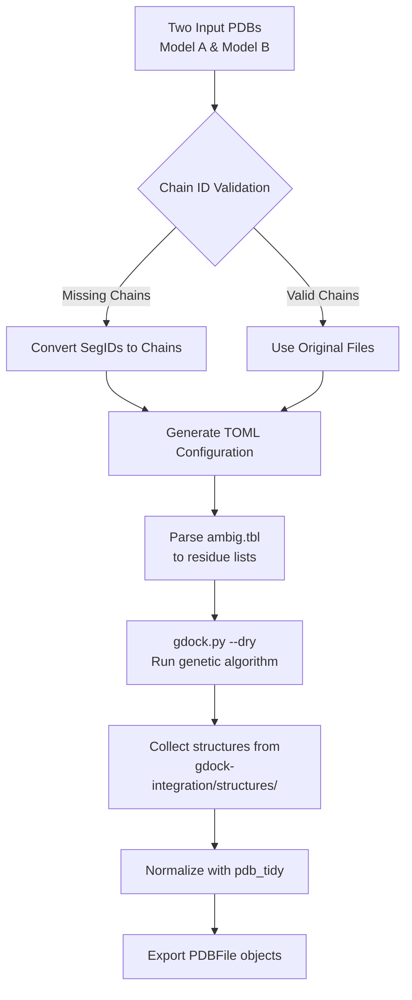

This documentation explains how HADDOCK3 integrates with two external docking engines—LightDock and GDock—providing alternative sampling strategies to complement HADDOCK's native rigid-body docking. These integration modules enable developers to leverage swarm intelligence (LightDock) and genetic algorithm (GDock) sampling within the HADDOCK3 workflow framework, maintaining seamless interoperability with HADDOCK's refinement and scoring stages.

## Architectural Overview

The integration architecture follows a modular design pattern where both LightDock and GDock are implemented as HADDOCK3 sampling modules that extend the `BaseHaddockModule` class. This design ensures compatibility with the workflow engine while delegating the actual sampling computation to external executables. The modules handle input preparation, subprocess execution, output parsing, and model export to maintain pipeline continuity.



Both integrations implement a consistent interface: they accept PDB files from previous modules, execute external sampling tools, parse output structures, and export standardized `PDBFile` objects to downstream stages. This design allows developers to interchangeably use LightDock, GDock, or native HADDOCK rigid-body sampling within the same workflow configuration.

Sources: [__init__.py](src/haddock/modules/sampling/lightdock/__init__.py#L25-L28), [__init__.py](src/haddock/modules/sampling/gdock/__init__.py#L33-L36)

## LightDock Integration

### Module Architecture and Workflow

The LightDock module implements the glowworm swarm optimization algorithm for protein-protein docking. The integration workflow follows a five-stage process:



The module begins by validating input structure format, ensuring proper chain identification through the `libpdb.identify_chainseg()` function. If chain IDs are missing, it performs automatic segid-to-chain conversion to maintain compatibility with LightDock's requirements. The input PDB is then split by chain into separate receptor and ligand files using `libpdb.split_by_chain()`.

Sources: [lightdock/__init__.py](src/haddock/modules/sampling/lightdock/__init__.py#L56-L79)

### Configuration Parameters

The LightDock module exposes ten configurable parameters through its `defaults.yaml`:

| Parameter | Type | Default | Description |
|-----------|------|---------|-------------|
| `swarms` | integer | 400 | Number of initial swarms to generate in the search space |
| `glowworms` | integer | 200 | Number of glowworms per swarm |
| `steps` | integer | 100 | Number of simulation steps/iterations |
| `scoring` | string | fastdfire | Scoring function (fastdfire, dfire, etc.) |
| `top` | integer | 10 | Number of top-ranked structures to output |
| `receptor_chains` | string | A | Chain identifier(s) for receptor |
| `ligand_chains` | string | B | Chain identifier(s) for ligand |
| `noxt` | boolean | true | Remove OXT atoms from structures |
| `noh` | boolean | true | Remove hydrogen atoms from structures |
| `ncores` | integer | null | Number of CPU cores for parallel execution |

The module also includes placeholders for active/passive residue definitions (`receptor_active`, `receptor_passive`, `ligand_active`, `ligand_passive`) which can be used to guide the sampling, though current implementation focuses on unrestrained sampling.

Sources: [lightdock/defaults.yaml](src/haddock/modules/sampling/lightdock/defaults.yaml#L1-L135)

### External Command Execution

The module executes LightDock through three sequential subprocess calls:

1. **Setup phase**: `lightdock3_setup.py receptor.pdb ligand.pdb -s {swarms} -g {glowworms} [--noxt] [--noh]`
2. **Simulation phase**: `lightdock3.py setup.json {steps} -c {cores} -s {scoring}`
3. **Ranking and extraction**: `lgd_rank.py {swarms} {steps}` followed by `lgd_top.py receptor.pdb ligand.pdb rank_by_scoring.list {top}`

The `ncores` parameter controls parallel execution during the simulation phase. The module creates a working directory context using `working_directory(self.path)` to ensure all LightDock files are isolated from other workflow stages.

Sources: [lightdock/__init__.py](src/haddock/modules/sampling/lightdock/__init__.py#L91-L147)

### Output Processing and Integration

LightDock generates output PDB files named `top_1.pdb`, `top_2.pdb`, etc., which are renamed to HADDOCK3 convention (`haddock_top_1.pdb`) and cleaned using `libpdb.tidy()` to ensure consistent formatting. The final models are instantiated as `PDBFile` objects, inheriting topology information from the input model and exported via `self.export_io_models()` for downstream processing.

> [!TIP]
> The module preserves original structural features (hydrogens, terminal OXT) through a temporary file copy mechanism, ensuring that LightDock's stripped versions don't affect the final output structures.

Sources: [lightdock/__init__.py](src/haddock/modules/sampling/lightdock/__init__.py#L131-L161)

## GDock Integration

### Module Architecture and Workflow

GDock provides genetic algorithm-based sampling with explicit support for ambiguous interaction restraints (AIRs). The integration follows a simplified workflow compared to LightDock:



Unlike LightDock which accepts a single PDB and splits by chains, GDock requires two separate input models (A and B). The module retrieves these from `self.previous_io.retrieve_models()[0]`, expecting exactly two structures for docking.

Sources: [gdock/__init__.py](src/haddock/modules/sampling/gdock/__init__.py#L70-L111)

### Environment and Installation

GDock integration requires the `GDOCK_PATH` environment variable to be set, pointing to the GDock installation directory. The `confirm_installation()` class method validates the installation by executing `gdock.py` and checking for the expected error message indicating correct argument parsing.

The module raises exceptions if `GDOCK_PATH` is undefined or if `gdock.py` executable cannot be found at `{GDOCK_PATH}/gdock.py`.

Sources: [gdock/__init__.py](src/haddock/modules/sampling/gdock/__init__.py#L43-L54)

### AIRs Configuration Through ambig Files

GDock's primary advantage is its native support for ambiguous interaction restraints. The module includes the `ambig2dic()` function that parses HADDOCK-style `ambig.tbl` files and converts them to GDock's TOML format:

```python
ambig_regex = r"resid\s*(\d*)\s*and\s*segid\s*(\w)"
```

This regex extracts residue numbers and segment identifiers from AIR definitions, organizing them by chain/segment into a dictionary. The resulting configuration follows this TOML structure:

```toml
[main]
identifier = "gdock-integration"
number_of_processors = {ncores}

[restraints]
A = [resid1, resid2, ...]
B = [resid3, resid4, ...]

[molecules]
A = "path/to/model_A.pdb"
B = "path/to/model_B.pdb"
```

The `ambig_fname` parameter (required) specifies the path to the AIR file, enabling restrained sampling that focuses the genetic algorithm on biologically relevant interfaces.

Sources: [gdock/__init__.py](src/haddock/modules/sampling/gdock/__init__.py#L17-L33), [gdock/__init__.py](src/haddock/modules/sampling/gdock/__init__.py#L93-L111)

### Configuration Parameters

GDock integration exposes minimal configuration parameters:

| Parameter | Type | Default | Description |
|-----------|------|---------|-------------|
| `ambig_fname` | file | '' | Path to ambiguous interaction restraints file (ambig.tbl) |
| `ncores` | integer | null | Number of processors for parallel execution |

The module includes placeholders for additional genetic algorithm parameters (`population_size`, `max_number_of_generations`) which are marked as work-in-progress in the current implementation.

Sources: [gdock/defaults.yaml](src/haddock/modules/sampling/gdock/defaults.yaml#L1-L9)

### Output Processing and Integration

GDock outputs structures to a subdirectory named `gdock-integration/structures/`. The module iterates through all PDB files in this directory, applies `pdb_tidy` to ensure consistent formatting, and creates `PDBFile` objects with `.score = 0.0` (since GDock doesn't provide explicit scoring values). The topology information from both input models is preserved and attached to output structures.

> [!TIP]
> GDock outputs are automatically tidied using the `pdbtools.pdb_tidy` function with `strict=False` to handle minor formatting inconsistencies while maintaining structural integrity.

Sources: [gdock/__init__.py](src/haddock/modules/sampling/gdock/__init__.py#L115-L153)

## Comparative Analysis

### Integration Characteristics

| Aspect | LightDock | GDock |
|--------|-----------|-------|
| **Algorithm** | Glowworm swarm optimization | Genetic algorithm |
| **Input** | Single PDB (split by chain) | Two separate PDBs |
| **Restraints** | Basic chain specification | Full AIR support via ambig.tbl |
| **Scoring** | Multiple functions (fastdfire, dfire) | Internal fitness function |
| **Output** | Scored, ranked structures | Unscored structures |
| **Parallelization** | Multi-core via `-c` parameter | Processor count via TOML |
| **Installation check** | `lightdock3.py -h` | Environment variable validation |

### Workflow Integration Patterns

Both modules follow consistent HADDOCK3 integration patterns but differ in practical usage:

**LightDock** excels when:
- You need a scored set of initial poses for downstream filtering
- Your system lacks prior interface information
- You want to leverage swarm intelligence for global search
- Single-structure inputs with chain separation are sufficient

**GDock** is preferred when:
- You have ambiguous interaction restraints from experimental data
- Genetic algorithm approach better suits your system
- Two separate structures are already prepared
- Interface-guided sampling is critical

Sources: [examples/thirdparty/lightdock/lightdock.cfg](examples/thirdparty/lightdock/lightdock.cfg), [examples/thirdparty/gdock/gdock-integration.cfg](examples/thirdparty/gdock/gdock-integration.cfg)

## Usage Examples

### Basic LightDock Workflow

```python
# topoaa
autohis = true

# lightdock sampling
[lightdock]
receptor_chains = "A"
ligand_chains = "B"
scoring = "fastdfire"
swarms = 8
steps = 10
glowworms = 20
top = 10
noxt = true
noh = true
ncores = 20

# emscoring for HADDOCK evaluation
[emscoring]
```

This configuration demonstrates a minimal LightDock integration with 8 swarms, 20 glowworms per swarm, running for 10 steps, and exporting the top 10 structures for HADDOCK scoring.

Sources: [examples/thirdparty/lightdock/lightdock.cfg](examples/thirdparty/lightdock/lightdock.cfg)

### GDock with AIRs and Refinement

```python
# Topology preparation
[topoaa]
autohis = false

# GDock sampling with restraints
[gdock]
ambig_fname = 'data/e2a-hpr_air.tbl'

# Evaluate sampling quality with CAPRI metrics
[caprieval]
reference_fname = 'data/e2a-hpr_1GGR.pdb'
sortby = 'irmsd'

# Cluster unscored GDock outputs
[clustfcc]
clust_cutoff = 0.4
min_population = 2

# Select best representatives
[seletopclusts]
top_clusters = 5
top_models = 4

# Refinement with original restraints
[flexref]
ambig_fname = 'data/e2a-hpr_air.tbl'

# Final refinement
[emref]
ambig_fname = 'data/e2a-hpr_air.tbl'
```

This advanced workflow demonstrates GDock's strength in AIR-guided sampling, followed by HADDOCC refinement while maintaining the same restraints throughout the pipeline. The `caprieval` module assesses sampling quality before refinement.

Sources: [examples/thirdparty/gdock/gdock-integration.cfg](examples/thirdparty/gdock/gdock-integration.cfg)

## Implementation Considerations for Developers

### Module Registration and Discovery

Both modules are automatically discovered by HADDOCK3's module system through their placement in `src/haddock/modules/sampling/`. Each module implements the `confirm_installation()` class method to verify external tool availability before execution, enabling graceful error handling and user guidance.

### Error Handling Patterns

The modules implement distinct error handling strategies:
- **LightDock**: Uses `self.finish_with_error()` for fatal conditions (multiple models, chain splitting failures)
- **GDock**: Raises exceptions for installation issues, uses `self.finish_with_error()` for missing executables

### Topology Preservation

Both modules maintain topology information from input structures by attaching it to output `PDBFile` objects:
```python
pdb.topology = topologies  # GDock: preserves both input topologies
topology=model.topology   # LightDock: preserves single input topology
```

This ensures downstream refinement and scoring modules have access to necessary molecular definitions.

### Chain/Segment ID Management

A critical integration detail is the automatic conversion between segment IDs and chain IDs when PDB files lack proper chain identifiers. The `libpdb.identify_chainseg()` function detects this condition and `libpdb.swap_segid_chain()` performs the conversion, ensuring compatibility with external tools that require proper chain specification.

Sources: [lightdock/__init__.py](src/haddock/modules/sampling/lightdock/__init__.py#L62-L70), [gdock/__init__.py](src/haddock/modules/sampling/gdock/__init__.py#L80-L89)

## Integration Testing and Validation

The integration with external docking tools requires careful validation to ensure seamless workflow execution. Developers should test:

1. **Installation verification**: Both modules provide `confirm_installation()` methods
2. **Chain handling**: Test with and without chain IDs in input structures
3. **Restrained sampling**: Validate AIR file parsing and conversion (GDock)
4. **Output compatibility**: Ensure generated structures pass HADDOCK's PDB validation
5. **Topology propagation**: Verify topology information flows through to refinement stages

The example configurations in `examples/thirdparty/` serve as integration test cases that developers can adapt for their own systems.
