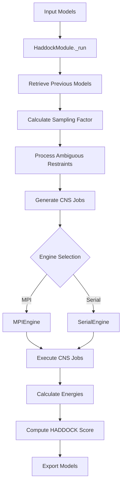
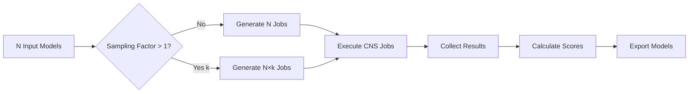

The energy minimization refinement (emref) module serves as a critical optimization stage in the HADDOCK3 workflow, refining input protein complexes through conjugate gradient energy minimization implemented in Crystallography & NMR System (CNS). This module eliminates structural clashes and improves the physical realism of docked complexes by systematically optimizing atomic coordinates under a sophisticated force field framework. The refined structures are then evaluated using the HADDOCK scoring function, generating quantitative metrics for model selection.
Sources: [src/haddock/modules/refinement/emref/__init__.py](src/haddock/modules/refinement/emref/__init__.py#L1-L8)

## Architectural Overview

The emref module operates as a refinement pipeline that integrates multiple computational stages: input processing, restraint management, energy minimization execution, and scoring. The architecture follows the **BaseCNSModule** pattern, inheriting common functionalities for CNS script management, parameter validation, and job execution. The module coordinates these components through a centralized `_run()` method that orchestrates the entire refinement workflow.



The module interfaces with the CNS system through environment variables (`MODULE`, `MODDIR`, `TOPPAR`) that define script locations, working directories, and force field parameters. This modular design allows the refinement process to execute in both serial and parallel (MPI) modes, scaling computational resources according to the number of models requiring refinement.
Sources: [src/haddock/modules/base_cns_module.py](src/haddock/modules/base_cns_module.py#L31-L47) and [src/haddock/modules/refinement/emref/__init__.py](src/haddock/modules/refinement/emref/__init__.py#L26-L45)

## Core Components

### CNS Script Integration

The refinement protocol is implemented in **emref.cns**, a 495-line CNS script that executes the energy minimization in three distinct phases with progressively decreasing harmonic restraints. The script initializes force field parameters, reads topology and coordinate data, and applies various restraint types before performing optimization. The integration follows a modular approach where specialized sub-scripts handle specific functionalities such as parameter reading, distance restraint processing, and coordinate writing.

Key sub-scripts include:
- `read_param.cns` - Force field and topology parameters
- `read_data.cns` - Coordinates and distance restraints
- `scale_inter_final.cns` - Final intermolecular interaction scaling
- `calc_free-ene.cns` - Internal energy calculations for unbound molecules
- `print_coorheader.cns` - Output coordinate formatting

Sources: [src/haddock/modules/refinement/emref/cns/emref.cns](src/haddock/modules/refinement/emref/cns/emref.cns#L1-L120) and [src/haddock/modules/refinement/emref/cns/emref.cns](src/haddock/modules/refinement/emref/cns/emref.cns#L370-L495)

### Parameter Configuration System

The module exposes 4653 lines of configurable parameters organized into logical groups in `defaults.yaml`. This comprehensive parameterization enables fine-grained control over every aspect of the refinement process. Parameters are validated by type and value ranges, with expertise level classifications (easy, expert, hidden) guiding users through complexity tiers.

**Parameter Groups:**
- **Molecule Settings**: Position fixing, shape definitions
- **Distance Restraints**: Ambiguous, unambiguous, hydrogen bond restraints
- **Dihedral Restraints**: Backbone dihedral angle controls
- **Other Restraints**: DNA/RNA conformation, NCS, planarity
- **Symmetry**: C2-C6 and S3 symmetry restraints
- **Energy Terms**: Van der Waals, electrostatics, desolvation, BSA
- **Execution**: Sampling factors, convergence criteria

Sources: [src/haddock/modules/refinement/emref/defaults.yaml](src/haddock/modules/refinement/emref/defaults.yaml#L1-L100)

## Three-Stage Energy Minimization Protocol

The emref module implements a sophisticated multi-stage minimization strategy that progressively reduces restraints while allowing increasing conformational freedom. This staged approach prevents the system from falling into local minima while maintaining structural integrity throughout refinement.

### Stage 1: Heavy Atom Restraints

The initial minimization phase applies weak harmonic restraints (force constant = 5.0) to all non-hydrogen heavy atoms except water and shape molecules. This stabilizes the overall structure while allowing localized adjustments to resolve steric clashes. The minimization uses the Powell algorithm for `nemsteps` iterations (user-configured), with a convergence criterion of 10.0 kcal/mol per step.


Flexible segments identified in the input are exempted from these restraints through the `flex_segment_back.cns` script, allowing targeted mobility at interfaces or pre-specified regions. This selective restraint strategy preserves rigid body orientations while permitting necessary conformational adjustments.

Sources: [src/haddock/modules/refinement/emref/cns/emref.cns](src/haddock/modules/refinement/emref/cns/emref.cns#L235-L250)

### Stage 2: Backbone Atom Restraints

The second phase reduces restraints further, applying very weak harmonic constraints (force constant = 1.0) exclusively to backbone atoms (CA, BB, C, N, P). This enables side-chain relaxation while maintaining secondary structure integrity. The Powell minimization continues for another `nemsteps` iterations with the same convergence threshold, allowing the system to explore conformational space near the stage 1 minimum.

This stage is critical for optimizing side-chain packing at interfaces while preserving the overall protein fold. The reduced restraint strength on backbone atoms allows subtle adjustments that improve complementarity without disrupting secondary structure elements.

Sources: [src/haddock/modules/refinement/emref/cns/emref.cns](src/haddock/modules/refinement/emref/emref.cns#L252-L260)

### Stage 3: Unconstrained Minimization

The final stage removes all harmonic restraints entirely, performing 200 steps of unconstrained Powell minimization. This allows the system to reach its true energy minimum under the complete force field, incorporating van der Waals, electrostatic, torsion, and restraint energy terms. The drop parameter (10.0) ensures the minimization terminates when energy improvements become negligible.

The unconstrained optimization is essential for achieving realistic atomic coordinates that satisfy all physical constraints without artificial bias from the harmonic potentials. This stage typically resolves minor steric clashes that remained after the earlier restrained minimizations.

Sources: [src/haddock/modules/refinement/emref/cns/emref.cns](src/haddock/modules/refinement/emref/cns/emref.cns#L262-L264)

## Energy Calculation and Scoring

Following minimization, the module calculates comprehensive energy components that form the basis of the HADDOCK scoring function. This calculation occurs in two phases: individual molecule internal energies and complex interaction energies.

### Internal Energy Calculation

The module first calculates the internal energy of each unbound molecule by isolating them from the complex. All non-bonded interactions and restraints are disabled, and the energy is evaluated for bonds, angles, impropers, dihedrals, van der Waals, and electrostatics. This provides the **unbound energy baseline** (`eintfree`) for each component.

Root-mean-square deviations (RMSD) from ideal geometry are computed for bonds, angles, impropers, and dihedrals with thresholds of 0.05, 5, 5, and 30 degrees respectively. These metrics serve as quality indicators for the refined structures.

Sources: [src/haddock/modules/refinement/emref/cns/emref.cns](src/haddock/modules/refinement/emref/cns/emref.cns#L285-L330)

### Complex Energy Calculation

The complex energy (`eintcplx`) is computed with all intermolecular interactions enabled and scaled according to user-defined interaction matrices. The `scale_inter_final.cns` script applies the scaling factors defined by `int_n1_n2` parameters, allowing different interaction strengths between molecule pairs. The final energy includes:

- **Bond energy** (`ebond`)
- **Angle energy** (`eangl`)
- **Improper energy** (`eimpr`)
- **Dihedral energy** (`edihe`)
- **Van der Waals energy** (implicitly included in total)
- **Electrostatics energy** (conditional on `elecflag`)
- **Distance restraint energy** (`eair`)

Ambiguous restraints are scaled by `ambig_scale`, unambiguous by `unambig_scale`, and hydrogen bonds by `hbond_scale`. For cross-validation scenarios, test set violations and RMSDs are calculated when `randremoval` is enabled.

Sources: [src/haddock/modules/refinement/emref/cns/emref.cns](src/haddock/modules/refinement/emref/cns/emref.cns#L340-L380) and [src/haddock/modules/refinement/emref/cns/emref.cns](src/haddock/modules/refinement/emref/cns/emref.cns#L415-L450)

### HADDOCK Score Computation

The Python layer computes the final HADDOCK score using the refined energies extracted from CNS output. The score is calculated as a weighted sum:

```
HADDOCK_score = w_vdw × E_vdw + w_elec × E_elec + w_desolv × E_desolv + w_air × E_air + w_bsa × E_bsa
```

Where weights are user-configurable parameters (`w_vdw`, `w_elec`, `w_desolv`, `w_air`, `w_bsa`). This score ranks models for subsequent selection and clustering stages.

> [!TIP]
> The emref module stores both unwritten energies (`unw_energies`) from the CNS job and the calculated score in the PDBFile object, enabling comprehensive energy-based analysis without re-executing the refinement.

Sources: [src/haddock/modules/refinement/emref/__init__.py](src/haddock/modules/refinement/emref/__init__.py#L120-L135)

## Restraint System

The emref module implements a comprehensive restraint system that guides the energy minimization toward experimentally-informed or physically-reasonable conformations.

### Distance Restraints

**Ambiguous Distance Restraints (AIRs)** are the primary experimental constraints, linking active residues between molecules based on biological interface information. These restraints are scaled by `ambig_scale` (default 50.0) and can be subjected to random removal for cross-validation via the `randremoval` and `npart` parameters. When `randremoval=true`, the `npart` parameter divides restraints into equal subsets, removing the first set to prevent overfitting to specific restraint combinations.

**Unambiguous Distance Restraints** provide hard constraints with specific distance targets and force constants (`unambig_scale`, default 50.0). These are typically used for NOE-derived or other experimentally-measured distances with narrow tolerance ranges.

**Hydrogen Bond Restraints** constrain donor-acceptor distances for specific hydrogen bonds, scaled by `hbond_scale` (default 50.0). These help maintain critical polar interactions during refinement.

Sources: [src/haddock/modules/refinement/emref/defaults.yaml](src/haddock/modules/refinement/emref/defaults.yaml#L26-L80)

### Contact Restraints

The `contactairs` feature automatically generates ambiguous distance restraints between all residue pairs within 5Å at the interface. This creates a comprehensive interface restraint network that maintains contact patterns observed in the input structures. However, this can generate thousands of restraints and significantly slow down computation, so it should be used judiciously. The force constant is controlled by `kcont` (default 1.0).

> [!TIP]
> Contact restraints disable random removal automatically since they're generated from the input structure rather than experimental data.

Sources: [src/haddock/modules/refinement/emref/defaults.yaml](src/haddock/modules/refinement/emref/defaults.yaml#L64-L80)

### Dihedral Restraints

Dihedral angle restraints maintain backbone and side-chain torsional preferences. The module supports three modes:

| Mode | Description | Application |
|------|-------------|--------------|
| `none` | No automatic dihedral restraints | Default |
| `all` | Restrain all backbone φ/ψ angles | Global secondary structure maintenance |
| `alpha` | Restrain only α-helical regions | Preserve helices specifically |
| `alphabeta` | Restrain both α-helical and β-sheet regions | Preserve all secondary structure |

Restraints target measured angles from input structures with error bounds defined by `error_dih` (default 10°). Custom dihedral restraints can be provided via `dihe_fname` and scaled by `dihedrals_scale` (default 200.0).

Sources: [src/haddock/modules/refinement/emref/defaults.yaml](src/haddock/modules/refinement/emref/defaults.yaml#L92-L130)

## Sampling and Job Management

The emref module supports controlled sampling through the `sampling_factor` parameter, which generates multiple refined structures from each input model. This is particularly useful for exploring alternative local minima or assessing convergence.



The module enforces a `max_nmodels` limit (user-configurable) to prevent excessive computational load. When `sampling_factor × len(input_models)` exceeds `max_nmodels`, the module terminates with an error, requiring adjustment of parameters or input selection.

Jobs are executed using the selected engine (MPI or Serial) through the `CNSJob` abstraction, which manages input preparation, output capture, and error handling. Each job receives a unique index for identification and output file naming (`emref_*.out`, `emref_*.cnserr`).

Sources: [src/haddock/modules/refinement/emref/__init__.py](src/haddock/modules/refinement/emref/__init__.py#L65-L95)

## Advanced Features

### Symmetry Restraints

For symmetric complexes, emref supports C2, C3, C4, C5, C6, and S3 symmetry restraints through the `sym_on` parameter. Each symmetry type requires defining segments with equal lengths, identified by residue ranges and segment IDs. The `ksym` parameter (default 10.0) controls the force constant for symmetry restraints, enforcing equivalent conformations across symmetric chains.

Custom symmetry restraint files can be provided via `symtbl_fname` for complex symmetry relationships not covered by the standard rotational symmetries.

Sources: [src/haddock/modules/refinement/emref/defaults.yaml](src/haddock/modules/refinement/emref/defaults.yaml#L150-L400)

### DNA/RNA Conformation Restraints

The `dnarest_on` parameter enables automatic conformational restraints for nucleic acids, maintaining:
- Single base planarity
- Sugar pucker geometry
- Phosphate backbone dihedral angles
- Watson-Crick base pairing

These restraints preserve nucleic acid structural integrity during protein-DNA/RNA complex refinement, preventing unrealistic deformations that could arise from protein-DNA interactions.

Sources: [src/haddock/modules/refinement/emref/defaults.yaml](src/haddock/modules/refinement/emref/defaults.yaml#L134-L148)

### Integration with Previous Restraints

The `previous_ambig` parameter allows emref to inherit ambiguous restraints from the preceding CNS module in the workflow. When enabled and no explicit `ambig_fname` is provided, the module extracts restraint information embedded in input models. This enables seamless restraint propagation through multi-stage workflows, with refinement stages using the same interface information as earlier sampling stages.

The module validates that all models contain restraint information when `previous_ambig=true`, raising an exception if this condition is not met.

Sources: [src/haddock/modules/refinement/emref/__init__.py](src/haddock/modules/refinement/emref/__init__.py#L75-L82) and [src/haddock/modules/base_cns_module.py](src/haddock/modules/base_cns_module.py#L116-L155)

## Configuration Parameters Summary

### Essential Parameters (Easy Level)

| Parameter | Type | Default | Description |
|-----------|------|---------|-------------|
| `sampling_factor` | integer | 1 | Number of refinements per input model |
| `max_nmodels` | integer | 1000 | Maximum total models to refine |
| `tolerance` | integer | 5 | Faulty job tolerance threshold |
| `ambig_fname` | file | '' | Ambiguous restraint filename |
| `unambig_fname` | file | '' | Unambiguous restraint filename |
| `hbond_fname` | file | '' | Hydrogen bond restraint filename |
| `w_vdw` | float | 0.01 | Van der Waals energy weight |
| `w_elec` | float | 0.2 | Electrostatic energy weight |
| `w_desolv` | float | 0.0 | Desolvation energy weight |
| `w_air` | float | 1.0 | AIR restraint energy weight |
| `w_bsa` | float | 0.0 | Buried surface area weight |

Sources: [src/haddock/modules/refinement/emref/defaults.yaml](src/haddock/modules/refinement/emref/defaults.yaml#L1-L60)

### Expert Parameters

| Parameter | Type | Default | Range | Description |
|-----------|------|---------|-------|-------------|
| `nemsteps` | integer | 1000 | 0-10000 | Number of minimization steps per stage |
| `ambig_scale` | integer | 50 | 0-1000 | Ambiguous restraint force constant |
| `unambig_scale` | integer | 50 | 0-1000 | Unambiguous restraint force constant |
| `hbond_scale` | integer | 50 | 0-1000 | Hydrogen bond restraint force constant |
| `dihedrals_scale` | integer | 200 | 0-9999 | Dihedral restraint force constant |
| `randremoval` | boolean | true | - | Enable random restraint removal |
| `npart` | integer | 2 | 1-20 | Number of restraint partitions |
| `contactairs` | boolean | false | - | Generate contact restraints |
| `kcont` | float | 1.0 | 0-1000 | Contact restraint force constant |

Sources: [src/haddock/modules/refinement/emref/defaults.yaml](src/haddock/modules/refinement/emref/defaults.yaml#L60-L100)

## Usage Example

```yaml
# Example emref module configuration
[emref]
sampling_factor = 1
max_nmodels = 100
w_vdw = 0.01
w_elec = 0.2
w_air = 1.0

# Restraint configuration
ambig_fname = "restraints/ambig.tbl"
unambig_fname = "restraints/unambig.tbl"
ambig_scale = 50
unambig_scale = 50

# Minimization parameters
nemsteps = 1000

# Sampling and cross-validation
randremoval = true
npart = 2

# Molecule-specific settings
mol_fix_origin_1 = false
```

This configuration refines 100 input models with 1000 minimization steps per stage, applies ambiguous and unambiguous restraints with standard force constants, and uses 2-fold cross-validation by randomly removing half the ambiguous restraints for each model.

Sources: [integration_tests/test_emref.py](integration_tests/test_emref.py#L14-L137)

## Integration with HADDOCK3 Workflow

The emref module serves as a bridge between sampling stages and final evaluation. It typically follows rigid-body docking or flexible refinement and precedes clustering and final scoring. The module's output includes both refined coordinates and energy metrics, enabling downstream modules to make informed selections based on both structural quality and energetic favorability.

The module seamlessly integrates with the broader HADDOCK3 workflow through the `BaseHaddockModule` infrastructure, inheriting parameter validation, job scheduling, and error handling capabilities. This integration ensures that emref can be combined with other modules in custom workflows while maintaining robustness and reproducibility.

For more information on related refinement approaches, see [Molecular Dynamics Refinement in Explicit Solvent](17-molecular-dynamics-refinement-in-explicit-solvent) and [Flexible Refinement Strategies](18-flexible-refinement-strategies). To understand how refinement results are evaluated, refer to [HADDOCK Scoring Function Components](19-haddock-scoring-function-components).
