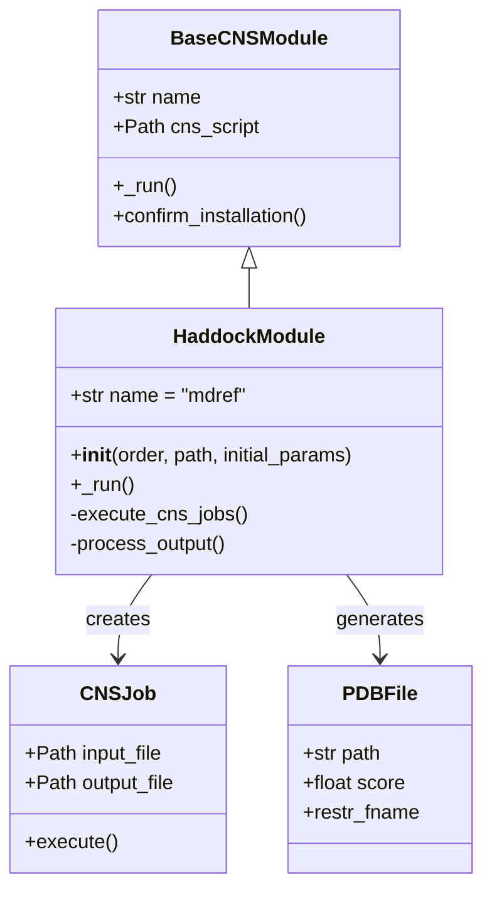
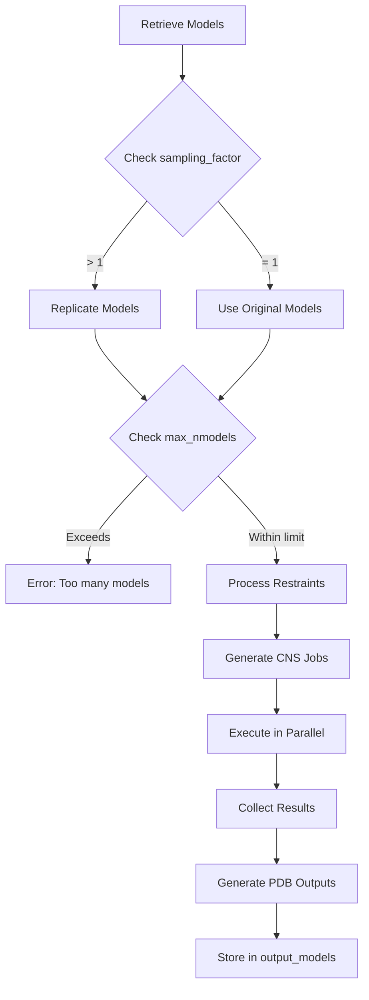
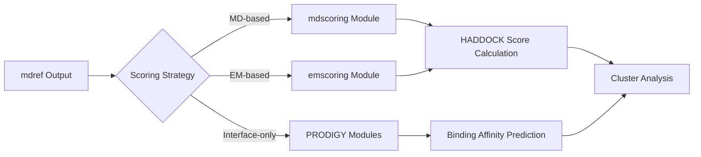

The Molecular Dynamics refinement module (`[mdref]`) performs explicit solvent refinement using the Crystallography & NMR System (CNS). This module, historically known as `itw` in the HADDOCK2.X series, applies short molecular dynamics simulations with explicit solvent to refine docked complexes. The protocol aims to improve scoring reliability rather than induce dramatic structural changes, making it particularly valuable for final polishing of docking results before experimental validation.


## Architecture and Protocol Design

The mdref module implements a carefully staged thermal cycle that balances conformational exploration with structural preservation. The protocol operates through four distinct phases executed sequentially for each input model:

Sources: [`__init__.py`](src/haddock/modules/refinement/mdref/__init__.py#L1-L20)

### Protocol Stages


The thermal cycle begins with a brief energy minimization to remove steric clashes introduced during initial docking. This is followed by a controlled heating sequence through three temperature points (100K → 200K → 300K), allowing the system to gradually adapt to higher thermal energy. Once at 300K, the system undergoes molecular dynamics equilibration, sampling conformations at physiological temperature. Finally, a three-stage cooling phase (300K → 200K → 100K) returns the system to a low-energy state suitable for final scoring.

Sources: [`__init__.py`](src/haddock/modules/refinement/mdref/__init__.py#L9-L13)

### Solvent Environment

The module generates an explicit solvent layer around surface residues with two solvent options:

| Solvent Type | Layer Thickness | Parameter | Use Case |
|--------------|----------------|-----------|----------|
| Water | 8.0 Å | Default | Standard protein-protein complexes |
| DMSO | 12.5 Å | `solvent_type: dmso` | Membrane-associated complexes, hydrophobic interfaces |

The solvent shell generation process creates a realistic solvation environment without requiring full periodic boundary conditions, significantly reducing computational cost while maintaining physical realism for interface refinement.

Sources: [`defaults.yaml`](src/haddock/modules/refinement/mdref/defaults.yaml#L2800-L2850)

## Implementation Architecture

### Module Structure

The mdref module extends the `BaseCNSModule` class, inheriting core functionality for CNS integration while implementing explicit solvent-specific logic:

Sources: [`__init__.py`](src/haddock/modules/refinement/mdref/__init__.py#L39-L40)



### CNS Script Integration

The module orchestrates multiple CNS scripts that handle distinct aspects of the refinement protocol:

Sources: [`__init__.py`](src/haddock/modules/refinement/mdref/__init__.py#L44-L47), [`mdref.cns`](src/haddock/modules/refinement/mdref/cns/mdref.cns#L1-L50)

| CNS Script | Purpose | Key Operations |
|------------|---------|----------------|
| `mdref.cns` | Main protocol controller | Coordinates thermal cycle, manages state transitions |
| `generate_water.cns` | Water solvent generation | Places water molecules around surface residues |
| `generate_dmso.cns` | DMSO solvent generation | Places DMSO molecules around surface residues |
| `def_solv_param.cns` | Solvent parameters definition | Sets solvent interaction parameters |
| `contactairs.cns` | Contact restraint generation | Creates interface contact restraints |
| `cm-restraints.cns` | Center-of-mass restraints | Maintains complex integrity |

The main `mdref.cns` script initializes protocol variables, configures energy terms, and manages the sequential execution of refinement stages. It handles integration with HADDOCK's restraint system, including ambiguous distance restraints, dihedral restraints, and symmetry restraints.

Sources: [`mdref.cns`](src/haddock/modules/refinement/mdref/cns/mdref.cns#L30-L80)

## Configuration Parameters

The mdref module exposes extensive configuration through a hierarchical parameter system organized into logical groups:

### Molecular Dynamics Parameters

| Parameter | Type | Default | Range | Description |
|-----------|------|---------|-------|-------------|
| `timestep` | float | 0.002 | 0.001-0.005 | Integration timestep in picoseconds |
| `waterheatsteps` | integer | 300 | 50-1000 | MD steps per heating stage |
| `watersteps` | integer | 1000 | 100-5000 | MD steps at 300K equilibration |
| `watercoolsteps` | integer | 300 | 50-1000 | MD steps per cooling stage |
| `solvent_type` | string | "water" | "water", "dmso" | Solvent type for explicit solvation |

These parameters control the temporal resolution and duration of each refinement stage. Longer simulations provide more thorough sampling but increase computational cost proportionally.

Sources: [`defaults.yaml`](src/haddock/modules/refinement/mdref/defaults.yaml#L3000-L3100)

### Restraint Configuration

Distance restraints guide the refinement process by enforcing experimental or bioinformatic constraints. The module supports multiple restraint types with independent force constants:

Sources: [`defaults.yaml`](src/haddock/modules/refinement/mdref/defaults.yaml#L25-L100)

| Restraint Type | Parameter | Default Force Constant | Description |
|----------------|-----------|----------------------|-------------|
| Ambiguous | `ambig_scale` | 50 | Ambiguous interaction restraints (AIRs) |
| Unambiguous | `unambig_scale` | 50 | Specific distance restraints |
| Hydrogen Bond | `hbond_scale` | 50 | H-bond distance restraints |
| Contact | `kcont` | 1.0 | Interface contact restraints |
| Center-of-Mass | `kcm` | 1.0 | Complex integrity restraints |

The `randremoval` parameter (default: `true`) randomly partitions ambiguous restraints into `npart` sets and discards the first set, introducing restraint diversity across different models. This prevents overfitting to a specific restraint subset and improves ensemble sampling.

Sources: [`defaults.yaml`](src/haddock/modules/refinement/mdref/defaults.yaml#L90-L130)

### Dihedral and Conformational Restraints

Backbone dihedral restraints maintain secondary structure integrity during refinement:

Sources: [`defaults.yaml`](src/haddock/modules/refinement/mdref/defaults.yaml#L180-L230)

| Parameter | Choices | Default | Description |
|-----------|---------|---------|-------------|
| `ssdihed` | none, all, alpha, alphabeta | none | Automatic backbone dihedral restraint application |
| `dihedrals_on` | true, false | false | User-defined dihedral restraints from file |
| `error_dih` | 0-180° | 10° | Dihedral angle tolerance range |

The `ssdihed` option automatically detects secondary structure elements and applies appropriate dihedral restraints:
- `all`: All residues
- `alpha`: α-helical regions only
- `alphabeta`: α-helical and β-sheet regions
- `none`: No automatic dihedral restraints

### Flexibility Control

The module provides granular control over molecular flexibility through semi-flexible and fully flexible segment definition:

Sources: [`defaults.yaml`](src/haddock/modules/refinement/mdref/defaults.yaml#L1500-L2200)

#### Semi-Flexible Segments

Semi-flexible regions allow side-chain and backbone movement while maintaining weak positional restraints:

| Parameter | Type | Default | Meaning |
|-----------|------|---------|---------|
| `nseg1` to `nseg20` | integer | -1 | Number of semi-flexible segments per molecule |
| `seg_sta_X_1` to `seg_sta_X_20` | integer | NaN | Starting residue for segment X |
| `seg_end_X_1` to `seg_end_X_20` | integer | NaN | Ending residue for segment X |

Special values for `nseg`:
- `-1`: Automatic definition based on interface contacts
- `0`: Rigid molecule (no flexibility)
- `≥1`: Manual definition using `seg_sta` and `seg_end` parameters

#### Fully Flexible Segments

Fully flexible regions remove all positional restraints, allowing complete conformational freedom:

| Parameter | Type | Default | Description |
|-----------|------|---------|-------------|
| `nfle` | integer | 0 | Number of fully flexible segments |
| `fle_seg_X` | string | - | Segment ID for flexible segment X |
| `fle_sta_X` | integer | NaN | Starting residue number |
| `fle_end_X` | integer | NaN | Ending residue number |

> [!TIP]
> Fully flexible segments should be used sparingly, typically for highly dynamic loops or termini where experimental evidence suggests substantial conformational rearrangement.

### Symmetry Restraints

For symmetric oligomers, the module implements symmetry restraints to maintain quaternary structure:

Sources: [`defaults.yaml`](src/haddock/modules/refinement/mdref/defaults.yaml#L400-L900)

| Symmetry Type | Parameter | Force Constant | Description |
|---------------|-----------|-----------------|-------------|
| C2 | `ksym`, `nc2sym` | 10.0 | Two-fold rotational symmetry |
| C3 | `nc3sym` | 10.0 | Three-fold rotational symmetry |
| C4 | `nc4sym` | 10.0 | Four-fold rotational symmetry |
| C5 | `nc5sym` | 10.0 | Five-fold rotational symmetry |
| C6 | `nc6sym` | 10.0 | Six-fold rotational symmetry |
| S3 | `ns3sym` | 10.0 | Three-fold improper rotational symmetry |

Each symmetry type requires specification of segment pairs or triplets through `cXsym_staY_Z`, `cXsym_endY_Z`, and `cXsym_segY_Z` parameters, where X is the symmetry order, Y is the segment index within the symmetry group, and Z is the molecule index.

Sources: [`defaults.yaml`](src/haddock/modules/refinement/mdref/defaults.yaml#L450-L600)

## Execution Flow and Processing

### Job Management

The module implements sophisticated job pooling and execution management:

Sources: [`__init__.py`](src/haddock/modules/refinement/mdref/__init__.py#L60-L100)



The `sampling_factor` parameter multiplies the number of input models, allowing generation of multiple refined variants from each starting structure. This is particularly useful for ensemble docking scenarios where starting models represent conformational families rather than precise structures.

Sources: [`__init__.py`](src/haddock/modules/refinement/mdref/__init__.py#L75-L90)

### Restraint File Handling

The module intelligently manages restraint file propagation through the workflow:

Sources: [`__init__.py`](src/haddock/modules/refinement/mdref/__init__.py#L95-L110)

| Scenario | `ambig_fname` | `previous_ambig` | Result |
|----------|---------------|------------------|--------|
| New file provided | User-specified | Any | Use new file, ignore previous |
| No new file, `previous_ambig: true` | Empty | `true` | Use restraints from previous module |
| No new file, `previous_ambig: false` | Empty | `false` | No ambiguous restraints used |

This design allows seamless integration with upstream restraint generation modules while maintaining flexibility for manual override in specific refinement stages.

### Output Processing

Each refined model generates a complete output package:

Sources: [`__init__.py`](src/haddock/modules/refinement/mdref/__init__.py#L120-L157)

- **PDB coordinates**: Refined atomic positions after solvent removal
- **Score information**: HADDOCK score calculated during refinement
- **Restraint violations**: Statistics on restraint satisfaction
- **Energy terms**: Van der Waals, electrostatic, and desolvation contributions
- **Trajectory data**: Optional storage of MD trajectory frames

The module stores outputs as `PDBFile` objects in the `output_models` list, making them available to downstream analysis and scoring modules.

## Comparison with Other Refinement Methods

HADDOCK3 offers multiple refinement approaches, each suited to different use cases:

Sources: [`modules/`](src/haddock/modules/refinement/)

| Feature | mdref (Explicit Solvent) | emref (Implicit Solvent) | flexref (Semi-flexible) |
|---------|-------------------------|-------------------------|------------------------|
| Solvent Model | Explicit (8-12.5Å) | Implicit distance-dependent | Implicit |
| Computational Cost | High | Low | Medium |
| Realism | High | Medium | Medium |
| Sampling | Limited thermal sampling | Energy minimization only | Side-chain + limited backbone |
| Best For | Final scoring refinement | Rapid prototyping | Interface optimization |
| MD Required | Yes | No | No |

The mdref module should typically be used as the final refinement step when:
- Computational resources permit explicit solvent simulation
- Accurate scoring is critical for ranking
- Structures are close to native-like conformations
- Interface geometry requires solvent-mediated validation

For rapid iteration during protocol development, emref provides faster feedback cycles. When significant backbone adjustments are needed at interfaces, flexref offers targeted flexibility without explicit solvent overhead.

## Integration with Scoring Workflows

The refined structures from mdref integrate seamlessly with HADDOCK3's scoring modules:

Sources: [`modules/scoring/mdscoring/`](src/haddock/modules/scoring/mdscoring/)



The mdref module's explicit solvent treatment provides physically realistic electrostatic and van der Waals contributions, which are particularly valuable for subsequent scoring with the [mdscoring](20-energy-minimization-vs-md-scoring) module. The improved energy landscape can lead to more reliable ranking when combined with clustering algorithms like [FCC](22-clustering-algorithms-fcc-and-rmsd) or RMSD-based methods.

Sources: [`modules/scoring/mdscoring/`](src/haddock/modules/scoring/mdscoring/)

## Practical Usage Examples

### Basic Refinement Configuration

```yaml
[mdref]
# Basic MD parameters
timestep = 0.002
solvent_type = water
waterheatsteps = 300
watersteps = 1000
watercoolsteps = 300

# Output control
sampling_factor = 1
max_nmodels = 200

# Restraint configuration
ambig_fname = 'restraints/ambig.tbl'
ambig_scale = 50
randremoval = true
npart = 2
```

This configuration performs standard refinement with water solvent, using ambiguous restraints from a user-specified file. The `randremoval` option introduces restraint diversity across models.

Sources: [`defaults.yaml`](src/haddock/modules/refinement/mdref/defaults.yaml#L25-L130)

### Advanced Configuration with Flexibility

```yaml
[mdref]
# MD parameters
timestep = 0.002
solvent_type = water
waterheatsteps = 500
watersteps = 1500
watercoolsteps = 500

# Flexibility control
nseg1 = -1  # Automatic semi-flexible segments for molecule 1
nseg2 = 2   # Manual definition for molecule 2
seg_sta_2_1 = 45
seg_end_2_1 = 60
seg_sta_2_2 = 120
seg_end_2_2 = 135

# Fully flexible termini
nfle = 2
fle_seg_1 = 'A'
fle_sta_1 = 1
fle_end_1 = 5
fle_seg_2 = 'A'
fle_sta_2 = 150
fle_end_2 = 155

# Dihedral restraints
ssdihed = alphabeta
error_dih = 15
```

This configuration enables automatic semi-flexible segment detection for the first molecule while manually specifying interface regions for the second molecule. Fully flexible termini are defined for both N- and C-termini, and dihedral restraints preserve α-helical and β-sheet secondary structure.

Sources: [`defaults.yaml`](src/haddock/modules/refinement/mdref/defaults.yaml#L180-L230), [`defaults.yaml`](src/haddock/modules/refinement/mdref/defaults.yaml#L1500-L2200)

### Symmetry-Restrained Refinement

```yaml
[mdref]
# Symmetry parameters
sym_on = true
ksym = 10.0
nc2sym = 1

# C2 symmetry segment definition
c2sym_seg1_1 = 'A'
c2sym_sta1_1 = 1
c2sym_end1_1 = 150
c2sym_seg2_1 = 'B'
c2sym_sta2_1 = 1
c2sym_end2_1 = 150

# Additional restraints
cmrest = true
cmtight = true
kcm = 1.0
```

This configuration enforces C2 symmetry between two identical chains while allowing interface relaxation. Center-of-mass restraints maintain complex integrity during refinement.

Sources: [`defaults.yaml`](src/haddock/modules/refinement/mdref/defaults.yaml#L400-L600)

## Performance Considerations and Optimization

### Computational Cost Analysis

The computational cost of mdref scales primarily with three factors:

Sources: [`__init__.py`](src/haddock/modules/refinement/mdref/__init__.py#L75-L90)

| Factor | Scaling | Optimization Strategy |
|--------|---------|----------------------|
| System size | O(n²) | Use smaller `solvent_type`, limit flexible segments |
| MD steps | Linear | Reduce `watersteps`, adjust `sampling_factor` |
| Number of models | Linear | Use `max_nmodels` with upstream filtering |

Typical runtime on 8 CPU cores:
- Small complex (200 residues): 5-15 minutes per model
- Medium complex (400 residues): 15-45 minutes per model  
- Large complex (800 residues): 45-120 minutes per model

> [!TIP]
> For prototyping, reduce `watersteps` to 500 and use implicit solvent refinement (emref) before committing to full mdref calculations.

### Memory Requirements

Explicit solvent simulation requires significant memory for coordinate and force storage:

| System Size | Solvent Molecules | RAM Requirement |
|-------------|-------------------|----------------|
| Small (200 residues) | ~800-1000 | 2-4 GB |
| Medium (400 residues) | ~1500-2000 | 4-8 GB |
| Large (800 residues) | ~3000-4000 | 8-16 GB |

Memory usage can be reduced by:
- Using the `-q` flag in CNS for "quiet" mode
- Limiting trajectory output with `trajout` parameter
- Processing models in batches when dealing with large ensembles

Sources: [`defaults.yaml`](src/haddock/modules/refinement/mdref/defaults.yaml#L2900-L2950)

## Troubleshooting Common Issues

### Convergence Problems

**Symptom**: Energy values do not stabilize, structures drift apart

**Potential Causes and Solutions**:

1. **Insufficient heating**: Increase `waterheatsteps` from 300 to 500
2. **Weak restraints**: Increase `ambig_scale` or `kcm` by 2-3×
3. **Overly flexible regions**: Reduce `nseg` values or convert to fully flexible segments
4. **Insufficient equilibration**: Increase `watersteps` from 1000 to 2000

Sources: [`defaults.yaml`](src/haddock/modules/refinement/mdref/defaults.yaml#L3000-L3100)

### High Restraint Violations

**Symptom**: Many distance or dihedral restraints violated in output

**Potential Causes and Solutions**:

1. **Conflicting restraints**: Review `ambig_fname` for contradictory constraints
2. **Force constants too high**: Reduce `ambig_scale` from 50 to 25-30
3. **Starting structure incompatible**: Check input models with [topoaa](10-molecule-topology-generation-with-topoaa) for structural issues
4. **Insufficient sampling**: Increase `watersteps` and consider `sampling_factor > 1`

Sources: [`defaults.yaml`](src/haddock/modules/refinement/mdref/defaults.yaml#L25-L130)

### Solvent Artifacts

**Symptom**: Unusual density or gaps around protein surface

**Potential Causes and Solutions**:

1. **Insufficient solvent thickness**: Verify solvent generation completed successfully
2. **Clashing starting structures**: Run initial [emref](16-energy-minimization-refinement) before mdref
3. **Charged surface residues**: Ensure proper protonation states in [topoaa](10-molecule-topology-generation-with-topoaa)
4. **DMSO incompatibility**: Switch from `solvent_type: dmso` to `solvent_type: water` for standard proteins

## Advanced Topics

### Custom CNS Script Modification

For specialized applications requiring protocol modifications:

Sources: [`mdref.cns`](src/haddock/modules/refinement/mdref/cns/mdref.cns#L1-L100)

1. **Copy the module** to prevent overwriting upstream changes
2. **Modify `mdref.cns`** to adjust thermal cycles or add custom operations
3. **Update defaults.yaml** if new parameters are required
4. **Test with small systems** before scaling to production calculations

Key sections in `mdref.cns` for modification:
- Lines 30-80: Parameter initialization and restraint setup
- Lines 200-400: Energy minimization and heating protocols
- Lines 400-500: 300K equilibration
- Lines 500-600: Cooling and final minimization

### Integration with External MD Packages

For users requiring longer simulations or alternative force fields, mdref can serve as a bridge to external packages:

Sources: [`__init__.py`](src/haddock/modules/refinement/mdref/__init__.py#L120-L157)

1. **Extract refined coordinates** from mdref output PDB files
2. **Generate topology files** compatible with target package (GROMACS, AMBER, NAMD)
3. **Transfer restraints** using format conversion utilities
4. **Perform extended simulations** for specific scientific questions
5. **Import final structures** back into HADDOCK3 for scoring and analysis

The [OpenMM](src/haddock/modules/refinement/openmm/) module in HADDOCK3 provides alternative MD integration paths for users preferring Python-based workflows.

### Ensemble Refinement Strategies

For systems with known conformational heterogeneity:

Sources: [`__init__.py`](src/haddock/modules/refinement/mdref/__init__.py#L75-L90)

```yaml
[mdref]
# Generate multiple replicas per starting structure
sampling_factor = 3

# Random restraint partitioning
randremoval = true
npart = 4

# Slightly varied MD protocols for diversity
watersteps = 1000  # Default protocol

[mdref.variation1]
# Slightly longer equilibration
watersteps = 1500

[mdref.variation2]
# Shorter but more replicas
watersteps = 800
sampling_factor = 5
```

This approach generates conformationally diverse ensembles suitable for [PRODIGY](21-prodigy-scoring-integration) scoring or clustering-based selection of representative structures.

## References and Further Reading

For deeper understanding of the algorithms and theoretical foundations:

1. **Explicit Solvent MD in CNS**: The mdref protocol builds on CNS's molecular dynamics implementation. Review CNS documentation for details on integration algorithms and force fields.

2. **HADDOCK2.X itw Protocol**: Historical context and comparative analysis available in [HADDOCK2.4 documentation](https://www.haddocking.org/).

3. **Restraint-Driven Refinement**: Understanding restraint selection and force constant tuning is covered in the [AIRs](14-ambiguous-interaction-restraints-airs) documentation.

4. **Scoring Function Physics**: The energy terms refined in mdref are detailed in the [HADDOCK Scoring](19-haddock-scoring-function-components) reference.

## Related Documentation

The mdref module integrates closely with several other HADDOCK3 components:

- **Previous Step**: [Flexible Refinement Strategies](18-flexible-refinement-strategies) - alternative interface optimization
- **Next Step**: [MD Scoring](20-energy-minimization-vs-md-scoring) - evaluating refined structures
- **Alternative**: [Energy Minimization Refinement](16-energy-minimization-refinement) - faster, implicit solvent alternative
- **Analysis**: [Clustering Algorithms](22-clustering-algorithms-fcc-and-rmsd) - analyzing ensemble diversity
- **Restraints**: [Ambiguous Interaction Restraints](14-ambiguous-interaction-restraints-airs) - input for refinement
