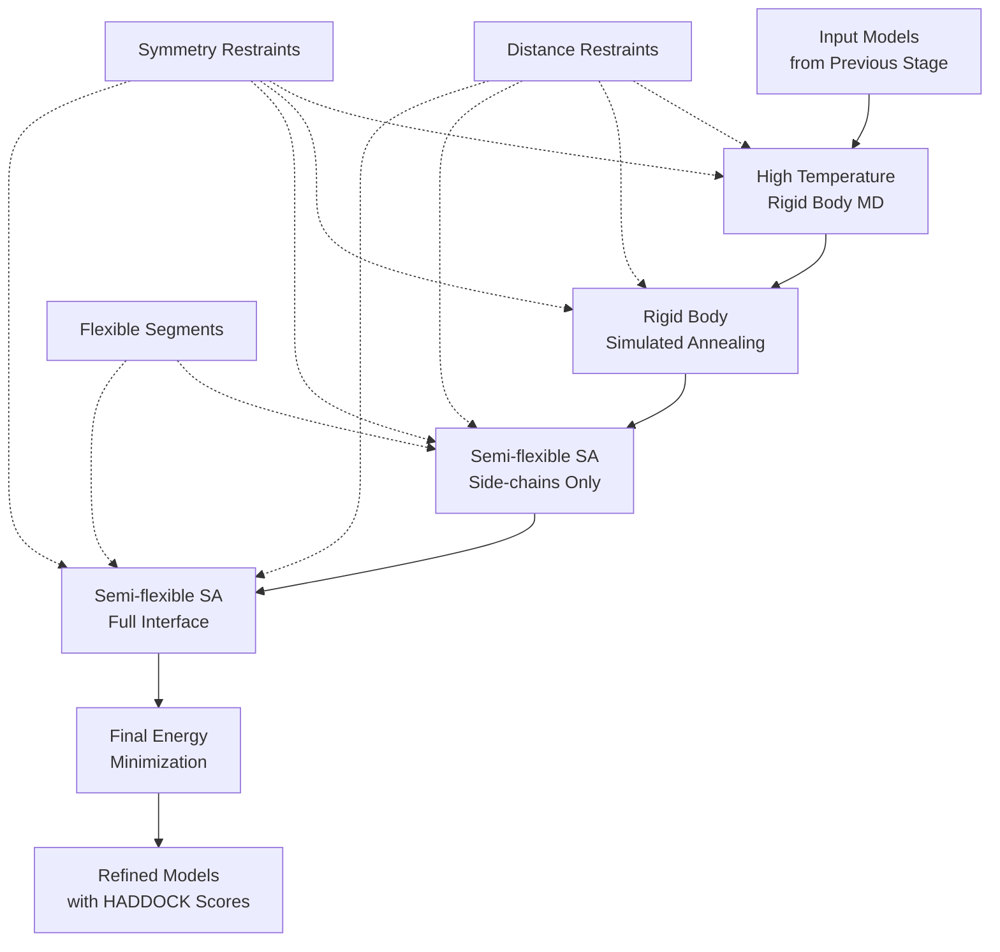

The Flexible Refinement (`flexref`) module implements a sophisticated semi-flexible simulated annealing protocol in torsion angle space, designed to refine rigid-body docking solutions by introducing controlled flexibility at molecular interfaces. This approach bridges the gap between computationally efficient rigid-body docking and more expensive explicit solvent molecular dynamics, making it ideal for optimizing protein-protein, protein-DNA, and other biomolecular complexes.

## Architecture Overview

The flexref module operates as a CNS (Crystallography & NMR System) based refinement engine that progressively increases flexibility while applying various experimental or theoretical restraints. The module follows a staged simulated annealing protocol that systematically samples conformational space with increasing granularity.



The refinement strategy follows a graduated approach where molecular flexibility is progressively increased. Initially, molecules are treated as rigid bodies during high-temperature dynamics to allow global reorientation. As the system cools through three distinct cooling phases, flexibility is first introduced in side-chains at the interface, and finally extended to include backbone atoms in interface regions [__init__.py](src/haddock/modules/refinement/flexref/__init__.py#L1-L19).

Sources: [__init__.py](src/haddock/modules/refinement/flexref/__init__.py#L1-L19), [flexref.cns](src/haddock/modules/refinement/flexref/cns/flexref.cns#L1-L70)

## Semi-Flexible Simulated Annealing Protocol

The flexref module implements a four-stage simulated annealing protocol that strategically balances sampling efficiency with model quality. Each stage serves a distinct purpose in the refinement process.

### Stage 1: High-Temperature Rigid Body Dynamics

The protocol begins with rigid-body molecular dynamics at elevated temperatures (typically 2000K), allowing molecules to explore global orientations while maintaining internal geometry. During this phase, all intermolecular interactions are evaluated, and distance restraints are applied with a moderate force constant (`ambig_hot=10`, `unambig_hot=10`). This stage is crucial for escaping local minima from the rigid-body docking stage and exploring alternative binding modes [flexref.cns](src/haddock/modules/refinement/flexref/cns/flexref.cns#L30-L45).

### Stage 2: Rigid Body Cooling

The system undergoes rigid-body simulated annealing from the high temperature down to an intermediate temperature (typically 1000K). During this cooling phase, the torsional angle dynamics factor (`tadfactor`) controls the transition between rigid body and torsional dynamics. By default, `tadfactor=4.0`, which provides a balanced approach allowing limited conformational sampling while maintaining computational efficiency [integration_tests/test_flexref.py](integration_tests/test_flexref.py#L78).

### Stage 3: Semi-Flexible Side-Chain Refinement

In the second cooling phase, side-chain atoms at the interface become flexible while backbone atoms remain rigid. This phase operates at lower temperatures (typically starting at 1000K and cooling to 300K) and applies stronger force constants (`ambig_cool2=50`, `unambig_cool2=50`). The interface is automatically detected based on intermolecular contacts, but can also be manually defined through flexible segment parameters. This allows optimization of side-chain conformations to better satisfy restraints and improve packing [flexref.cns](src/haddock/modules/refinement/flexref/cns/flexref.cns#L50-L65).

### Stage 4: Fully Flexible Interface Refinement

The final cooling phase introduces full flexibility at the interface, including both backbone and side-chain atoms. This stage continues cooling to room temperature (300K) and applies the strongest restraint force constants (`ambig_cool3=50`, `unambig_cool3=50`). This phase is critical for resolving steric clashes, optimizing hydrogen bonding networks, and achieving optimal geometry at the molecular interface [defaults.yaml](src/haddock/modules/refinement/flexref/defaults.yaml#L28-L45).

Sources: [defaults.yaml](src/haddock/modules/refinement/flexref/defaults.yaml#L28-L76), [flexref.cns](src/haddock/modules/refinement/flexref/cns/flexref.cns#L30-L65), [integration_tests/test_flexref.py](integration_tests/test_flexref.py#L78-L90)

## Flexibility Control Mechanisms

The flexref module provides multiple mechanisms to control which regions of the molecular complex are flexible during refinement, ranging from fully automatic detection to precise manual specification.

### Automatic Interface Detection

By default, the module automatically identifies flexible regions based on intermolecular contacts. Residues that make contacts across the molecular interface are automatically flagged as flexible and treated accordingly during the semi-flexible SA phases. This approach requires no user intervention and works well for typical protein-protein interfaces where the binding site is clearly defined by the rigid-body docking solution [__init__.py](src/haddock/modules/refinement/flexref/__init__.py#L10-L18).

### Manual Flexible Segment Definition

For cases where automatic detection is insufficient, users can manually define flexible segments using the `nfle` parameter and associated flexible segment definitions. Each flexible segment is defined by:

- `fle_sta_N`: Starting residue number for segment N
- `fle_end_N`: Ending residue number for segment N  
- `fle_seg_N`: Segment identifier (typically the chain ID)

For example, to define residues 66-77 on chain B as flexible:

```yaml
nfle: 1
fle_sta_1: 66
fle_end_1: 77
fle_seg_1: "B"
```

Multiple flexible segments can be defined by incrementing the segment index. Importantly, manually defined flexible segments are treated as fully flexible throughout the entire protocol, starting from the high-temperature rigid body phase [integration_tests/test_flexref.py](integration_tests/test_flexref.py#L86-L98) [integration_tests/test_flexref.py](integration_tests/test_flexref.py#L113-L125).

### Torsional Angle Dynamics Factor

The `tadfactor` parameter controls the balance between rigid-body and torsional angle dynamics. Higher values increase the weight of torsional energy terms, effectively making the system more flexible. The default value of 4.0 provides balanced sampling, while values can be adjusted based on system complexity and desired refinement depth [integration_tests/test_flexref.py](integration_tests/test_flexref.py#L78).

> [!TIP]
> When defining flexible segments for loops or mobile domains, consider that these regions will remain flexible throughout all stages of refinement, including the high-temperature rigid body phase. This can lead to excessive conformational sampling and potential loss of structural integrity. For most cases, rely on automatic interface detection unless you have specific knowledge about regions requiring flexibility.

Sources: [integration_tests/test_flexref.py](integration_tests/test_flexref.py#L86-L125), [__init__.py](src/haddock/modules/refinement/flexref/__init__.py#L10-L18)

## Restraint System Configuration

The flexref module supports a comprehensive restraint system that guides the refinement process using experimental or theoretical information. Different types of restraints can be applied independently or in combination to steer the refinement toward physically meaningful solutions.

### Distance Restraints

Distance restraints are the primary guidance mechanism in flexible refinement, divided into three categories:

**Ambiguous Distance Restraints (AIRs)**: Defined between active residues on different molecules, ambiguous restraints guide the docking without specifying exact interaction partners. The `ambig_fname` parameter specifies the restraint file, and force constants are controlled separately for each SA phase:

- `ambig_hot=10`: During high-temperature rigid body phase
- `ambig_cool1=10`: First cooling phase
- `ambig_cool2=50`: Side-chain flexible phase
- `ambig_cool3=50`: Fully flexible interface phase

The `randremoval` parameter enables random removal of a fraction of ambiguous restraints for each model, controlled by `npart`. By default, 50% of restraints are removed (npart=2), which helps prevent over-constraint and allows exploration of alternative binding modes [defaults.yaml](src/haddock/modules/refinement/flexref/defaults.yaml#L10-L32) [defaults.yaml](src/haddock/modules/refinement/flexref/defaults.yaml#L57-L65).

**Unambiguous Distance Restraints**: Specify exact atom-atom pairs, typically derived from NMR NOE data or cross-linking experiments. Controlled via `unambig_fname` with analogous phase-specific force constants (`unambig_hot`, `unambig_cool1`, etc.) [defaults.yaml](src/haddock/modules/refinement/flexref/defaults.yaml#L34-L46).

**Hydrogen Bond Restraints**: Specialized restraints for maintaining hydrogen bonding patterns, specified through `hbond_fname`. These are particularly useful for maintaining secondary structure elements or specific interactions critical to complex formation [defaults.yaml](src/haddock/modules/refinement/flexref/defaults.yaml#L48-L55).

### Dihedral Angle Restraints

Dihedral restraints maintain specific backbone or side-chain conformations during refinement. The module supports both user-defined and automatically generated dihedral restraints:

**User-defined Dihedrals**: Specified through `dihedrals_on=true` and `dihed_fname`, these allow precise control over specific torsional angles. Force constants are phase-dependent (`dihedrals_hot=5`, `dihedrals_cool1=5`, `dihedrals_cool2=50`, `dihedrals_cool3=200`) with progressively stronger enforcement during cooling [defaults.yaml](src/haddock/modules/refinement/flexref/defaults.yaml#L89-L108).

**Secondary Structure Dihedrals**: The `ssdihed` parameter automatically generates backbone dihedral restraints for specific structural elements:
- `all`: All residues in the structure
- `alphabeta`: Alpha helices and beta sheets
- `alpha`: Alpha helices only

The `error_dih` parameter (default 10°) defines the allowed deviation from target angles [defaults.yaml](src/haddock/modules/refinement/flexref/defaults.yaml#L110-L122).

### Symmetry Restraints

For symmetric complexes, the module provides comprehensive symmetry enforcement through the `sym_on` parameter. Symmetry restraints maintain structural equivalence across symmetry-related chains. The module supports various symmetry types (C2 through C6, S3) with specific segment definitions for each symmetry operation. The `ksym` parameter controls the force constant for symmetry restraints (default 10.0), and custom symmetry restraint files can be provided via `symtbl_fname` [defaults.yaml](src/haddock/modules/refinement/flexref/defaults.yaml#L414-L423) [defaults.yaml](src/haddock/modules/refinement/flexref/defaults.yaml#L425-L450).

Sources: [defaults.yaml](src/haddock/modules/refinement/flexref/defaults.yaml#L10-L122), [defaults.yaml](src/haddock/modules/refinement/flexref/defaults.yaml#L414-L450)

## Configuration Parameters and Tuning

The flexref module exposes a comprehensive parameter set that allows fine-tuning of the refinement protocol for different biological systems and computational resources.

### Sampling Parameters

**Sampling Factor**: The `sampling_factor` parameter controls how many refined models are generated from each input model. By default, sampling_factor=1, but values up to 100 are supported. Higher values increase sampling but also computational cost. The module enforces a maximum number of models (`max_nmodels`, default 200) to prevent runaway calculations [__init__.py](src/haddock/modules/refinement/flexref/__init__.py#L65-L77).

**Molecular Dynamics Steps**: The number of MD steps for each phase is controlled by:
- `mdsteps_rigid`: Steps during rigid body phase (default 1000)
- `mdsteps_cool1`: Steps during first cooling phase (default 1000)
- `mdsteps_cool2`: Steps during side-chain flexible phase (default 2000)
- `mdsteps_cool3`: Steps during fully flexible phase (default 1000)

These can be adjusted based on system complexity and available computational resources [flexref.cns](src/haddock/modules/refinement/flexref/cns/flexref.cns#L42-L48).

### Temperature Schedule

The simulated annealing temperature schedule controls the cooling progression through the protocol:

- `temp_high`: Starting temperature for rigid body dynamics (default 2000K)
- `temp_cool1_init`/`temp_cool1_final`: First cooling phase range (default 2000K to 1000K)
- `temp_cool2_init`/`temp_cool2_final`: Second cooling phase range (default 1000K to 300K)
- `temp_cool3_init`/`temp_cool3_final`: Third cooling phase range (default 300K to 50K)

The default schedule balances thorough sampling with convergence to low-energy states [flexref.cns](src/haddock/modules/refinement/flexref/cns/flexref.cns#L33-L40).

### Energy Component Weights

The final HADDOCK score combines multiple energy components with tunable weights:

- `w_vdw`: Van der Waals energy weight (default 1.0)
- `w_elec`: Electrostatic energy weight (default 1.0)
- `w_desolv`: Desolvation energy weight (default 1.0)
- `w_air`: Ambiguous interaction restraint energy weight (default 0.01)
- `w_bsa`: Buried surface area weight (default 0.0)

These weights allow customization of the scoring function for specific system requirements [__init__.py](src/haddock/modules/refinement/flexref/__init__.py#L145-L151).

> [!TIP]
> For challenging systems with sparse experimental restraints, consider increasing the `sampling_factor` to 2-3 and adjusting `tadfactor` to 5.0-6.0. This provides more extensive conformational sampling while still maintaining reasonable computational efficiency. Always validate results by checking restraint satisfaction and energy component balance.

Sources: [__init__.py](src/haddock/modules/refinement/flexref/__init__.py#L65-L77), [__init__.py](src/haddock/modules/refinement/flexref/__init__.py#L145-L151), [flexref.cns](src/haddock/modules/refinement/flexref/cns/flexref.cns#L33-L48)

## Execution Model and Integration

The flexref module follows HADDOCK3's modular architecture, seamlessly integrating with the workflow engine and parallel execution framework.

### Job Preparation and Execution

The module generates CNS jobs for each input model, with job creation following this pattern:

1. Input models are retrieved from the previous module via `self.previous_io.retrieve_models()`
2. For each model, `sampling_factor` refined structures are generated
3. CNS input files are prepared with proper restraint files and parameters
4. Jobs are dispatched to the execution engine (MPI or local)
5. Output models are processed and scored with the HADDOCK scoring function

Ambiguous restraint files are propagated from previous modules if `previous_ambig=true` and no explicit `ambig_fname` is provided [__init__.py](src/haddock/modules/refinement/flexref/__init__.py#L50-L143).

### Model Scoring and Evaluation

After refinement, each model undergoes energy evaluation using the HADDOCK scoring function. The module extracts energy components from the CNS output and calculates the composite HADDOCK score based on the configured weights. Models that fail the tolerance check are filtered out, and successful models are exported for subsequent analysis or refinement stages [__init__.py](src/haddock/modules/refinement/__init__.py#L145-L160).

### Quality Metrics

The module uses multiple quality metrics to assess refinement success:

- **Energy Components**: Van der Waals, electrostatic, desolvation, and restraint energies
- **HADDOCK Score**: Weighted combination of energy components
- **Restraint Violation**: Number and severity of violated distance restraints
- **Structural Quality**: RMSD to input structure, clashes, and geometry

Integration tests demonstrate that flexref typically achieves native-like contacts (Fnat > 0.9) for well-defined protein-protein complexes [integration_tests/test_flexref.py](integration_tests/test_flexref.py#L70-L84).

Sources: [__init__.py](src/haddock/modules/refinement/flexref/__init__.py#L50-L160), [integration_tests/test_flexref.py](integration_tests/test_flexref.py#L70-L84)

## Practical Implementation Guide

### Basic Configuration Example

For a standard protein-protein refinement with automatic interface detection:

```yaml
[flexref]
sampling_factor = 1
ambig_fname = "air.tbl"
randremoval = true
npart = 2
```

### Advanced Configuration with Flexible Segments

For refining a complex with known flexible loops:

```yaml
[flexref]
sampling_factor = 2
nfle = 2
fle_sta_1 = 66
fle_end_1 = 77
fle_seg_1 = "B"
fle_sta_2 = 120
fle_end_2 = 135
fle_seg_2 = "B"
tadfactor = 5.0
ssdihed = "alphabeta"
error_dih = 15
```

### Symmetric Complex Configuration

For refining a homodimer with C2 symmetry:

```yaml
[flexref]
sym_on = true
nc2sym = 1
c2sym_sta1_1 = 1
c2sym_end1_1 = 250
c2sym_seg1_1 = "A"
c2sym_sta2_1 = 1
c2sym_end2_1 = 250
c2sym_seg2_1 = "B"
ksym = 20.0
```

Sources: [integration_tests/test_flexref.py](integration_tests/test_flexref.py#L86-L125), [defaults.yaml](src/haddock/modules/refinement/flexref/defaults.yaml#L414-L450)

## Comparison with Other Refinement Methods

| Feature | flexref | emref | mdref |
|---------|---------|-------|-------|
| **Flexibility** | Semi-flexible, torsion angle space | Rigid body only | Fully flexible, Cartesian space |
| **Solvent Model** | Implicit | Implicit | Explicit |
| **Computational Cost** | Moderate | Low | High |
| **Interface Optimization** | Side-chain + backbone | No | Side-chain + backbone + loops |
| **Restraint Support** | AIRs, unambiguous, dihedral, symmetry | AIRs, unambiguous | AIRs, unambiguous |
| **Typical Use Case** | Protein-protein interface refinement | Quick refinement after docking | High-quality refinement with solvent effects |

The flexref module occupies a unique position in the refinement pipeline, offering balanced computational efficiency with sophisticated flexibility modeling. It is particularly well-suited for protein-protein complexes where interface optimization is critical but full explicit solvent dynamics would be prohibitively expensive.

Sources: [src/haddock/modules/refinement](src/haddock/modules/refinement)

## Next Steps

- Explore **[Energy Minimization Refinement](16-energy-minimization-refinement)** for faster refinement without side-chain optimization
- Learn about **[Molecular Dynamics Refinement in Explicit Solvent](17-molecular-dynamics-refinement-in-explicit-solvent)** for high-quality refinement with solvent effects
- Understand **[HADDOCK Scoring Function Components](19-haddock-scoring-function-components)** to interpret refinement results
- Review **[Custom Workflow Design](27-custom-workflow-design)** for integrating flexref into sophisticated multi-stage protocols