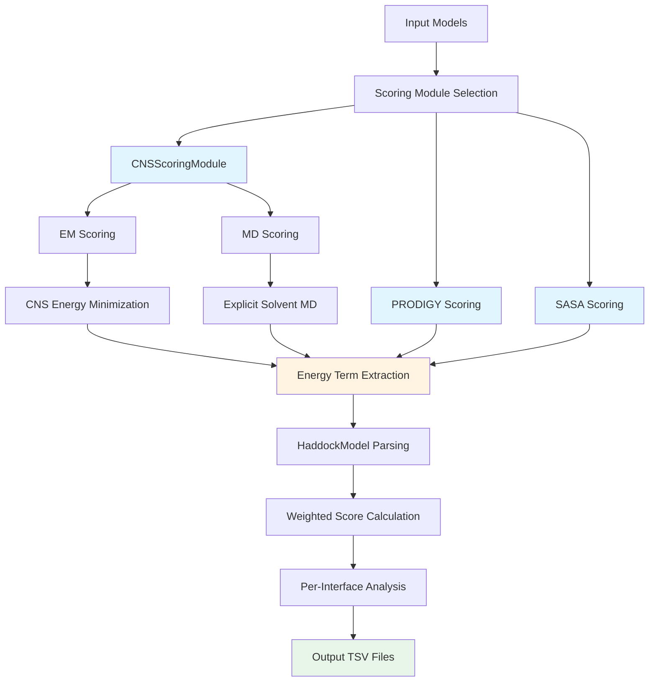

The HADDOCK scoring function provides a comprehensive energy-based evaluation framework for molecular docking models, combining physics-based energy terms with empirical restraints and interface-specific analysis. This system enables precise ranking and selection of predicted complexes through modular scoring components that can be weighted according to specific biological scenarios.

## Core Architecture

The scoring system is built upon a hierarchical class structure with `ScoringModule` as the base class and `CNSScoringModule` extending it for CNS-based calculations. This architecture supports multiple scoring approaches including energy minimization-based scoring, molecular dynamics-based scoring, PRODIGY complex scoring, and solvent accessibility analysis. The scoring workflow processes models through parallel job execution, extracts energy terms from output files, and generates tabular results with customizable sorting options.
Sources: [src/haddock/modules/scoring/__init__.py](src/haddock/modules/scoring/__init__.py#L1-L50), [src/haddock/modules/scoring/emscoring/__init__.py](src/haddock/modules/scoring/emscoring/__init__.py#L1-L30)

## HADDOCK Score Components

The HADDOCK score is a weighted linear combination of multiple energy terms, each representing distinct physical or empirical contributions to binding affinity. The score is computed as:

**HADDOCKscore = w_vdw × Evdw + w_elec × Eelec + w_desolv × Edesolv + w_air × Eair + w_bsa × BSA**

where each term can be configured through parameter weights. The `HaddockModel` class parses PDB REMARK lines to extract individual energy components, enabling flexible scoring combinations through the `calc_haddock_score` method.
Sources: [src/haddock/gear/haddockmodel.py](src/haddock/gear/haddockmodel.py#L100-L156), [src/haddock/modules/scoring/emscoring/defaults.yaml](src/haddock/modules/scoring/emscoring/defaults.yaml#L48-L100)

| Energy Term | Description | Default Weight | Range | Physical Meaning |
|-------------|-------------|----------------|-------|------------------|
| **Evdw** | Intermolecular van der Waals energy | 1.0 | -9999 to 9999 | Lennard-Jones potential representing steric complementarity |
| **Eelec** | Intermolecular electrostatic energy | 0.2 | -9999 to 9999 | Coulombic interactions between charged/polar groups |
| **Edesolv** | Desolvation energy | 1.0 | -9999 to 9999 | Penalty for removing atoms from solvent contact |
| **Eair** | Ambiguous Interaction Restraints energy | 0.0 | 0 to 9999 | Satisfaction of user-defined distance restraints |
| **BSA** | Buried Surface Area | 0.0 | -9999 to 9999 | Interface area removed from solvent exposure |
| **Sym** | Symmetry restraint energy | 0.0 | 0 to 9999 | Enforcement of symmetric interfaces |

Sources: [src/haddock/modules/scoring/emscoring/defaults.yaml](src/haddock/modules/scoring/emscoring/defaults.yaml#L48-L100)

## Energy Minimization Scoring (emscoring)

The emscoring module performs energy minimization followed by comprehensive energy evaluation using the CNS force field. The process begins with a short Powell minimization (configurable through `nemsteps` parameter) to relieve structural clashes, then calculates internal energies of isolated components and the full complex. The scoring script executes separate energy evaluations for intra- and intermolecular interactions through specialized scaling modules (`scale_intra_only.cns` and `scale_inter_final.cns`), which selectively enable interaction terms between different molecular components.
Sources: [src/haddock/modules/scoring/emscoring/cns/emscoring.cns](src/haddock/modules/scoring/emscoring/cns/emscoring.cns#L100-L150), [src/haddock/modules/scoring/emscoring/cns/calc_free-ene.cns](src/haddock/modules/scoring/emscoring/cns/calc_free-ene.cns#L1-L25)

The intermolecular energy calculation systematically evaluates all non-redundant chain pairs within the complex, constructing interaction groups that exclude dummy atoms (ANI, DAN, XAN, DUM, SHA) and solvent molecules. This approach ensures that only physically relevant interactions contribute to the final score. The `scale_inter_final.cns` module implements the interaction scaling logic by iterating through component pairs and applying appropriate weight factors to van der Waals and electrostatic terms.
Sources: [src/haddock/modules/scoring/emscoring/cns/scale_inter_final.cns](src/haddock/modules/scoring/emscoring/cns/scale_inter_final.cns#L1-L40)

> [!TIP]
> The energy minimization scoring step does not apply restraints during evaluation, making it purely an energy-based assessment regardless of whether restraints were used during sampling. The `w_air` parameter controls restraint contribution to the final score but does not affect the minimization itself.

## Molecular Dynamics Scoring (mdscoring)

MD scoring extends the evaluation framework by performing short molecular dynamics simulations in explicit solvent (water or DMSO) before energy calculation. This approach captures solvation effects and conformational flexibility that are absent from static energy minimization scoring. The module configures explicit solvent parameters including heating steps, equilibration steps, cooling steps, and time step control through the refinement-specific parameters (`waterheatsteps`, `watersteps`, `watercoolsteps`, `timestep`).
Sources: [src/haddock/modules/scoring/mdscoring/__init__.py](src/haddock/modules/scoring/mdscoring/__init__.py#L1-L103), [src/haddock/modules/scoring/mdscoring/cns/mdscoring.cns](src/haddock/modules/scoring/mdscoring/cns/mdscoring.cns#L50-L100)

The MD scoring pipeline includes additional features such as DNA/RNA restraints, secondary structure restraints with multiple strategies (all dihedrals, alpha-beta only, alpha only), and ion restraints. These components maintain structural integrity during the dynamics simulation while allowing interface refinement. Like emscoring, the final score is computed from weighted energy components, but the underlying conformational sampling reflects the more realistic solvated environment.
Sources: [src/haddock/modules/scoring/mdscoring/cns/mdscoring.cns](src/haddock/modules/scoring/mdscoring/cns/mdscoring.cns#L70-L90)

## Per-Interface Scoring Analysis

HADDOCK3 supports detailed per-interface energy decomposition for complexes with multiple chains, enabling focused analysis of specific interfaces. When `per_interface_scoring` is enabled, the system calculates individual HADDOCK scores for each chain pair and writes these values to PDB REMARK headers. The `HaddockModel` class parses these interface-specific scores through the `_load_per_interface_energies` method, extracting Evdw, Eelec, Edesol, BSA, and HADDOCKscore for each interface combination.
Sources: [src/haddock/modules/scoring/__init__.py](src/haddock/modules/scoring/__init__.py#L50-L120), [src/haddock/gear/haddockmodel.py](src/haddock/gear/haddockmodel.py#L100-L140)

The `interface_combinations` parameter provides expert-level control over which interfaces contribute to the final score. For multi-chain complexes like antibody-antigen systems, this allows treating certain chain combinations (e.g., heavy-light chain pairs) as single entities while evaluating other interfaces separately. The system automatically handles interface ordering symmetry (A-B equals B-A) and generates separate TSV output files for each analyzed interface.
Sources: [src/haddock/modules/scoring/emscoring/defaults.yaml](src/haddock/modules/scoring/emscoring/defaults.yaml#L10-L40), [src/haddock/modules/scoring/__init__.py](src/haddock/modules/scoring/__init__.py#L200-L306)

| Parameter | Type | Default | Purpose |
|-----------|------|---------|---------|
| `per_interface_scoring` | boolean | false | Enable detailed interface analysis and output |
| `interface_combinations` | list | [] | Specify chain pairs to evaluate (e.g., ["A,H", "A,L"]) |
| `w_vdw`, `w_elec`, `w_desolv`, `w_air`, `w_bsa` | float | See defaults | Individual term weights |

Sources: [src/haddock/modules/scoring/emscoring/defaults.yaml](src/haddock/modules/scoring/emscoring/defaults.yaml#L10-L100)

## Alternative Scoring Methods

Beyond the standard physics-based scoring, HADDOCK3 integrates PRODIGY scoring for rapid complex affinity prediction. The `prodigyprotein` and `prodigyligand` modules implement machine learning-based scoring trained on experimental binding data, providing ΔG or pKd predictions independent of force field calculations. These modules are particularly valuable for quick screening when computational resources are limited or when complementary scoring metrics are desired.
Sources: [src/haddock/modules/scoring/prodigyprotein/__init__.py](src/haddock/modules/scoring/prodigyprotein/__init__.py#L1-L40)

The SASA (Solvent Accessible Surface Area) scoring module offers experimental constraint validation by comparing predicted residue burial states against user-defined expectations. Users specify residues that should be buried (`resdic_buried`) or accessible (`resdic_accessible`), and the module penalizes deviations from these criteria. This approach is useful for integrating biochemical or mutagenesis data into the scoring process.
Sources: [src/haddock/modules/scoring/sasascore/__init__.py](src/haddock/modules/scoring/sasascore/__init__.py#L1-L50)

## Output and Analysis

All scoring modules generate standardized TSV output files containing sorted results with structure identifiers, original names, MD5 hashes, and calculated scores. The `CNSScoringModule.output` method formats this data using pandas DataFrames with configurable sorting (ascending by default for better models). For per-interface analyses, separate TSV files are generated for each chain combination, enabling detailed interface-specific ranking and comparison.
Sources: [src/haddock/modules/scoring/__init__.py](src/haddock/modules/scoring/__init__.py#L20-L50), [src/haddock/modules/scoring/emscoring/__init__.py](src/haddock/modules/scoring/emscoring/__init__.py#L85-L102)

The scoring framework integrates seamlessly with HADDOCK3's workflow engine, supporting parallel execution through MPI or local multiprocessing modes. Job management through `CNSJob` objects enables efficient batch processing of hundreds to thousands of models, with automatic error handling and tolerance settings for failed calculations. This scalable architecture makes HADDOCK scoring suitable for both small-scale studies and large-scale virtual screening campaigns.
Sources: [src/haddock/modules/scoring/emscoring/__init__.py](src/haddock/modules/scoring/emscoring/__init__.py#L40-L70)

---

For deeper understanding of scoring methodologies, see [Energy Minimization vs MD Scoring](20-energy-minimization-vs-md-scoring) to compare the two main physics-based approaches, or [PRODIGY Scoring Integration](21-prodigy-scoring-integration) for details on machine learning-based affinity prediction. To implement custom scoring strategies, refer to [Parameter Reference and Tuning](26-parameter-reference-and-tuning) for complete weight configuration options.