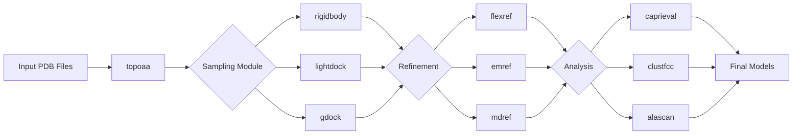

This guide will help you get started with HADDOCK3, the next-generation integrative modeling software for biomolecular docking. You'll learn how to install HADDOCK3, understand its modular architecture, run your first docking simulation, and explore available examples.


Sources: [README.md](README.md#L1-L30)

## Understanding HADDOCK3 Architecture

HADDOCK3 represents a complete redesign of the HADDOCK2.x series, transforming the traditional rigid three-stage pipeline into a **modular, flexible workflow system**. Unlike its predecessor which enforced a fixed sequence (it0 → it1 → itw), HADDOCK3 allows you to combine simulation modules like puzzle pieces, creating custom pipelines tailored to your specific research needs.

The core innovation is **modularization**—each stage of the docking process (topology generation, sampling, refinement, scoring, analysis) is now an independent module that can be arranged, repeated, or omitted as needed. This flexibility enables workflows such as running multiple refinement cycles, selecting models between stages, or integrating third-party sampling software directly into your pipeline.


Sources: [intro.md](docs/intro.md#L1-L35)

### Module Categories Overview

HADDOCK3 modules are organized into functional categories, though you can freely mix modules from different categories:

| Category | Purpose | Key Modules |
|----------|---------|-------------|
| **Topology** | Generate molecular topologies for CNS engine | `topoaa` |
| **Sampling** | Generate initial docking poses | `rigidbody`, `lightdock`, `gdock` |
| **Refinement** | Improve model quality | `flexref`, `emref`, `mdref` |
| **Scoring** | Evaluate model energetics | `emscoring`, `mdscoring` |
| **Analysis** | Analyze and filter results | `caprieval`, `clustfcc`, `clustrmsd`, `alascan`, `contactmap` |

Sources: [intro.md](docs/intro.md#L36-L65)



> [!TIP]
> The modular architecture means you can design workflows that would be impossible in HADDOCK2.x, such as running rigidbody sampling twice with different parameters, or inserting analysis modules between refinement stages to filter models before proceeding.

## Installation

HADDOCK3 requires Python 3.9 or higher. The installation process is straightforward using pip.

### Basic Installation

Create a virtual environment and install HADDOCK3:

```bash
# Using venv
python -m venv .venv
source .venv/bin/activate

# Or using conda
conda create -n haddock3 python=3.9
conda activate haddock3

# Install HADDOCK3
pip install haddock3
```

Sources: [INSTALL.md](docs/INSTALL.md#L1-L20), [README.md](README.md#L25-L30)

### MPI Support (Optional)

For parallel execution using MPI, install the MPI extension:

```bash
pip install 'haddock3[mpi]'
```

This requires OpenMPI to be installed separately. For detailed MPI setup instructions, see the [MPI Configuration](4-mpi-configuration) documentation.

Sources: [README.md](README.md#L31-L35), [INSTALL.md](docs/INSTALL.md#L21-L25)

> [!TIP]
> If the CNS executable included with the pip installation fails on your architecture, you can recompile CNS and replace the binary at the path shown by `pip show haddock3`. Instructions are available in [INSTALL.md](docs/INSTALL.md#L28-L52).

## Running Your First Simulation

The basic HADDOCK3 command is:

```bash
haddock3 <configuration-file.toml>
```

Configuration files use a TOML-like format that specifies which modules to run and their parameters. Most parameters have sensible defaults, so you can get started with minimal configuration.

Sources: [USAGE.md](docs/USAGE.md#L10-L20), [README.md](README.md#L40-L50)

### Test Example: Protein-Protein Docking

The repository includes a test example perfect for your first run:

```bash
cd examples/docking-protein-protein
haddock3 docking-protein-protein-test.cfg
```

This example uses minimal sampling (20 rigidbody models) and completes quickly, making it ideal for testing your installation.

Sources: [USAGE.md](docs/USAGE.md#L25-L35)

### Understanding the Configuration File

Here's the protein-protein test configuration with annotations:

```toml
# Directory for results
run_dir = "run1-test"

# Execution settings
mode = "local"
ncores = 40

# Input molecules (PDB files)
molecules = [
    "data/e2aP_1F3G.pdb",
    "data/hpr_ensemble.pdb"
]

# Topology generation
[topoaa]
autohis = false
[topoaa.mol1]
nhisd = 0
nhise = 1
hise_1 = 75
[topoaa.mol2]
nhisd = 1
hisd_1 = 76
nhise = 1
hise_1 = 15

# Rigid body docking with NMR restraints
[rigidbody]
tolerance = 20
ambig_fname = "data/e2a-hpr_air.tbl"
sampling = 20

# Quality assessment
[caprieval]
reference_fname = "data/e2a-hpr_1GGR.pdb"

# Select top 5 models
[seletop]
select = 5

# Flexible refinement
[flexref]
tolerance = 20
ambig_fname = "data/e2a-hpr_air.tbl"

# Final energy minimization
[emref]
tolerance = 20
ambig_fname = "data/e2a-hpr_air.tbl"

# Clustering
[clustfcc]
min_population = 1

# Select top cluster models
[seletopclusts]
top_models = 4

# Final quality assessment
[caprieval]
reference_fname = "data/e2a-hpr_1GGR.pdb"
```

Sources: [docking-protein-protein-test.cfg](examples/docking-protein-protein/docking-protein-protein-test.cfg#L1-L65)

### Command-Line Options

HADDOCK3 provides several useful options:

| Option | Purpose |
|--------|---------|
| `--restart STEP` | Restart from a specific step, deleting subsequent folders |
| `--extend-run DIR` | Continue from a previously prepared run directory |
| `--setup` | Only set up the run without execution |
| `--log-level LEVEL` | Set logging level (DEBUG, INFO, WARNING, ERROR, CRITICAL) |
| `-v, --version` | Show version information |

Sources: [README.md](README.md#L40-L60)

### Exploring Module Parameters

To see all available parameters for any module:

```bash
haddock3-cfg -m <MODULE_NAME>
```

For example, to see rigidbody parameters:
```bash
haddock3-cfg -m rigidbody
```

Sources: [USAGE.md](docs/USAGE.md#L36-L45)

## Exploring Examples

The `examples/` directory contains comprehensive examples for various docking scenarios. Each subdirectory includes both test configurations (fast, for validation) and full configurations (production-ready with recommended parameters).

Sources: [examples.md](docs/examples.md#L1-L20)

### Available Example Categories

| Example Type | Description | Key Features |
|--------------|-------------|--------------|
| **Protein-Protein** | Standard protein-protein docking | AIRs, clustering, refinement |
| **Antibody-Antigen** | Antibody docking using CDR loops | CDR-based restraints, ensemble docking |
| **Nanobody-Antigen** | Nanobody docking scenarios | Epitope information variants |
| **Protein-DNA** | Protein-nucleic acid docking | DNA-specific electrostatics, helix restraints |
| **Protein-Glycan** | Carbohydrate docking | Shape-based scoring, il-RMSD clustering |
| **Protein-Ligand** | Small molecule docking | Binding site constraints |
| **Protein-Homotrimer** | Symmetric docking | C3 symmetry, NCS restraints |

Sources: [examples.md](docs/examples.md#L25-L100)

### Running Other Examples

Navigate to any example directory and run the test configuration:

```bash
cd examples/docking-antibody-antigen
haddock3 docking-antibody-antigen-CDR-accessible-test.cfg
```

Each example includes:
- **Test configurations** (`*-test.cfg`): Fast runs with minimal sampling for validation
- **Full configurations** (`*-full.cfg`): Production runs with recommended parameters, often designed for batch systems
- **Data files**: Input PDB structures and restraint files

Sources: [examples.md](docs/examples.md#L15-L25), [examples/README.md](examples/README.md#L1-L8)

## Project Structure Overview

Understanding the repository structure helps you navigate the codebase and locate resources:

```
haddock3/
├── examples/              # Docking examples and test cases
│   ├── docking-protein-protein/
│   ├── docking-antibody-antigen/
│   ├── docking-protein-DNA/
│   └── ...               # More example directories
├── docs/                  # Documentation files
│   ├── figs/             # Documentation images
│   ├── tutorials/        # Tutorial materials
│   ├── modules/          # Module documentation
│   └── reference/        # Reference documentation
├── integration_tests/    # Integration test suite
├── src/haddock/          # Source code
│   └── modules/          # Module implementations
│       ├── sampling/     # Sampling modules (rigidbody, lightdock, gdock)
│       ├── refinement/   # Refinement modules (flexref, emref, mdref)
│       ├── topology/     # Topology modules
│       ├── analysis/     # Analysis modules
│       └── scoring/      # Scoring modules
└── tests/                # Unit tests
```

Sources: [Repository structure](#environment)

## Next Steps

Now that you've successfully installed HADDOCK3 and run your first simulation, here are recommended next steps:

1. **[Installation Guide](3-installation-guide)** - Detailed installation options, including third-party tools like LightDock and GDock
2. **[HADDOCK3 Architecture and Design Philosophy](6-haddock3-architecture-and-design-philosophy)** - Deep dive into the modular architecture and design principles
3. **[Parameter Reference and Tuning](26-parameter-reference-and-tuning)** - Comprehensive guide to all module parameters
4. **[Protein-Protein Docking](30-protein-protein-docking)** - Specialized guide for protein-protein docking workflows
5. **[Custom Workflow Design](27-custom-workflow-design)** - Learn to create custom docking pipelines

For detailed tutorials on specific features, explore the `docs/tutorials/` directory, which covers MPI configuration, user customization, and advanced topics.
