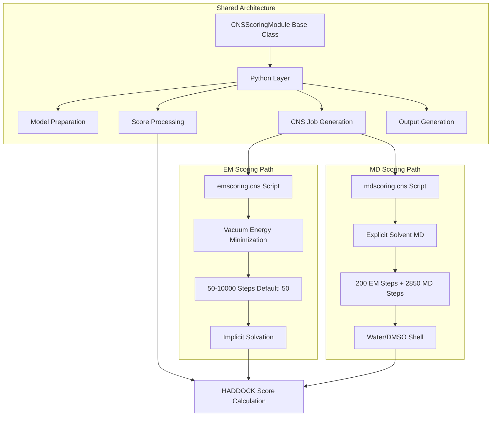

HADDOCK3 provides two distinct scoring approaches for evaluating molecular docking models: Energy Minimization (EM) scoring and Molecular Dynamics (MD) scoring. Both modules assess model quality using the HADDOCK scoring function but differ fundamentally in their computational approach, sampling methodology, and the physical context in which models are evaluated. Understanding these differences is crucial for selecting the appropriate scoring strategy based on your specific docking scenario, computational resources, and scientific objectives.

## Architectural Overview

Both scoring modules share a common architectural foundation through the `CNSScoringModule` base class, implementing identical Python-level workflows for model preparation, CNS job execution, and score processing. The critical distinction lies in their CNS-level execution scripts, where the physical simulation methodology diverges significantly.

Sources: [src/haddock/modules/scoring/emscoring/__init__.py](src/haddock/modules/scoring/emscoring/__init__.py#L1-L102), [src/haddock/modules/scoring/mdscoring/__init__.py](src/haddock/modules/scoring/mdscoring/__init__.py#L1-L103)



The shared architecture ensures consistent score interpretation across both methods, while the divergent CNS scripts provide fundamentally different physical environments for model evaluation. Both modules retrieve models from the previous workflow step using `retrieve_models(individualize=True)`, prepare CNS inputs via `prepare_cns_input()`, execute jobs through the configured engine, and update PDB scores with interface-specific analysis when requested.

Sources: [src/haddock/modules/scoring/emscoring/__init__.py](src/haddock/modules/scoring/emscoring/__init__.py#L38-L101), [src/haddock/modules/scoring/mdscoring/__init__.py](src/haddock/modules/scoring/mdscoring/__init__.py#L39-L102)

## Energy Minimization Scoring

EM scoring performs a concise energy minimization in vacuum using implicit solvation, targeting the nearest local energy minimum from the input conformation. This approach emphasizes computational efficiency while providing reasonable score assessment for well-converged docking poses.

### Core Characteristics

The EM scoring protocol executes energy minimization using the OPLS-AA force field parameters with electrostatic and van der Waals interactions scaled by user-configurable weights. The default configuration performs 50 minimization steps, though this can be adjusted from 0 to 10,000 steps depending on convergence requirements and computational constraints.

Sources: [src/haddock/modules/scoring/emscoring/defaults.yaml](src/haddock/modules/scoring/emscoring/defaults.yaml#L288-L297)

The scoring function weights emphasize van der Waals interactions (w_vdw = 1.0) and desolvation energy (w_desolv = 1.0), with reduced electrostatic contribution (w_elec = 0.2) to account for the implicit solvation environment. This weighting scheme balances physical realism with computational tractability in vacuum conditions.

Sources: [src/haddock/modules/scoring/emscoring/defaults.yaml](src/haddock/modules/scoring/emscoring/defaults.yaml#L89-L169)

### Force Field Configuration

EM scoring offers flexible electrostatic treatment through the `elecflag`, `dielec`, and `epsilon` parameters. The default configuration uses constant dielectric (cdie) with ε = 1.0, appropriate for vacuum conditions. Alternatively, distance-dependent dielectric (rdie) can be employed to implicitly model screening effects, though this reduces electrostatic interactions through a 1/r² dependency.

Sources: [src/haddock/modules/scoring/emscoring/defaults.yaml](src/haddock/modules/scoring/emscoring/defaults.yaml#L235-L268)

## Molecular Dynamics Scoring

MD scoring implements a short explicit-solvent molecular dynamics simulation, providing a more physically realistic assessment of model stability through thermal sampling and solvent interactions. The protocol encompasses energy minimization, heating, equilibration, and cooling phases, totaling approximately 3,050 simulation steps.

Sources: [src/haddock/modules/scoring/mdscoring/defaults.yaml](src/haddock/modules/scoring/mdscoring/defaults.yaml#L377-L430)

### Multi-Phase Simulation Protocol

The MD scoring workflow progresses through carefully staged temperature ramps to ensure stable trajectory integration:

1. **Energy Minimization**: 200 steps to relieve clashes and establish proper bond geometry
2. **Heating Phase**: 100 steps across three temperatures (100K, 200K, 300K)
3. **Equilibration Phase**: 1,250 steps at 300K for solvent relaxation
4. **Cooling Phase**: 500 steps across descending temperatures (300K, 200K, 100K)

This staged approach prevents energy explosions and allows gradual adaptation of both solute and solvent to the explicit environment.

Sources: [src/haddock/modules/scoring/mdscoring/defaults.yaml](src/haddock/modules/scoring/mdscoring/defaults.yaml#L377-L430)

### Explicit Solvent Environment

MD scoring generates an explicit solvent shell by shifting pre-equilibrated solvent boxes around the molecular complex. The solvent type and shell thickness depend on the selected solvent:

- **Water**: 8Å solvent shell with TIP3P water model
- **DMSO**: 12.5Å solvent shell for non-polar environments

The `solvent` parameter determines which solvent shell is generated, with water being the default choice for most protein-protein docking applications.

Sources: [src/haddock/modules/scoring/mdscoring/defaults.yaml](src/haddock/modules/scoring/mdscoring/defaults.yaml#L361-L376)

> [!TIP]
> The explicit solvent approach in MD scoring provides superior modeling of hydrophobic interactions and water-mediated contacts, which are critical for accurate binding affinity prediction. However, the computational cost is approximately 10-20x higher than EM scoring due to solvent degrees of freedom and extended simulation time.

### Advanced Restraint Options

Unlike EM scoring, MD scoring provides additional restraint capabilities to maintain structural integrity during thermal sampling:

- **Contact Restraints** (`contactairs`): Generates ambiguous distance restraints between interfacial residues within 5Å, preserving interface geometry during thermal fluctuations
- **Backbone Dihedral Restraints** (`ssdihed`): Automatically restrains phi/psi angles in secondary structure elements (all, alphabeta, or alpha options)
- **Nucleic Acid Restraints** (`dnarest_on`): Maintains Watson-Crick base pairing, sugar pucker, and backbone dihedrals for DNA/RNA molecules

These restraints prevent structural drift while allowing realistic conformational sampling around the native state.

Sources: [src/haddock/modules/scoring/mdscoring/defaults.yaml](src/haddock/modules/scoring/mdscoring/defaults.yaml#L217-L286)

## Comparative Analysis

The following table summarizes the key differences between EM and MD scoring approaches across multiple dimensions:

| Aspect | EM Scoring | MD Scoring |
|--------|------------|------------|
| **Physical Environment** | Vacuum with implicit solvation | Explicit solvent (water/DMSO) |
| **Default Simulation Length** | 50 EM steps | 200 EM + 2850 MD steps |
| **Electrostatic Treatment** | cdie/rdie, ε = 1.0 | Explicit electrostatics with solvent screening |
| **Thermal Sampling** | None (0K) | Heating (100-300K) + Equilibration + Cooling |
| **Computational Cost** | Low (~seconds per model) | High (~minutes per model) |
| **Water-Mediated Interactions** | Approximated via desolvation term | Explicitly modeled |
| **Restraint Options** | Scoring weights only | Contact, dihedral, nucleic acid restraints |
| **Output Trajectory** | Final minimized structure | Final frame after cooling |

Sources: [src/haddock/modules/scoring/emscoring/defaults.yaml](src/haddock/modules/scoring/emscoring/defaults.yaml#L1-L325), [src/haddock/modules/scoring/mdscoring/defaults.yaml](src/haddock/modules/scoring/mdscoring/defaults.yaml#L1-L475)

### Scoring Function Comparison

Both modules utilize identical scoring function weights by default, ensuring comparable score interpretation across methods:

- **w_vdw**: 1.0 (van der Waals)
- **w_desolv**: 1.0 (desolvation)
- **w_elec**: 0.2 (electrostatics)
- **w_bsa**: 0.0 (buried surface area)
- **w_air**: 0.0 (ambiguous interaction restraints)

The critical difference lies in how these energy components are calculated: EM scoring evaluates them in the minimized vacuum structure, while MD scoring averages or extracts them from the final explicit-solvent frame. This means MD scores incorporate solvent-screened electrostatics and water-mediated desolvation effects more accurately.

Sources: [src/haddock/modules/scoring/emscoring/defaults.yaml](src/haddock/modules/scoring/emscoring/defaults.yaml#L31-L169), [src/haddock/modules/scoring/mdscoring/defaults.yaml](src/haddock/modules/scoring/mdscoring/defaults.yaml#L31-L169)

## Configuration and Usage

### Module Invocation

Both scoring modules are invoked identically within HADDOCK3 workflows using their respective module names:

```yaml
# EM scoring configuration
[emscoring]
nemsteps = 50
w_vdw = 1.0
w_desolv = 1.0
w_elec = 0.2

# MD scoring configuration  
[mdscoring]
nemsteps = 200
watersteps = 1250
solvent = water
timestep = 0.002
w_vdw = 1.0
w_desolv = 1.0
w_elec = 0.2
```

Sources: [src/haddock/modules/scoring/emscoring/defaults.yaml](src/haddock/modules/scoring/emscoring/defaults.yaml#L1-L325), [src/haddock/modules/scoring/mdscoring/defaults.yaml](src/haddock/modules/scoring/mdscoring/defaults.yaml#L1-L475)

### Interface-Specific Scoring

Both modules support per-interface scoring through the `per_interface_scoring` and `interface_combinations` parameters. When enabled, all inter-chain combinations are analyzed, and individual HADDOCK scores (Eelec, Evdw, Edesol, BSA) are written to PDB headers. This capability is particularly valuable for multi-component complexes or antibody-antigen systems where specific chain interfaces require separate evaluation.

Sources: [src/haddock/modules/scoring/emscoring/defaults.yaml](src/haddock/modules/scoring/emscoring/defaults.yaml#L4-L30), [src/haddock/modules/scoring/mdscoring/defaults.yaml](src/haddock/modules/scoring/mdscoring/defaults.yaml#L4-L30)

```yaml
# Per-interface scoring example
[emscoring]
per_interface_scoring = true
interface_combinations = ["A,H", "A,L"]  # Antibody heavy/light chains vs antigen
```

### Tolerance and Error Handling

Both modules implement identical failure tolerance mechanisms through the `tolerance` parameter (default: 5%), allowing a specified percentage of scoring jobs to fail without compromising module completion. This robustness is essential for large-scale docking campaigns where occasional CNS failures may occur due to numerical instabilities or edge cases in molecular geometry.

Sources: [src/haddock/modules/scoring/emscoring/defaults.yaml](src/haddock/modules/scoring/emscoring/defaults.yaml#L298-L308), [src/haddock/modules/scoring/mdscoring/defaults.yaml](src/haddock/modules/scoring/mdscoring/defaults.yaml#L449-L459)

## Use Case Recommendations

### Choose EM Scoring When

- **Rapid screening** of thousands of models is required
- **Computational resources** are limited
- **Initial ranking** of rigid-body docking poses is needed
- **Scoring consistency** across large datasets is prioritized
- **Implicit solvation** is deemed sufficient for the system
- **Water-mediated interactions** are not critical for binding affinity

EM scoring excels in high-throughput scenarios where computational efficiency outweighs the need for physical accuracy. Its rapid execution enables iterative refinement workflows and extensive parameter space exploration.

Sources: [src/haddock/modules/scoring/emscoring/defaults.yaml](src/haddock/modules/scoring/emscoring/defaults.yaml#L288-L297)

### Choose MD Scoring When

- **Explicit solvent effects** are critical for accurate scoring
- **Thermal stability** of poses requires validation
- **Water-mediated interactions** are suspected to contribute significantly
- **Final ranking** of refined models for experimental validation
- **Hydrophobic effects** play a major role in binding
- **Nucleic acid-containing complexes** require structural restraints

MD scoring provides superior physical realism for final model selection, particularly when the scoring results will guide experimental validation or publication. The explicit solvent environment captures subtle effects like water bridges and hydrophobic collapse that implicit models approximate poorly.

Sources: [src/haddock/modules/scoring/mdscoring/defaults.yaml](src/haddock/modules/scoring/mdscoring/defaults.yaml#L361-L430)

### Hybrid Workflow Strategy

A pragmatic approach combines both methods: use EM scoring for rapid filtering of large candidate sets (e.g., after rigid-body docking), then apply MD scoring to the top-ranked subset (e.g., top 100 models) for final ranking. This strategy balances computational efficiency with physical accuracy, leveraging the strengths of both approaches.

Sources: [src/haddock/modules/scoring/emscoring/__init__.py](src/haddock/modules/scoring/emscoring/__init__.py#L1-L102), [src/haddock/modules/scoring/mdscoring/__init__.py](src/haddock/modules/scoring/mdscoring/__init__.py#L1-L103)

## Technical Implementation Details

### CNS Script Architecture

Both modules execute distinct CNS scripts that implement the respective scoring protocols:

- **EM scoring**: `src/haddock/modules/scoring/emscoring/cns/emscoring.cns`
- **MD scoring**: `src/haddock/modules/scoring/mdscoring/cns/mdscoring.cns`

The EM script focuses on energy minimization loops with gradient-based optimization, while the MD script implements velocity Verlet integration with thermostat control and periodic boundary conditions for the solvent shell. Both scripts access the same scoring function components but evaluate them at different physical states.

Sources: [src/haddock/modules/scoring/emscoring/__init__.py](src/haddock/modules/scoring/emscoring/__init__.py#L30-L31), [src/haddock/modules/scoring/mdscoring/__init__.py](src/haddock/modules/scoring/mdscoring/__init__.py#L31-L32)

> [!TIP]
> The MD scoring protocol's default timestep of 0.002 ps (2 femtoseconds) balances numerical stability with computational efficiency. Advanced users may reduce this to 0.001 ps for systems with high-frequency bond vibrations, though this approximately doubles the computational cost.

### Output Format

Both modules generate identical output formats for seamless integration with downstream analysis:

- **`{module_name}.tsv`**: Tab-separated scores table with energy components
- **PDB headers**: Individual scores written to REMARK lines when `per_interface_scoring` is enabled
- **Scored models**: Output PDB files with updated score attributes

The consistent output format allows modules to be swapped in workflows without modifying analysis pipelines.

Sources: [src/haddock/modules/scoring/emscoring/__init__.py](src/haddock/modules/scoring/emscoring/__init__.py#L94-L101), [src/haddock/modules/scoring/mdscoring/__init__.py](src/haddock/modules/scoring/mdscoring/__init__.py#L95-L102)

## Performance Considerations

### Computational Scaling

The computational requirements differ significantly between the two approaches:

| System Size | EM Scoring Time | MD Scoring Time |
|-------------|-----------------|-----------------|
| Small complex (~100 residues) | ~10-30 seconds | ~2-5 minutes |
| Medium complex (~300 residues) | ~30-60 seconds | ~5-15 minutes |
| Large complex (>500 residues) | ~1-2 minutes | ~15-45 minutes |

These estimates assume a single CPU core. Parallel execution across multiple models is supported through HADDOCK3's MPI and threading infrastructure, allowing near-linear scaling for large model sets.

### Memory Requirements

MD scoring requires significantly more memory to store the explicit solvent shell:

- **EM scoring**: ~100-500 MB per model (dependent on system size)
- **MD scoring**: ~1-4 GB per model (including solvent coordinates and velocities)

The memory footprint can impact the number of concurrent jobs possible on shared memory systems, potentially reducing effective parallelism for MD scoring workflows.

Sources: [src/haddock/modules/scoring/emscoring/defaults.yaml](src/haddock/modules/scoring/emscoring/defaults.yaml#L288-L297), [src/haddock/modules/scoring/mdscoring/defaults.yaml](src/haddock/modules/scoring/mdscoring/defaults.yaml#L377-L430)

## Advanced Configuration

### Custom Force Field Parameters

Both modules support custom ligand parameters through `ligand_param_fname` and `ligand_top_fname`, enabling scoring of non-standard molecules not included in HADDOCK's default topology libraries. This capability is essential for drug discovery applications and studies involving cofactors or post-translational modifications.

Sources: [src/haddock/modules/scoring/emscoring/defaults.yaml](src/haddock/modules/scoring/emscoring/defaults.yaml#L217-L234), [src/haddock/modules/scoring/mdscoring/defaults.yaml](src/haddock/modules/scoring/mdscoring/defaults.yaml#L290-L307)

### Random Number Control

MD scoring provides deterministic control through the `iniseed` parameter (default: 917), allowing reproducible simulations across different runs. EM scoring is inherently deterministic as minimization follows gradient descent without stochastic elements.

Sources: [src/haddock/modules/scoring/mdscoring/defaults.yaml](src/haddock/modules/scoring/mdscoring/defaults.yaml#L431-L440)

### Verbose Logging

Both modules support configurable CNS verbosity through `log_level` (quiet, normal, verbose). While `quiet` mode (default) minimizes output for production runs, `verbose` mode provides detailed energy information useful for debugging convergence issues or analyzing scoring component evolution.

Sources: [src/haddock/modules/scoring/emscoring/defaults.yaml](src/haddock/modules/scoring/emscoring/defaults.yaml#L309-L323), [src/haddock/modules/scoring/mdscoring/defaults.yaml](src/haddock/modules/scoring/mdscoring/defaults.yaml#L460-L474)

## Integration with Refinement Workflows

Both scoring modules naturally integrate with refinement protocols in the HADDOCK3 workflow:

- **After EM refinement** (`emref`): Use EM scoring for consistency with the refinement method
- **After MD refinement** (`mdref`): Use MD scoring to leverage the explicit solvent environment
- **After flexible refinement** (`flexref`): Either method may be appropriate depending on system characteristics

The choice of scoring method should align with the refinement approach to maintain physical consistency throughout the workflow. However, cross-method comparisons can provide valuable insights into scoring method sensitivity.

Sources: [Energy Minimization Refinement](16-energy-minimization-refinement), [Molecular Dynamics Refinement in Explicit Solvent](17-molecular-dynamics-refinement-in-explicit-solvent)

## Conclusion

EM and MD scoring offer complementary approaches to model evaluation in HADDOCK3, each optimized for different scenarios and priorities. EM scoring provides rapid, efficient assessment suitable for high-throughput screening, while MD scoring delivers physically rigorous evaluation for final model selection. Understanding the strengths and limitations of each approach enables informed decisions that optimize the trade-off between computational cost and scoring accuracy for your specific docking applications.

The modular architecture of HADDOCK3 allows both methods to be seamlessly integrated into diverse workflows, supporting everything from rapid virtual screening campaigns to publication-quality model refinement. By carefully matching the scoring approach to the scientific question and available resources, researchers can maximize the effectiveness of their docking pipelines and improve the reliability of final predictions.