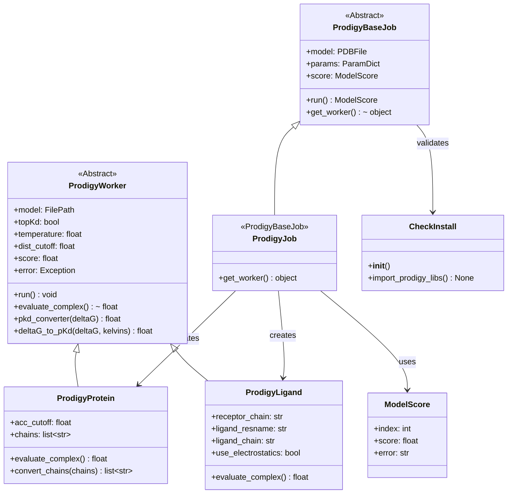
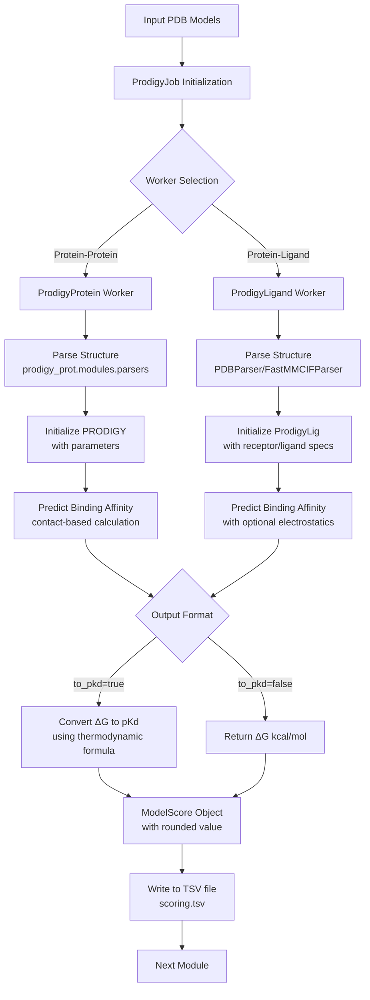
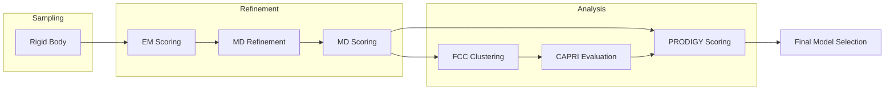

PRODIGY (PROtein binDing enerGY prediction) is integrated into HADDOCK3 as a post-docking scoring module that predicts binding affinities for protein-protein and protein-ligand complexes. This integration leverages the PRODIGY machine-learning based scoring functions developed by the Structural Bioinformatics Group at Utrecht University. The module provides rapid binding affinity predictions (ΔG or pKd) based on structural features of docked complexes, enabling researchers to rank and evaluate docking results beyond traditional HADDOCK scoring.

## Architecture Overview

The PRODIGY integration follows a modular design pattern with shared infrastructure supporting both protein-protein and protein-ligand scoring variants. The architecture separates worker logic from job management, enabling consistent execution patterns while accommodating the distinct requirements of different molecular interaction types.



The base class hierarchy provides a clean separation of concerns: `ProdigyWorker` handles the actual PRODIGY library interactions, while `ProdigyBaseJob` manages workflow integration and error handling. Both scoring variants inherit from these abstract bases, implementing only the domain-specific evaluation logic.

## Module Variants

HADDOCK3 integrates two distinct PRODIGY scoring modules, each optimized for specific interaction types:

### PRODIGY Protein (prodigyprotein)

Designed for protein-protein complex scoring, this module analyzes inter-chain contacts and solvent accessibility to predict binding affinities. It's particularly useful for evaluating antibody-antigen complexes, multimeric proteins, and other protein-protein interactions.

### PRODIGY Ligand (prodigyligand)

Specialized for protein-ligand scoring, this module considers the receptor-ligand interface with optional electrostatic components. It can extract electrostatic information from HADDOCK-generated models when available, enhancing prediction accuracy for small molecule docking.

Both modules share the core infrastructure but differ in their parameter requirements and underlying PRODIGY library calls ([prodigyprotein.py](src/haddock/modules/scoring/prodigyprotein/prodigy.py#L1-L79), [prodigylig.py](src/haddock/modules/scoring/prodigyligand/prodigylig.py#L1-L86)).

## Installation and Verification

PRODIGY scoring requires external Python packages that are not part of the core HADDOCK3 installation. The `CheckInstall` class automatically validates the availability of these libraries at runtime ([libprodigy.py](src/haddock/libs/libprodigy.py#L20-L46)).

**Installation:**
```bash
pip install prodigy-prot prodigy-lig
```

> [!TIP]
> The installation verification occurs automatically when PRODIGY modules are executed. If the libraries are missing, HADDOCK3 raises a `ModuleError` with installation instructions, preventing silent failures.

## Parameter Reference

### PRODIGY Protein Parameters

| Parameter | Type | Default | Range | Description |
|-----------|------|---------|-------|-------------|
| `chains` | list | `[]` | 0-20 items | Chain identifiers for scoring. Empty lists consider all inter-chain contacts. Groups can be specified with commas (e.g., `["A,B", "C"]` treats A and B as a single group interacting with C) |
| `distance_cutoff` | float | `5.5` | 1.0-100.0 Å | Distance cutoff for extracting amino acid contacts between chains |
| `accessibility_cutoff` | float | `0.05` | 0.0-1.0 | Solvent accessibility threshold for buried surface area analysis |
| `temperature` | float | `25.00` | -273.15-95.0°C | Temperature for pKd conversion from ΔG |
| `to_pkd` | boolean | `true` | - | Convert ΔG (kcal/mol) to pKd values |

**Chain Parameter Examples:**
- `[]` or `[A, B, C]` → Calculates contacts between all chain pairs
- `["A", "B"]` → Only A-B contacts considered
- `["A,B", "C"]` → A and B treated as single unit interacting with C

Sources: [defaults.yaml](src/haddock/modules/scoring/prodigyprotein/defaults.yaml#L1-L65)

### PRODIGY Ligand Parameters

| Parameter | Type | Default | Range | Description |
|-----------|------|---------|-------|-------------|
| `receptor_chain` | string | `"A"` | 1 character | Chain ID of the receptor protein |
| `ligand_chain` | string | `"B"` | 1 character | Chain ID containing the ligand |
| `ligand_resname` | string | `"UNK"` | 1-3 characters | Residue name of the ligand in the PDB file |
| `electrostatics` | boolean | `true` | - | Use electrostatic component from HADDOCK model REMARKs |
| `distance_cutoff` | float | `10.5` | 1.0-100.0 Å | Distance cutoff for extracting receptor residues contacting the ligand |
| `temperature` | float | `25.00` | -273.15-95.0°C | Temperature for pKd conversion |
| `to_pkd` | boolean | `true` | - | Convert ΔG (kcal/mol) to pKd values |

Sources: [defaults.yaml](src/haddock/modules/scoring/prodigyligand/defaults.yaml#L1-L77)

## Scoring Pipeline Execution

The PRODIGY scoring workflow follows a consistent pattern regardless of the interaction type:



The execution pipeline demonstrates how both scoring variants converge on common post-processing steps while maintaining distinct evaluation logic appropriate to their molecular contexts.

### ΔG to pKd Conversion

When `to_pkd=true`, the system converts the PRODIGY-predicted ΔG (kcal/mol) to pKd using the thermodynamic relationship:

```python
ΔG_joules = ΔG × CALS_TO_JOULES × 1000
Kd = exp(-ΔG_joules / (R_GAS_CONST × kelvins))
pKd = -log10(Kd)
```

Where:
- `CALS_TO_JOULES = 4.184` (calories to joules conversion)
- `R_GAS_CONST = 8.31446261815324` J·mol⁻¹·K⁻¹
- `kelvins = temperature + 273.15` (Celsius to Kelvin)

The temperature parameter is critical for accurate pKd conversion, as binding affinity is temperature-dependent.

Sources: [libprodigy.py](src/haddock/libs/libprodigy.py#L75-L128)

## Configuration Examples

### Protein-Protein Scoring

Basic configuration for evaluating protein-protein complexes:

```yaml
# Using defaults - all chains considered
prodigyprotein:
  to_pkd: true
  temperature: 25.00

# Antibody-antigen with chain grouping
prodigyprotein:
  chains: ["A,B", "C"]  # Heavy+Light chains as unit vs Antigen
  to_pkd: true
  temperature: 37.00  # Physiological temperature
  distance_cutoff: 5.5
  accessibility_cutoff: 0.05
```

Sources: [prodigy-protein-protein-test.cfg](examples/scoring/prodigy-protein-protein-test.cfg), [prodigy-antibody-antigen-test.cfg](examples/scoring/prodigy-antibody-antigen-test.cfg)

### Protein-Ligand Scoring

Configuration for protein-ligand complexes:

```yaml
prodigyligand:
  receptor_chain: "A"
  ligand_chain: "B"
  ligand_resname: "HEM"  # Adjust to your ligand name
  electrostatics: true    # Use HADDOCK electrostatics
  distance_cutoff: 10.5
  temperature: 25.00
  to_pkd: true
```

The `electrostatics` parameter leverages electrostatic calculations performed by HADDOCK during refinement stages, which are stored in the PDB file's REMARK section.

Sources: [prodigy-protein-ligand-test.cfg](examples/scoring/prodigy-protein-ligand-test.cfg)

### Integration in Complete Workflows

PRODIGY scoring is typically used as a post-refinement evaluation step:

```yaml
# Complete docking workflow with PRODIGY evaluation
topoaa:
  mode: local
rigidbody:
  sampling: 1000
refine:
  mode: all
mdref:
  mode: all
prodigyprotein:
  chains: []
  to_pkd: true
```

This pattern allows you to evaluate the quality of refined models using an independent, physics-informed scoring metric.

## Output Format

Both PRODIGY modules generate a `scoring.tsv` file containing one row per model with the following columns:

| Column | Description |
|--------|-------------|
| `model` | Model filename or identifier |
| `score` | Predicted binding affinity (pKd or ΔG depending on `to_pkd` parameter) |

The scores are rounded to 3 decimal places for pKd and 3 decimal places for ΔG values, providing sufficient precision for ranking models without excessive significant digits.

Sources: [libprodigy.py](src/haddock/libs/libprodigy.py#L131-L137), [libprodigy.py](src/haddock/libs/libprodigy.py#L114-L128)

## Error Handling and Validation

The PRODIGY integration includes comprehensive error handling at multiple levels:

**Installation Level:** The `CheckInstall` class validates that `prodigy_prot` and `prodigy_lig` packages are available before attempting any scoring operations ([libprodigy.py](src/haddock/libs/libprodigy.py#L20-L46)).

**Execution Level:** Each worker wraps the PRODIGY library calls in try-catch blocks, capturing exceptions and storing them in the `ModelScore.error` field ([libprodigy.py](src/haddock/libs/libprodigy.py#L155-L163)). This allows the workflow to continue processing other models even if individual models fail.

**Logging Level:** PRODIGY's internal logging is suppressed at the CRITICAL level to prevent excessive output during batch processing ([libprodigy.py](src/haddock/libs/libprodigy.py#L61-L62)).

## Performance Considerations

PRODIGY scoring is computationally efficient compared to traditional scoring methods that require extensive energy calculations. Key performance characteristics:

- **Speed:** Typically < 1 second per model for both protein-protein and protein-ligand variants
- **Memory:** Low memory footprint as PRODIGY uses lightweight structural features
- **Scalability:** Suitable for evaluating hundreds to thousands of models in a single run
- **Parallelization:** The module can be combined with HADDOCK3's MPI parallelization for large-scale scoring jobs

## Integration with HADDOCK3 Workflow

The PRODIGY modules are fully integrated into the HADDOCK3 module system and can be combined with other analysis and scoring modules:



> [!TIP]
> PRODIGY scoring is most valuable when used alongside traditional HADDOCK scoring and CAPRI evaluation. The combination provides complementary perspectives: physics-based energy calculations (HADDOCK), interface quality assessment (CAPRI), and binding affinity prediction (PRODIGY).

## Testing and Validation

Integration tests verify both module variants with various parameter combinations:

- **Default parameters:** Ensures baseline functionality with standard settings
- **Temperature variations:** Validates pKd conversion across different temperatures
- **Distance cutoff modifications:** Tests impact of contact definition changes
- **Accessibility adjustments:** Verifies BSA threshold functionality
- **Electrostatic components:** Tests optional electrostatic usage in ligand scoring

These tests use mock data representing real protein complexes and small molecules, ensuring the modules work correctly in production scenarios.

Sources: [test_prodigyprotein.py](integration_tests/test_prodigyprotein.py#L1-L132), [test_prodigyligand.py](integration_tests/test_prodigyligand.py#L1-L156)

## Best Practices

1. **Chain Selection:** For antibody-antigen complexes, explicitly group heavy and light chains using the `chains` parameter to treat the antibody as a single interacting unit

2. **Temperature Consistency:** Match the `temperature` parameter to your experimental conditions when comparing predicted affinities to measured binding data

3. **Electrostatics Usage:** Enable `electrostatics=true` for protein-ligand scoring only when your models have undergone refinement with electrostatic calculations in HADDOCK

4. **Combined Scoring:** Use PRODIGY scores in conjunction with HADDOCK scores and clustering metrics for comprehensive model evaluation

5. **Output Format:** Consider using `to_pkd=false` if you prefer working with ΔG values directly, especially when comparing to thermodynamic measurements

## Next Steps

- To understand how PRODIGY scoring fits into the broader HADDOCK3 evaluation framework, see [HADDOCK Scoring Function Components](19-haddock-scoring-function-components)
- For comprehensive result analysis workflows, explore [Result Analysis and Interpretation](25-result-analysis-and-interpretation)
- To learn about other specialized scoring methods like EM-based scoring, refer to [Energy Minimization vs MD Scoring](20-energy-minimization-vs-md-scoring)
- For complete workflow design including PRODIGY evaluation, consult [Custom Workflow Design](27-custom-workflow-design)