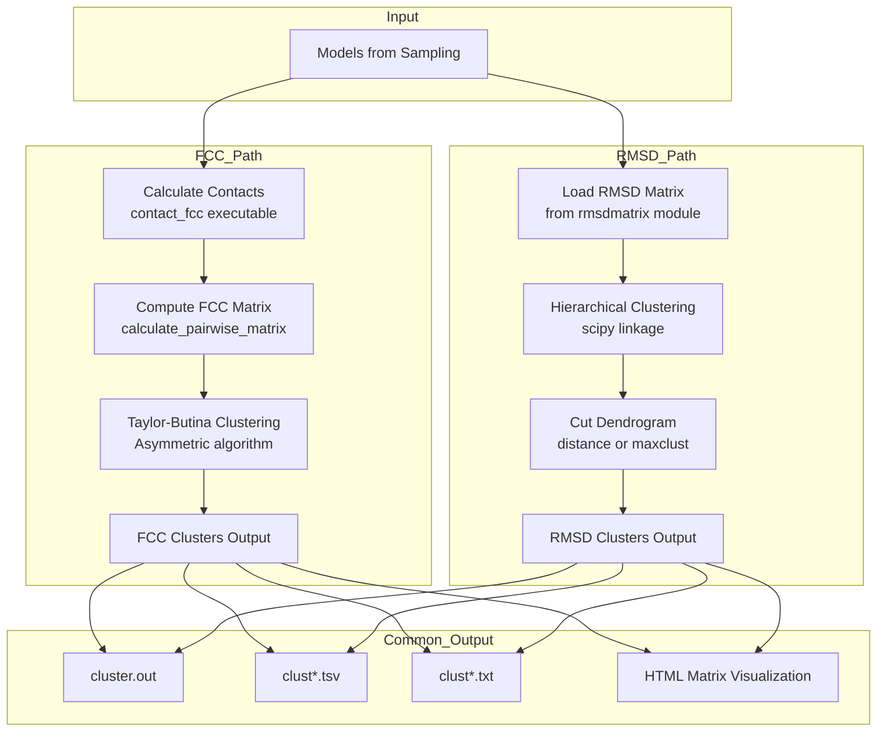

HADDOCK3 provides two complementary clustering approaches to organize and analyze docking results: **Fraction of Common Contacts (FCC)** clustering and **RMSD-based clustering**. These algorithms enable you to group structurally similar models, identify representative solutions, and reduce computational complexity in subsequent refinement stages. Understanding when and how to apply each method is crucial for effective docking workflow design.

## Overview of Clustering in HADDOCK3

Clustering serves as a critical post-processing step in HADDOCK3 workflows, serving three primary purposes: reducing redundant solutions, identifying consensus binding modes, and selecting representative models for further refinement. The choice between FCC and RMSD clustering depends on your specific scientific objectives, the type of molecular interaction, and the characteristics of your sampling results.

HADDOCK3's clustering architecture integrates with the broader workflow through modular design, enabling seamless execution after sampling modules like `rigidbody` or `flexref`. Both clustering approaches output standardized files containing cluster assignments, ranked cluster lists, and model-level annotations that propagate through subsequent workflow stages.



Sources: [src/haddock/modules/analysis/clustfcc/__init__.py](src/haddock/modules/analysis/clustfcc/__init__.py), [src/haddock/modules/analysis/clustrmsd/__init__.py](src/haddock/modules/analysis/clustrmsd/__init__.py)

## FCC Clustering: Fraction of Common Contacts

**FCC clustering** groups models based on similarity of their intermolecular contact patterns rather than geometric superposition. This approach is particularly valuable for protein-protein, protein-peptide, and protein-DNA interactions where the binding interface topology is more informative than global structural alignment. The method was originally described by Rodrigues et al. (2012) and has been implemented in HADDOCK3 with algorithmic optimizations for large-scale analysis.

### Core Algorithm Implementation

The FCC clustering workflow follows a three-stage pipeline. First, the `contact_fcc` executable identifies atomic contacts within a user-defined distance cutoff (default 5.0Å). This C++ implementation processes PDB files efficiently, handling chain segmentation and residue identification while ignoring hydrogens and HETATM records [src/haddock/deps/contact_fcc.cpp](src/haddock/deps/contact_fcc.cpp#L23-L35). Contact residues are encoded as unique integers incorporating chain and residue information, enabling fast set operations for similarity calculations.

The second stage computes a pairwise FCC matrix where each entry represents the fraction of common contacts between two models. The calculation uses asymmetric FCC values (FCC_AB and FCC_BA) to account for differences in interface sizes, implementing strictness factors to prevent small interfaces from clustering promiscuously with larger ones [src/haddock/libs/libfcc.py](src/haddock/libs/libfcc.py#L140-L148). The strictness parameter (default 0.75) multiplies the clustering cutoff for the second direction, allowing controlled variability while maintaining biological relevance.

The final stage applies the **Asymmetric Taylor-Butina Disjoint Clustering Algorithm**, a greedy iterative method that selects cluster centers based on neighbor count and progressively assigns unclustered models to the most appropriate cluster [src/haddock/fcc/cluster_fcc.py](src/haddock/fcc/cluster_fcc.py#L69-L96). This approach ensures each model belongs to exactly one cluster and prioritizes large, well-populated clusters over smaller singletons.

### Key Classes and Data Structures

FCC clustering centers on two fundamental classes defined in the library module. The `Element` class represents individual models with attributes for name, cluster assignment, and neighbor relationships [src/haddock/libs/libfcc.py](src/haddock/libs/libfcc.py#L7-L24). Each Element maintains a set of neighboring Elements that satisfy the FCC similarity criteria, enabling efficient cluster formation.

The `Cluster` class encapsulates clustering results with a name, center Element, and member list [src/haddock/libs/libfcc.py](src/haddock/libs/libfcc.py#L26-L66). The `populate()` method automatically assigns all unclustered neighbors of the center to the cluster, while the `add_member()` method allows manual addition of specific models. Cluster size calculations include both center and members, providing accurate population statistics for ranking.

### Configuration Parameters

FCC clustering exposes five key configuration parameters in `defaults.yaml`:

| Parameter | Type | Default | Range | Description |
|-----------|------|---------|-------|-------------|
| `contact_distance_cutoff` | float | 5.00 | 2.00-999.99 | Maximum distance (Å) for atomic contact detection. Smaller values increase specificity but may miss relevant contacts. |
| `clust_cutoff` | float | 0.60 | 0.00-1.00 | Minimum FCC value for models to belong to same cluster. Higher values produce stricter clustering. |
| `min_population` | integer | 4 | 1-9999 | Minimum cluster size threshold. Clusters with fewer members are discarded. The algorithm iteratively reduces this value if no clusters are found. |
| `strictness` | float | 0.75 | 0.00-1.00 | Multiplier for asymmetric FCC calculation. Lower values increase clustering promiscuity for small interfaces. |
| `plot_matrix` | boolean | false | - | Enable generation of HTML matrix visualization for interactive cluster inspection. |

Sources: [src/haddock/modules/analysis/clustfcc/defaults.yaml](src/haddock/modules/analysis/clustfcc/defaults.yaml)

### Practical Considerations

FCC clustering excels in scenarios where interface conservation is more important than global structural alignment. For antibody-antigen complexes, the method groups solutions sharing similar paratope-epitope contact patterns, even when overall orientations differ. Similarly, for protein-DNA docking, FCC clusters models with analogous contact footprints on the nucleic acid surface, facilitating identification of conserved binding modes [docs/examples.md](docs/examples.md#docking-protein-dna).

> [!TIP]
> The `strictness` parameter requires careful tuning based on your system's interface characteristics. For small peptides binding to large protein surfaces, increase strictness (0.85-0.95) to prevent clustering of spurious contacts. For protein-protein interactions with large, well-defined interfaces, default or lower strictness (0.65-0.75) provides reasonable sensitivity.

FCC clustering requires contact calculation for all input models, which can be computationally expensive for large ensembles (>10,000 models). However, the resulting clusters tend to be more biologically interpretable since they reflect interface conservation rather than global structural similarity. The method is particularly robust to conformational changes away from the binding interface.

## RMSD Clustering: Hierarchical Geometric Grouping

**RMSD clustering** organizes models based on geometric similarity using hierarchical clustering on pre-computed RMSD matrices. This traditional approach groups structures with similar overall orientations, making it ideal for systems where global binding pose is the primary distinguishing feature, such as protein-ligand docking or symmetric complex assembly.

### Integration with RMSD Matrix Module

RMSD clustering depends on the `rmsdmatrix` module to generate the pairwise distance matrix. The RMSD matrix module calculates all-atom or interface-ligand RMSD values using an optimized C implementation, with options to restrict calculations to specific residues via the `resdic_` parameter [src/haddock/modules/analysis/rmsdmatrix/__init__.py](src/haddock/modules/analysis/rmsdmatrix/__init__.py#L16-L46). The matrix is stored in condensed format and passed between modules via the `rmsd_matrix.json` file, enabling multiple `clustrmsd` executions with different parameters on the same matrix.

### Hierarchical Clustering with SciPy

The `clustrmsd` module leverages scipy's hierarchical clustering implementation, supporting seven linkage methods for dendrogram construction:

| Linkage Method | Description | Use Case |
|----------------|-------------|----------|
| `average` | Average distance between all pairs of clusters | Default choice; balances single and complete linkage |
| `complete` | Maximum distance between cluster members | Produces compact, spherical clusters |
| `single` | Minimum distance between cluster members | Sensitive to noise; produces chaining effects |
| `ward` | Minimizes variance increase | Good for equally sized, compact clusters |
| `centroid` | Distance between cluster centroids | Can produce inversions in dendrogram |
| `median` | Weighted centroid distance | Less common; similar to centroid |
| `weighted` | Weighted average distance | Suitable for imbalanced cluster sizes |

Sources: [src/haddock/modules/analysis/clustrmsd/defaults.yaml](src/haddock/modules/analysis/clustrmsd/defaults.yaml#L16-L25)

The dendrogram construction follows the standard hierarchical clustering procedure, where models are iteratively merged based on pairwise RMSD distances until a single cluster remains [src/haddock/modules/analysis/clustrmsd/clustrmsd.py](src/haddock/modules/analysis/clustrmsd/clustrmsd.py#L82-L88). The resulting linkage matrix is saved to `dendrogram.txt` for inspection and visualization purposes.

### Dendrogram Cutting Strategies

Two complementary strategies determine how the dendrogram is cut to produce final clusters. The `distance` criterion cuts the dendrogram at a specified RMSD threshold (`clust_cutoff`), grouping all models within that distance [src/haddock/modules/analysis/clustrmsd/clustrmsd.py](src/haddock/modules/analysis/clustrmsd/clustrmsd.py#L90-L96). This approach produces clusters of varying sizes depending on the structural diversity of the input ensemble.

The `maxclust` criterion specifies the desired number of clusters (`n_clusters`), cutting the dendrogram to produce exactly that many groups [src/haddock/modules/analysis/clustrmsd/clustrmsd.py](src/haddock/modules/analysis/clustrmsd/clustrmsd.py#L90-L96). This strategy is useful when you want to control the number of representative models for downstream processing, though cluster quality depends on the inherent structure of the data.

> [!TIP]
> When using the `distance` criterion, apply the `min_population` filter iteratively rather than as a strict cutoff. The `iterate_min_population` function progressively relaxes the population threshold if no clusters satisfy the requirement, ensuring you obtain meaningful clusters even from challenging datasets.

### Cluster Center Identification

RMSD clustering identifies representative structures by computing the model with minimum average RMSD to all other cluster members [src/haddock/modules/analysis/clustrmsd/clustrmsd.py](src/haddock/modules/analysis/clustrmsd/clustrmsd.py#L35-L67). This "medoid" selection ensures the center is a actual model from the ensemble rather than a theoretical average, maintaining structural validity for subsequent refinement stages.

### Configuration Parameters

RMSD clustering provides six configuration parameters:

| Parameter | Type | Default | Range | Description |
|-----------|------|---------|-------|-------------|
| `linkage` | string | average | - | Method for hierarchical clustering. Affects dendrogram structure. |
| `criterion` | string | distance | distance/maxclust | Strategy for cutting dendrogram. |
| `clust_cutoff` | float | 7.5 | 0.1-100 | RMSD threshold (Å) when criterion=`distance`. Higher values produce fewer, larger clusters. |
| `min_population` | integer | 4 | 1-9999 | Minimum cluster size. Ignored when criterion=`maxclust`. |
| `n_clusters` | integer | 4 | 1-9999 | Desired number of clusters when criterion=`maxclust`. Ignored otherwise. |
| `plot_matrix` | boolean | false | - | Enable HTML matrix visualization with color-coded RMSD values. |

Sources: [src/haddock/modules/analysis/clustrmsd/defaults.yaml](src/haddock/modules/analysis/clustrmsd/defaults.yaml)

### Practical Considerations

RMSD clustering is particularly effective for protein-ligand docking where global binding orientation distinguishes meaningful solutions. The method groups ligands with similar binding poses, enabling identification of consensus binding modes even when the ligand undergoes conformational rearrangement [docs/examples.md](docs/examples.md#docking-protein-ligand).

For glycan-protein interactions, RMSD clustering can be complemented with interface-ligand RMSD (ilRMSD) calculations through the `ilrmsdmatrix` module, focusing similarity assessment on the glycan's binding pose rather than overall protein orientation [docs/examples.md](docs/examples.md#docking-protein-glycan). This hybrid approach captures both global binding mode and interface-specific conservation.

## Common Clustering Infrastructure

Both clustering algorithms share substantial infrastructure through the `libclust` library, including cluster ranking, output formatting, and visualization generation. This common architecture ensures consistent user experience and facilitates switching between methods based on workflow requirements.

### Cluster Ranking and Scoring

Clusters are ranked by the average HADDOCK score of their top members, prioritizing energetically favorable solutions [src/haddock/libs/libclust.py](src/haddock/libs/libclust.py#L227-L260). The `rank_clusters()` function sorts cluster members by score, calculates the mean of the top `min_population` models, and returns a sorted list of clusters from best to worst. This scoring strategy identifies clusters with strong energetic signals rather than simply the most populated ones.

The ranking integrates with the model metadata through the `add_cluster_info()` function, which annotates each model with its cluster ID and rank assignment [src/haddock/libs/libclust.py](src/haddock/libs/libclust.py#L260-L292). These annotations propagate through subsequent workflow stages, enabling downstream modules to make cluster-aware decisions during model selection.

### Output File Generation

Both clustering modules generate three primary output files with standardized formats. The `cluster.out` file contains simple cluster listings with center and member indices, providing compatibility with legacy HADDOCK analysis tools [src/haddock/modules/analysis/clustfcc/clustfcc.py](src/haddock/modules/analysis/clustfcc/clustfcc.py#L42-L62). The `.tsv` files (e.g., `clustfcc.tsv`, `clustrmsd.tsv`) provide tab-separated model listings with cluster assignments, scores, and rankings for programmatic access.

The detailed cluster reports (`clustfcc.txt`, `clustrmsd.txt`) contain comprehensive information including clustering parameters, cluster statistics (size, mean score, standard deviation), and member lists with score annotations [src/haddock/modules/analysis/clustfcc/clustfcc.py](src/haddock/modules/analysis/clustfcc/clustfcc.py#L105-L210). Cluster centers are marked with asterisks for easy identification. These reports are ideal for publication-quality documentation and detailed analysis.

### Matrix Visualization

When `plot_matrix=true`, both modules generate interactive HTML visualizations of their respective similarity matrices [src/haddock/libs/libclust.py](src/haddock/libs/libclust.py#L62-L174). The FCC matrix displays contact-based similarities with color gradients (blue = similar), while the RMSD matrix uses reverse coloring (blue = distant). Cluster boundaries are delineated with white lines, and hover effects reveal exact pairwise values.

The visualization function handles large matrices efficiently, limiting display to 3100 entries (approximately 56 models) to prevent browser performance issues [src/haddock/libs/libclust.py](src/haddock/libs/libclust.py#L23). For larger ensembles, consider sub-sampling representative models or analyzing cluster-specific subsets.

## Algorithm Selection Guide

Choosing between FCC and RMSD clustering depends on your scientific objectives and system characteristics. Consider the following decision framework:

**Choose FCC clustering when:**
- Interface conservation is more informative than global orientation
- Working with protein-protein or protein-nucleic acid interactions
- Binding interfaces are well-defined and structurally conserved
- You want to group solutions with similar contact patterns regardless of overall pose
- Analyzing antibody-antigen or peptide-protein interactions with multiple binding modes

**Choose RMSD clustering when:**
- Global binding orientation is the primary distinguishing feature
- Working with protein-ligand or small molecule docking
- Systems exhibit large conformational changes away from binding interface
- You need to identify structurally similar binding poses
- Analyzing symmetric complexes or multi-component assemblies

**Consider hybrid approaches when:**
- Both interface and global orientation provide complementary information
- Systems exhibit intermediate characteristics (e.g., protein-glycan interactions)
- You want to compare clustering results from different perspectives

| Scenario | Recommended Method | Rationale |
|----------|-------------------|-----------|
| Protein-protein with NMR restraints | FCC | Interface restraints produce similar contact patterns |
| Protein-ligand with known binding site | RMSD | Global orientation distinguishes binding modes |
| Antibody-antigen with multiple epitopes | FCC | Contact patterns identify epitope-specific solutions |
| Protein-DNA with sequence-specific binding | FCC | Base-specific contacts cluster effectively |
| Symmetric homotrimer assembly | RMSD | Global symmetry constraints produce structural groups |
| Protein-glycan with flexible sugar | ilRMSD/RMSD | Hybrid captures local glycan pose and global binding |

## Workflow Integration Examples

### Example 1: Standard Protein-Protein Docking

```yaml
modules:
  - rigidbody:
      sampling: 1000
  - caprieval:
      reference: ./data/reference.pdb
  - clustfcc:
      clust_cutoff: 0.60
      min_population: 4
  - seletopclusts:
      top_cluster: 10
      top_model: 10
  - flexref:
  - emref:
```

This workflow generates 1000 rigid-body models, applies FCC clustering to group interface-similar solutions, selects the top 10 models from each of the best 10 clusters, and performs flexible refinement. The FCC clustering ensures diverse interface chemistries are represented in downstream refinement.

### Example 2: Protein-Ligand with RMSD Clustering

```yaml
modules:
  - rigidbody:
      sampling: 1000
  - rmsdmatrix:
      resdic_: [1-100]  # Focus on protein binding site
  - clustrmsd:
      linkage: average
      criterion: distance
      clust_cutoff: 5.0
      min_population: 2
  - seletopclusts:
      top_cluster: 5
      top_model: 5
  - emref:
```

This protein-ligand workflow uses RMSD clustering restricted to the binding site via `resdic_`, grouping ligands with similar binding orientations regardless of minor conformational differences. The relatively loose cutoff (5.0Å) accommodates ligand flexibility while distinguishing major binding modes.

### Example 3: Multiple Clustering Strategies

```yaml
modules:
  - rigidbody:
      sampling: 2000
  - clustfcc:
      contact_distance_cutoff: 5.0
      clust_cutoff: 0.65
      min_population: 4
  - clustrmsd:
      linkage: complete
      criterion: maxclust
      n_clusters: 20
```

This parallel clustering approach applies both FCC and RMSD clustering to the same sampling output, enabling comparison of interface-based and geometry-based grouping strategies. The FCC clustering produces biologically meaningful interface clusters, while RMSD clustering provides complementary structural groupings.

Sources: [docs/examples.md](docs/examples.md#general-analysis-tasks)

## Advanced Configuration and Troubleshooting

### Adjusting Clustering Stringency

The sensitivity of both clustering methods can be tuned through primary cutoff parameters. For FCC, reduce `clust_cutoff` (e.g., 0.50) to increase cluster size and sensitivity, or increase it (e.g., 0.75) for stricter grouping [src/haddock/modules/analysis/clustfcc/defaults.yaml](src/haddock/modules/analysis/clustfcc/defaults.yaml#L15-L24). The `strictness` parameter provides additional control over asymmetric relationships.

For RMSD clustering, `clust_cutoff` directly controls the distance threshold [src/haddock/modules/analysis/clustrmsd/defaults.yaml](src/haddock/modules/analysis/clustrmsd/defaults.yaml#L30-L36). Typical values range from 2.0Å (very strict) to 10.0Å (very loose), depending on system flexibility and desired granularity. The `linkage` method also affects cluster characteristics; `complete` linkage produces tighter clusters than `average`.

### Handling Challenging Datasets

When no clusters satisfy the `min_population` threshold, both algorithms implement adaptive strategies. The FCC module iteratively reduces `min_population` until at least one cluster is found [src/haddock/modules/analysis/clustfcc/clustfcc.py](src/haddock/modules/analysis/clustfcc/clustfcc.py#L17-L38). The RMSD module provides the `iterate_min_population()` function for similar behavior when `criterion=distance` [src/haddock/modules/analysis/clustrmsd/clustrmsd.py](src/haddock/modules/analysis/clustrmsd/clustrmsd.py#L120-L150).

If your dataset produces many singletons or very small clusters, consider: (1) relaxing similarity thresholds, (2) reducing `min_population`, (3) checking if contact cutoff is too restrictive (FCC), or (4) verifying RMSD calculation parameters (RMSD). Poor clustering often indicates insufficient sampling diversity or inappropriate parameter choices for your system.

### Performance Considerations

FCC clustering complexity scales as O(n²) for pairwise contact comparison plus O(n) for the greedy clustering algorithm. The contact calculation phase dominates runtime for large ensembles, with the C++ `contact_fcc` executable providing optimized performance. Parallel execution distributes contact calculations across available cores via the Job dispatcher [src/haddock/modules/analysis/clustfcc/__init__.py](src/haddock/modules/analysis/clustfcc/__init__.py#L38-L50).

RMSD clustering efficiency depends on the pre-computed RMSD matrix. The `rmsdmatrix` module provides optimized C implementation with parallel support, handling up to 10,000 models by default [src/haddock/modules/analysis/rmsdmatrix/__init__.py](src/haddock/modules/analysis/rmsdmatrix/__init__.py#L108-L115). The hierarchical clustering step in `clustrmsd` is O(n²) but typically fast for datasets under 5000 models.

For very large ensembles (>5000 models), consider pre-filtering with energy-based selection or initial coarse clustering before detailed analysis. The `seletop` module can reduce input size while preserving diversity based on score distributions.

## Next Steps

Now that you understand the clustering algorithms available in HADDOCK3, you can explore related analysis and visualization tools:

- [Contact Map Visualization](23-contact-map-visualization) - Visualize interfacial contacts within clusters
- [Alanine Scanning for Interface Analysis](24-alanine-scanning-for-interface-analysis) - Identify hotspot residues in clustered solutions
- [Result Analysis and Interpretation](25-result-analysis-and-interpretation) - Strategies for selecting final models from clustered ensembles

For practical implementation details, review the example workflows demonstrating clustering integration in [Usage Documentation](2-quick-start) and the analysis examples in `examples/analysis/` [docs/examples.md](docs/examples.md#general-analysis-tasks).