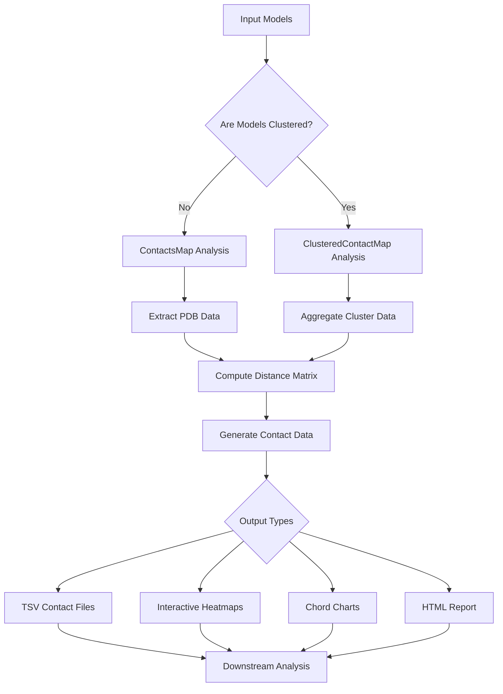
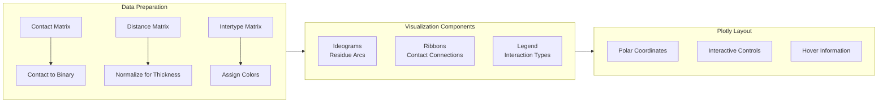

The contactmap module provides comprehensive visualization and analysis of intermolecular contacts in protein complexes. This module generates interactive heatmaps and chord charts that reveal residue-residue interaction patterns across both individual structures and clustered docking results. By quantifying contact probabilities and distances, you can identify stable interaction interfaces, analyze binding modes, and extract mechanistic insights from your docking experiments.

## Architecture Overview

The contactmap module operates on two distinct analysis modes depending on whether input structures are clustered. The architecture comprises two primary analysis classes: `ContactsMap` for single-structure analysis and `ClusteredContactMap` for ensemble-based analysis of clustered models. Both classes implement a common `SupportsRun` interface, enabling flexible execution through HADDOCK3's scheduling system.



The module integrates seamlessly with HADDOCK3's workflow engine, accepting `PDBFile` objects from previous steps and forwarding them unchanged to subsequent modules. This design pattern allows contact map analysis to be inserted at any point in the workflow without disrupting the model pipeline.

Sources: [src/haddock/modules/analysis/contactmap/__init__.py](src/haddock/modules/analysis/contactmap/__init__.py#L1-L14), [src/haddock/modules/analysis/contactmap/contmap.py](src/haddock/modules/analysis/contactmap/contmap.py#L1-L5), [src/haddock/modules/analysis/contactmap/contmap.py](src/haddock/modules/analysis/contactmap/contmap.py#L158-L294)

## Core Analysis Concepts

The contactmap module quantifies molecular interactions through two complementary metrics: Cα-Cα distances and shortest heavy-atom distances. Cα-Cα distances capture overall residue proximity and are particularly useful for identifying backbone-level interaction patterns, with a default threshold of 9.0 Å. The shortest heavy-atom distance metric provides atomic-level resolution by finding the minimum distance between any heavy atoms of two residues, using a more stringent default threshold of 4.5 Å.

For clustered analysis, the module aggregates contact data across all structures within a cluster. This aggregation enables computation of contact probabilities—the fraction of structures in a cluster where two residues satisfy the contact threshold. This probabilistic approach distinguishes consistent interface contacts from transient or artifact interactions, providing crucial insights into binding specificity.

> [!TIP]
> Contact probabilities in clustered analysis are normalized by cluster size, enabling direct comparison between clusters of different cardinalities. Use the `cluster_heatmap_datatype` parameter to switch between average distances and contact probabilities depending on your analytical needs.

The module also classifies residue-residue interactions by polarity type (polar-apolar, polar-polar, apolar-apolar, etc.), which is used in chord charts to color-code interaction ribbons according to chemical character. This classification follows standard biochemical categorization of amino acid properties.

Sources: [src/haddock/modules/analysis/contactmap/contmap.py](src/haddock/modules/analysis/contactmap/contmap.py#L38-L75), [src/haddock/modules/analysis/contactmap/defaults.yaml](src/haddock/modules/analysis/contactmap/defaults.yaml#L1-L21), [src/haddock/modules/analysis/contactmap/contmap.py](src/haddock/modules/analysis/contactmap/contmap.py#L292-L380)

## Configuration Parameters

The contactmap module offers extensive configurability through its parameter system. Understanding these parameters enables fine-tuning of analysis sensitivity and output presentation.

| Parameter | Type | Default | Range/Choices | Description |
|-----------|------|---------|--------------|-------------|
| `ca_ca_dist_threshold` | float | 9.0 | 4.0-1000.0 | Cα-Cα distance (Å) defining a contact |
| `shortest_dist_threshold` | float | 4.5 | 2.0-1000.0 | Minimum heavy-atom distance defining a contact |
| `color_ramp` | string | 'Greys' | Custom colorscales | Color scheme for heatmap visualization |
| `single_model_analysis` | boolean | false | - | Enable analysis for individual unclustered models |
| `generate_heatmap` | boolean | true | - | Generate interactive heatmap visualizations |
| `generate_chordchart` | boolean | true | - | Generate chord chart visualizations |
| `topX` | integer | 10 | 1-100 | Number of top unclustered models to analyze |
| `cluster_heatmap_datatype` | string | 'shortest-cont-probability' | See below | Data type for cluster heatmaps |
| `chordchart_datatype` | string | 'shortest-dist' | See below | Data type for chord charts |

The `cluster_heatmap_datatype` parameter supports four data representations:
- `ca-ca-dist`: Average Cα-Cα distances across the cluster
- `ca-ca-cont-probability`: Probability of Cα-Cα contact satisfaction
- `shortest-dist`: Average shortest heavy-atom distances
- `shortest-cont-probability`: Probability of heavy-atom contact satisfaction

For chord charts, which focus solely on intermolecular contacts, only distance-based options (`ca-ca-dist` and `shortest-dist`) are available as the visualization directly encodes distances in ribbon thickness.

Sources: [src/haddock/modules/analysis/contactmap/defaults.yaml](src/haddock/modules/analysis/contactmap/defaults.yaml#L1-L121), [src/haddock/modules/analysis/contactmap/__init__.py](src/haddock/modules/analysis/contactmap/__init__.py#L58-L124)

## Visualization Types

### Heatmap Visualization

Heatmaps provide a comprehensive matrix view of all residue-residue contacts, including both intra- and intermolecular interactions. The x- and y-axes represent individual residues ordered by chain and sequence position, while cell colors encode the chosen metric (distance or contact probability). This format enables rapid identification of interaction hotspots and comparative analysis across different clusters.

The module generates interactive Plotly heatmaps saved as HTML files, supporting zooming, hovering for detailed information, and color scale adjustments. The heatmaps utilize half-matrix representation (upper triangle only) to avoid redundancy, with diagonal elements representing each residue's self-contact.

> [!TIP]
> For large complexes, consider using a reversed colorscale (e.g., 'Greys_r') where darker colors represent shorter distances or higher contact probabilities. This matches intuitive expectations where stronger interactions are more visually prominent.

Heatmap generation leverages the `heatmap_plotly` function from `libplots.py`, which supports delineation traces for visual separation of chains and customizable hover templates for detailed interaction inspection.

Sources: [src/haddock/modules/analysis/contactmap/contmap.py](src/haddock/modules/analysis/contactmap/contmap.py#L1071-L1195), [src/haddock/libs/libplots.py](src/haddock/libs/libplots.py#L1280-L1373)

### Chord Chart Visualization

Chord charts offer an intuitive circular representation focusing exclusively on intermolecular contacts. Residues are arranged as arcs around a circle, grouped by chain, with connecting ribbons representing contacts. Ribbon thickness encodes contact strength (inverse of distance), while ribbon colors reflect the chemical polarity of the interacting residue pair.



The chord chart implementation employs sophisticated geometric calculations using Bézier curves to create smooth ribbon arcs connecting interacting residues. Each chain occupies a proportional segment of the circle, with gaps between chains for visual clarity. The `make_chordchart` function orchestrates this process, handling matrix transformations, ideogram arc generation, and ribbon construction.

Chord charts excel at revealing interface architecture and identifying key residue pairs that mediate intermolecular binding. The circular layout naturally highlights chain boundaries and enables rapid assessment of interface continuity.

Sources: [src/haddock/modules/analysis/contactmap/contmap.py](src/haddock/modules/analysis/contactmap/contmap.py#L1902-L2151), [src/haddock/modules/analysis/contactmap/contmap.py](src/haddock/modules/analysis/contactmap/contmap.py#L2253-L2378)

## Data Processing Pipeline

The contactmap module implements a systematic data processing pipeline that transforms raw PDB coordinates into structured contact information.

### Single Model Analysis

For individual structures, `ContactsMap` executes the following workflow:

1. **PDB Parsing**: Extract ATOM/HETATM records organized by chain and residue, maintaining chain order and residue sequence positions. The `extract_pdb_dt` function builds a hierarchical dictionary structure mapping chain → residue → atom data.

2. **Coordinate Extraction**: The `get_ordered_coords` function extracts atomic coordinates (default: Cα atoms only) and generates ordered residue keys in the format `chainid_resid`. This ordering ensures consistent matrix indexing.

3. **Distance Matrix Computation**: Using SciPy's `pdist` and `squareform` functions, compute an all-vs-all distance matrix between all extracted atoms. This N×N matrix serves as the foundation for all subsequent contact analysis.

4. **Contact Enumeration**: Iterate over all residue pairs (upper triangle only) to extract:
   - Cα-Cα distances
   - Shortest heavy-atom distances
   - Interaction polarity types
   - Chain identities for intermolecular filtering

5. **Output Generation**: Write contact data to TSV files and generate requested visualizations.

### Clustered Analysis

`ClusteredContactMap` extends single-model analysis through aggregation:

1. **Individual Processing**: For each model in the cluster, instantiate `ContactsMap` and extract contact data using the same pipeline as single-model analysis.

2. **Contact Aggregation**: The `aggregate_contacts` static method accumulates contact values across all cluster members. Each unique residue pair maintains lists of distances from all structures, enabling computation of averages and contact probabilities.

3. **Statistical Summarization**: Compute mean distances and contact probabilities by calculating the fraction of structures where each contact satisfies the defined threshold.

4. **Consolidated Output**: Generate aggregated TSV files and visualizations representing the cluster's consensus interaction pattern.

This aggregated approach robustly identifies persistent interface features while filtering out model-specific noise.

Sources: [src/haddock/modules/analysis/contactmap/contmap.py](src/haddock/modules/analysis/contactmap/contmap.py#L652-L792), [src/haddock/modules/analysis/contactmap/contmap.py](src/haddock/modules/analysis/contactmap/contmap.py#L172-L215), [src/haddock/modules/analysis/contactmap/contmap.py](src/haddock/modules/analysis/contactmap/contmap.py#L307-L380)

## Output Structure

The contactmap module generates a hierarchical output structure organized by analysis type and target (single model or cluster).

### File Organization

```
contactmap_output/
├── ContactMapReport.html           # Master navigation page
├── cluster1/                       # Cluster-based analyses
│   ├── cluster1_contacts.tsv      # Aggregated contact data
│   ├── cluster1_contacts.html     # Interactive heatmap
│   └── cluster1_chordchart.html   # Interactive chord chart
├── cluster2/
│   └── [same structure as cluster1]
└── Unclustered_*/                  # Single model analyses (if enabled)
    ├── Unclustered_model1_contacts.tsv
    ├── Unclustered_model1_contacts.html
    └── Unclustered_model1_chordchart.html
```

### TSV File Format

The generated TSV files contain tab-separated contact data with the following columns:

| Column | Description |
|--------|-------------|
| `res1` | First residue identifier (format: `chainid_resid_resname`) |
| `res2` | Second residue identifier |
| `ca-ca-dist` | Cα-Cα distance (Å) |
| `ca-ca-cont-probability` | Probability of Cα-Cα contact satisfaction |
| `shortest-dist` | Shortest heavy-atom distance (Å) |
| `shortest-cont-probability` | Probability of heavy-atom contact satisfaction |
| `interaction_type` | Polarity-based interaction classification |

The `ContactMapReport.html` file serves as a central navigation hub, providing organized links to all generated visualizations and data files, with entries grouped by cluster or individual model.

Sources: [src/haddock/modules/analysis/contactmap/contmap.py](src/haddock/modules/analysis/contactmap/contmap.py#L516-L600), [src/haddock/modules/analysis/contactmap/contmap.py](src/haddock/modules/analysis/contactmap/contmap.py#L975-L1070), [src/haddock/modules/analysis/contactmap/contmap.py](src/haddock/modules/analysis/contactmap/contmap.py#L216-L290)

## Integration with HADDOCK3 Workflows

The contactmap module is designed to integrate flexibly within HADDOCK3 workflows. It can be positioned after any module that generates `PDBFile` objects, including docking, refinement, and scoring steps. The module accepts both clustered and unclustered inputs, automatically detecting the input structure type and applying appropriate analysis strategies.

When models contain clustering information (via `cluster_id` and `cluster_rank` attributes), the module performs cluster-based analysis by default. Unclustered models are handled according to the `topX` parameter, which selects a subset of top-scoring models for individual analysis. This dual-mode approach ensures comprehensive contact analysis regardless of upstream processing.

The module does not modify input models; instead, it forwards them unchanged to the next workflow step. This pass-through design allows contact map analysis to serve as an inspection point without affecting downstream calculations.

Sources: [src/haddock/modules/analysis/contactmap/__init__.py](src/haddock/modules/analysis/contactmap/__init__.py#L58-L124), [src/haddock/modules/analysis/contactmap/contmap.py](src/haddock/modules/analysis/contactmap/contmap.py#L597-L627)

## Advanced Usage Patterns

### Custom Threshold Tuning

Adjust contact thresholds based on your system's characteristics. For small, rigid interfaces, tighter thresholds (e.g., `shortest_dist_threshold=3.5`) can reduce false positives. For flexible or transient interactions, looser thresholds (e.g., `shortest_dist_threshold=5.5`) capture weaker but potentially important contacts.

### Multi-Stage Analysis

Run contactmap at multiple workflow stages to track interaction evolution. Early stage (e.g., after rigid-body docking) reveals sampling diversity, while later stages (e.g., after refinement) show convergence to stable interfaces. Comparing these analyses identifies which contacts persist through refinement—indicating likely biological relevance.

### Offline Mode

For environments without internet access, use the `offline=True` parameter when calling `tsv_to_heatmap` or `tsv_to_chordchart`. This embeds Plotly JavaScript libraries directly in the HTML files, enabling full interactivity without external dependencies.

Sources: [src/haddock/modules/analysis/contactmap/defaults.yaml](src/haddock/modules/analysis/contactmap/defaults.yaml#L1-L121), [src/haddock/modules/analysis/contactmap/contmap.py](src/haddock/modules/analysis/contactmap/contmap.py#L1071-L1195)

## Troubleshooting and Common Issues

**Missing Cα Atoms**: The module defaults to using Cα atoms for residue representation. If structures contain non-standard residues or missing Cα atoms, consider lowering `ca_ca_dist_threshold` or relying on `shortest-dist` metrics which use all heavy atoms.

**Large Complex Memory Usage**: For very large complexes (>1000 residues), the all-vs-all distance matrix can consume significant memory. Consider analyzing chains individually or using cluster-based analysis to reduce computational load.

**Visual Clutter in Chord Charts**: Dense interfaces can produce visually crowded chord charts. Use the `filter_intermolecular_contacts` parameter to focus on the strongest contacts, or adjust `shortest_dist_threshold` to include only high-confidence interactions.

**HTML Display Issues**: Ensure your browser supports HTML5 and JavaScript for interactive Plotly visualizations. For static environments, export plots to static image formats using Plotly's `write_image` functionality.

Sources: [src/haddock/modules/analysis/contactmap/contmap.py](src/haddock/modules/analysis/contactmap/contmap.py#L840-L892), [src/haddock/modules/analysis/contactmap/contmap.py](src/haddock/modules/analysis/contactmap/contmap.py#L2253-L2378)

## Related Documentation

For deeper understanding of complementary analysis methods, explore these related pages:

- [Clustering Algorithms (FCC and RMSD)](22-clustering-algorithms-fcc-and-rmsd) - Understanding how models are grouped before contact analysis
- [Alanine Scanning for Interface Analysis](24-alanine-scanning-for-interface-analysis) - Systematic evaluation of interface residue importance
- [Result Analysis and Interpretation](25-result-analysis-and-interpretation) - Broader context for interpreting docking results
- [HADDOCK Scoring Function Components](19-haddock-scoring-function-components) - Energy terms that correlate with interface stability

The contact map visualization module serves as a bridge between geometric docking results and biological interpretation, transforming coordinate data into actionable insights about molecular recognition mechanisms.