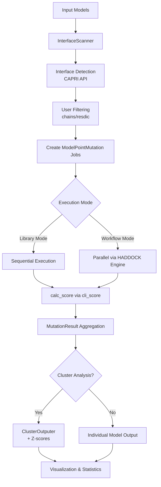

The alanine scanning module provides a systematic approach to identify and analyze interface residues critical for molecular interactions in protein-protein complexes. By systematically mutating interface residues to alanine (or other specified residues) and recalculating energy scores, this module quantifies the energetic contribution of each residue to binding affinity. The implementation operates as a post-docking analysis tool that can process multiple models simultaneously and generate comprehensive reports with cluster-based statistics and visualization capabilities.

## Core Architecture and Design Principles

The module is built around a modular architecture with distinct responsibilities separated across multiple classes. The primary workflow involves interface detection, mutation generation, score recalculation, and result aggregation. This design enables both sequential processing in library mode and distributed execution through the HADDOCK workflow engine.

**Key Design Pattern**: The module employs a two-mode execution strategy. In library mode (`library_mode=True`), mutations execute sequentially within a single model analysis context. In workflow mode, mutation jobs are generated and distributed across available computational resources by the HADDOCK Engine [scan.py#L637-L795](src/haddock/modules/analysis/alascan/scan.py#L637-L795).

The scoring delta calculation follows a consistent convention:

```python
delta_score = score_wildtype - score_mutant
```

Where a positive delta_score indicates a destabilizing mutation (binding weakened), while a negative delta_score indicates a stabilizing mutation (binding strengthened) [__init__.py#L9-L14](src/haddock/modules/analysis/alascan/__init__.py#L9-L14).

## Module Components and Data Flow

The scanning process orchestrates multiple components through a well-defined pipeline:



### Interface Detection and Mutation Generation

The `InterfaceScanner` class serves as the primary orchestrator for identifying target residues. It begins by calculating native scores for the reference model, then identifies interface residues using the CAPRI interface detection algorithm with a configurable distance cutoff [scan.py#L637-L795](src/haddock/modules/analysis/alascan/scan.py#L637-L795).

Interface detection relies on spatial proximity:

```python
cutoff = self.params.get("int_cutoff", 5.0)
interface = CAPRI.identify_interface(self.model_path, cutoff=cutoff)
```

**Interface Filtering Strategy**: The module implements a hierarchical filtering approach. Users can specify target residues via `resdic_*` parameters (expandable by chain identifier) or limit analysis to specific chains using the `chains` parameter [scan.py#L685-L716](src/haddock/modules/analysis/alascan/scan.py#L685-L716). When both are omitted, all interface residues across all chains are processed.

The filtering logic handles edge cases:
- User-specified residues are validated against the detected interface
- Non-interface residues specified by users are automatically excluded
- Mutations that would convert a residue to its own type (e.g., ALA→ALA) are skipped [scan.py#L717-L729](src/haddock/modules/analysis/alascan/scan.py#L717-L729)

### Mutation Execution and Score Calculation

The `ModelPointMutation` class encapsulates the execution of individual point mutations. Each mutation follows a precise workflow:

1. **Mutation Generation**: The `mutate()` function performs atomic coordinate replacement for the target residue, mutating only backbone atoms (N, CA, C, O) and the Cβ atom to match the target residue geometry [scan.py#L87-L136](src/haddock/modules/analysis/alascan/scan.py#L87-L136).

2. **Score Recalculation**: The mutated structure is scored using the `calc_score()` function, which invokes the `cli_score` module to compute HADDOCK energy components through CNS energy minimization [scan.py#L165-L207](src/haddock/modules/analysis/alascan/scan.py#L165-L207).

3. **Delta Computation**: The energetic impact is calculated by subtracting mutant scores from native wild-type scores for all components: HADDOCK-score, van der Waals (vdw), electrostatic (elec), desolvation (desolv), and buried surface area (bsa) [scan.py#L840-L868](src/haddock/modules/analysis/alascan/scan.py#L840-L868).

**Score Components**:
- **HADDOCK-score**: Combined weighted score used for model ranking
- **vdw**: Van der Waals interaction energy
- **elec**: Electrostatic interaction energy  
- **desolv**: Desolvation energy penalty
- **bsa**: Buried surface area upon complex formation

> [!TIP]
> The mutation process is computationally intensive as each mutation requires a complete energy minimization. For large interfaces with many residues, the runtime scales linearly with the number of mutations. Consider using the `resdic_*` parameters to focus on residues of interest rather than scanning entire interfaces.

## Configuration Parameters

The module provides extensive configuration options through the defaults.yaml configuration file, allowing users to customize scanning behavior and output generation.

| Parameter | Type | Default | Description |
|-----------|------|---------|-------------|
| `int_cutoff` | float | 5.0Å | Distance cutoff for interface detection between chains |
| `scan_residue` | string | "ALA" | Target residue type for mutations (20 standard + modified) |
| `chains` | list | [] | Specific chains to analyze; empty analyzes all chains |
| `resdic_*` | list | [] | Chain-specific residue lists for targeted scanning |
| `output_mutants` | boolean | false | Output energy-minimized mutant PDB files (single model only) |
| `output_bfactor` | boolean | false | Output original models with delta scores in B-factor column |
| `plot` | boolean | false | Generate visualization plots of scanning results |

**Expandable Parameters**: The `resdic_*` parameters are expandable, allowing specification per chain (e.g., `resdic_A=[1,2,3]`, `resdic_B=[10,15,20]`) [defaults.yaml#L3-L17](src/haddock/modules/analysis/alascan/defaults.yaml#L3-L17).

## Output and Analysis

### MutationResult Data Structure

Each mutation produces a `MutationResult` dataclass containing comprehensive information:

```python
@dataclass
class MutationResult:
    model_id: str                    # Model identifier
    chain: str                       # Chain identifier
    resid: int                       # Residue number
    ori_resname: str                 # Original residue name
    target_resname: str              # Target residue name
    mutant_scores: Tuple[...]        # Mutant energy components
    delta_scores: Tuple[...]         # Energy differences (wt - mut)
    success: bool                    # Execution status
    error_msg: Optional[str]         # Error message if failed
```

### Cluster-Based Analysis

When cluster information is available from previous workflow stages, the module performs cluster-aggregated analysis. The `group_scan_by_cluster()` function aggregates mutation results across models within each cluster [scan.py#L564-L635](src/haddock/modules/analysis/alascan/scan.py#L564-L635).

**Statistical Enrichment**: For each amino acid position, Z-scores are calculated to identify statistically significant energetic contributions:

```python
Z = (delta_score - mean) / std
```

Where mean and standard deviation are computed over all amino acid delta scores within the cluster [scan.py#L209-L232](src/haddock/modules/analysis/alascan/scan.py#L209-L232). This normalization enables comparison across different positions and clusters.

### Visualization Options

When `plot=True`, the `ClusterOutputer` class generates bar plots showing delta scores for each scanned position. Plots include error bars representing standard deviation across models in each cluster, enabling visual identification of critical interface residues [scan.py#L343-L368](src/haddock/modules/analysis/alascan/scan.py#L343-L368).

### B-Factor Visualization

The `output_bfactor` option enables structural visualization of alanine scanning results. The `AddDeltaBFactor` class normalizes delta scores to a 0-100 range and writes them to the B-factor column of the original (unmutated) PDB files [scan.py#L370-L488](src/haddock/modules/analysis/alascan/scan.py#L370-L488).

**Normalization Formula**:

```python
normalized_score = 100 * (delta_score - min_score) / (max_score - min_score)
```

This allows direct visualization in molecular graphics software (e.g., PyMOL, ChimeraX) where residues with larger B-factors indicate stronger destabilizing effects upon mutation.

## Integration with HADDOCK Workflows

The module is designed as a post-docking analysis step, typically placed after scoring and clustering modules. It operates on `PDBFile` objects from the previous workflow stage and generates analysis outputs in dedicated subdirectories [__init__.py#L100-L156](src/haddock/modules/analysis/alascan/__init__.py#L100-L156).

**Workflow Position**: The module should be placed after modules that generate cluster information (e.g., `clustfcc` or `clustrmsd`) to enable cluster-based analysis. See [Clustering Algorithms (FCC and RMSD)](22-clustering-algorithms-fcc-and-rmsd) for details on cluster generation.

## Performance Considerations and Best Practices

> [!TIP]
> When analyzing multiple models, consider that each mutation requires energy minimization. For large interfaces (>50 residues), the `resdic_*` parameters become essential to focus analysis on residues of interest. The `output_mutants` option is restricted to single-model inputs due to storage considerations.

The module handles error conditions gracefully. Failed mutations are logged with error messages but do not halt execution, allowing analysis to complete for successful mutations [scan.py#L869-L880](src/haddock/modules/analysis/alascan/scan.py#L869-L880).

## Next Steps

For comprehensive analysis of docking results, combine alanine scanning with other analysis modules:

- [Contact Map Visualization](23-contact-map-visualization) - Visualize interface residue contacts
- [Result Analysis and Interpretation](25-result-analysis-and-interpretation) - Understand overall docking quality
- [Clustering Algorithms (FCC and RMSD)](22-clustering-algorithms-fcc-and-rmsd) - Generate cluster information for alanine scanning aggregation

For details on the scoring components used in delta calculations, see [HADDOCK Scoring Function Components](19-haddock-scoring-function-components).