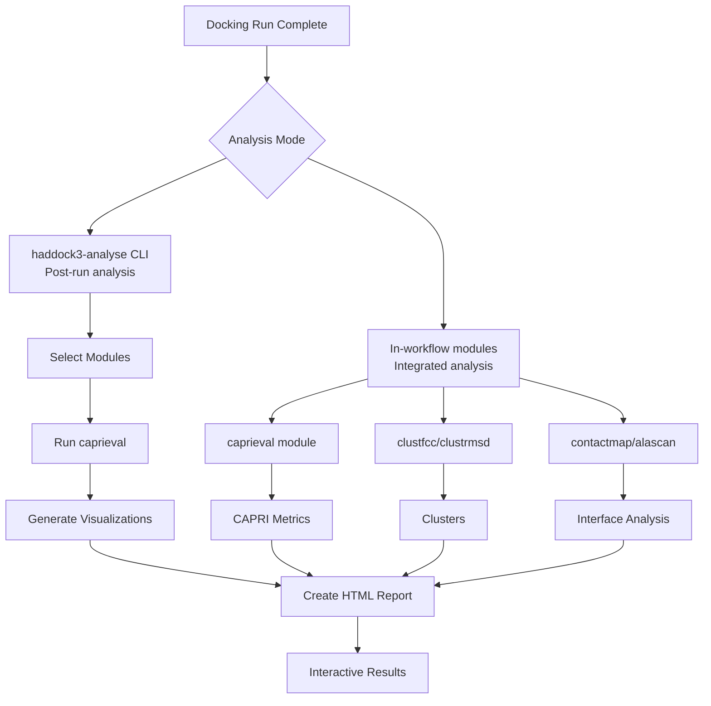
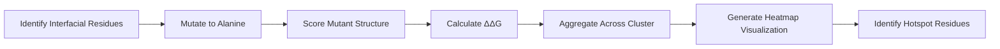
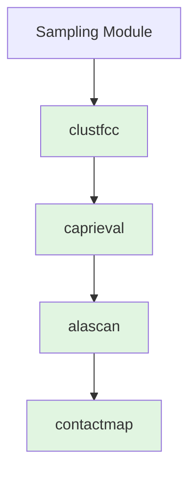

Understanding and interpreting HADDOCK3 docking results is crucial for extracting meaningful biological insights from molecular modeling experiments. HADDOCK3 provides a comprehensive suite of analysis tools designed to evaluate model quality, cluster structural solutions, and generate publication-ready visualizations. This documentation guides you through the complete analysis workflow, from automated CAPRI metrics evaluation to detailed interface analysis.

The analysis framework operates at two levels: **post-run analysis** through the dedicated `haddock3-analyse` command-line tool and **in-workflow analysis** through modular analysis steps that can be embedded directly in your docking workflows. This dual approach enables both rapid assessment of completed runs and sophisticated integrated analysis pipelines.

## Analysis Architecture Overview

HADDOCK3's analysis system follows a modular architecture where each analysis capability is implemented as an independent module. These modules process structural outputs from sampling and refinement stages, generating quantitative metrics, clusters, and visualizations that help identify the most biologically relevant docking solutions.

The analysis workflow typically involves three sequential stages: metric calculation, structural clustering, and visualization. Each stage can be customized through configuration parameters, and results are aggregated in comprehensive HTML reports containing interactive plots and sortable tables.



Sources: [cli_analyse.py](/src/haddock/clis/cli_analyse.py#L1-L22), [analysis modules](/src/haddock/modules/analysis/)

## haddock3-analyse Command-Line Tool

The `haddock3-analyse` tool provides a streamlined interface for analyzing completed HADDOCK3 runs without modifying the original workflow. This tool automatically extracts relevant output files, computes CAPRI metrics, generates visualizations, and produces comprehensive HTML reports for specified workflow steps.

### Basic Usage

The tool requires specifying the run directory and the workflow steps to analyze. For example, to analyze rigid-body docking results from step 1 and flexible refinement from step 3:

```bash
haddock3-analyse -r run1 -m 1 3
```

Where `-m 1 3` indicates analysis should be performed on the `1_rigidbody` and `3_flexref` steps. The tool creates an `analysis/` directory within the run folder containing all generated reports and visualizations.

Sources: [cli_analyse.py](/src/haddock/clis/cli_analyse.py#L1-L22)

### Key Parameters

| Parameter | Description | Default |
|-----------|-------------|---------|
| `-r, --run-dir` | Path to the HADDOCK3 run directory | Required |
| `-m, --modules` | List of step numbers to analyze | Required |
| `-t, --top_clusters` | Number of top clusters to display | 10 |
| `--format` | Output image format (png, jpeg, svg, pdf, etc.) | None |
| `--scale` | Scaling factor for generated images | 1.0 |
| `--offline` | Generate self-contained plots without external JS dependencies | False |
| `--self-contained` | Copy model files locally for external visualization | False |
| `--mode` | Execution mode (local, batch, mpi) | local |
| `-p, --other-params` | Additional caprieval parameters | {} |

The `--offline` parameter is particularly useful when reports need to be viewed on systems without internet access, as it embeds all necessary Plotly JavaScript libraries directly in the HTML files. The `--self-contained` option creates portable analysis directories that can be shared with collaborators who don't have access to the original run directory.

Sources: [cli_analyse.py](/src/haddock/clis/cli_analyse.py#L77-L177)

### Analysis Output Structure

When `haddock3-analyse` executes successfully, it generates a structured output hierarchy:

```
run1/
└── analysis/
    ├── README.md                           # Instructions for viewing results
    ├── 1_rigidbody_analysis/               # Analysis for step 1
    │   ├── report.html                     # Interactive HTML report
    │   ├── capri_ss.tsv                    # Model-level CAPRI scores
    │   ├── capri_clt.tsv                   # Cluster-level statistics
    │   ├── box_plots/                      # Box plot images
    │   ├── scatter_plots/                  # Scatter plot images
    │   └── models/                         # Model files (if --self-contained)
    └── 3_flexref_analysis/                 # Analysis for step 3
        └── (same structure as above)
```

The HTML reports provide interactive visualization of results, including sortable tables, zoomable plots, and direct links to model structures. To view structures in the browser, navigate to the analysis directory and run a simple HTTP server:

```bash
cd run1/analysis/1_rigidbody_analysis
python -m http.server --directory .
```

Then open `http://0.0.0.0:8000/report.html` in your web browser to explore the interactive report.

Sources: [cli_analyse.py](/src/haddock/clis/cli_analyse.py#L690-L862), [cli_analyse.py](/src/haddock/clis/cli_analyse.py#L510-L642)

## CAPRI Metrics Evaluation

The CAPRI (Critical Assessment of Predicted Interactions) metrics provide standardized quantitative assessments of docking model quality. HADDOCK3 implements the full CAPRI evaluation suite through the `caprieval` module, calculating key metrics when a reference structure is available.

### Core CAPRI Metrics

| Metric | Description | Physical Meaning |
|--------|-------------|------------------|
| **i-RMSD** | Interface RMSD | Accuracy of interface orientation after ligand superposition |
| **l-RMSD** | Ligand RMSD | Accuracy of ligand position after interface superposition |
| **il-RMSD** | Interface-Ligand RMSD | Combined measure of interface and ligand accuracy |
| **Fnat** | Fraction of native contacts | Proportion of correct intermolecular contacts recovered |
| **DOCKQ** | Docking Quality Score | Composite score combining RMSD and Fnat metrics |

These metrics are calculated using algorithms that align models to the reference structure and compute geometric and contact-based quality measures. The CAPRI quality classification system categorizes models based on these metrics into four tiers: Incorrect, Acceptable, Medium, and High quality.

Sources: [capri.py](/src/haddock/modules/analysis/caprieval/capri.py#L1-L50), [libplots.py](/src/haddock/libs/libplots.py#L31-L91)

### Energy Component Analysis

Beyond geometric metrics, CAPRI evaluation includes detailed energy component analysis that reveals the physical driving forces behind docking solutions. The scoring function components include:

- **Evdw**: Van der Waals interaction energy
- **Eelec**: Electrostatic interaction energy
- **Edesolv**: Desolvation energy
- **Eair**: Restraint energy (from ambiguous interaction restraints)
- **BSA**: Buried surface area

These energy terms are weighted according to the parameters used during the docking simulation. The caprieval module extracts these weights from the original CNS step configuration to ensure consistent scoring calculations.

Sources: [capri.py](/src/haddock/modules/analysis/caprieval/capri.py#L48-L65), [libplots.py](/src/haddock/libs/libplots.py#L77-L91)

### CAPRI Quality Categories

Based on the calculated metrics, models are automatically classified according to CAPRI standards:

| Category | i-RMSD | l-RMSD | Fnat | Typical DOCKQ |
|----------|--------|--------|------|---------------|
| **Incorrect** | > 4.0 | > 10.0 | < 0.10 | < 0.23 |
| **Acceptable** | 2.0-4.0 | 5.0-10.0 | 0.10-0.30 | 0.23-0.49 |
| **Medium** | 1.0-2.0 | 2.0-5.0 | 0.30-0.50 | 0.49-0.72 |
| **High** | < 1.0 | < 2.0 | > 0.50 | > 0.72 |

These classifications help researchers quickly identify the most promising models for downstream experimental validation or further computational refinement.

Sources: [libplots.py](/src/haddock/libs/libplots.py#L752-L789)

## Structural Clustering Analysis

Clustering is essential for identifying recurrent docking solutions that represent probable binding modes. HADDOCK3 provides two complementary clustering algorithms: **FCC clustering** (Fraction of Common Contacts) and **RMSD-based clustering**, each optimized for different types of structural data.

### FCC Clustering

The Fraction of Common Contacts (FCC) algorithm groups models based on their similarity in intermolecular contact patterns rather than geometric coordinates. This approach is particularly valuable for identifying functionally similar binding modes that may exhibit conformational flexibility.

The FCC calculation determines the fraction of common residue-residue contacts between two models, where a contact is defined based on a distance cutoff between specific atoms. Models with FCC scores above a threshold are grouped into the same cluster. This method robustly handles cases where overall orientation varies but the core interface remains conserved.

Key FCC clustering parameters:

| Parameter | Description | Default |
|-----------|-------------|---------|
| `min_population` | Minimum number of models required to form a cluster | 4 |
| `fcc_cutoff` | Minimum FCC score for cluster membership | 0.6 |
| `shortest_dist_threshold` | Distance cutoff for contact definition (Å) | 4.5 |
| `contact_distance` | Contact distance between interface atoms (Å) | 5.0 |

Sources: [clustfcc.py](/src/haddock/modules/analysis/clustfcc/clustfcc.py#L17-L55), [contmap-test.cfg](/examples/analysis/contmap-test.cfg)

### RMSD-Based Clustering

RMSD-based clustering groups models by their structural similarity measured through root-mean-square deviation. This traditional approach uses hierarchical clustering with a user-defined distance cutoff, producing clusters where all models are within the specified RMSD threshold of the cluster centroid.

The `clustrmsd` module implements a hierarchical clustering algorithm with the following key parameters:

| Parameter | Description | Default |
|-----------|-------------|---------|
| `n_clusters` | Target number of clusters to generate | 10 |
| `clust_cutoff` | RMSD threshold for cluster assignment (Å) | 2.5 |
| `min_population` | Minimum models per valid cluster | 4 |

RMSD clustering is particularly effective for identifying conformationally homogeneous solutions and is the preferred method when high-resolution structural accuracy is paramount.

Sources: [clustrmsd.py](/src/haddock/modules/analysis/clustrmsd/), [alascan-test.cfg](/examples/analysis/alascan-test.cfg#L27)

### Cluster Ranking and Selection

Both clustering algorithms produce ranked clusters based on the average HADDOCK score of member models. This ranking strategy prioritizes energetically favorable solutions while ensuring diversity through distinct clustering approaches. The top-ranked clusters typically represent the most probable binding modes, though researchers should also consider clusters with favorable CAPRI metrics even if they rank lower by HADDOCK score.

Cluster statistics include:
- Average score and standard deviation
- Population (number of models)
- Best model within the cluster
- Representative structure (cluster center)

These statistics are displayed in the HTML reports, enabling informed selection of models for downstream analysis or experimental validation.

Sources: [libplots.py](/src/haddock/libs/libplots.py#L752-L789), [libplots.py](/src/haddock/libs/libplots.py#L825-L876)

## Contact Map Visualization

Contact maps provide intuitive graphical representations of intermolecular interactions, revealing which residues from each molecule participate in the binding interface. The `contactmap` module generates both heatmaps and chord diagrams that can be analyzed at the individual model, cluster, or whole-ensemble level.

### Heatmap Visualization

Heatmaps display contact frequencies using a color-coded matrix where each cell represents the interaction between a specific pair of residues from the two molecules. The color intensity corresponds to either:

- **Contact probability**: The fraction of models in a cluster where the contact is present
- **Shortest distance**: The minimum interatomic distance between the residues across all models

Multiple color ramps are supported (Greys, Viridis, Plasma, etc.), allowing customization for different visualization preferences and publication requirements.

```python
[contactmap]
# Distance thresholds for contact definition
ca_ca_dist_threshold = 9.0          # Cα-Cα distance threshold (Å)
shortest_dist_threshold = 4.5      # Any atom-any atom threshold (Å)

# Heatmap configuration
generate_heatmap = true
cluster_heatmap_datatype = "shortest-cont-probability"
color_ramp = "Greys"

# Chord diagram configuration
generate_chordchart = true
chordchart_datatype = "shortest-dist"

# Analysis scope
single_model_analysis = false        # Analyze individual models
topX = 10                            # Top unclustered models to analyze
```

Sources: [contmap.py](/src/haddock/modules/analysis/contactmap/contmap.py#L1-L100), [contmap-test.cfg](/examples/analysis/contmap-test.cfg#L35-L60)

### Chord Diagram Visualization

Chord diagrams offer an alternative visualization style that emphasizes the overall topology of intermolecular contacts. In these diagrams, residues from each molecule are arranged along a circle, and ribbons connect contacting residues. The ribbon thickness indicates contact strength or frequency, and colors represent residue properties (polar, apolar, positive, negative).

This visualization is particularly effective for identifying:
- Hotspot residues that contact many partners
- Asymmetric interaction patterns
- Clusters of contacting residues forming interface patches

Residue polarity classifications used in coloring:
- **Polar**: CYS, HIS, ASN, GLN, SER, THR, TYR, TRP
- **Apolar**: ALA, PHE, GLY, ILE, VAL, MET, PRO, LEU
- **Positive**: LYS, ARG
- **Negative**: GLU, ASP

Sources: [contmap.py](/src/haddock/modules/analysis/contactmap/contmap.py#L49-L89)

### Interface Polarity Analysis

The contact map system automatically classifies residue interactions based on chemical properties, generating color-coded visualizations that highlight the physicochemical nature of the binding interface. This analysis helps identify whether interfaces are driven by:
- **Polar-polar interactions**: Hydrogen bonding networks
- **Apolar-apolar interactions**: Hydrophobic cores
- **Charged interactions**: Salt bridges and electrostatic complementarity

Understanding the physicochemical composition of interfaces provides insights into binding specificity, stability, and potential mutational effects.

Sources: [contmap.py](/src/haddock/modules/analysis/contactmap/contmap.py#L90-L130)

## Alanine Scanning for Interface Analysis

Alanine scanning is a computational mutagenesis technique that systematically mutates interfacial residues to alanine and evaluates the resulting change in binding energy. The `alascan` module automates this process, identifying **hotspot residues** that contribute significantly to binding affinity.

### Scan Configuration

The alanine scan can be configured to target specific residues, chains, or scan the entire interface:

```python
[alascan]
scan_residue = "ALA"              # Target residue for mutation
output_bfactor = true             # Store results as B-factors in PDB
plot = true                       # Generate visualization plots
int_cutoff = 3.0                  # Interface distance cutoff (Å)
```

When `output_bfactor = true`, the ΔΔG values are written as B-factors in the output PDB files, enabling immediate visualization in molecular graphics software like PyMOL or Chimera.

Sources: [scan.py](/src/haddock/modules/analysis/alascan/scan.py#L1-L100), [alascan-test.cfg](/examples/analysis/alascan-test.cfg#L29-L35)

### Mutation Analysis Workflow

For each interfacial residue, the alascan module:

1. **Identifies target residues** based on the interface cutoff distance
2. **Creates mutant structures** by replacing the original residue with alanine
3. **Scores the mutant** using the HADDOCK scoring function
4. **Calculates ΔΔG** as the difference between mutant and wild-type scores
5. **Aggregates results** across models in each cluster

The mutation process preserves backbone geometry while mutating side chain atoms to alanine, ensuring that observed energy changes reflect the contribution of the original side chain rather than structural rearrangements.



Sources: [scan.py](/src/haddock/modules/analysis/alascan/scan.py#L100-L150), [MutationResult class](/src/haddock/modules/analysis/alascan/scan.py#L68-L78)

### Hotspot Identification

Hotspot residues are defined as those that contribute disproportionately to binding energy, typically with ΔΔG values greater than 1.0-2.0 kcal/mol. The alascan output includes:
- Per-residue ΔΔG values for all analyzed residues
- Cluster-averaged ΔΔG values
- Ranking of residues by energetic contribution
- Visual heatmaps showing hotspots on the 3D structure

These insights guide experimental mutagenesis studies and help identify key residues for therapeutic targeting in protein-protein interfaces.

Sources: [libplots.py](/src/haddock/libs/libplots.py#L1412-L1523), [alascan-test.cfg](/examples/analysis/alascan-test.cfg)

## Visualization and Reporting

HADDOCK3 generates publication-ready visualizations through the `libplots` library, which leverages Plotly for interactive HTML-based plots and matplotlib for static image generation. The reporting system aggregates all analysis results into comprehensive HTML documents that can be shared with collaborators or incorporated into presentations.

### Box Plots

Box plots display the distribution of scores and metrics across clusters, providing a visual comparison of cluster quality and heterogeneity. Each box represents the interquartile range (25th-75th percentile), with the median marked by a horizontal line. Whiskers extend to 1.5 times the interquartile range, and individual points beyond the whiskers are shown as outliers.

Box plots are generated for:
- HADDOCK scores and all energy components
- CAPRI metrics (i-RMSD, l-RMSD, Fnat, DOCKQ)
- Custom metrics defined by the user

These plots help identify clusters with consistent, favorable scoring characteristics versus those with high variance that may represent alternative binding modes.

Sources: [libplots.py](/src/haddock/libs/libplots.py#L244-L368), [libplots.py](/src/haddock/libs/libplots.py#L326-L361)

### Scatter Plots

Scatter plots reveal correlations between different metrics, helping understand the relationship between energetic scores, geometric accuracy, and other quality measures. The system generates a 5×5 matrix of scatter plots comparing pairs of metrics:

**Metric pairs analyzed:**
- i-RMSD vs. Score, Desolvation, Vdw, Elec, Air
- DOCKQ vs. Score, Desolvation, Vdw, Elec, Air
- l-RMSD vs. Score, Desolvation, Vdw, Elec, Air
- il-RMSD vs. Score, Desolvation, Vdw, Elec, Air
- Fnat vs. Score, Desolvation, Vdw, Elec, Air

Each scatter plot uses different colors for different clusters, enabling visual assessment of how clusters separate in different metric spaces. This multi-dimensional perspective is invaluable for understanding the trade-offs between different quality criteria.

Sources: [libplots.py](/src/haddock/libs/libplots.py#L31-L61), [libplots.py](/src/haddock/libs/libplots.py#L401-L600)

### Interactive HTML Reports

The centerpiece of HADDOCK3's analysis system is the interactive HTML report generated by the `report_generator` function. These reports combine:

- **Sortable tables** displaying model and cluster statistics
- **Interactive plots** with zoom, pan, and hover functionality
- **Embedded structure viewers** for quick model inspection
- **Download links** for model files and analysis data
- **Navigation controls** for easy movement between sections

Reports are self-contained when generated with the `--offline` flag, embedding all necessary JavaScript libraries and data within a single HTML file. This enables easy sharing and viewing on systems without internet access.

Sources: [libplots.py](/src/haddock/libs/libplots.py#L1038-L1231), [libplots.py](/src/haddock/libs/libplots.py#L1232-L1278)

## Practical Analysis Examples

### Example 1: Protein-Protein Docking Analysis

For a typical protein-protein docking workflow, analyze the rigid-body and flexible refinement stages:

```bash
# Analyze the complete workflow
haddock3-analyse -r docking-protein-protein/run1 -m 1 2 3 -t 5 --format png
```

This generates analysis for rigid-body (step 1), semflex (step 2), and flexible refinement (step 3) stages, showing the top 5 clusters with PNG image formats. The resulting reports help identify:
- Which refinement stage produced the best models
- Whether clustering improved after refinement
- Which clusters combine good scores with favorable CAPRI metrics

Sources: [examples/docking-protein-protein](/examples/docking-protein-protein/), [topoaa-clustfcc-test.cfg](/examples/analysis/topoaa-clustfcc-test.cfg)

### Example 2: Contact Map Analysis Workflow

Embed contact map analysis directly in a workflow for detailed interface characterization:

```python
[topoaa]
autohis = true

[rigidbody]
sampling = 20
ambig_fname = "restraints.tbl"

[clustfcc]
min_population = 2

[contactmap]
ca_ca_dist_threshold = 9.0
shortest_dist_threshold = 4.5
generate_heatmap = true
generate_chordchart = true
cluster_heatmap_datatype = "shortest-cont-probability"
```

This workflow performs clustering and automatically generates contact maps for each identified cluster, providing immediate insight into interaction patterns without requiring post-run analysis commands.

Sources: [contmap-test.cfg](/examples/analysis/contmap-test.cfg)

### Example 3: Alanine Scanning for Hotspot Identification

Perform alanine scanning on refined clusters to identify binding hotspots:

```python
[topoaa]
autohis = true

[mdref]
sampling_factor = 10

[caprieval]
reference_fname = "reference.pdb"

[clustrmsd]
n_clusters = 2

[alascan]
scan_residue = "ALA"
output_bfactor = true
plot = true
int_cutoff = 3.0
```

After this workflow completes, examine the alascan output in the final directory. The ΔΔG values written as B-factors enable immediate visualization of hotspot residues in PyMOL by coloring the structure by B-factor.

Sources: [alascan-test.cfg](/examples/analysis/alascan-test.cfg)

## Advanced Analysis Topics

### Custom Analysis Workflows

The modular architecture allows custom analysis workflows by combining different analysis modules. For example, integrate clustering with both CAPRI evaluation and alanine scanning:



This workflow provides a comprehensive characterization: identifies recurrent binding modes, evaluates their accuracy, maps energetic contributions, and visualizes interfacial contacts.

### Batch Analysis Mode

For analyzing multiple runs or extensive parameter sweeps, use batch mode to automate processing:

```bash
# Analyze multiple runs with consistent parameters
for run_dir in run_*/; do
    haddock3-analyse -r "$run_dir" -m 1 3 --mode batch --offline
done
```

Batch mode optimizes resource utilization for large-scale analysis tasks, while the `--offline` flag ensures reports are portable and viewable without network connectivity.

Sources: [cli_analyse.py](/src/haddock/clis/cli_analyse.py#L139-L146)

### Integrating with External Tools

Analysis outputs are provided in standard formats (PDB, TSV, HTML) that can be easily integrated with external tools:

- **PyMOL/Chimera**: Load B-factor annotated structures from alanine scanning
- **R/Python**: Import TSV files for custom statistical analysis
- **Jupyter notebooks**: Create custom visualizations using the exported data
- **Web servers**: Deploy HTML reports for collaborative review

> [!TIP]
> The `--self-contained` option copies all model files into the analysis directory, creating fully portable results that can be shared with collaborators who don't have access to the original computational infrastructure. This is particularly valuable for multi-institutional collaborations or when preparing supplementary materials for publications.

Sources: [cli_analyse.py](/src/haddock/clis/cli_analyse.py#L156-L162)

## Troubleshooting Analysis Issues

### Empty Analysis Results

If analysis produces empty results or missing files:
1. Verify that the specified modules produced valid output
2. Check that `capri_ss.tsv` and `capri_clt.tsv` files exist in the module directories
3. Ensure the reference structure for CAPRI evaluation is correctly specified
4. Review log files for error messages during analysis execution

### Visualization Rendering Problems

For interactive plots that don't render correctly:
1. Try generating with `--offline` flag to embed JavaScript libraries
2. Check browser compatibility (modern Chrome, Firefox, Safari recommended)
3. Verify sufficient memory for large datasets with many models
4. Consider reducing the number of clusters or models analyzed with `-t` parameter

### Performance Optimization

For large-scale analysis:
1. Use `--mode mpi` with appropriate `--ncores` for parallel execution
2. Limit analysis to top clusters rather than all clusters
3. Disable individual model analysis in contactmap: `single_model_analysis = false`
4. Use lighter-weight visualization formats (SVG instead of PNG) for large datasets

Sources: [cli_analyse.py](/src/haddock/clis/cli_analyse.py#L510-L642)

## Next Steps

After completing your analysis workflow, you may want to explore:

- **[Parameter Reference and Tuning](26-parameter-reference-and-tuning)**: Learn about advanced configuration options for analysis modules
- **[Custom Workflow Design](27-custom-workflow-design)**: Design sophisticated analysis pipelines tailored to your research questions
- **[Clustering Algorithms (FCC and RMSD)](22-clustering-algorithms-fcc-and-rmsd)**: Deep dive into clustering methodology and parameter selection
- **[Contact Map Visualization](23-contact-map-visualization)**: Detailed guide to interpreting contact maps and chord diagrams

The analysis capabilities described here form the foundation for extracting biological insights from HADDOCK3 simulations. By combining quantitative metrics with intuitive visualizations, researchers can make informed decisions about which models merit experimental validation and gain deeper understanding of molecular interaction mechanisms.