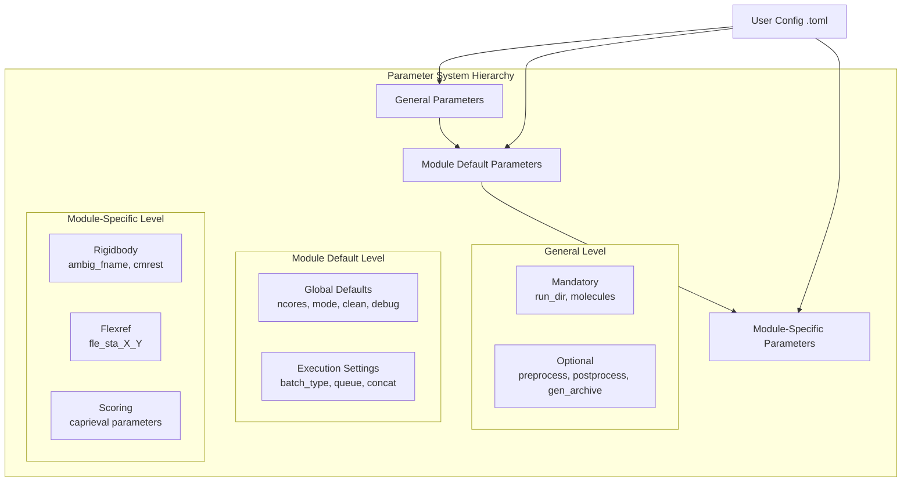
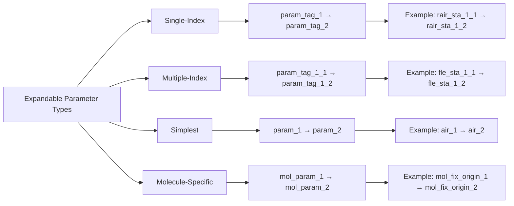
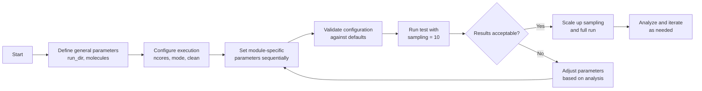

HADDOCK3's parameter system provides a hierarchical and extensible framework for configuring every aspect of your docking workflow. Understanding this architecture is essential for effective tuning and optimization of docking simulations. This guide covers the parameter system structure, configuration syntax, expandable parameters, module-specific settings, and practical tuning strategies.

## Parameter System Architecture

The HADDOCK3 parameter system is organized into three hierarchical levels, each serving distinct purposes in the workflow configuration. This layered design enables both global settings control and fine-grained module customization.

Sources: [parameters.py](src/haddock/gear/parameters.py#L1-L19), [config.py](src/haddock/gear/config.py#L1-L55)



The parameter hierarchy processes configuration files in a cascading manner. General parameters define the workflow context and mandatory inputs. Module default parameters establish baseline settings applicable to all modules unless overridden. Module-specific parameters provide granular control for individual workflow stages, enabling customization of docking protocols, refinement strategies, and scoring functions.

## General Parameters

General parameters control the fundamental behavior of HADDOCK3 runs and are defined in the core configuration files. These parameters are divided into mandatory and optional categories.

Sources: [mandatory.yaml](src/haddock/core/mandatory.yaml#L1-L19), [optional.yaml](src/haddock/core/optional.yaml#L1-L33)

### Mandatory Parameters

Mandatory parameters must be defined in every HADDOCK3 configuration file. They establish the basic operational context for the workflow.

| Parameter | Type | Description | Example |
|-----------|------|-------------|---------|
| `run_dir` | dir | Directory created to store the HADDOCK3 run output | `run_dir = "my_docking_run"` |
| `molecules` | list | Input PDB files for docking (1-20 molecules) | `molecules = ["protein1.pdb", "protein2.pdb"]` |

### Optional Parameters

Optional parameters provide convenient shortcuts for common workflow operations while maintaining flexibility for advanced users.

| Parameter | Type | Default | Description |
|-----------|------|---------|-------------|
| `preprocess` | boolean | false | Enables automatic PDB validation and correction before workflow execution. Checks residue numbering, chain ID compatibility, and other requirements. |
| `postprocess` | boolean | true | Automatically executes `haddock3-analyse` on CAPRI folders at workflow completion for result visualization and analysis. |
| `gen_archive` | boolean | false | Creates compressed archives (.tgz) of both the run directory and analysis results in self-contained mode for portability. |

## Global Default Parameters

Global default parameters apply to all modules in the workflow unless specifically overridden. These parameters are defined in the module system's defaults file and control execution behavior, resource management, and output handling.

Sources: [defaults.yaml](src/haddock/modules/defaults.yaml#L1-L155)

### Execution Parameters

Execution parameters govern how HADDOCK3 manages computational resources and job scheduling.

| Parameter | Type | Default | Range | Expert Level | Description |
|-----------|------|---------|-------|--------------|-------------|
| `cns_exec` | file | "" | N/A | easy | Path to the CNS executable. Uses installation-configured path if not specified. |
| `ncores` | integer | 4 | 1-500 | easy | Number of CPU cores for CNS calculations. Truncated to available CPUs minus 1. |
| `max_cpus` | boolean | true | N/A | expert | If true, uses maximum available CPUs; if false, reserves one CPU for system tasks. |
| `mode` | string | local | local/batch | easy | Execution mode: local runs on current machine, batch uses queuing system (SLURM/Torque). |
| `batch_type` | string | slurm | slurm/torque | easy | Type of batch system for job submission in batch mode. |
| `queue` | string | "" | N/A | easy | Batch queue name for job submission. Uses system default if empty. |
| `queue_limit` | integer | 100 | 1-9999 | easy | Maximum number of jobs to submit to batch system simultaneously. |
| `concat` | integer | 1 | 1-9999 | easy | Number of models to generate per job script. Higher values reduce scheduler load but increase individual job duration. |

### Resource Management Tuning

Resource management parameters directly impact performance and system utilization. The `concat` parameter is particularly important for HPC environments where job startup overhead is significant. Setting `concat > 1` groups multiple models into single job scripts, reducing scheduler load but requiring longer walltime per job.

Sources: [defaults.yaml](src/haddock/modules/defaults.yaml#L27-L54)

> [!TIP]
> When running on HPC clusters with high job submission overhead, use `concat = 10` or higher to batch model generation. For local development or debugging, keep `concat = 1` for faster iteration and better error isolation.

### Debug and Output Parameters

Debug and output parameters control verbosity, intermediate file retention, and execution isolation.

| Parameter | Type | Default | Expert Level | Description |
|-----------|------|---------|--------------|-------------|
| `clean` | boolean | true | easy | Compresses output files (PDB, PSF to .gz) and archives intermediate files (.seed, .inp, .out) after successful module completion. |
| `offline` | boolean | false | easy | Embeds Plotly JavaScript (~3MB) in HTML files for complete internet isolation. Set true for secure environments. |
| `debug` | boolean | false | easy | Writes intermediate input, output, and stdout files to disk for troubleshooting. Increases I/O operations significantly. |
| `self_contained` | boolean | false | guru | Copies CNS scripts and executable to run directory for remote execution or debugging without affecting main installation. |

> [!TIP]
> For workflows running on network file systems with slow I/O, set `debug = false` to reduce I/O operations. Only enable `debug = true` when troubleshooting specific issues, as it can significantly slow down large-scale sampling runs.

## Configuration File Format

HADDOCK3 configuration files use a TOML-like syntax with extended features for repeated module definitions. This format combines TOML's readability with HADDOCK3-specific requirements for workflow flexibility.

Sources: [config.py](src/haddock/gear/config.py#L1-L55)

### Basic Structure

Configuration files organize parameters under module headers. HADDOCK3's parser supports both standard TOML syntax and extended header naming for module repetition.

```toml
[topoaa]
# Topology generation parameters

[rigidbody]
sampling = 1000
ambig_fname = "ambig.tbl"

[flexref]
# Flexible refinement parameters

[caprieval]
# Scoring and evaluation parameters

# Module repetition using HADDOCK3 extended syntax
[caprieval.1]
# Additional scoring for second set of structures
```

### Standard TOML vs HADDOCK3 Extended Syntax

| Feature | Standard TOML | HADDOCK3 Extended Syntax |
|---------|---------------|-------------------------|
| Header Format | `[modulename]` | `[modulename]` or `[modulename]` repeated |
| Module Repetition | `['modulename.1']` | `[modulename]` repeated multiple times |
| Compatibility | TOML parsers only | HADDOCK3 parser only |

HADDOCK3's extended syntax allows cleaner workflow definitions by enabling repeated module headers without numeric suffixes. This is particularly useful for iterative workflows where the same module appears multiple times with different parameters.

## Expandable Parameters

Expandable parameters represent a powerful feature enabling parameter groups to be dynamically extended beyond their default definitions. This system supports flexible configuration while maintaining type safety and validation.

Sources: [expandable_parameters.py](src/haddock/gear/expandable_parameters.py#L1-L73)

### Four Types of Expandable Parameters

The expandable parameter system defines four distinct patterns for parameter extension:

1. **Single-index parameters**: Parameters following the pattern `<name>_<suffix>_<group>`
2. **Multiple-index parameters**: Parameters following the pattern `<name>_<suffix>_<N>_<group>`
3. **Simplest parameters**: Parameters following the pattern `<name>_<integer>`
4. **Molecule-specific parameters**: Parameters starting with `mol_` that expand to the number of input molecules



### Single-Index Parameters

Single-index parameters define groups of related parameters that can be replicated. The pattern is `<name>_<suffix>_<group>`, where the group index can be incremented to create additional parameter sets.

Sources: [expandable_parameters.py](src/haddock/gear/expandable_parameters.py#L26-L41)

**Example from `rigidbody` module**:
```yaml
rair_sta_1_1:
  default: .nan
  type: integer
  title: Starting residue number for segment
  group: 'ab initio mode'

rair_end_1_1:
  default: .nan
  type: integer
  title: Ending residue number for segment
  group: 'ab initio mode'
```

This defines segment 1 for random interaction restraints. You can extend to multiple segments:

```yaml
# User configuration can define additional segments
rair_sta_1_1 = 10
rair_end_1_1 = 50

rair_sta_1_2 = 100
rair_end_1_2 = 150

rair_sta_1_3 = 200
rair_end_1_3 = 250
```

### Multiple-Index Parameters

Multiple-index parameters follow the pattern `<name>_<suffix>_<N>_<group>`, where `N` identifies which molecule or object the parameter applies to, and `group` identifies the specific instance. This pattern is used extensively in flexible refinement modules.

Sources: [expandable_parameters.py](src/haddock/gear/expandable_parameters.py#L42-L56)

**Example from `flexref` module**:
```yaml
fle_sta_1_1:
  default: .nan
  type: integer
  title: Starting residue for flexible segment 1

fle_end_1_1:
  default: .nan
  type: integer
  title: Ending residue for flexible segment 1

fle_sta_2_1:
  default: .nan
  type: integer
  title: Starting residue for flexible segment 2

fle_end_2_1:
  default: .nan
  type: integer
  title: Ending residue for flexible segment 2
```

You can define multiple flexible segments per molecule:

```toml
# First molecule, three flexible segments
fle_sta_1_1 = 10
fle_end_1_1 = 30

fle_sta_1_2 = 50
fle_end_1_2 = 70

fle_sta_1_3 = 100
fle_end_1_3 = 120

# Second molecule, one flexible segment
fle_sta_2_1 = 5
fle_end_2_1 = 25
```

### Simplest Expandable Parameters

The simplest expandable parameters follow the pattern `<name>_<integer>`. Due to the generic nature of this pattern, specific parameters must be explicitly registered in the `type_simplest_ep` dictionary.

Sources: [expandable_parameters.py](src/haddock/gear/expandable_parameters.py#L57-L65)

### Molecule-Specific Parameters

Molecule-specific parameters automatically expand to match the number of input molecules (up to the maximum of 20). These parameters always start with the `mol_` prefix and follow the pattern `mol_<parameter>_<molecule_number>`.

Sources: [expandable_parameters.py](src/haddock/gear/expandable_parameters.py#L67-L73)

**Example from `rigidbody` module**:
```yaml
mol_fix_origin_1:
  default: false
  type: boolean
  title: Fix molecule in original position
  group: 'molecule'

mol_shape_1:
  default: false
  type: boolean
  title: Define molecule as shape
  group: 'molecule'
```

For a three-molecule docking, you can configure:
```toml
# Fix first molecule, treat others as mobile
mol_fix_origin_1 = true
mol_fix_origin_2 = false
mol_fix_origin_3 = false

# Define third molecule as a shape (e.g., electron density)
mol_shape_1 = false
mol_shape_2 = false
mol_shape_3 = true
```

## Module-Specific Parameters

Each HADDOCK3 module defines its own set of parameters in a `defaults.yaml` file. These parameters control module-specific behavior and are organized into logical groups with expertise level indicators.

Sources: [rigidbody/defaults.yaml](src/haddock/modules/sampling/rigidbody/defaults.yaml#L1-L200)

### Rigid-Body Docking Parameters

The `rigidbody` module implements the initial sampling stage with extensive parameter control for restraints and ab-initio modes.

#### Molecule Group Parameters

| Parameter | Type | Default | Expert Level | Description |
|-----------|------|---------|--------------|-------------|
| `mol_fix_origin_1` | boolean | false | expert | Fixes the molecule in its original position during sampling |
| `mol_shape_1` | boolean | false | easy | Defines the molecule as a shape (collection of beads) |

#### Distance Restraint Parameters

| Parameter | Type | Default | Range | Expert Level | Description |
|-----------|------|---------|-------|--------------|-------------|
| `ambig_fname` | file | "" | N/A | easy | Filename containing ambiguous interaction restraints (AIRs) |
| `previous_ambig` | boolean | false | N/A | expert | If true, uses restraints from previous CNS module |
| `unambig_fname` | file | "" | N/A | easy | Filename containing unambiguous distance restraints |
| `hbond_fname` | file | "" | N/A | easy | Filename containing hydrogen bond restraints |
| `ambig_scale` | integer | 50 | 0-1000 | expert | Force constant for ambiguous distance restraints |
| `unambig_scale` | integer | 50 | 0-1000 | expert | Force constant for unambiguous distance restraints |
| `hbond_scale` | integer | 50 | 0-1000 | expert | Force constant for hydrogen bond restraints |
| `randremoval` | boolean | true | N/A | expert | Randomly removes a fraction of ambiguous restraints per model |
| `npart` | integer | 2 | 1-20 | expert | Number of partitions for random restraint splitting |

The restraint force constants (`ambig_scale`, `unambig_scale`, `hbond_scale`) control how strongly restraints influence the sampling. Higher values enforce stricter adherence to experimental or predicted restraints, while lower values allow more exploration. The random restraint removal (`randremoval` with `npart`) introduces diversity by varying which restraints are active for each model, reducing bias from potentially incorrect restraints.

#### Ab-Initio Mode Parameters

| Parameter | Type | Default | Range | Expert Level | Description |
|-----------|------|---------|-------|--------------|-------------|
| `cmrest` | boolean | false | N/A | expert | Enables automatic center-of-mass restraints between molecules |
| `cmtight` | boolean | true | N/A | expert | Controls tightness of center-of-mass distance limits |
| `kcm` | float | 1.0 | 0-1000 | expert | Force constant for center-of-mass restraints |
| `ranair` | boolean | false | N/A | expert | Generates random interaction restraints from surface patches |
| `nrair_1` | integer | 0 | 0-100 | expert | Number of surface segments for random restraints (molecule 1) |
| `nrair_2` | integer | 0 | 0-100 | expert | Number of surface segments for random restraints (molecule 2) |
| `rair_sta_1_1` | integer | .nan | -9999-9999 | expert | Starting residue for segment 1 |
| `rair_end_1_1` | integer | .nan | -9999-9999 | expert | Ending residue for segment 1 |

The ab-initio mode enables docking without experimental restraints. `cmrest` automatically defines distance restraints between molecular centers of mass, while `ranair` generates random ambiguous interaction restraints from solvent-accessible surface patches. The `cmtight` parameter controls restraint tightness: true uses the average of the two smallest molecular dimensions, while false uses all three dimensions, resulting in looser restraints.

### Flexible Refinement Parameters

The `flexref` module enables segment-level flexibility during refinement, requiring precise parameter specification for each flexible region.

Sources: [flexref/defaults.yaml](src/haddock/modules/refinement/flexref/defaults.yaml#L1-L50)

Flexible refinement parameters define which protein segments become flexible during refinement. The expandable parameter system allows specifying multiple flexible segments per molecule, with control over backbone and sidechain flexibility independently.

> [!TIP]
> When defining flexible segments, start with small, well-defined regions (5-15 residues) around known or predicted interaction sites. Large flexible segments can lead to sampling inefficiencies and increased computational cost. Consider using interface prediction or mutagenesis data to guide flexible segment selection.

## Parameter Validation System

HADDOCK3 implements a comprehensive parameter validation system that ensures configuration files adhere to type constraints, range limits, and dependency rules. This system validates parameters at multiple stages: during configuration loading, before module execution, and during CNS script generation.

Sources: [validations.py](src/haddock/gear/validations.py), [parameters.py](src/haddock/gear/parameters.py)

### Validation Levels

The parameter validation system operates at three levels:

1. **Type Validation**: Ensures parameter values match declared types (boolean, integer, float, string, file, directory, list)
2. **Range Validation**: Verifies numeric parameters fall within specified minimum and maximum values
3. **Dependency Validation**: Checks incompatible parameter combinations and required dependencies

### Parameter Attributes

Each parameter definition includes several attributes that guide validation and user interface:

| Attribute | Purpose | Example |
|-----------|---------|---------|
| `type` | Data type validation | `type: integer` |
| `default` | Default value if not specified | `default: 4` |
| `min` | Minimum value for numeric types | `min: 1` |
| `max` | Maximum value for numeric types | `max: 500` |
| `choices` | Allowed string values | `choices: [local, batch]` |
| `group` | Logical grouping for UI organization | `group: 'execution'` |
| `explevel` | User expertise level indicator | `explevel: expert` |
| `title` | Human-readable parameter name | `title: Number of CPU cores` |
| `short` | Brief description | `short: Number of cores for CNS calculations` |
| `long` | Detailed documentation | `long: Multi-line explanation of parameter behavior` |

### Expertise Levels

Parameters are tagged with expertise levels to guide users:

- **Easy**: Essential parameters for basic usage
- **Intermediate**: Parameters for fine-tuning without deep technical knowledge
- **Expert**: Parameters requiring understanding of HADDOCK3 internals
- **Guru**: Parameters for advanced customization and debugging

## Parameter Tuning Strategies

Effective parameter tuning requires balancing sampling completeness, computational resources, and result quality. The following strategies provide systematic approaches to optimization.

### Sampling Stage Tuning

The rigid-body sampling stage defines the conformational space explored during docking. Key tuning parameters include sampling size, restraint strength, and randomness.

| Parameter | Conservative | Aggressive | When to Use |
|-----------|--------------|------------|-------------|
| `sampling` (rigidbody) | 1000 | 10000 | Use aggressive when computational resources allow and quality data is available |
| `ambig_scale` | 10-30 | 50-100 | Higher for high-confidence restraints, lower for ambiguous or sparse data |
| `randremoval` | true | false | Enable true when restraint quality uncertain, false for well-defined interactions |
| `npart` | 3-5 | 2 | Higher values increase restraint diversity but reduce per-model restraint count |

> [!TIP]
> For ab-initio docking without experimental restraints, use `cmrest = true` with `kcm = 1.0` to enforce compactness. Set `cmtight = true` for tighter complexes, `cmtight = false` for more extended conformations. Combine with `ranair = true` for surface-driven sampling when binding interfaces are unknown.

### Refinement Stage Tuning

Refinement parameters control the balance between energy minimization and conformational sampling around docking poses.

| Parameter | Conservative | Aggressive | When to Use |
|-----------|--------------|------------|-------------|
| Flexible segment size | 5-10 residues | 15-25 residues | Larger segments when interface regions well-defined, smaller for uncertainty |
| Refinement temperature | 300K | 500-1000K | Higher temperatures for larger conformational changes |
| Number of minimization steps | 1000 | 5000+ | More steps for complex interfaces or large molecules |

### Scoring Stage Tuning

Scoring parameters affect how models are ranked and selected for subsequent stages or final output.

| Parameter | Conservative | Aggressive | When to Use |
|-----------|--------------|------------|-------------|
| Clustering threshold | 7.5Å | 5.0-10.0Å | Tighter for similar models, looser for diverse sampling |
| Number of clusters | 4 | 8-10 | More clusters when diversity is expected |
| Scoring weights | Equal | Customized | Adjust weights to emphasize specific energy terms for your system |

### Resource Allocation Tuning

Optimizing resource allocation maximizes computational efficiency without sacrificing result quality.

| Scenario | `ncores` | `concat` | `queue_limit` | Rationale |
|----------|----------|----------|---------------|-----------|
| Local workstation | 4-8 | 1 | N/A | Minimal overhead for rapid iteration |
| Small HPC cluster | 16-32 | 5-10 | 50 | Balance between throughput and walltime |
| Large HPC cluster | 64-128 | 10-20 | 100+ | Maximize throughput for large-scale sampling |
| I/O-constrained system | 8-16 | 20+ | 50 | Reduce I/O operations with large concat |

## Best Practices and Common Patterns

Following established patterns for parameter configuration improves reproducibility, efficiency, and result quality.

### Parameter Configuration Workflow



### Common Configuration Patterns

#### Pattern 1: Standard Protein-Protein Docking

```toml
run_dir = "protein_protein_docking"
molecules = ["receptor.pdb", "ligand.pdb"]

[topoaa]

[rigidbody]
sampling = 1000
ambig_fname = "ambig.tbl"
ambig_scale = 50

[caprieval]
ref_structure = "native.pdb"

[flexref]
# Define single flexible segment on each molecule
fle_sta_1_1 = 150
fle_end_1_1 = 160
fle_sta_2_1 = 45
fle_end_2_1 = 55

[caprieval.1]

[mdref]

[caprieval.2]
```

#### Pattern 2: Ab-Initio Docking

```toml
run_dir = "abinitio_docking"
molecules = ["protein1.pdb", "protein2.pdb"]

[topoaa]

[rigidbody]
sampling = 5000
cmrest = true
kcm = 1.0
cmtight = true
ranair = true
nrair_1 = 5
nrair_2 = 5

[caprieval]

[flexref]
fle_sta_1_1 = 100
fle_end_1_1 = 110
fle_sta_2_1 = 80
fle_end_2_1 = 90

[caprieval.1]
```

#### Pattern 3: HPC Batch Execution

```toml
run_dir = "hpc_docking"
molecules = ["*.pdb"]

[topoaa]

[rigidbody]
sampling = 10000
mode = "batch"
batch_type = "slurm"
queue = "long"
queue_limit = 200
concat = 20
ncores = 64

[caprieval]

[flexref]

[caprieval.1]
```

### Troubleshooting Parameter Issues

| Symptom | Likely Cause | Solution |
|---------|--------------|----------|
| No convergence in clustering | Insufficient sampling or wrong clustering threshold | Increase `sampling` parameter or adjust clustering threshold |
| All models score similarly | Overly restrictive restraints | Reduce `ambig_scale` or enable `randremoval` |
| Out-of-memory errors | Too many concurrent jobs | Reduce `ncores` or increase `concat` |
| Runtime exceeds queue limit | Individual jobs too long | Increase `concat` to group more models per job |
| Unexpected model orientations | Incorrect restraint definitions | Validate restraint files using `haddock3-cfg` |

## Next Steps

For detailed information on specific aspects of HADDOCK3 parameter usage and workflow design, explore these related pages:

- **[Workflow Engine and Execution Model](7-workflow-engine-and-execution-model)** - Learn how parameters flow through the workflow engine and execution pipeline
- **[Molecule Topology Generation with topoaa](10-molecule-topology-generation-with-topoaa)** - Understand topology-related parameters for different molecule types
- **[Rigid-Body Docking Fundamentals](13-rigid-body-docking-fundamentals)** - Deep dive into sampling parameters and restraint strategies
- **[Flexible Refinement Strategies](18-flexible-refinement-strategies)** - Master flexible segment definition and refinement parameter tuning
- **[Custom Workflow Design](27-custom-workflow-design)** - Build complex workflows with parameter inheritance and module chaining

The parameter system is designed for both simplicity in basic usage and flexibility for advanced customization. Start with recommended default values for your use case, then iteratively tune parameters based on intermediate results and domain knowledge.