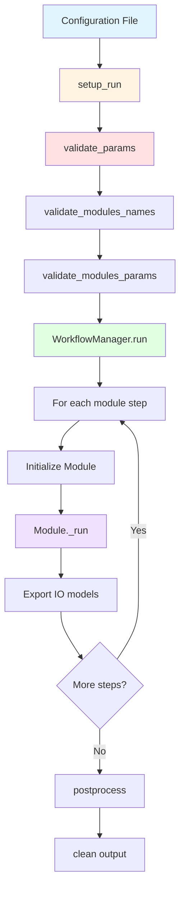

Custom workflow design in HADDOCK3 empowers you to compose sophisticated molecular docking protocols by combining modular components through declarative configuration. This document provides the architectural foundation and practical guidance for creating tailored workflows, from simple docking pipelines to complex multi-stage protocols involving sampling, refinement, scoring, and analysis.

## Workflow Architecture

HADDOCK3 implements a **modular workflow engine** where each computational task is encapsulated as an independent module. The workflow execution is orchestrated by the `WorkflowManager` and `Workflow` classes in [libworkflow.py](src/haddock/libs/libworkflow.py#L23-L144), which interpret configuration files and coordinate sequential module execution.

The workflow follows a **step-based execution model**:



The **Workflow class** ([libworkflow.py#L98-L141](src/haddock/libs/libworkflow.py#L98-L141)) represents a complete set of stages to be executed, initializing `Step` objects for each module defined in the configuration. Each step combines module-specific parameters with global parameters, applying recursive dictionary updates where local settings override global defaults.

## Module System Organization

Modules are **categorized by their functional role** within the workflow, providing a clear ontology for protocol composition. The module registry in [modules/__init__.py](src/haddock/modules/__init__.py#L48-L53) indexes each module within its category:

| Category | Purpose | Example Modules |
|----------|---------|-----------------|
| **topology** | Generate molecular topologies and parameters | `topoaa`, `topocg` |
| **sampling** | Generate conformational ensembles | `rigidbody`, `flexref`, `lightdock`, `gdock` |
| **refinement** | Refine structures with advanced protocols | `emref`, `mdref`, `openmm` |
| **scoring** | Calculate energy and scoring terms | `emscoring`, `mdscoring`, `prodigyligand`, `prodigyprotein`, `sasascore` |
| **analysis** | Analyze and filter results | `clustfcc`, `clustrmsd`, `filter`, `seletop`, `caprieval`, `alascan`, `contactmap` |
| **extras** | Utility and exit modules | `exit` |

Each module **inherits from base classes** providing common functionality. The `BaseHaddockModule` class ([modules/__init__.py#L115-L395](src/haddock/modules/__init__.py#L115-L395)) defines the interface for all modules, including parameter management, I/O handling, and execution orchestration. CNS-based modules extend `BaseCNSModule` with CNS-specific job generation capabilities.

All modules share a **standard directory structure**:
```
module_name/
├── __init__.py          # Module class definition
├── defaults.yaml        # Parameter specifications
├── cns/                 # CNS scripts (if applicable)
└── [additional files]
```

## Configuration Methodology

Workflows are defined through **configuration files** using either the INI-style `.cfg` format or YAML format. The configuration defines both **global parameters** and **module-specific parameters**. Global parameters control execution mode, resource allocation, and general behavior, while module parameters define the specific behavior of each workflow stage.

Here's the **structure of a complete workflow configuration** from the protein-protein docking example:

```cfg
# Global parameters
run_dir = "run1-full"
mode = "batch"
ncores = 4
queue_limit = 100
concat = 5

# Input molecules
molecules = [
    "data/e2aP_1F3G.pdb",
    "data/hpr_ensemble.pdb"
]

# Module stages
[topoaa]
autohis = false

[topoaa.mol1]
nhisd = 0
nhise = 1

[rigidbody]
tolerance = 5
ambig_fname = "data/e2a-hpr_air.tbl"
sampling = 1000

[seletop]
select = 200

[flexref]
tolerance = 5

[emref]
tolerance = 5

[clustfcc]

[seletopclusts]
top_models = 4
```

Sources: [docking-protein-protein-full.cfg](examples/docking-protein-protein/docking-protein-protein-full.cfg)

The **parameter system** in [defaults.yaml](src/haddock/modules/defaults.yaml#L1-L155) defines the complete specification for each parameter, including:

- **type**: The Python type (integer, float, string, boolean, file, list)
- **default**: The default value
- **min/max**: Valid range for numeric types
- **choices**: Enumerated valid options
- **explevel**: User expertise level (easy, medium, expert, guru)
- **group**: Logical grouping for documentation
- **short/long**: Parameter descriptions
- **incompatible**: Mutually exclusive parameter combinations

> [!TIP]
> Use the `haddock3-cfg` command to generate a configuration template with all available modules and their default parameters: `haddock3-cfg > my_workflow.cfg`. This provides a complete reference for parameter customization.

## Creating Custom Workflows

### Design Principles

Effective workflow design follows these **core principles**:

1. **Logical progression**: Build from simple to complex, starting with topology generation and progressing through sampling, refinement, and analysis
2. **Data flow integrity**: Ensure each module produces the expected input for the next module in the pipeline
3. **Resource awareness**: Match computational complexity to available resources
4. **Validation integration**: Include scoring and analysis modules to assess quality at critical junctures

### Common Workflow Patterns

**Pattern 1: Basic Docking Pipeline**
```cfg
[topoaa]
[rigidbody]
[seletop]
select = 100
[flexref]
[emref]
[clustfcc]
[seletopclusts]
top_models = 10
```

**Pattern 2: Multi-Stage Scoring**
```cfg
[topoaa]
[rigidbody]
[emscoring]
[seletop]
select = 200
[mdscoring]
[seletop]
select = 100
[prodigyprotein]
[seletopclusts]
top_models = 5
```

**Pattern 3: Integrative Docking with Restraints**
```cfg
[topoaa]
[rigidbody]
ambig_fname = "data/restraints.tbl"
tolerance = 5
sampling = 2000
[caprieval]
reference_fname = "data/reference.pdb"
[seletop]
select = 400
[flexref]
ambig_fname = "data/restraints.tbl"
[caprieval]
[emref]
[caprieval]
[clustfcc]
```

### Parameter Inheritance

HADDOCK3 implements **cascading parameter inheritance** where global parameters automatically apply to all modules unless overridden. The parameter merging logic in [libworkflow.py#L119-L129](src/haddock/libs/libworkflow.py#L119-L129) performs recursive dictionary updates, ensuring module-specific settings take precedence.

Common **globally applicable parameters** include:
- `ncores`: Number of CPU cores for parallel execution
- `mode`: Execution mode (local, batch, mpi)
- `clean`: Whether to clean intermediate files
- `debug`: Enable verbose debugging output

## Developing Custom Modules

### Module Structure Template

The **module template** in [_template_cat/README.md](src/haddock/modules/_template_cat/README.md#L1-L31) provides the blueprint for custom module development. Follow these steps:


### Module Class Implementation

The core module class follows this pattern from the `rigidbody` module:

```python
class HaddockModule(BaseCNSModule):
    """HADDOCK3 module for rigid body sampling."""
    
    name = RECIPE_PATH.name
    
    def __init__(
        self, 
        order: int, 
        path: Path, 
        initial_params: FilePath = DEFAULT_CONFIG
    ) -> None:
        super().__init__(order, path, initial_params)
    
    @classmethod
    def confirm_installation(cls) -> None:
        """Confirm module is installed."""
        # Return for built-in modules
        return
    
    def _run(self) -> None:
        """Execute module."""
        # Module-specific implementation
        pass
```

Sources: [rigidbody/__init__.py](src/haddock/modules/sampling/rigidbody/__init__.py#L50-L198)

### Parameter Specification

The `defaults.yaml` file defines all module parameters:

```yaml
sampling:
  default: 1000
  type: integer
  min: 1
  max: 50000
  title: Number of sampling models
  short: Number of models to generate
  long: Number of rigid-body docking models to generate
  group: "general"
  explevel: easy

ambig_fname:
  default: ""
  type: file
  title: Ambiguous Interaction Restraints file
  short: Path to AIRs table file
  long: Path to the file containing ambiguous interaction restraints
  group: "restraints"
  explevel: easy
```

Sources: [defaults.yaml](src/haddock/modules/defaults.yaml#L1-L155)

### Input/Output Management

Modules exchange data through the **ModuleIO system** defined in [modules/__init__.py#L324-L336](src/haddock/modules/__init__.py#L324-L336). The `export_io_models` method writes output information to `io.json`, which subsequent modules read to identify input structures:

```python
def export_io_models(self, faulty_tolerance: float = 0.0) -> None:
    """Export input and output models to io.json."""
    io = ModuleIO()
    io.add(
        "output",
        self.output_models,
        "out",
        self.order,
    )
    io.save(self.path)
```

This system ensures **data flow integrity** across the workflow, with automatic discovery of previous step outputs.

## Validation and Error Handling

The workflow engine implements **multi-level validation** to catch configuration errors before execution:

1. **Mandatory parameter check**: Ensures required parameters are present
2. **Module name validation**: Verifies module names match the registered module library
3. **Parameter validation**: Checks type, range, and choices for each parameter
4. **Incompatibility detection**: Identifies mutually exclusive parameter combinations
5. **Installation verification**: Confirms third-party software availability

The validation pipeline in [prepare_run.py#L514-L576](src/haddock/gear/prepare_run.py#L514-L576) systematically applies these checks:

```python
def validate_params(params):
    """Validate the parameter file."""
    check_mandatory_argments_are_present(params)
    validate_modules_names(params)

def validate_modules_params(modules_params: ParamMap, max_mols: int) -> None:
    """Validate individual parameters for each module."""
    for module_name, args in modules_params.items():
        module_name = get_module_name(module_name)
        defaults = _read_defaults(module_name)
        # Parameter existence check
        # Type and value validation
        # Default parameter injection
```

> [!TIP]
> Enable the `debug` parameter to retain intermediate files and stdout/stderr logs, facilitating troubleshooting of module failures and parameter tuning.

## Advanced Workflow Features

### Conditional Execution

The **filter module** ([filter/__init__.py](src/haddock/modules/analysis/filter/__init__.py#L1-L48)) enables conditional workflow paths based on scoring criteria, allowing adaptive protocols that respond to intermediate results:

```cfg
[rigidbody]
sampling = 1000
[emscoring]
[filter]
threshold = -50.0
[flexref]
```

If no models pass the threshold, the workflow terminates with an error, preventing wasted computation on poor candidates.

### Restart and Extend Functionality

The workflow system supports **incremental execution** through the `restart` parameter, allowing you to resume from any completed step. The `extend_run` function in [gear/extend_run.py](src/haddock/gear/extend_run.py) enables workflow modification from intermediate states, adding new modules or adjusting parameters without recomputing earlier stages.

See [Restart and Extend Functionality](28-restart-and-extend-functionality) for detailed guidance on these features.

### Expandable Parameters

HADDOCK3 supports **dynamic parameter expansion** for molecule-specific settings. The `get_expandable_parameters` function in [prepare_run.py#L1156-L1266](src/haddock/gear/prepare_run.py#L1156-L1266) identifies parameters like `mol1`, `mol2` that scale with the number of input molecules:

```cfg
[topoaa.mol1]
nhisd = 0
nhise = 1

[topoaa.mol2]
nhisd = 1
hisd_1 = 76
nhise = 1
```

This pattern enables per-molecule parameter customization throughout the workflow.

## Workflow Best Practices

### Resource Optimization

- **Balance sampling and selectivity**: Use `seletop` modules to reduce computational load before expensive refinement stages
- **Concatenate jobs**: Set `concat > 1` to batch multiple models into single scheduler jobs, reducing queue overhead
- **Parallelize effectively**: Adjust `ncores` to match available resources without oversubscribing

### Quality Assurance

- **Integrate validation checkpoints**: Include `caprieval` modules at critical stages to assess convergence
- **Multiple scoring methods**: Combine different scoring functions to evaluate model quality comprehensively
- **Cluster analysis**: Apply `clustfcc` or `clustrmsd` to identify conformational families and select representative models

### Debugging Strategy

- **Start simple**: Begin with minimal workflows and incrementally add complexity
- **Test modules individually**: Use isolated configurations to verify module behavior
- **Examine io.json**: Review input/output files at each step to understand data flow
- **Enable debug mode**: Retain all intermediate files for detailed analysis

## Example: Multi-Stage Antibody-Antigen Docking

This advanced workflow demonstrates custom design for antibody-antigen docking with CDR-based restraints:

```cfg
run_dir = "antibody_docking"
mode = "batch"
ncores = 16
concat = 10

molecules = [
    "data/antibody.pdb",
    "data/antigen.pdb"
]

# Topology with CDR-specific HIS protonation
[topoaa]
[topoaa.mol1]
nhisd = 2
hisd_1 = 33
hisd_2 = 95

# Rigid body sampling with CDR restraints
[rigidbody]
sampling = 10000
ambig_fname = "data/cdr_restraints.tbl"
tolerance = 5

# Initial evaluation
[caprieval]
reference_fname = "data/complex.pdb"

[seletop]
select = 1000

# Flexible refinement
[flexref]
tolerance = 3
ambig_fname = "data/cdr_restraints.tbl"

# Semi-flexible refinement
[emref]
tolerance = 3

# Energy minimization scoring
[emscoring]

# Select best models
[seletop]
select = 200

# MD-based scoring
[mdscoring]

# PRODIGY affinity prediction
[prodigyprotein]

# Cluster by interface similarity
[clustfcc]

# Select top clusters
[seletopclusts]
top_models = 10
```

Sources: [docking-antibody-antigen-full.cfg](examples/docking-antibody-antigen/docking-antibody-antigen-CDR-accessible-full.cfg)

## Integration with External Tools

HADDOCK3 provides **integration modules** for external sampling tools:

- **LightDock**: GPU-accelerated global docking ([lightdock module](src/haddock/modules/sampling/lightdock/))
- **GDock**: Genetic algorithm-based docking ([gdock module](src/haddock/modules/sampling/gdock/))
- **OpenMM**: Flexible refinement with modern MD engines ([openmm module](src/haddock/modules/refinement/openmm/))

These modules follow the same interface as native HADDOCK3 modules, enabling seamless integration into custom workflows:

```cfg
[topoaa]
[lightdock]
num_solutions = 1000
[topoaa]
[rigidbody]
sampling = 100
```

See [Integration with LightDock and GDock](15-integration-with-lightdock-and-gdock) for detailed configuration guidance.

## Next Steps

Having mastered custom workflow design, you can explore:

- **[Parameter Reference and Tuning](26-parameter-reference-and-tuning)**: Comprehensive parameter documentation for all modules
- **[Restart and Extend Functionality](28-restart-and-extend-functionality)**: Advanced workflow continuation techniques
- **[Parallel Execution and Resource Management](29-parallel-execution-and-resource-management)**: HPC and MPI configuration for large-scale workflows
- **[Module System and Plugin Architecture](9-module-system-and-plugin-architecture)**: Deep dive into module development patterns

The modular architecture of HADDOCK3 provides the foundation for virtually unlimited protocol customization. By combining the appropriate modules, parameters, and validation strategies, you can design workflows tailored to specific molecular recognition problems, from protein-protein docking to antibody-antigen complexes and beyond.