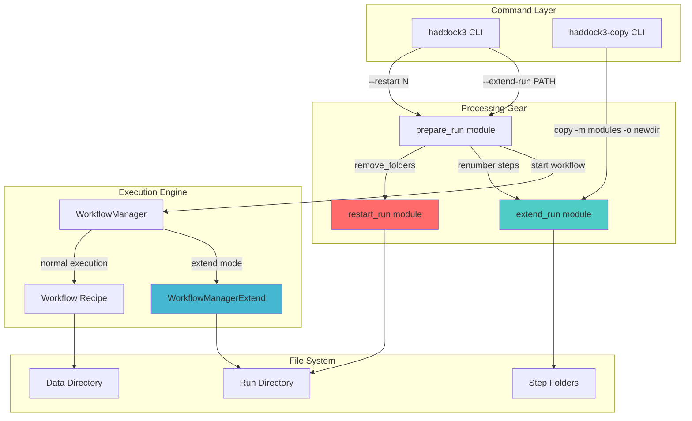

HADDOCK3 provides powerful workflow resumption capabilities that enable you to recover from interruptions, restart from intermediate steps, or extend existing runs with additional modules. These features maximize computational efficiency and provide flexibility in experimental design by allowing you to leverage previously calculated results.

The restart and extend functionality operates at two distinct levels: **restart** enables rerunning from a specific step within the same workflow, while **extend** allows you to build upon a previous run by adding new modules to the pipeline. Both mechanisms handle the complex task of managing step folder numbering, data directory synchronization, and file reference updates automatically.

Sources: [restart_run.py](src/haddock/gear/restart_run.py#L1-L68), [extend_run.py](src/haddock/gear/extend_run.py#L1-L284)

## Architecture Overview

The restart and extend functionality is built upon three core components that interact with the workflow engine. The CLI layer accepts user commands, the gear layer handles folder manipulation and reference updates, and the workflow manager orchestrates execution from the appropriate starting point.



Sources: [cli.py](src/haddock/clis/cli.py#L81-L218), [prepare_run.py](src/haddock/gear/prepare_run.py#L214-L340)

## Restart Functionality

The restart mechanism enables you to rerun a HADDOCK3 workflow from any specified step number, automatically removing all subsequent steps and their data. This is particularly valuable when a job fails partway through a long workflow, or when you want to modify parameters from an intermediate stage without recomputing earlier steps.

### Core Mechanism

When you invoke restart with `--restart N`, HADDOCK3 performs a systematic cleanup before resuming execution. The system identifies all step folders with indices greater than or equal to N in both the main run directory and the `data/` subdirectory, then removes them completely. This ensures a clean state from which to begin the restart process.

The restart validation requires that the step number be a non-negative integer, with `0` representing the first step. The system uses a partial function wrapper around `non_negative_int()` to provide clear error messages when invalid values are provided.

Sources: [restart_run.py](src/haddock/gear/restart_run.py#L31-L67), [restart_run.py](src/haddock/gear/restart_run.py#L14-L18)

### Implementation Details

The `remove_folders_after_number()` function implements the core restart logic by first resolving the run directory path, then retrieving all module step folders using `get_module_steps_folders()`. It filters these folders to identify those with numeric prefixes meeting or exceeding the restart threshold, and iteratively removes each matching folder using the `remove_folder()` utility.


The folder naming convention follows a zero-padded format (e.g., `00_topoaa`, `01_rigidbody`), where the numeric prefix determines execution order. When restart is invoked, all folders from the specified step onward are deleted, preserving earlier computational results.

Sources: [restart_run.py](src/haddock/gear/restart_run.py#L31-L67), [modules/__init__.py](src/haddock/modules)

### Usage Example

To restart a workflow from step 2 (zero-indexed, meaning the third step), you would execute:

```bash
haddock3 config.cfg --restart 2
```

This command removes all step folders with indices ≥ 2 and their corresponding data subdirectories, then resumes execution beginning with step 2. The renumbering process ensures that the remaining steps maintain sequential indexing (e.g., if only steps 0 and 1 remain, they are not renumbered—only deleted steps are removed).

> [!TIP]
> The restart operation is destructive—it permanently deletes step folders and their contents. Always backup your run directory before using --restart, especially if you may need to revert to the original state.

Sources: [cli.py](src/haddock/clis/cli.py#L47-L48), [prepare_run.py](src/haddock/gear/prepare_run.py#L332-L335)

## Extend Functionality

The extend functionality provides a more sophisticated approach to workflow continuation, allowing you to selectively copy successful steps from a previous run and append additional modules to create an extended workflow. This is implemented through a two-step process: first using `haddock3-copy` to prepare a new run directory, then using `--extend-run` to execute the extended workflow.

### Preparing Extended Runs with haddock3-copy

The `haddock3-copy` CLI tool enables selective copying of step folders from an existing run directory to a new location. This selection mechanism allows you to cherry-pick specific intermediate results as starting points for new experiments, potentially combining results from different branches or exploring alternative refinement strategies.

The command syntax requires specifying the source run directory, the modules (by their numeric index) to copy, and the destination directory:

```bash
haddock3-copy -r <run_dir> -m <module_indices> -o <new_run_dir>
```

For example, to copy only the topology generation (step 0) and flexible refinement (step 4) from a run:

```bash
haddock3-copy -r run1 -m 0 4 -o run2
```

Sources: [cli_cp.py](src/haddock/clis/cli_cp.py#L2-L44), [cli_cp.py](src/haddock/clis/cli_cp.py#L106-L175)

### Copy and Renumbering Process

The `haddock3-copy` workflow performs several critical operations to ensure the copied steps form a valid starting point:

1. **Step Selection**: The CLI accepts module indices (0-based) and retrieves the corresponding step folder names from the source run directory
2. **Directory Creation**: A new run directory is created, with validation to prevent overwriting existing directories
3. **Zero-Fill Calibration**: The system calibrates the zero-fill width based on the total number of selected steps to maintain consistent naming
4. **Folder Copying**: Selected step folders are copied to the new directory with sequential renumbering (0, 1, 2, ...)
5. **Data Directory Copying**: Corresponding data subdirectories are copied for steps that contain them (not all steps have `data/` subfolders)
6. **File Content Updates**: All references to old step names, old run directory paths, and step indices are updated throughout the copied files

The renumbering process transforms non-sequential step indices into a sequential series. For example, copying modules `0_topoaa` and `4_flexref` results in new folders named `0_topoaa` and `1_flexref`.

Sources: [extend_run.py](src/haddock/gear/extend_run.py#L121-L178), [extend_run.py](src/haddock/gear/extend_run.py#L181-L224)

### Content Update Mechanism

The `update_contents_of_new_steps()` function performs find-replace operations across all files in the newly copied step folders. This ensures that file references and path configurations accurately reflect the new directory structure. The function updates:

- Old step folder names to new sequential names
- Old run directory references to the new run directory name

The function iterates through each new step folder, reads each file as text (skipping binary files that raise UnicodeDecodeError), and performs string replacements before writing the updated content back to disk.

Sources: [extend_run.py](src/haddock/gear/extend_run.py#L226-L284)

### Executing Extended Workflows

Once the extended run directory is prepared with `haddock3-copy`, you execute it using the `--extend-run` flag:

```bash
haddock3 new-config.cfg --extend-run run2
```

The workflow manager automatically determines the next step number by examining the highest-indexed step in the extended directory and incrementing by one. For example, if `run2` contains steps `0_topoaa` and `1_flexref`, the workflow will begin execution at step 2, processing any modules defined in the configuration file beyond that point.

Sources: [cli.py](src/haddock/clis/cli.py#L78-L89), [cli.py](src/haddock/clis/cli.py#L175-L193)

### WorkflowManagerExtend Class

The `WorkflowManagerExtend` class extends the standard `WorkflowManager` to handle the specific requirements of extended runs. Its key responsibilities include:

- **Initialization**: Accepts workflow parameters and a start step number, creating a `Workflow` recipe configured to begin at the specified step
- **Execution Management**: Runs the workflow steps, handling `HaddockTermination` exceptions that may occur when the workflow encounters an exit module
- **Output Cleaning**: Implements a specialized `clean()` method that compresses folders that were unpacked during the copy process, then applies standard compression to newly generated module outputs

The class tracks whether the workflow was terminated early via the `_terminated` attribute, which synchronizes with the exit module's behavior for proper post-processing.

Sources: [extend_run.py](src/haddock/gear/extend_run.py#L28-L76)

## Comparison: Restart vs Extend

The restart and extend functionalities serve different use cases and operate with distinct semantics. Understanding their differences ensures you select the appropriate mechanism for your workflow continuation needs.

| Feature | Restart (`--restart`) | Extend (`--extend-run`) |
|---------|----------------------|------------------------|
| **Purpose** | Rerun from intermediate step in same workflow | Append new modules to existing results |
| **Preparation** | None required | Must use `haddock3-copy` first |
| **Step Handling** | Deletes all steps ≥ N | Copies selected steps, renumbers sequentially |
| **Configuration** | Uses original config file | Uses new config file defining additional modules |
| **Starting Point** | Specified step number N | Automatically determined (last copied step + 1) |
| **Use Case** | Failed job recovery, parameter tuning | Building upon successful results, workflow branching |
| **Destructive** | Yes (deletes subsequent steps) | No (creates new directory) |

Sources: [restart_run.py](src/haddock/gear/restart_run.py#L10-L11), [extend_run.py](src/haddock/gear/extend_run.py#L82-L86)

## Setup and Validation

The `setup_run()` function in `prepare_run.py` serves as the central orchestrator for both restart and extend scenarios. This function performs a comprehensive series of validation and preparation steps, with conditional logic branches depending on whether the run is starting from scratch, restarting from a step, or extending a previous run.

### Conditional Execution Paths

The function distinguishes three execution modes through boolean flags:

```python
from_scratch = restart_from is None and extend_run is None
scratch_rest0 = from_scratch or restart_from == 0
restarting_from = not_none(restart_from)
starting_from_copy = not_none(extend_run)
```

These flags determine which preparation steps execute:

- **From Scratch**: Validates run directory doesn't exist, checks mandatory parameters, copies molecules to data directory
- **Restarting**: Removes folders after restart number, renumbers remaining steps, validates and copies molecules
- **Extending**: Reads molecule count from existing steps, renumbers steps based on copied configuration, extends run directory from copy path

Sources: [prepare_run.py](src/haddock/gear/prepare_run.py#L318-L340)

### Molecule Count Detection

When extending a run, the system must determine the number of molecules in the system to configure new modules correctly. The `read_num_molecules_from_folder()` function handles this by:

1. Finding the lowest-indexed step folder in the extended directory
2. Loading the `io.json` file from that step
3. Counting the number of items in the `output` key
4. Returning this count as the number of molecules

This information populates molecule-specific parameters (like `mol1`, `mol2`, etc.) for new modules that need them.

Sources: [extend_run.py](src/haddock/gear/extend_run.py#L92-L118)

## Advanced Workflows

The restart and extend functionality enables sophisticated experimental workflows that would be difficult or impossible to achieve with a single linear execution.

### Branching Experiments

You can use `haddock3-copy` to create multiple branches from a common starting point. For example:

```bash
# Create base run through rigid body docking
haddock3 base.cfg

# Branch into different refinement protocols
haddock3-copy -r run1 -m 0 1 -o run_flexref
haddock3-copy -r run1 -m 0 1 -o run_mdref

# Execute different refinement strategies
haddock3 flexref.cfg --extend-run run_flexref
haddock3 mdref.cfg --extend-run run_mdref
```

This enables systematic comparison of different protocols starting from identical intermediate results.

Sources: [cli_cp.py](src/haddock/clis/cli_cp.py#L2-L44)

### Parameter Optimization

The restart mechanism facilitates parameter tuning without recomputing earlier steps:

```bash
# Initial run with parameter set A
haddock3 config_A.cfg

# Restart from step 2 with modified parameters
haddock3 config_B.cfg --restart 2
```

Only steps 2 and beyond are recomputed with the new parameters, saving computational resources.

Sources: [prepare_run.py](src/haddock/gear/prepare_run.py#L332-L336)

### Error Recovery

When a job fails due to transient issues (cluster node failure, network problems, etc.), restart allows you to resume from the failed step:

```bash
# Original run fails at step 3
haddock3 config.cfg
# [job fails at step 3]

# Resume from step 3
haddock3 config.cfg --restart 3
```

The system removes the incomplete step 3 folder and all subsequent steps, then re-executes from a clean state.

Sources: [restart_run.py](src/haddock/gear/restart_run.py#L31-L67)

## Integration with Workflow Engine

Both restart and extend functionality integrate deeply with HADDOCK3's workflow engine, leveraging the modular architecture to maintain consistency across execution modes.

### Step Folder Discovery

The `get_module_steps_folders()` function (imported from `haddock.modules`) provides the mechanism for discovering existing step folders in a run directory. This function returns sorted step folder names, which the restart and extend functionality uses to determine which folders to delete, copy, or renumber.

The function handles the zero-padded naming convention, ensuring that folders are processed in the correct numerical order regardless of string sorting limitations.

Sources: [modules/__init__.py](src/haddock/modules), [restart_run.py](src/haddock/gear/restart_run.py#L7)

### Zero-Fill Management

The `gear.zerofill` module manages the zero-padded numbering scheme that maintains consistent step folder names across runs. When copying steps with `haddock3-copy`, the system calibrates the zero-fill width based on the total number of steps being copied. This ensures that a run with 10 steps uses `00`, `01`, ... `09` formatting, while a run with 100 steps uses `000`, `001`, ... `099` formatting.

The `zero_fill.fill()` function generates properly formatted folder names given a module name and its sequential index in the workflow.

Sources: [extend_run.py](src/haddock/gear/extend_run.py#L149-L150), [extend_run.py](src/haddock/gear/extend_run.py#L18)

## CLI Integration

The restart and extend functionality is fully integrated into the main `haddock3` CLI through argument parser configuration.

### Argument Definition

The CLI defines two primary arguments for workflow resumption:

```python
# Restart argument
parser.add_argument(
    "--restart",
    type=_arg_non_neg_int,
    default=None,
    help=_help_cli,
)

# Extend-run argument
parser.add_argument(
    '--extend-run',
    help=(
        "Start a run from a run directory previously prepared with "
        "the `haddock3-copy` CLI. Provide the run directory created "
        "with `haddock3-copy` CLI."
    ),
    default=EXTEND_RUN_DEFAULT,
    type=Path,
)
```

The `--restart` argument accepts a non-negative integer type validated by `_arg_non_neg_int`, while `--extend-run` accepts a Path object pointing to a directory prepared with `haddock3-copy`.

Sources: [restart_run.py](src/haddock/gear/restart_run.py#L21-L28), [extend_run.py](src/haddock/gear/extend_run.py#L78-L89)

### Execution Flow

When the main CLI executes, it passes both arguments to `setup_run()`, which determines the appropriate workflow manager class based on the provided flags:

```python
if extend_run:
    steps_folders = get_module_steps_folders(extend_run)
    restart_step = max([int(fold.split('_')[0]) for fold in steps_folders])
    restart_step += 1
    WorkflowManager_ = WorkflowManagerExtend
else:
    restart_step = restart
    WorkflowManager_ = WorkflowManager
```

The workflow is then instantiated and executed with the calculated starting step:

```python
workflow = WorkflowManager_(
    workflow_params=params,
    start=restart_step,
    **other_params,
)
workflow.run()
```

Sources: [cli.py](src/haddock/clis/cli.py#L175-L193)

## Best Practices and Considerations

When working with restart and extend functionality, several best practices ensure reliable and efficient workflow continuation.

### Backup Strategy

Before using `--restart`, always create a backup of your run directory. Since restart is destructive, backup enables recovery if you need to revert to the original state:

```bash
cp -r run_dir run_dir_backup
haddock3 config.cfg --restart 3
```

> [!TIP]
> Use the `--setup` flag to validate your configuration before executing. This is especially valuable when restarting or extending runs, as it catches configuration errors without modifying your run directory.

Sources: [cli.py](src/haddock/clis/cli.py#L169-L173)

### Module Dependencies

When using `haddock3-copy`, ensure you copy all prerequisite modules for the new workflow. Specifically, if your new workflow includes CNS-dependent modules, you must copy the topology generation step (typically `topoaa`), as CNS requires topology information from earlier steps.

The system validates that required modules are present through `check_if_modules_are_installed()` during setup.

Sources: [cli_cp.py](src/haddock/clis/cli_cp.py#L27-L29), [prepare_run.py](src/haddock/gear/prepare_run.py#L315-L316)

### Configuration Consistency

When extending runs, ensure your new configuration file is consistent with the copied steps. The molecule count, residue numbering, and structural parameters must match those used in the original steps. The `read_num_molecules_from_folder()` function helps maintain consistency by automatically detecting the molecule count from existing steps.

Sources: [extend_run.py](src/haddock/gear/extend_run.py#L92-L118)

## Troubleshooting

Common issues encountered with restart and extend functionality include:

### Folder Not Found Errors

If restart fails with "folder not found" errors, verify that:

1. You're in the correct working directory or specify the full path
2. The run directory exists and contains step folders with the expected naming convention
3. The restart number is within the valid range (0 to number of steps - 1)

### Inconsistent Molecule Count

When extending runs, errors about molecule count mismatches typically indicate:

1. The configuration file specifies different molecules than those in the copied steps
2. Not all required topology steps were copied
3. The `io.json` file in the copied steps is corrupted

Verify molecule consistency by examining the `io.json` file in the lowest-indexed copied step.

Sources: [extend_run.py](src/haddock/gear/extend_run.py#L92-L118)

### Path Reference Errors

After copying steps with `haddock3-copy`, if jobs fail due to incorrect path references:

1. Verify that `update_contents_of_new_steps()` executed successfully
2. Check that all file references in the copied folders point to the new directory
3. Ensure the configuration file specifies the correct run directory

The content update mechanism is comprehensive but may fail on binary files or files with special encoding.

Sources: [extend_run.py](src/haddock/gear/extend_run.py#L226-L284)

## Next Steps

For comprehensive workflow management, consider exploring these related topics:

- **[Workflow Engine and Execution Model](7-workflow-engine-and-execution-model)** - Understand the core execution engine that powers restart and extend functionality
- **[Custom Workflow Design](27-custom-workflow-design)** - Learn how to design workflows that leverage restart and extend capabilities
- **[Parameter Reference and Tuning](26-parameter-reference-and-tuning)** - Detailed parameter documentation for effective workflow modification between restarts
- **[Parallel Execution and Resource Management](29-parallel-execution-and-resource-management)** - Optimize computational efficiency when restarting or extending large-scale runs
