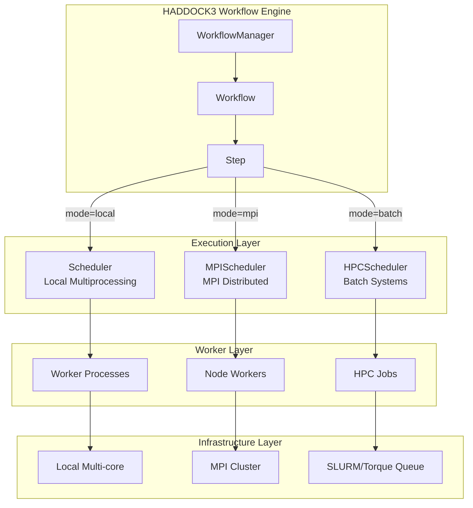
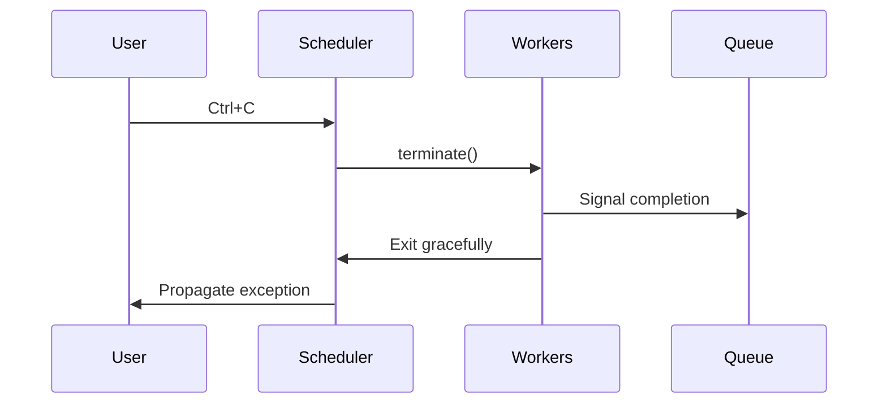
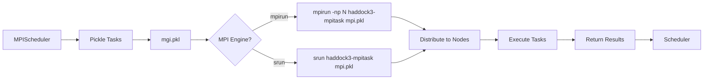
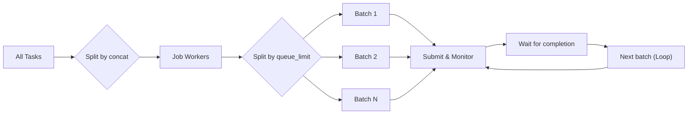
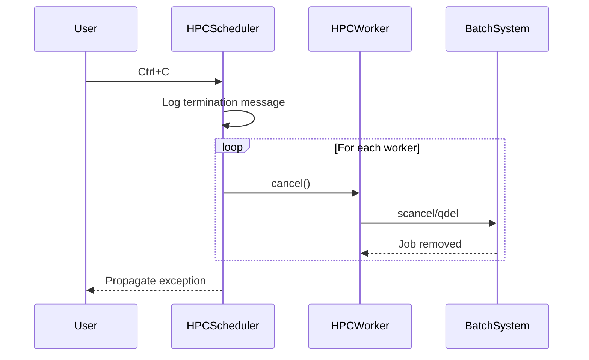
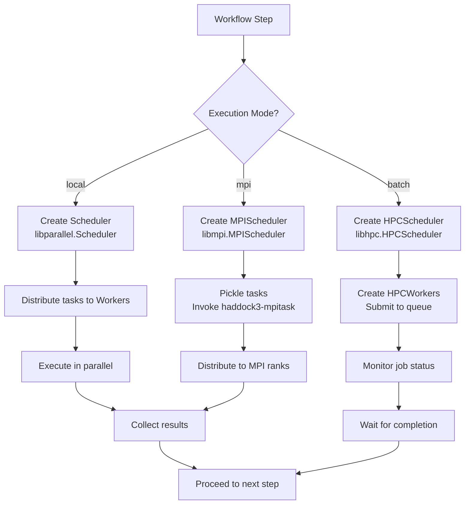

HADDOCK3 provides a sophisticated parallel execution framework supporting multiple execution models to adapt to different computational environments. The system intelligently manages computational resources across local workstations, MPI-enabled clusters, and High-Performance Computing (HPC) batch systems.

## Architecture Overview

HADDOCK3 implements a **three-tier execution architecture** that abstracts the complexity of parallel task distribution:



The execution mode is controlled by the `mode` parameter in your workflow configuration, enabling seamless transition between execution environments without modifying the workflow logic.

## Local Multiprocessing Execution

Local multiprocessing represents the **default execution mode** for HADDOCK3, leveraging Python's multiprocessing module to distribute tasks across multiple CPU cores on a single machine.

### Scheduler Architecture

The `Scheduler` class ([libparallel.py](src/haddock/libs/libparallel.py#L105-L209)) orchestrates parallel task execution through the following components:

- **Task Distribution**: Tasks are evenly split across available cores using the `split_tasks()` function ([libparallel.py](src/haddock/libs/libparallel.py#L19-L27))
- **Worker Processes**: Each worker inherits from `Process` ([libparallel.py](src/haddock/libs/libparallel.py#L75-L104)) and executes a subset of tasks
- **Result Collection**: A shared `Queue` aggregates results from all workers with completion signaling
- **Task Sorting**: When tasks are `CNSJob` objects, they are sorted by `input_file` name to ensure consistent ordering ([libparallel.py](src/haddock/libs/libparallel.py#L132-L150))

> [!TIP]
> The scheduler automatically sorts CNSJob tasks by input_file name before distribution. This ensures that task #2 always runs before task #10, preventing non-deterministic execution order that could affect downstream analysis.

### CPU Core Allocation

The system intelligently determines the optimal number of cores through the `parse_ncores()` function ([libutil.py](src/haddock/libs/libutil.py#L178-L243)):

```python
# Core allocation logic
1. Detect available cores via cpu_count()
2. Apply max_cpus constraint (true = all cores, false = cores - 1)
3. Min(desired_ncores, njobs, max_cpus) final allocation
```

The `cpu_count()` function ([libutil.py](src/haddock/libs/libutil.py#L134-L177)) uses `os.sched_getaffinity(0)` for accurate detection of cores allocated to the current process, with fallback to `os.cpu_count()` on macOS.

### Task Distribution Algorithm

For distributing N models across C cores, `get_index_list()` ([libparallel.py](src/haddock/libs/libparallel.py#L27-L61)) implements an optimal load-balancing algorithm:

- **Base allocation**: Each core receives `nmodels // ncores` models
- **Remainder distribution**: First `nmodels % ncores` cores receive one additional model
- **Index boundaries**: Returns list of partition indices for parallel scanning

This ensures even task distribution when the number of models is not evenly divisible by the core count.

### Controlled Termination

The scheduler implements graceful shutdown through the `terminate()` method ([libparallel.py](src/haddock/libs/libparallel.py#L203-L209)):



Keyboard interrupts are caught and propagated to the workflow layer ([libparallel.py](src/haddock/libs/libparallel.py#L188-L195)), allowing clean cancellation without leaving orphaned processes.

## MPI Distributed Execution

For **multi-node clusters**, HADDOCK3 provides MPI support through the `MPIScheduler` class ([libmpi.py](src/haddock/libs/libmpi.py#L14-L59)).

### MPI Workflow



The MPI execution flow involves:

1. **Task Serialization**: Tasks are pickled to `mpi.pkl` in the current working directory ([libmpi.py](src/haddock/libs/libmpi.py#L52-L59))
2. **Engine Detection**: Automatically detects `mpirun` or `srun` availability ([libmpi.py](src/haddock/libs/libmpi.py#L25-L33))
3. **Command Execution**: Submits tasks via `subprocess.run()` with error checking ([libmpi.py](src/haddock/libs/libmpi.py#L35-L50))

### MPI Task Runner

The `haddock3-mpitask` CLI ([cli_mpi.py](src/haddock/clis/cli_mpi.py#L1-L124)) serves as the MPI entry point:

- **Lazy MPI Loading**: MPI module imports are deferred via `get_mpi()` function ([cli_mpi.py](src/haddock/clis/cli_mpi.py#L39-L56)) to facilitate testing
- **Task Splitting**: Distributes tasks evenly across MPI ranks using `split_tasks()` ([cli_mpi.py](src/haddock/clis/cli_mpi.py#L57-L62))
- **Execution**: Each rank executes its assigned task subset independently

> [!TIP]
> The MPI runner uses lazy loading of the MPI module. This design allows the CLI to be imported and tested without requiring MPI to be installed on the development system.

## HPC Batch System Execution

For **large-scale production runs**, HADDOCK3 integrates with SLURM and Torque workload managers through the `HPCScheduler` class ([libhpc.py](src/haddock/libs/libhpc.py#L136-L234)).

### Batch System Architecture

| Component | Class | Responsibility |
|-----------|-------|----------------|
| Job Definition | `HPCWorker` ([libhpc.py](src/haddock/libs/libhpc.py#L45-L135)) | Defines individual batch jobs |
| Queue Management | `HPCScheduler` ([libhpc.py](src/haddock/libs/libhpc.py#L136-L234)) | Submits and monitors batch jobs |
| Job Generation | `create_slurm_header()` ([libhpc.py](src/haddock/libs/libhpc.py#L236-L280)) | Creates SLURM job scripts |
| Job Generation | `create_torque_header()` ([libhpc.py](src/haddock/libs/libhpc.py#L280-L320)) | Creates Torque job scripts |

### Job Concatenation Strategy

The `concat` parameter enables **job bundling** to optimize batch system efficiency:

- **Default**: 1 model per job (maximum parallelism)
- **Higher values**: Multiple models calculated within a single job script
- **Benefits**: Reduces scheduler load, longer job duration, less frequent submission

The scheduler concatenates tasks based on the concat level ([libhpc.py](src/haddock/libs/libhpc.py#L150-L154)):

```python
job_list = [task_list[i:i + concat] for i in range(0, len(task_list), concat)]
```

### Queue Limiting and Batching

To prevent overwhelming the batch scheduler, the `queue_limit` parameter controls submission concurrency:



The scheduler processes jobs in batches ([libhpc.py](src/haddock/libs/libhpc.py#L167-L197)):

1. **Batch creation**: Split workers into `queue_limit` sized batches
2. **Submission**: Submit all jobs in current batch
3. **Monitoring**: Poll job status with adaptive sleep intervals:
   - < 10 jobs: 10 seconds
   - 10-50 jobs: 30 seconds
   - > 50 jobs: 60 seconds
4. **Completion tracking**: Wait for all jobs in batch to reach terminated state
5. **Progress reporting**: Log batch completion percentage

### Job Status Monitoring

The `update_status()` method ([libhpc.py](src/haddock/libs/libhpc.py#L114-L127)) retrieves job status from the scheduler:

- **SLURM**: Parses `scontrol show job` output using regex ([libhpc.py](src/haddock/libs/libhpc.py#L342-L362))
- **Torque**: Parses `qstat` output
- **Status mapping**: Converts scheduler-specific states to unified status codes ([libhpc.py](src/haddock/libs/libhpc.py#L18-L28)):
  - `PENDING` → `submitted`
  - `RUNNING`/`COMPLETING` → `running`
  - `SUSPENDED` → `hold`
  - `COMPLETED` → `finished`
  - `FAILED` → `failed`
  - `TIMEOUT` → `timed-out`

### Job File Generation

HPC workers generate submission scripts automatically ([libhpc.py](src/haddock/libs/libhpc.py#L80-L105)):

```bash
# SLURM example header
#!/bin/bash
#SBATCH --job-name=haddock3
#SBATCH --partition=<queue>
#SBATCH --ntasks=1
#SBATCH --output=<job_fname>.out
#SBATCH --error=<job_fname>.err

# Export CNS environment
export MODDIR=<module_directory>
export MODULE=<cns_folder>
export TOPPAR=<toppar_path>

# Execute tasks
cd <module_directory>
cns < input_file1 > output_file1
cns < input_file2 > output_file2
```

Environment variables are exported via `create_CNS_export_envvars()` ([libhpc.py](src/haddock/libs/libhpc.py#L363-L388)) to ensure CNS execution context is properly configured.

### Controlled Job Cancellation

The `terminate()` method ([libhpc.py](src/haddock/libs/libhpc.py#L227-L234)) handles graceful cancellation:



The `HPCWorker.cancel()` method ([libhpc.py](src/haddock/libs/libhpc.py#L128-L135)) bypasses finished/failed jobs to prevent redundant cancellation commands.

## Configuration Parameters

Execution behavior is controlled through a comprehensive set of parameters defined in [modules/defaults.yaml](src/haddock/modules/defaults.yaml):

### Core Execution Parameters

| Parameter | Default | Type | Description |
|-----------|---------|------|-------------|
| `mode` | `local` | string | Execution mode: `local`, `batch` |
| `ncores` | 4 | integer | CPU cores for local execution |
| `max_cpus` | true | boolean | Allow maximum CPU usage |
| `batch_type` | `slurm` | string | Batch system: `slurm`, `torque` |
| `queue` | "" | string | Target queue/partition name |

### Queue Management Parameters

| Parameter | Default | Type | Range | Description |
|-----------|---------|------|-------|-------------|
| `queue_limit` | 100 | integer | 1-9999 | Max concurrent batch jobs |
| `concat` | 1 | integer | 1-9999 | Models per job script |

> [!TIP]
> The `concat` parameter is particularly useful for HPC environments with job submission limits. Setting `concat=10` reduces the number of job submissions by 10× while still utilizing parallelism within each job.

### Advanced Parameters

| Parameter | Default | Type | Level | Description |
|-----------|---------|------|-------|-------------|
| `self_contained` | false | boolean | guru | Copy CNS scripts to run folder |
| `clean` | true | boolean | easy | Compress output files on success |
| `offline` | false | boolean | easy | Isolate from internet |
| `debug` | false | boolean | easy | Write intermediate files |

## Execution Mode Selection

The workflow engine automatically selects the appropriate scheduler based on the `mode` parameter:



### Resource Parameter Dependencies

Some parameters have dependencies that affect execution:

- **`debug` + `mode=batch`**: Incompatible ([defaults.yaml](src/haddock/modules/defaults.yaml#L151-L155)) - increased I/O conflicts with batch system policies
- **`self_contained`**: Required for remote execution or debugging without modifying installation files
- **`max_cpus`**: Controls whether to reserve one core for system processes (`false`) or use all available cores (`true`)

## Integration with Workflow Engine

The `Step.execute()` method ([libworkflow.py](src/haddock/libs/libworkflow.py#L157-L177)) demonstrates how parallel execution integrates with the overall workflow:

1. **Module Loading**: Dynamically imports the module based on `module_name`
2. **Configuration**: Updates module parameters with user settings
3. **Execution**: Calls `module.run()`, which internally uses the appropriate scheduler
4. **Error Handling**: Catches `KeyboardInterrupt` for controlled termination

The `Step.clean()` method ([libworkflow.py](src/haddock/libs/libworkflow.py#L183-L191)) leverages parallelism for cleanup operations by passing `ncores` to `clean_output()`.

## Best Practices

### Local Execution

- Set `max_cpus=false` on interactive workstations to reserve CPU for other tasks
- Use `ncores` matching your available physical cores (avoid oversubscription)
- Monitor system load to prevent disk I/O bottlenecks with many concurrent jobs

### MPI Execution

- Ensure `mpirun` or `srun` is in your PATH before execution
- Match `ncores` to the number of nodes/cores allocated by your MPI job scheduler
- Use for scaling across multiple compute nodes, not single-node parallelism

### HPC Execution

- Use `concat` values that balance job duration and scheduler efficiency
- Set `queue_limit` based on your institution's submission policies
- Monitor queue status with batch system commands independently if needed
- Consider `self_contained=true` for debugging failed jobs on login nodes

### Troubleshooting

| Issue | Diagnosis | Solution |
|-------|-----------|----------|
| Orphaned processes after Ctrl+C | Scheduler not caught interrupt | Check for proper exception handling in custom modules |
| Uneven load distribution | Tasks not CNSJob type | Ensure tasks have `input_file` attribute for sorting |
| Batch jobs pending indefinitely | Queue not specified | Set `queue` parameter to correct partition name |
| MPI tasks timeout | Pickle file too large | Reduce task count or use HPC mode instead |

## Next Steps

Understanding parallel execution is essential for optimizing HADDOCK3 performance. To deepen your knowledge:

- Explore [Workflow Engine and Execution Model](7-workflow-engine-and-execution-model) to understand how parallel execution integrates with the overall workflow architecture
- Review [Parameter Reference and Tuning](26-parameter-reference-and-tuning) for detailed parameter explanations
- Study [Restart and Extend Functionality](28-restart-and-extend-functionality) to see how execution state is preserved across runs
- Examine [Module System and Plugin Architecture](9-module-system-and-plugin-architecture) to understand how individual modules implement parallel execution

For practical implementation guidance, see the [examples/](src/haddock/examples) directory, particularly the MPI integration examples demonstrating distributed execution across computational clusters.