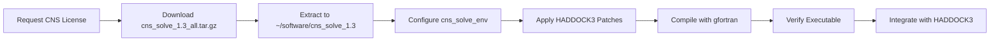

This guide provides comprehensive instructions for installing HADDOCK3 across different environments and use cases. HADDOCK3 supports multiple installation methods tailored to your computing environment, expertise level, and intended applications.

## System Requirements

HADDOCK3 requires specific system configurations to function correctly across its computational modules.

| Component | Minimum Version | Recommended Version | Notes |
|-----------|----------------|---------------------|-------|
| Python | 3.9 | 3.11 - 3.12 | Supported up to 3.13, < 3.15 |
| Operating System | Linux, macOS | Linux (Ubuntu/Debian) | POSIX-compliant systems |
| Memory | 4GB RAM | 8GB+ RAM | For complex docking scenarios |
| Disk Space | 2GB | 10GB+ | For temporary files and results |
| CNS Compiler | gcc, gfortran, csh | Latest stable | Required for CNS compilation |

**Python Environment**: The project officially supports Python 3.9 through 3.13, with dependency specifications defined in the build configuration that ensure compatibility across minor versions [pyproject.toml](/pyproject.toml#L42-L52).

Sources: [pyproject.toml](/pyproject.toml#L42-L52), [README.md](/README.md#L37-L40)

## Installation Architecture Overview

Understanding HADDOCK3's installation architecture helps you choose the right installation path for your needs.

```mermaid
flowchart TD
    A[HADDOCK3 Installation] --> B{Installation Method}
    
    B --> C[Production Install]
    B --> D[Development Install]
    B --> E[Docker Install]
    
    C --> F{Environment Choice}
    F --> G[venv]
    F --> H[conda]
    
    G --> I[pip install haddock3]
    H --> I
    
    D --> J[Clone Repository]
    J --> K[pip install -e .]
    
    E --> L[Pull Docker Image]
    L --> M[Docker Build]
    
    I --> N{Optional Components}
    N --> O[MPI Support]
    N --> P[OpenMM]
    N --> Q[Third-party Tools]
    
    O --> R[pip install 'haddock3[mpi]']
    P --> S[OpenMM + pdbfixer]
    Q --> T[lightdock, gdock]
    
    R --> U[✅ Ready to Use]
    S --> U
    T --> U
    M --> U
```

The installation process follows a modular approach where you can choose your base installation method and then layer optional components based on your computational requirements.

Sources: [docs/INSTALL.md](/docs/INSTALL.md#L1-L20), [README.md](/README.md#L27-L39), [pyproject.toml](/pyproject.toml#L61-L76)

## Quick Installation

For most users, the quickest path to get started is through a production installation using pip.


### Using Virtual Environment (venv)

The Python `venv` module provides a lightweight and recommended approach for creating isolated environments:

```bash
# Create a virtual environment
python -m venv .venv

# Activate the virtual environment
source .venv/bin/activate  # On Linux/macOS
# .venv\Scripts\activate  # On Windows

# Install HADDOCK3
pip install haddock3
```

### Using Conda

If you prefer Conda for environment management:

```bash
# Create a new conda environment
conda create -n haddock3 python=3.11
conda activate haddock3

# Install HADDOCK3
pip install haddock3
```

> [!TIP]
> Always activate your virtual environment before running HADDOCK3 commands. This prevents conflicts with system-wide packages and ensures reproducibility.

After installation, verify your installation with:

```bash
haddock3 --version
haddock3 -h
```

Sources: [docs/INSTALL.md](/docs/INSTALL.md#L4-L15), [README.md](/README.md#L27-L32)

## Installation Options

### Standard Installation

The standard installation includes all core dependencies required for basic HADDOCK3 functionality:

- **pdb-tools**: PDB file manipulation
- **biopython**: Bioinformatics utilities
- **numpy/scipy**: Numerical computing
- **pyyaml/toml**: Configuration file parsing
- **pandas**: Data analysis
- **prodigy-prot/prodigy-lig**: Scoring functions
- **plotly**: Visualization
- **freesasa**: Solvent accessibility calculations

These dependencies are automatically installed when you run `pip install haddock3` [pyproject.toml](/pyproject.toml#L51-L59).

### MPI Support Installation

For parallel execution on multi-core systems or compute clusters, install HADDOCK3 with MPI support:

```bash
pip install 'haddock3[mpi]'
```

This installs `mpi4py>=4.0.2` as an additional dependency [pyproject.toml](/pyproject.toml#L74). For detailed instructions on configuring and using MPI with HADDOCK3, refer to the [MPI Configuration](4-mpi-configuration) page.

### Development Installation

If you plan to contribute to HADDOCK3 or need the latest development features:

```bash
# Clone the repository
git clone https://github.com/haddocking/haddock3.git
cd haddock3

# Create and activate a virtual environment
python -m venv .venv
source .venv/bin/activate

# Install in development mode
pip install -e .

# Install development dependencies
pip install -e '.[dev]'
```

Development mode (`-e`) creates an editable installation that reflects changes in the source code immediately. Development dependencies include testing frameworks (pytest, hypothesis), coverage tools, and web service components [pyproject.toml](/pyproject.toml#L63-L71).

Sources: [README.md](/README.md#L33-L35), [pyproject.toml](/pyproject.toml#L61-L76)

## Docker Installation

For users who prefer containerized environments or need reproducible deployments:

### Using Pre-built Images

HADDOCK3 provides Docker containers with all dependencies pre-configured:

```bash
# Pull the latest image
docker pull haddocking/haddock3:latest

# Run HADDOCK3
docker run --rm -v $(pwd):/data haddocking/haddock3:latest <config-file.toml>
```

### Building from Dockerfile

If you need to customize the Docker environment:

```dockerfile
FROM python:3.13
WORKDIR /opt/software
COPY . .
RUN pip install --no-cache-dir .
WORKDIR /data
ENTRYPOINT [ "haddock3" ]
```

Build the image:

```bash
docker build -t haddock3-custom .
docker run --rm -v $(pwd):/data haddock3-custom <config-file.toml>
```

The Dockerfile uses Python 3.13 as the base image and installs HADDOCK3 with all necessary dependencies in a clean environment [Dockerfile](/Dockerfile#L1-L9).

Sources: [Dockerfile](/Dockerfile#L1-L9), [pyproject.toml](/pyproject.toml#L1-L114)

## CNS Installation and Configuration

The Crystallography and NMR System (CNS) serves as the computational engine for most HADDOCK3 modules. While a pre-compiled CNS binary is included with pip installations, you may need to compile CNS manually for your specific architecture.

### Prerequisites for CNS Compilation

Install required compilers:

```bash
# Ubuntu/Debian
sudo apt-get install gcc gfortran csh

# macOS with Homebrew
brew install gcc
```

### CNS Installation Process



#### Step 1: Download CNS

1. Request a free academic license at http://cns-online.org
2. Download `cns_solve_1.3_all.tar.gz` with provided credentials
3. Extract to your preferred location:

```bash
mkdir ~/software
mv ~/Downloads/cns_solve_1.3_all.tar.gz ~/software/
tar -zxvf cns_solve_1.3_all.tar.gz
```

#### Step 2: Configure CNS Environment

Configure the environment file to point to your installation directory:

```bash
cd cns_solve_1.3
sed -i 's@_CNSsolve_location_@'"$PWD"'@' cns_solve_env
```

Verify the configuration:

```bash
sed -n 18p cns_solve_env
# Expected output: setenv CNS_SOLVE '/Absolute/path/to/cns_solve_1.3'
```

#### Step 3: Apply HADDOCK3 Patches

**Critical**: CNS requires HADDOCK3-specific patches to function correctly with HADDOCK3.

```bash
cp -r ~/software/haddock3/varia/cns1.3/[bis]* ~/software/cns_solve_1.3/
```

These patches contain modifications to the CNS source code that enable HADDOCK3-specific features [docs/CNS.md](/docs/CNS.md#L66-L71).

#### Step 4: Compile CNS

Check your system architecture:

```bash
~/software/cns_solve_1.3/bin/getarch
```

Compile CNS:

```bash
cd ~/software/cns_solve_1.3
make install compiler=gfortran
```

The executable will be created in an architecture-specific directory, such as:
- Linux (Intel/AMD): `intel-x86_64bit-linux/source/cns_solve-XXXXXXX.exe`
- Mac ARM (M1/2/3): `mac-arm-darwin/source/cns_solve-XXXXXXX.exe`

#### Step 5: Verify and Integrate

Test the compiled executable:

```bash
~/software/cns_solve_1.3/intel-x86_64bit-linux/source/cns_solve-2405221906.exe
```

You should see the CNS prompt. Exit with `stop`.

Integrate with HADDOCK3 installation:

```bash
# Find HADDOCK3 installation location
pip show haddock3

# Copy compiled CNS to HADDOCK3 bin directory
cp <cns-executable> <haddock3-installation-path>/haddock/bin/cns
```

> [!TIP]
> If the pip-installed CNS binary fails due to missing libraries, recompiling CNS for your specific architecture resolves most compatibility issues.

Sources: [docs/CNS.md](/docs/CNS.md#L1-L200), [docs/INSTALL.md](/docs/INSTALL.md#L41-L63), [setup.py](/setup.py#L230-L250)

## Optional: OpenMM Integration

HADDOCK3's OpenMM module enables advanced molecular dynamics simulations and requires additional dependencies.

### Installation with venv (Python ≥ 3.10)

```bash
# Create a new environment (OpenMM requires Python ≥ 3.10)
python3.12 -m venv hd3-openmm
source hd3-openmm/bin/activate

# Install HADDOCK3
pip install haddock3

# Install OpenMM and pdbfixer
pip install openmm==8.2.0
pip install https://github.com/openmm/pdbfixer/archive/refs/tags/v1.10.tar.gz
```

### Installation with conda (Python 3.9-3.13)

```bash
conda create -n hd3-p39-openmm python=3.9
conda activate hd3-p39-openmm

# Install HADDOCK3
pip install haddock3

# Install libstdcxx and OpenMM
conda install -c conda-forge libstdcxx-ng
conda install -c conda-forge openmm==8.2.0 pdbfixer==1.10
```

OpenMM automatically detects and uses the fastest available platform (CPU, GPU, or both) on your system.

Sources: [docs/INSTALL.md](/docs/INSTALL.md#L107-L151)

## Optional: Third-Party Tool Integration

HADDOCK3 can integrate with external docking and analysis tools to expand its capabilities.

### LightDock and GDock

**Note**: These tools are marked as outdated but remain available for specialized use cases.

#### LightDock Installation

Follow instructions at https://github.com/lightdock/lightdock. Install in the same Python environment as HADDOCK3.

#### GDock Installation

```bash
# Clone the repository
cd some-folder
git clone https://github.com/rvhonorato/gdock.git

# Install dependencies
pip install deap scipy mgzip biopython

# Set environment variable
export GDOCK_PATH=some-folder
```

Refer to the GDock repository for complete installation instructions [docs/INSTALL.md](/docs/INSTALL.md#L79-L105).

## Optional: Web Service Dependencies

To run the HADDOCK3 restraints web service:

```bash
pip install uvicorn fastapi
```

The web service enables remote generation of restraints and is documented in the restraints module [docs/INSTALL.md](/docs/INSTALL.md#L65-L70), [src/haddock/clis/restraints/webservice.py](/src/haddock/clis/restraints/webservice.py).

## Verification and Testing

After installation, verify your setup:

### Basic Functionality Test

```bash
# Check version
haddock3 -v

# Display help
haddock3 -h
```

### Run Example

Navigate to the examples directory:

```bash
cd examples/docking-protein-protein/
haddock3 run.toml
```

### Integration Tests

For comprehensive testing, run the integration test suite:

```bash
# From repository root
pytest integration_tests/
```

These tests verify core functionality across different modules and scenarios [integration_tests/](/integration_tests/).

## Troubleshooting

### CNS Binary Issues

**Problem**: CNS executable gives errors about missing libraries.

**Solution**: Recompile CNS from source following the CNS installation process above. Replace the packaged binary with your compiled version [docs/INSTALL.md](/docs/INSTALL.md#L41-L63).

### Architecture Not Recognized

**Problem**: `getarch` returns `unknown-...`.

**Solution**: Edit the `bin/getarch` script to add your architecture. For Mac M1/2/3 processors:

```shell
arm64:Darwin:*:*)
    echo mac-arm64-darwin
    exit 0 ;;
```

Then create the corresponding directory under `instlib/machine/supported/` [docs/CNS.md](/docs/CNS.md#L171-L194).

### Compiler Not Found

**Problem**: Error message "no suitable compiler found".

**Solution**: Install gfortran:

```bash
# Linux
sudo apt-get install gfortran

# macOS
brew install gcc
```

Sources: [docs/CNS.md](/docs/CNS.md#L196-L235)

## Available CLI Tools

HADDOCK3 provides multiple command-line interfaces for different tasks:

| Command | Purpose | Entry Point |
|---------|---------|-------------|
| `haddock3` | Main execution CLI | `haddock.clis.cli:maincli` |
| `haddock3-mpitask` | MPI task execution | `haddock.clis.cli_mpi:maincli` |
| `haddock3-cfg` | Configuration management | `haddock.clis.cli_cfg:maincli` |
| `haddock3-clean` | Output cleanup | `haddock.clis.cli_clean:maincli` |
| `haddock3-copy` | Run directory copying | `haddock.clis.cli_cp:maincli` |
| `haddock3-pp` | PDB preprocessing | `haddock.clis.cli_pp:maincli` |
| `haddock3-score` | Scoring utilities | `haddock.clis.cli_score:maincli` |
| `haddock3-analyse` | Result analysis | `haddock.clis.cli_analyse:maincli` |
| `haddock3-restraints` | Restraint generation | `haddock.clis.cli_restraints:maincli` |

Sources: [pyproject.toml](/pyproject.toml#L78-L92), [src/haddock/clis/](/src/haddock/clis/)

## Next Steps

After successful installation, proceed with:

1. **[Quick Start](2-quick-start)**: Run your first HADDOCK3 simulation with example configurations
2. **[MPI Configuration](4-mpi-configuration)**: Set up parallel execution for large-scale docking
3. **[Third-Party Tool Integration](5-third-party-tool-integration)**: Configure external tools for specialized workflows
4. **[HADDOCK3 Architecture](6-haddock3-architecture-and-design-philosophy)**: Understand the system design for advanced usage

For detailed usage instructions and examples, visit the [examples](https://github.com/haddocking/haddock3/blob/main/examples/README.md) directory and consult the [online documentation](https://www.bonvinlab.org/haddock3-user-manual).
