Protein-protein docking in HADDOCK3 follows a **modular, multi-stage workflow** that systematically explores conformational space from coarse sampling to fine-grained refinement. This approach leverages experimental data through Ambiguous Interaction Restraints (AIRs) to guide the docking process toward biologically relevant solutions. The workflow architecture enables you to customize each stage independently, selecting appropriate modules based on your specific computational resources and experimental constraints.

## Protein-Protein Docking Architecture

The protein-protein docking pipeline operates through a **sequential modular workflow** where each stage progressively refines the docking solutions. The core architecture consists of four primary stages: topology preparation, rigid-body sampling, semi-flexible refinement, and final refinement with clustering. This staged approach balances computational efficiency with solution quality by progressively applying more expensive computational methods to increasingly focused solution sets.


The workflow execution model is built around three core classes in the `libworkflow.py` module: `WorkflowManager` orchestrates the entire pipeline, `Workflow` represents the collection of stages, and `Step` encapsulates individual module execution. This design enables the system to handle **complex dependencies** between modules while maintaining clean separation of concerns. The workflow manager reads configuration parameters, executes modules in sequence, and handles post-processing and cleanup operations.

The following diagram illustrates the protein-protein docking workflow with module progression and data flow:

```mermaid
flowchart LR
    A[Input PDB Files] --> B[topoaa<br/>Topology Generation]
    B --> C[rigidbody<br/>Rigid-Body Sampling]
    C --> D[seletop<br/>Selection]
    D --> E[flexref<br/>Semi-Flexible Refinement]
    E --> F[emref<br/>Final Energy Minimization]
    F --> G[clustfcc<br/>Clustering]
    G --> H[seletopclusts<br/>Top Model Selection]
    H --> I[Analysis & Evaluation]
    
    style A fill:#e1f5fe
    style I fill:#c8e6c9
```



Sources: [libworkflow.py](/src/haddock/libs/libworkflow.py#L23-L191), [docking-protein-protein-full.cfg](/examples/docking-protein-protein/docking-protein-protein-full.cfg#L1-L76)

## Core Module Sequence

The protein-protein docking workflow consists of **essential modules** that must be executed in sequence. Each module transforms the structural models and prepares them for the next stage, with optional analysis modules interleaved to monitor progress.

### Topology Preparation (topoaa)

The `topoaa` module generates molecular topologies from PDB files, preparing molecules for CNS-based calculations. This module handles critical preprocessing tasks including **automatic protonation state assignment**, hydrogen addition, and disulfide bond detection. For protein-protein docking, you can manually specify histidine protonation states when experimental knowledge is available.

Key configuration options include:
- `autohis`: Automatically determines histidine protonation based on electrostatic energy
- `delenph`: Removes non-polar hydrogens to reduce computational cost
- `molX` parameters: Molecule-specific settings for histidine states, terminal charges

Sources: [topoaa defaults.yaml](/src/haddock/modules/topology/topoaa/defaults.yaml#L1-L220), [docking-protein-protein-test.cfg](/examples/docking-protein-protein/docking-protein-protein-test.cfg#L19-L25)

### Rigid-Body Sampling (rigidbody)

The `rigidbody` module performs **extensive conformational sampling** by treating molecules as rigid bodies and exploring rotational and translational space. This is the most computationally intensive stage, typically generating hundreds to thousands of models. The module supports multiple sampling strategies including restrained docking with AIRs and ab initio modes with center-of-mass restraints or random interaction restraints.

Critical parameters include:
- `sampling`: Number of models to generate (default varies by mode)
- `ambig_fname`: Path to ambiguous interaction restraints file
- `cmrest`: Enable center-of-mass restraints for ab initio docking
- `ranair`: Generate random interaction restraints from surface residues

The `randremoval` parameter enables **restraint randomization** by splitting ambiguous restraints into partitions and excluding one set per model. With default `npart=2`, approximately 50% of restraints are randomly removed for each model, reducing bias and increasing solution diversity.

Sources: [rigidbody defaults.yaml](/src/haddock/modules/sampling/rigidbody/defaults.yaml#L1-L200), [docking-protein-protein-full.cfg](/examples/docking-protein-protein/docking-protein-protein-full.cfg#L31-L34)

### Model Selection (seletop)

After rigid-body sampling, the `seletop` module **filters models** based on energy scores or other criteria to reduce the solution set for refinement. This selection is crucial for computational efficiency, as refinement stages are more expensive per model. The module selects the top N models by default, but can be customized for different selection strategies.

Configuration example:
```toml
[seletop]
select = 200
```

This reduces 1000 rigid-body models to 200 for semi-flexible refinement.

### Semi-Flexible Refinement (flexref)

The `flexref` module introduces **conformational flexibility** through a simulated annealing protocol. Molecules are allowed to move relative to each other while side-chain and backbone flexibility can be enabled at interfaces. This stage uses a **multi-phase annealing schedule** with separate force constants for hot, cool1, cool2, and cool3 phases.

Phase-specific force constants enable progressive tightening of restraints:
- `ambig_hot`: Force constant during initial high-temperature phase (default: 10)
- `ambig_cool1`: First cooling phase (default: 10)
- `ambig_cool2`: Second cooling phase with side-chain flexibility (default: 50)
- `ambig_cool3`: Third cooling phase with backbone flexibility (default: 50)

The module also supports fully flexible segments specified through the `nfle` parameter, allowing detailed conformational sampling in specific regions.

Sources: [flexref defaults.yaml](/src/haddock/modules/refinement/flexref/defaults.yaml#L1-L200), [docking-protein-protein-test.cfg](/examples/docking-protein-protein/docking-protein-protein-test.cfg#L39-L41)

### Final Refinement (emref)

The `emref` module performs **energy minimization** to remove any residual strains and optimize atomic positions. This final refinement step uses full atomic detail with explicit solvent representation, producing the final docked models ready for analysis.

### Clustering and Selection (clustfcc, seletopclusts)

The `clustfcc` module groups similar solutions using **Fast Contact Clustering**, a graph-based algorithm that clusters models based on interface contacts. This identifies distinct binding modes and helps assess solution convergence. The `seletopclusts` module then selects the top models from each cluster, typically returning 4 representative models.

Sources: [docking-protein-protein-test.cfg](/examples/docking-protein-protein/docking-protein-protein-test.cfg#L43-L47)

## Ambiguous Interaction Restraints (AIRs)

AIRs are the **primary experimental data integration mechanism** in HADDOCK. They define distance restraints between active residues on one molecule and active or passive residues on the partner molecule. The ambiguity arises because the system doesn't specify which exact residue pairs interact, allowing the docking algorithm to determine optimal contact configurations.

### AIR File Format

AIRs are defined in CNS-format `.tbl` files using the `assign` statement. Each restraint specifies:
- **Selection criteria** for the first molecule (typically active residues)
- **Logical OR** of selections for the second molecule (active or passive residues)
- **Distance parameters**: lower bound, upper bound, and force constant

Example from the E2A-HPR complex:

```
assign ( resid 38  and segid A )
       (
        ( resid 15  and segid B )
     or  ( resid 16  and segid B )
     or  ( resid 17  and segid B )
     or  ( resid 20  and segid B )
     ...
       )  2.0 2.0 0.0
```

This restrains residue 38 in chain A to be within 2.0 Å of at least one of the specified residues in chain B. The parameters (2.0 2.0 0.0) define lower bound, upper bound, and force constant respectively.

Sources: [e2a-hpr_air.tbl](/examples/docking-protein-protein/data/e2a-hpr_air.tbl#L1-L200)

### Generating AIRs

You can generate AIRs through multiple approaches:
- **Manual definition** based on experimental mutagenesis data
- **NMR chemical shift perturbation** identifying affected residues
- **Bioinformatics predictions** using conservation and surface accessibility
- **Cross-linking mass spectrometry** distance constraints
- **HADDOCK tools** for automated restraint generation

The `cli_restraints` and `cli_pp` (preprocessing) modules in the `clis/` directory provide utilities for converting active/passive residue lists into AIR files.

> [!TIP]
> The `randremoval` parameter in rigidbody and flexref modules provides a powerful mechanism to reduce restraint bias. By randomly excluding a subset of AIRs for each model (default 50%), the system can explore a broader conformational space while still being guided by experimental data.

## Configuration with TOML

HADDOCK3 uses **TOML format** for workflow configuration, providing a clear, human-readable structure. The configuration file specifies molecules, module sequence, and module-specific parameters.

### Basic Configuration Structure

A typical protein-protein docking configuration:

```toml
# Directory for output
run_dir = "run1-test"

# Execution mode
mode = "local"
ncores = 40

# Input molecules
molecules = [
    "data/e2aP_1F3G.pdb",
    "data/hpr_ensemble.pdb"
]

# Module sequence and parameters
[topoaa]
autohis = false
[topoaa.mol1]
nhise = 1
hise_1 = 75

[rigidbody]
sampling = 1000
ambig_fname = "data/e2a-hpr_air.tbl"

[seletop]
select = 200

[flexref]
tolerance = 5
ambig_fname = "data/e2a-hpr_air.tbl"

[emref]
tolerance = 5
ambig_fname = "data/e2a-hpr_air.tbl"

[clustfcc]

[seletopclusts]
top_models = 4
```

Sources: [docking-protein-protein-test.cfg](/examples/docking-protein-protein/docking-protein-protein-test.cfg#L1-L65)

### Execution Modes

The `mode` parameter controls execution strategy:
- `local`: Runs on local machine using specified `ncores`
- `batch`: Submits jobs to queuing system (requires queue configuration)
- `mpi`: Uses MPI for parallel execution across multiple nodes

Each mode has different resource management implications and requires appropriate environment setup. The `concat` parameter controls how many models are grouped into a single job for batch/mpi modes, optimizing load balancing.

Sources: [docking-protein-protein-full.cfg](/examples/docking-protein-protein/docking-protein-protein-full.cfg#L4-L15)

## Parameter Tuning Strategies

Effective protein-protein docking requires **careful parameter selection** balancing computational cost and solution quality. The following table provides guidance for key parameters:

| Module | Parameter | Range | Effect | Recommendation |
|--------|-----------|-------|--------|----------------|
| rigidbody | sampling | 100-10,000 | Solution space coverage | Start with 1000, increase for difficult cases |
| rigidbody | ambig_scale | 0-1000 | Restraint strength | 50 is default; increase if restraints are confident |
| rigidbody | npart | 1-20 | Restraint randomization fraction | 2 gives 50% removal; increase for more diversity |
| flexref | ambig_cool2/cool3 | 0-1000 | Refinement restraint strength | 50 is default; may need tuning |
| clustfcc | min_population | 1+ | Minimum cluster size | Higher values reduce cluster count |

### Sampling Considerations

The `sampling` parameter in rigidbody directly impacts computational time. For **initial exploration**, use 100-200 models. For **production runs**, 1000-2000 models is typical. For **ab initio docking** without restraints, consider 5000-10,000 models to adequately sample conformational space.

### Tolerance Settings

The `tolerance` parameter sets the **acceptable failure rate** for each module. Values of 5-20% allow for occasional CNS job failures while preventing complete workflow termination. Higher tolerance values reduce false negatives but may propagate errors.

> [!TIP]
> When working with ensembles (multiple conformers for a molecule), ensure the `topoaa` module processes all conformers. The `limit=false` parameter disables molecule number limits, enabling ensemble docking workflows.

## Running Protein-Protein Docking

Execute a protein-protein docking workflow with the `haddock3` command:

```bash
cd examples/docking-protein-protein
haddock3 docking-protein-protein-test.cfg
```

For batch execution on HPC systems:

```bash
haddock3 docking-protein-protein-full.cfg
```

The system will create a directory structure with outputs for each module, allowing you to **monitor progress** and inspect intermediate results.

Sources: [USAGE.md](/docs/USAGE.md#L30-L35)

## Analysis and Evaluation

HADDOCK3 provides multiple analysis modules for evaluating docking results:

### CAPRI Evaluation

The `caprieval` module compares docked models to a reference structure using **CAPRI criteria** (Interface RMSD, L-RMSD, fnat). This is particularly useful for benchmarking and validation.

```toml
[caprieval]
reference_fname = "data/e2a-hpr_1GGR.pdb"
```

Sources: [docking-protein-protein-test.cfg](/examples/docking-protein-protein/docking-protein-protein-test.cfg#L35-L36)

### Additional Analysis Tools

- **Contact Map**: Visualize interface residue contacts
- **Cluster Analysis**: Examine solution clustering statistics
- **Alanine Scanning**: Assess energetic contribution of interface residues
- **IL-RMSD**: Interface-ligand RMSD calculations

These tools are available in the `modules/analysis/` directory and can be integrated into post-processing workflows.

Sources: [analysis modules](/src/haddock/modules/analysis)

## Advanced Topics

### Ab Initio Docking

When experimental restraints are unavailable, enable ab initio modes:
- **Center-of-mass restraints**: `cmrest=true` with `kcm` controlling strength
- **Random interaction restraints**: `ranair=true` with surface residue selection

These approaches require larger sampling but can produce viable docking solutions for well-behaved complexes.

### Ensemble Docking

For proteins with **conformational flexibility**, use ensemble inputs:
```toml
molecules = [
    "data/protein_conformer1.pdb",
    "data/protein_conformer2.pdb",
    "data/partner.pdb"
]
```

Each conformer is treated independently, with results combined in clustering.

### Integration with External Tools

HADDOCK3 integrates with **LightDock** and **GDock** for enhanced sampling capabilities. These external samplers can replace or supplement the rigidbody module, providing alternative exploration strategies.

Sources: [LightDock integration](/examples/thirdparty/lightdock/lightdock.cfg), [GDock integration](/examples/thirdparty/gdock/gdock-integration.cfg)

## Troubleshooting Common Issues

| Issue | Cause | Solution |
|-------|-------|----------|
| Poor cluster convergence | Insufficient sampling | Increase rigidbody `sampling` parameter |
| Models violate restraints | Restraints too weak | Increase `ambig_scale` or `ambig_cool` parameters |
| High failure rates | Incompatible input structures | Use `cli_pp` for preprocessing and validation |
| Memory errors | Too many parallel jobs | Reduce `ncores` or `queue_limit` |

For comprehensive parameter documentation, use:
```bash
haddock3-cfg -m rigidbody
```

This displays all available parameters with descriptions for any module.

Sources: [USAGE.md](/docs/USAGE.md#L40-L44)

## Next Steps

Master the fundamentals of **molecular topology generation** with [Molecule Topology Generation with topoaa](10-molecule-topology-generation-with-topoaa), then explore **restraint definition strategies** in [Ambiguous Interaction Restraints (AIRs)](14-ambiguous-interaction-restraints-airs). For production docking runs, understand the **workflow execution model** in [Workflow Engine and Execution Model](7-workflow-engine-and-execution-model) and configure parallel execution with [MPI Configuration](4-mpi-configuration).