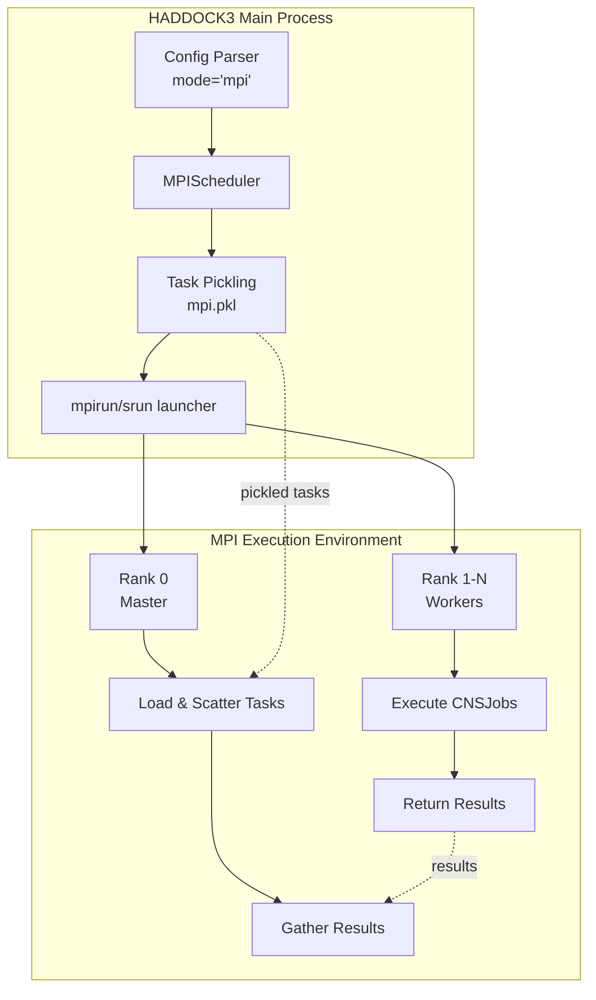

HADDOCK3 supports Message Passing Interface (MPI) for distributed execution across multiple compute nodes, enabling large-scale docking simulations that exceed the capabilities of single-machine parallelization. This configuration guide explains the MPI architecture, installation requirements, and practical setup for cluster environments.

## MPI Architecture Overview

HADDOCK3 implements a two-tier parallelization strategy: local multiprocessing for single-machine execution and MPI-based distributed computing for multi-node clusters. The MPI architecture follows a master-worker pattern where the main process orchestrates task distribution and result aggregation across compute nodes.



The system distinguishes between multiprocessing mode (default, using Python's `multiprocessing` module) and MPI mode (using `mpi4py`). The multiprocessing implementation, found in [`libparallel.py`](src/haddock/libs/libparallel.py#L105-L209), operates on a single machine with the `Scheduler` class managing `Worker` processes. In contrast, the MPI implementation uses the [`MPIScheduler`](src/haddock/libs/libmpi.py#L14-L59) class which launches the [`haddock3-mpitask`](src/haddock/clis/cli_mpi.py#L85-L93) CLI wrapper across multiple nodes.

## Installation Requirements

### MPI Dependencies

To enable MPI functionality, you must install both the Python MPI bindings and the system-level MPI implementation:

```bash
# Install mpi4py in your HADDOCK3 environment
pip install 'haddock3[mpi]'

# Alternatively, install mpi4py separately
pip install mpi4py

# Or use conda
conda install -c conda-forge mpi4py
```

The optional `mpi` dependency is defined in [`pyproject.toml`](pyproject.toml#L73) as `mpi4py>=4.0.2`. This package provides the Python interface to MPI, while the underlying MPI implementation (typically OpenMPI) must be available on your system.

Sources: [pyproject.toml](pyproject.toml#L53-L73), [INSTALL.md](docs/INSTALL.md#L26-L32)

### System Requirements

Your cluster must have one of the following MPI launchers installed:

| Launcher | Detection | Use Case |
|----------|-----------|----------|
| `mpirun` | Checked via `which()` | Standard OpenMPI environments |
| `srun` | Checked via `which()` | SLURM-based clusters |

The system automatically detects the available launcher during execution, as shown in the [`MPIScheduler.run()`](src/haddock/libs/libmpi.py#L29-L36) method.

## Configuration Parameters

### Essential Settings

To enable MPI execution, configure the following parameters in your HADDOCK3 workflow configuration file:

```toml
# Execution mode
mode = "mpi"

# Total number of cores across all nodes
ncores = 192
```

The `mode` parameter determines whether HADDOCK3 uses multiprocessing (default `"local"`) or MPI (`"mpi"`). The `ncores` parameter specifies the total number of CPU cores to utilize across all compute nodes.

Sources: [docking-protein-protein-mpi.cfg](examples/docking-protein-protein/docking-protein-protein-mpi.cfg#L8-L10)

### SLURM Integration

When running on SLURM-managed clusters, ensure your job submission script matches the `ncores` configuration:

```bash
#!/bin/bash
#SBATCH --nodes=2
#SBATCH --tasks-per-node=96
#SBATCH -J haddock3mpi

# Activate HADDOCK3 environment
source $HOME/miniconda3/bin/activate
conda activate haddock3

# Navigate to example directory
cd $HOME/haddock3/examples/docking-protein-protein

# Execute HADDOCK3 (NOT with mpirun prefix!)
haddock3 docking-protein-protein-mpi.cfg
```

In this example, `ncores = 192` matches `--nodes=2` × `--tasks-per-node=96`. The critical detail is that you should **not** prefix the `haddock3` command with `mpirun`—the MPI launcher is invoked internally by the `MPIScheduler` class.

Sources: [docking-protein-protein-mpi.job](examples/docking-protein-protein/docking-protein-protein-mpi.job#L1-L14), [mpi.md](docs/tutorials/mpi.md#L12-L13)

## Task Execution Workflow

### Pickling and Distribution

The MPI execution process follows these steps:

1. **Task Serialization**: The [`MPIScheduler`](src/haddock/libs/libmpi.py#L14-L59) pickles all tasks to a file named `mpi.pkl` in the current working directory. This serialization ensures tasks can be distributed across nodes with full state preservation.

2. **MPI Launch**: The scheduler invokes either `mpirun` or `srun` with the `haddock3-mpitask` CLI wrapper:
   ```python
   cmd = f"mpirun -np {self.ncores} haddock3-mpitask {pkl_tasks}"
   ```

3. **Task Distribution**: Within the MPI environment, rank 0 (master) loads the pickled tasks and scatters them across all available ranks using `COMM.scatter()`.

4. **Parallel Execution**: Each rank executes its assigned tasks (typically `CNSJob` instances) independently.

Sources: [libmpi.py](src/haddock/libs/libmpi.py#L22-L42), [cli_mpi.py](src/haddock/clis/cli_mpi.py#L99-L119)

### Load Balancing

Tasks are distributed across MPI ranks using a round-robin splitting strategy implemented in [`split_tasks()`](src/haddock/clis/cli_mpi.py#L57-L59):

```python
def split_tasks(task_l: list[AnyT], n: int) -> list[list[AnyT]]:
    """Split tasks into equal length chunks."""
    return [task_l[_i::n] for _i in range(n)]
```

This approach distributes tasks as evenly as possible across all ranks. For example, with 10 tasks and 4 ranks, the distribution would be:
- Rank 0: tasks [0, 4, 8]
- Rank 1: tasks [1, 5, 9]
- Rank 2: tasks [2, 6]
- Rank 3: tasks [3, 7]

> [!TIP]
> The pickled tasks file (`mpi.pkl`) can become large for extensive workflows. Ensure your working directory has sufficient disk space, as this file is written before MPI execution begins and remains until the run completes.

Sources: [cli_mpi.py](src/haddock/clis/cli_mpi.py#L57-L59)

## Testing MPI Installation

### Verification Steps

To verify your MPI installation is correctly configured:

1. **Check mpi4py import**:
   ```bash
   python -c "from mpi4py import MPI; print(MPI.get_vendor())"
   ```

2. **Verify MPI launcher**:
   ```bash
   which mpirun
   # or
   which srun
   ```

3. **Run integration tests** (requires CNS executable):
   ```bash
   pytest integration_tests/test_mpi.py -v
   ```

The integration tests in [`test_mpi.py`](integration_tests/test_mpi.py#L50-L81) verify both `CNSJob` and generic task execution through the MPI infrastructure. Tests use the `@has_mpi` marker defined in [`__init__.py`](integration_tests/__init__.py#L25-L32) to skip gracefully when MPI is unavailable.

Sources: [test_mpi.py](integration_tests/test_mpi.py#L50-L81), [integration_tests/__init__.py](integration_tests/__init__.py#L25-L32)

### Mock Testing for Development

The unit test suite in [`tests/test_libmpi.py`](tests/test_libmpi.py#L34-L71) mocks the MPI infrastructure for development environments without MPI:

```python
def test_mpischduler_run(mocker, mpischeduler):
    mock_subprocess_run = mocker.patch("subprocess.run")
    # Test verifies correct command construction
    mock_subprocess_run.assert_called_once_with(
        ["mpirun", "-np", str(mpischeduler.ncores), 
         "haddock3-mpitask", "mocked_pkl_tasks"],
        stdout=subprocess.PIPE,
        stderr=subprocess.PIPE,
    )
```

Sources: [test_libmpi.py](tests/test_libmpi.py#L34-L64)

## Comparison: MPI vs Multiprocessing

| Feature | Multiprocessing Mode | MPI Mode |
|---------|---------------------|----------|
| **Scope** | Single machine | Multiple compute nodes |
| **Implementation** | `Scheduler` class in [`libparallel.py`](src/haddock/libs/libparallel.py#L105-L209) | `MPIScheduler` class in [`libmpi.py`](src/haddock/libs/libmpi.py#L14-L59) |
| **Worker Type** | Python `Process` objects | MPI ranks via `mpi4py` |
| **Task Distribution** | Process-based with shared Queue | MPI scatter/gather pattern |
| **Use Case** | Workstations, small clusters | HPC clusters, large-scale simulations |
| **Configuration** | Default (`mode = "local"` or omitted) | Explicit (`mode = "mpi"`) |

The multiprocessing scheduler uses [`split_tasks()`](src/haddock/libs/libparallel.py#L19-L24) and [`get_index_list()`](src/haddock/libs/libparallel.py#L27-L58) to optimize task distribution for single-machine execution, while MPI relies on the more sophisticated scatter/gather mechanisms provided by the MPI standard.

Sources: [libparallel.py](src/haddock/libs/libparallel.py#L19-L58), [libparallel.py](src/haddock/libs/libparallel.py#L105-L167)

## Troubleshooting Common Issues

### ImportError: mpi4py not found

**Symptom**: Error when running MPI mode:
```
ModuleNotFoundError: No module named 'mpi4py'
```

**Solution**: Install the MPI dependencies:
```bash
pip install 'haddock3[mpi]'
```

Sources: [cli_mpi.py](src/haddock/clis/cli_mpi.py#L43-L53)

### MPI launcher not available

**Symptom**: Runtime error indicating neither `mpirun` nor `srun` found:
```
mpirun or srun are not available on the system
```

**Solution**: Install OpenMPI or ensure your cluster's MPI module is loaded. Contact your system administrator for MPI installation on your cluster.

Sources: [libmpi.py](src/haddock/libs/libmpi.py#L29-L36)

### Core count mismatch

**Symptom**: Tasks not distributed evenly or performance not scaling as expected.

**Solution**: Verify that `ncores` in your configuration matches the product of `--nodes` × `--tasks-per-node` in your SLURM script. Mismatches can lead to underutilized resources or allocation failures.

> [!TIP]
> The lazy loading pattern in `cli_mpi.py` ensures MPI modules are only imported when needed, which facilitates testing. The global `MPI` and `COMM` variables are initialized only when `get_mpi()` is called, preventing premature MPI environment setup that could interfere with unit tests.

Sources: [cli_mpi.py](src/haddock/clis/cli_mpi.py#L29-L54)

## Next Steps

With MPI configured, you can:

- Explore the full [HADDOCK3 Architecture and Design Philosophy](6-haddock3-architecture-and-design-philosophy) to understand how MPI integrates with the broader system
- Learn about the [Workflow Engine and Execution Model](7-workflow-engine-and-execution-model) to understand task scheduling beyond parallelization
- Review [Parallel Execution and Resource Management](29-parallel-execution-and-resource-management) for advanced optimization strategies

For practical implementation, examine the complete MPI example at [`examples/docking-protein-protein/docking-protein-protein-mpi.cfg`](examples/docking-protein-protein/docking-protein-protein-mpi.cfg) and its corresponding SLURM job script [`docking-protein-protein-mpi.job`](examples/docking-protein-protein/docking-protein-protein-mpi.job).
