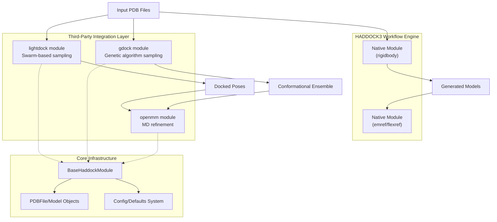
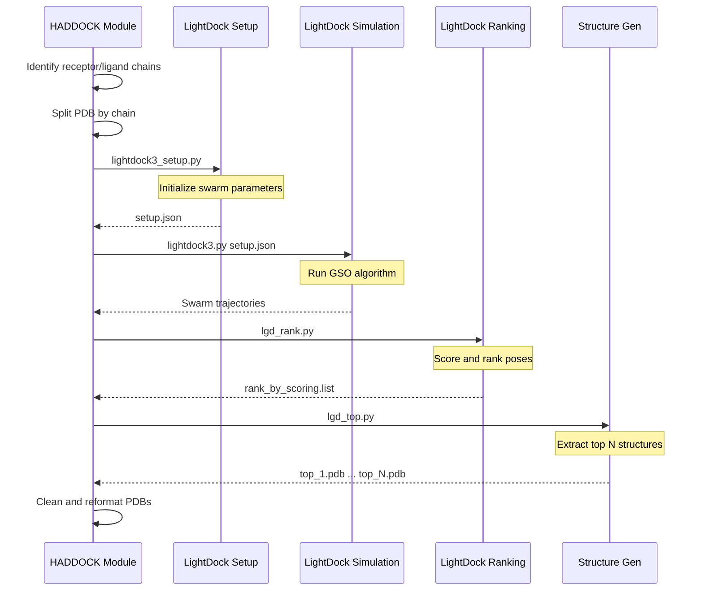
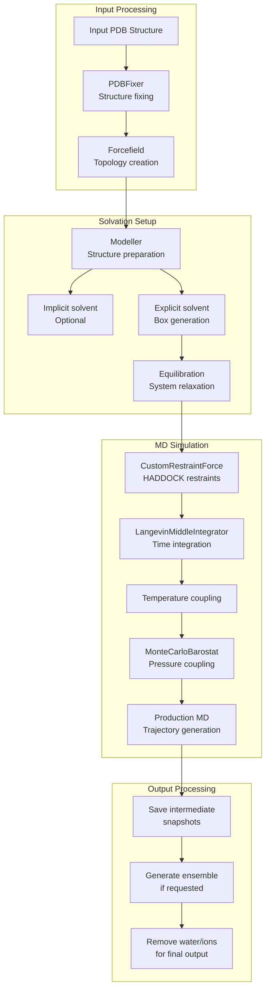

HADDOCK3's modular architecture enables seamless integration with external computational tools, extending its capabilities beyond native CNS-based sampling and refinement. These integrations allow you to leverage specialized algorithms for protein-protein docking sampling and advanced molecular dynamics refinement while maintaining HADDOCK3's workflow management and scoring infrastructure.

## Integration Architecture

HADDOCK3 implements third-party integrations through a standardized module interface pattern. Each external tool is encapsulated as a HADDOCK module that handles input preparation, tool execution, and output parsing, ensuring consistent data flow regardless of the underlying algorithm.



The integration architecture follows a consistent pattern where each external tool module inherits from `BaseHaddockModule`, implementing `_run()` methods that orchestrate subprocess calls to third-party executables while managing HADDOCK3's internal data structures [src/haddock/modules/sampling/lightdock/__init__.py#L20-L42](src/haddock/modules/sampling/lightdock/__init__.py#L20-L42). This design ensures that whether you're using native CNS-based modules or external tools, your workflow configuration follows the same syntax and produces compatible outputs.

Sources: [lightdock module](src/haddock/modules/sampling/lightdock/__init__.py#L20-L42), [gdock module](src/haddock/modules/sampling/gdock/__init__.py#L40-L54), [openmm module](src/haddock/modules/refinement/openmm/openmm.py#L61-L109)

## LightDock Integration

LightDock provides swarm intelligence-based global docking optimization through the Glowworm Swarm Optimization (GSO) algorithm. This integration enables sampling of protein-protein complexes using LightDock's stochastic search capabilities while maintaining compatibility with HADDOCK3's post-processing and scoring pipeline.

### LightDock Architecture

The LightDock module implements a four-stage workflow: setup, simulation, ranking, and structure generation. The module handles automatic chain splitting, LightDock executable invocation, and conversion of LightDock outputs back to HADDOCK3-compatible PDB formats [src/haddock/modules/sampling/lightdock/__init__.py#L40-L161](src/haddock/modules/sampling/lightdock/__init__.py#L40-L161).



### Configuration Parameters

The LightDock module exposes key sampling parameters through HADDOCK3's configuration system:

| Parameter | Type | Default | Description |
|-----------|------|---------|-------------|
| `glowworms` | integer | 200 | Number of glowworms per swarm |
| `steps` | integer | 100 | Number of simulation steps |
| `swarms` | integer | 400 | Number of independent swarms |
| `scoring` | string | fastdfire | Scoring function (fastdfire, dfire, itensor) |
| `top` | integer | 10 | Number of top models to output |
| `receptor_chains` | string | A | Chain identifier for receptor |
| `ligand_chains` | string | B | Chain identifier for ligand |
| `noxt` | boolean | true | Remove OXT atoms from structures |
| `noh` | boolean | true | Remove hydrogen atoms from structures |

Sources: [lightdock defaults](src/haddock/modules/sampling/lightdock/defaults.yaml#L1-L135)

### Installation Requirements

LightDock must be installed in the same Python environment as HADDOCK3. The module performs installation verification through subprocess calls to the `lightdock3.py` executable [src/haddock/modules/sampling/lightdock/__init__.py#L35-L37](src/haddock/modules/sampling/lightdock/__init__.py#L35-L37). Note that this integration is marked as **outdated** and may not be actively maintained.

```bash
# Install LightDock in your HADDOCK3 environment
source your_haddock3_venv/bin/activate
pip install lightdock
```

> [!TIP]
> LightDock integration is considered outdated. For new projects, consider using HADDOCK3's native `rigidbody` sampling or explore the OpenMM module for advanced refinement scenarios.

Sources: [lightdock installation](docs/INSTALL.md#L61-L68), [lightdock confirm_installation](src/haddock/modules/sampling/lightdock/__init__.py#L35-L37)

## gdock Integration

The gdock integration provides access to a genetic algorithm-based docking approach that utilizes ambiguous interaction restraints (AIRs) to guide conformational sampling. This module is particularly useful for exploring conformational spaces when experimental restraints are available.

### gdock Workflow Pattern

gdock integration focuses on conformation generation rather than comprehensive docking workflows. The typical pattern uses gdock for extensive sampling, followed by HADDOCK3's refinement modules (`flexref`, `emref`) and quality assessment (`caprieval`) [examples/thirdparty/gdock/gdock-integration.cfg](examples/thirdparty/gdock/gdock-integration.cfg#L1-L100).

```mermaid
graph LR
    subgraph Sampling["Conformation Generation"]
        TopoAA1["topoaa<br/>Topology generation"]
        GDock["gdock<br/>Genetic algorithm sampling"]
    end
    
    subgraph Refinement["HADDOCK3 Refinement"]
        Capri1["caprieval<br/>Initial assessment"]
        Cluster["clustfcc<br/>Conformation clustering"]
        Select["seletopclusts<br/>Select best models"]
        FlexRef["flexref<br/>Flexible refinement"]
        Capri2["caprieval<br/>Post-refinement check"]
        EMRef["emref<br/>Final refinement"]
        Capri3["caprieval<br/>Final assessment"]
    end
    
    Input["Input Structures"] --> TopoAA1
    TopoAA1 --> GDock
    GDock --> Capri1
    Capri1 --> Cluster
    Cluster --> Select
    Select --> FlexRef
    FlexRef --> Capri2
    Capri2 --> EMRef
    EMRef --> Capri3
```



### Restraint Handling

The gdock module includes utility functions for converting HADDOCK3's ambiguous interaction restraints (`ambig.tbl`) into gdock-compatible residue lists [src/haddock/modules/sampling/gdock/__init__.py#L23-L38](src/haddock/modules/sampling/gdock/__init__.py#L23-L38). This enables seamless transfer of experimental restraints between HADDOCK3 and gdock.

```python
def ambig2dic(ambig_f: FilePath) -> dict[str, list[int]]:
    """Read an ambig.tbl file and convert it to a dictionary."""
    ambig_regex = r"resid\s*(\d*)\s*and\s*segid\s*(\w)"
    ambig_dic: dict[str, list[int]] = {}
    with open(ambig_f) as fh:
        for line in fh.readlines():
            matches = re.finditer(ambig_regex, line)
            for m in matches:
                resid = int(m.group(1))
                chain = m.group(2)
                if chain not in ambig_dic:
                    ambig_dic[chain] = []
                ambig_dic[chain].append(resid)
    return ambig_dic
```

### Configuration and Environment

The gdock module requires the `GDOCK_PATH` environment variable to point to the gdock installation directory [src/haddock/modules/sampling/gdock/__init__.py#L56-L63](src/haddock/modules/sampling/gdock/__init__.py#L56-L63). Key configuration includes:

| Parameter | Type | Default | Description |
|-----------|------|---------|-------------|
| `ambig_fname` | file | '' | Path to ambiguous interaction restraints file |

```bash
# Set up gdock environment
export GDOCK_PATH=/path/to/gdock
pip install deap scipy mgzip biopython
```

> [!TIP]
> Like LightDock, the gdock integration is marked as outdated. The primary use case today is for comparative studies or when specific genetic algorithm-based sampling is required for research purposes.

Sources: [gdock module](src/haddock/modules/sampling/gdock/__init__.py#L23-L63), [gdock configuration](src/haddock/modules/sampling/gdock/defaults.yaml#L1-L9), [gdock example](examples/thirdparty/gdock/gdock-integration.cfg#L1-L100)

## OpenMM Integration

The OpenMM module represents HADDOCK3's most modern and actively maintained third-party integration, providing molecular dynamics refinement capabilities with explicit or implicit solvent models. This integration bridges classical MD force fields with HADDOCK3's restraint-based docking approach.

### OpenMM Architecture

The OpenMM module implements a comprehensive MD refinement pipeline including PDB fixing, solvation box creation, equilibration, production MD, and trajectory analysis [src/haddock/modules/refinement/openmm/openmm.py#L61-L1006](src/haddock/modules/refinement/openmm/openmm.py#L61-L1006).



### Force Field and Solvent Options

OpenMM integration supports multiple AMBER and CHARMM force fields with flexible solvent models:

| Parameter | Type | Choices | Description |
|-----------|------|---------|-------------|
| `forcefield` | string | amber14-all.xml, amber14/protein.ff14SB.xml, amber14/protein.ff15ipq.xml, amber14/DNA.OL15.xml, amber14/RNA.OL3.xml, amber14/GLYCAM_06j-1.xml, charmm36.xml | Molecular force field |
| `explicit_solvent_model` | string | amber14/tip3p.xml, amber14/spce.xml, amber14/tip4pew.xml, charmm36/tip4pew.xml, charmm36/tip5p.xml | Explicit water model |
| `implicit_solvent_model` | string | implicit/hct.xml, implicit/obc1.xml, implicit/obc2.xml, implicit/gbn.xml, implicit/gbn2.xml | Implicit solvent model |
| `constraints` | string | None, HBonds, AllBonds, HAngles | Bond constraints for timestepping |

Sources: [openmm defaults](src/haddock/modules/refinement/openmm/defaults.yaml#L1-L200)

### Simulation Parameters

The OpenMM module provides extensive control over MD simulation parameters:

| Parameter | Type | Default | Range | Description |
|-----------|------|---------|-------|-------------|
| `timestep_ps` | float | 0.002 | 0.001-0.004 | Integration timestep (picoseconds) |
| `equilibration_timesteps` | integer | 2000 | 0-100000 | Equilibration steps |
| `simulation_timesteps` | integer | 2000 | 0-1000000 | Production MD steps |
| `temperature_kelvin` | float | 298.15 | 1.0-1000.0 | Simulation temperature |
| `ph` | float | 7.4 | -3.0-12.0 | Buffer pH for protonation states |
| `sampling_factor` | integer | 1 | 1-20 | Number of replicas |
| `save_intermediate` | integer | 1 | 0-100 | Number of intermediate snapshots |

### Restraint Implementation

A key feature of the OpenMM integration is the preservation of HADDOCK restraints during MD simulation. The module implements custom OpenMM forces to maintain ambiguous interaction restraints, unambiguous restraints, and center-of-mass restraints [src/haddock/modules/refinement/openmm/openmm.py#L473-L571](src/haddock/modules/refinement/openmm/openmm.py#L473-L571).

```python
@staticmethod
def _gen_restrain_force(
        atoms: list,
        positions: list,
        subset: Union[bool, list] = None,
        spring_constant: float = 20.0,
        ) -> CustomExternalForce:
    """Generate harmonic restraint force for atoms."""
    # Implementation creates CustomExternalForce with 
    # k * (x - x0)^2 + k * (y - y0)^2 + k * (z - z0)^2
```

The module also implements centroid restraints to maintain overall complex geometry while allowing local flexibility:

```python
def _chain_centroid_force(
        self,
        system: System,
        chain1: str,
        chain2: str,
        ) -> CustomCentroidBondForce:
    """Generate force to restrain distance between chain centroids."""
    # Prevents chains from drifting apart during MD
```

### Installation Options

OpenMM installation varies by Python version and package manager. Two recommended approaches:

#### Conda Installation (Recommended)
```bash
conda create -n hd3-openmm python=3.11
conda activate hd3-openmm
pip install haddock3
conda install -c conda-forge libstdcxx-ng
conda install -c conda-forge openmm==8.2.0 pdbfixer==1.10
```

#### Virtual Environment Installation
```bash
python3.12 -m venv hd3-openmm
source hd3-openmm/bin/activate
pip install .
pip install openmm==8.2.0
pip install https://github.com/openmm/pdbfixer/archive/refs/tags/v1.10.tar.gz
```

Sources: [OpenMM installation](docs/INSTALL.md#L75-L151), [OpenMM module](src/haddock/modules/refinement/openmm/openmm.py#L1-L1006)

## Configuration Examples

### LightDock + HADDOCK3 Scoring Workflow

This configuration demonstrates using LightDock for sampling with HADDOCK3's energy minimization scoring:

```toml
molecules = "../../data/2oob.pdb"
run_dir = "run1"

[topoaa]
autohis = true

[lightdock]
receptor_chains = "A"
ligand_chains = "B"
scoring = "fastdfire"
swarms = 8
steps = 10
glowworms = 20
top = 10
noxt = true
noh = true
ncores = 20

[emscoring]
```

Sources: [lightdock example](examples/thirdparty/lightdock/lightdock.cfg)

### gdock + HADDOCK3 Refinement Pipeline

This example shows gdock generating conformations followed by HADDOCK3 refinement:

```toml
run_dir = "run1"
ncores = 20
molecules = [
    "data/e2aP_1F3G.pdb",
    "data/hpr_ensemble_1.pdb"
    ]

[topoaa]
autohis = false
[topoaa.input.mol1]
nhisd = 0
nhise = 1
hise_1 = 75
[topoaa.input.mol2]
nhisd = 1
hisd_1 = 76
nhise = 1
hise_1 = 15

[gdock]
ambig_fname = 'data/e2a-hpr_air.tbl'

[caprieval]
reference_fname = 'data/e2a-hpr_1GGR.pdb'
sortby = 'irmsd'

[clustfcc]
clust_cutoff = 0.4
min_population = 2

[seletopclusts]
top_clusters = 5
top_models = 4

[flexref]
ambig_fname = 'data/e2a-hpr_air.tbl'

[emref]
ambig_fname = 'data/e2a-hpr_air.tbl'
```

Sources: [gdock example](examples/thirdparty/gdock/gdock-integration.cfg)

### OpenMM Explicit Solvent Refinement

Refinement with explicit water solvation:

```toml
run_dir = "run1-omm-complex-test"
ncores = 40
molecules = [
    "data/1NX1_protein.pdb",
    "data/DAIDALSSDFT_alpha.pdb"
    ]

[topoaa]
autohis = false
[topoaa.mol1]
nhisd = 2
hisd_1 = 36
hisd_2 = 109
nhise = 1
hise_1 = 113

[rigidbody]
ambig_fname = "./data/ambig.tbl"
sampling = 5

[caprieval]
reference_fname = "data/1nx1_refe.pdb"

[openmm]
forcefield = 'amber14-all.xml'
explicit_solvent_model = 'amber14/tip3p.xml'
timestep_ps = 0.002
constraints = 'HBonds'
equilibration_timesteps = 1000
simulation_timesteps = 1000
```

Sources: [openmm explicit example](examples/thirdparty/openmm/openmm-complex-refinement.cfg)

### OpenMM Implicit Solvent Refinement

Faster refinement with implicit solvent model:

```toml
run_dir = "run1-omm-implicit-test"
ncores = 40
molecules = ["data/DAIDALSSDFT_alpha.pdb"]

[topoaa]
autohis = false
[topoaa.mol1]
nhisd = 2
hisd_1 = 36
hisd_2 = 109
nhise = 1
hise_1 = 113

[openmm]
forcefield = 'amber14-all.xml'
implicit_solvent = true
implicit_solvent_model = 'implicit/obc1.xml'
timestep_ps = 0.002
constraints = 'HBonds'
equilibration_timesteps = 100
simulation_timesteps = 200
```

Sources: [openmm implicit example](examples/thirdparty/openmm/openmm-implicit-solvent-test.cfg)

## Best Practices and Troubleshooting

### Installation Verification

HADDOCK3 modules include built-in installation verification methods that should be called before running workflows:

```python
# Verify LightDock installation
lightdock_module.HaddockModule.confirm_installation()

# Verify gdock installation (checks GDOCK_PATH)
gdock_module.HaddockModule.confirm_installation()
```

Sources: [lightdock confirm_installation](src/haddock/modules/sampling/lightdock/__init__.py#L35-L37), [gdock confirm_installation](src/haddock/modules/sampling/gdock/__init__.py#L51-L54)

### Environment Management

> [!TIP]
> Always install third-party packages in the same Python environment as HADDOCK3. Different environments will cause module import errors when HADDOCK3 attempts to load the integration modules.

### Performance Considerations

| Integration | CPU Scaling | GPU Support | Memory Requirements |
|-------------|-------------|-------------|---------------------|
| LightDock | Multi-core (configurable) | No | Moderate |
| gdock | Single-core typical | No | Low |
| OpenMM | Multi-core | Yes (recommended) | High for explicit solvent |

OpenMM GPU acceleration can provide 10-50x speedup for MD simulations. Ensure you have CUDA (NVIDIA) or ROCm (AMD) drivers installed and OpenMM compiled with GPU support.

### Error Handling

Third-party modules use HADDOCK3's exception handling framework. Common issues:

- **LightDock/gdock not found**: Verify installation with `confirm_installation()` and ensure executables are in `$PATH`
- **GDOCK_PATH not defined**: Set environment variable before running workflow
- **OpenMM import errors**: Verify OpenMM and pdbfixer versions match installation instructions
- **Chain identification errors**: Ensure input PDB files have proper chain IDs (not segids only)

Sources: [module base](src/haddock/modules/base_cns_module.py), [exceptions](src/haddock/core/exceptions.py)

## Integration Status and Recommendations

| Integration | Status | Recommended Use | Maintenance Priority |
|-------------|--------|-----------------|----------------------|
| OpenMM | Active | MD refinement, explicit solvent, peptide dynamics | High |
| LightDock | Outdated | Historical comparison only | Low |
| gdock | Outdated | Historical comparison only | Low |

For new projects, prioritize HADDOCK3's native modules (rigidbody, flexref, emref) supplemented by the OpenMM module for advanced MD refinement when needed.

## Next Steps

- Explore [Workflow Engine and Execution Model](7-workflow-engine-and-execution-model) for understanding how third-party modules integrate into HADDOCK3's orchestration system
- Read [Module System and Plugin Architecture](9-module-system-and-plugin-architecture) to learn about developing custom integrations
- Study [Molecular Dynamics Refinement in Explicit Solvent](17-molecular-dynamics-refinement-in-explicit-solvent) for deeper OpenMM configuration details
- Review [Custom Workflow Design](27-custom-workflow-design) for patterns combining native and third-party modules