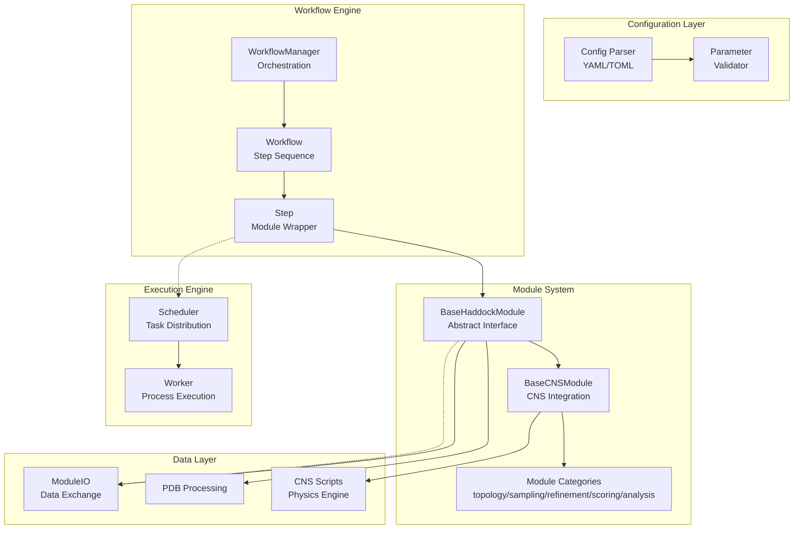

HADDOCK3 is a modular framework for biomolecular docking that provides a flexible, plugin-based architecture designed to handle complex computational biology workflows. This guide introduces the core architectural principles and design philosophy that make HADDOCK3 both powerful and accessible for developers at all levels.

The framework is built around a clear separation of concerns: workflow orchestration, module execution, configuration management, and data flow. This design enables researchers to combine different computational steps—topology generation, sampling, refinement, scoring, and analysis—into coherent docking protocols without writing code.

## Core Architectural Principles

HADDOCK3 follows four foundational design principles that shape its architecture:

**Modularity** is at the heart of HADDOCK3. Every computational task is encapsulated in a self-contained module that can be combined with others through simple configuration. Modules are organized into logical categories—topology, sampling, refinement, scoring, analysis, and extras—each serving a specific purpose in the docking workflow [modules/__init__.py](src/haddock/modules/__init__.py#L40-L90).

**Extensibility** enables researchers and developers to add new functionality through a plugin-like architecture. The abstract `BaseHaddockModule` class provides a consistent interface that all modules must implement, ensuring compatibility while allowing complete customization of computational logic [modules/__init__.py](src/haddock/modules/__init__.py#L115-L270).

**Reproducibility** is enforced through a rigorous parameter system. Every module defines its default parameters in YAML files, which can be overridden at the workflow level or per-module level. This explicit configuration ensures that workflows can be reproduced exactly and parameterized systematically [modules/defaults.yaml](src/haddock/modules/defaults.yaml).

**Scalability** is achieved through built-in parallelization and resource management. The framework provides different execution modes (batch, local, MPI) and handles task distribution through a scheduler abstraction that abstracts away the complexities of parallel execution [modules/__init__.py](src/haddock/modules/__init__.py#L396-L403).

## High-Level Architecture Overview

The HADDOCK3 architecture consists of five core subsystems that work together to execute docking workflows:



### Module System and Categories

The module system is the foundation of HADDOCK3's extensibility. Modules are automatically discovered from the `src/haddock/modules/` directory and indexed by their category:

| Category | Purpose | Example Modules |
|----------|---------|-----------------|
| **Topology** | Generate molecular parameters and topologies for physics-based calculations | `topoaa` (all-atom), `topocg` (coarse-grained) |
| **Sampling** | Explore conformational space through different algorithms | `rigidbody`, `lightdock`, `gdock` |
| **Refinement** | Improve selected models through energy minimization and molecular dynamics | `emref`, `mdref`, `flexref` |
| **Scoring** | Evaluate model quality using various scoring functions | `emscoring`, `mdscoring`, `sasascore`, `prodigy` |
| **Analysis** | Analyze and interpret docking results | `clustfcc`, `clustrmsd`, `alascan`, `contactmap` |
| **Extras** | Utility and workflow control modules | `exit` (termination) |

Modules inherit from `BaseHaddockModule`, which provides standard lifecycle methods and parameter management [modules/__init__.py](src/haddock/modules/__init__.py#L115-L270). For modules that interact with the CNS physics engine, there's `BaseCNSModule`, which adds CNS-specific functionality like environment variable setup and script management [modules/base_cns_module.py](src/haddock/modules/base_cns_module.py#L1-L100).

### Configuration Management

HADDOCK3 uses a sophisticated configuration system that supports both YAML and custom TOML-like syntax. The configuration layer handles several critical responsibilities:

**Parameter Hierarchy**: Parameters flow through three levels—module defaults (YAML files), workflow-level overrides, and per-module customizations. The system recursively merges these configurations while respecting parameter types and validation rules [gear/config.py](src/haddock/gear/config.py#L1-L100).

**Mandatory vs Optional Parameters**: The framework distinguishes between mandatory parameters that must be provided by the user (like `run_dir` and `molecules`) and optional parameters that have sensible defaults [core/mandatory.yaml](src/haddock/core/mandatory.yaml#L1-L19) [gear/parameters.py](src/haddock/gear/parameters.py#L1-L19).

**Expandable Parameters**: A unique feature is the ability to define parameters on a per-molecule basis using the `mol_*` syntax. This allows, for example, different sampling parameters for each molecule in a docking calculation [gear/expandable_parameters.py](src/haddock/gear/expandable_parameters.py).

### Workflow Execution Engine

The workflow engine is responsible for orchestrating the execution of modules in sequence:

**WorkflowManager** serves as the top-level coordinator, managing the overall workflow execution, handling restarts, and coordinating post-processing tasks [libs/libworkflow.py](src/haddock/libs/libworkflow.py#L23-L64).

**Workflow** represents the sequence of steps and manages their order. Each step wraps a module with its specific configuration [libs/libworkflow.py](src/haddock/libs/libworkflow.py#L98-L141).

**Step** is the execution wrapper that handles the actual module invocation, error handling, and task distribution when parallelization is needed [libs/libworkflow.py](src/haddock/libs/libworkflow.py#L142-L191).

The execution engine supports three modes selected via the `mode` parameter:
- **Local**: Executes tasks sequentially on the current machine
- **MPI**: Uses MPI for distributed execution across compute nodes
- **Batch**: Integrates with job schedulers for HPC environments

### Data Flow and Module Communication

Modules communicate through a standardized data exchange mechanism using `ModuleIO` objects stored as `io.json` files. This decouples modules from each other, enabling them to be rearranged without code changes [core/defaults.py](src/haddock/core/defaults.py#L20-L21).

Each module receives input from the previous step's `io.json` and produces its own output file, creating a chain of data transformation. This design supports:
- Automatic dependency tracking
- Easy workflow restart and extension
- Transparent inspection of intermediate results
- Modular testing and validation

> [!TIP]
> The module I/O system makes HADDOCK3 workflows inherently reproducible. Each step's inputs and outputs are fully documented in JSON files, enabling exact reconstruction of any workflow state for debugging or sharing purposes.

### CNS Integration Layer

For physics-based calculations (rigid-body docking, refinement, scoring), HADDOCK3 integrates with CNS (Crystallography & NMR System) through a dedicated abstraction layer:

**BaseCNSModule** extends `BaseHaddockModule` with CNS-specific functionality, including:
- Loading and managing CNS protocol scripts
- Setting up environment variables (MODULE, MODDIR, TOPPAR)
- Handling topology and parameter files
- Managing self-contained runs [modules/base_cns_module.py](src/haddock/modules/base_cns_module.py#L1-L100)

Each CNS module includes a directory of CNS scripts (`.cns` files) that define the actual physics calculations. For example, the rigidbody module includes scripts for random rotations, energy minimization, and restraint handling [modules/sampling/rigidbody/cns/](src/haddock/modules/sampling/rigidbody/cns/).

### Parallel Execution and Resource Management

HADDOCK3 provides built-in parallelization through a flexible scheduler abstraction:

**Scheduler** manages task distribution across multiple CPU cores. It automatically divides work into chunks and manages worker processes [libs/libparallel.py](src/haddock/libs/libparallel.py#L105-L209).

**Worker** is a process that executes a queue of tasks and returns results through a shared queue [libs/libparallel.py](src/haddock/libs/libparallel.py#L75-L104).

The parallel execution is transparent to modules—each module simply provides a list of tasks (e.g., different molecular orientations to sample), and the framework handles distribution and result collection.

### Error Handling and Validation

HADDOCK3 implements a comprehensive error handling system with custom exception types that provide specific feedback:

| Exception Type | Purpose |
|----------------|---------|
| `ConfigurationError` | Issues in configuration files |
| `ModuleError` | Errors within specific modules |
| `StepError` | Errors in workflow step execution |
| `CNSRunningError` | Errors from CNS execution |
| `KnownCNSError` | Recognized CNS errors with hints |
| `HaddockTermination` | Controlled workflow termination |

Additionally, the framework validates parameters against schemas defined in YAML files, catching configuration errors before execution begins [gear/validations.py](src/haddock/gear/validations.py#L1-L108).

## Design Philosophy Summary

HADDOCK3's architecture embodies the following philosophical principles:

**Declarative Configuration**: Workflows are defined through configuration files rather than code. This makes HADDOCK3 accessible to non-programmers while still allowing developers to extend functionality.

**Composability**: Modules can be combined in arbitrary order to create custom workflows. The framework doesn't prescribe a single workflow but provides building blocks for users to assemble their own protocols.

**Fail-Safe Design**: Comprehensive validation and error handling help users identify and fix issues quickly. Known errors include helpful hints and suggestions.

**Performance-First**: Built-in parallelization and efficient data structures ensure HADDOCK3 scales to large docking calculations without code changes.

**Scientific Rigor**: Reproducibility is built into every aspect of the framework, from deterministic random seeds to complete parameter logging.


## Project Structure Visualization

The physical organization of the codebase reflects the logical architecture:

```
src/haddock/
├── core/           # Core definitions and exceptions
├── gear/           # Utilities for configuration, validation, I/O
├── libs/           # Reusable library functions
├── modules/        # Module implementations by category
│   ├── topology/   # Topology generation
│   ├── sampling/   # Sampling algorithms
│   ├── refinement/ # Refinement methods
│   ├── scoring/    # Scoring functions
│   ├── analysis/   # Analysis tools
│   └── extras/     # Utility modules
├── cns/            # CNS topology and parameter files
└── clis/           # Command-line interfaces
```

## Where to Go Next

Now that you understand HADDOCK3's architecture, you can explore specific aspects in more detail:

- For understanding how workflows are executed, see [Workflow Engine and Execution Model](7-workflow-engine-and-execution-model)
- To learn about module implementation details, see [Module System and Plugin Architecture](9-module-system-and-plugin-architecture)
- For information on using CNS for physics calculations, see [CNS Integration and Script Generation](8-cns-integration-and-script-generation)
- To get started with practical usage, review [Quick Start](2-quick-start)