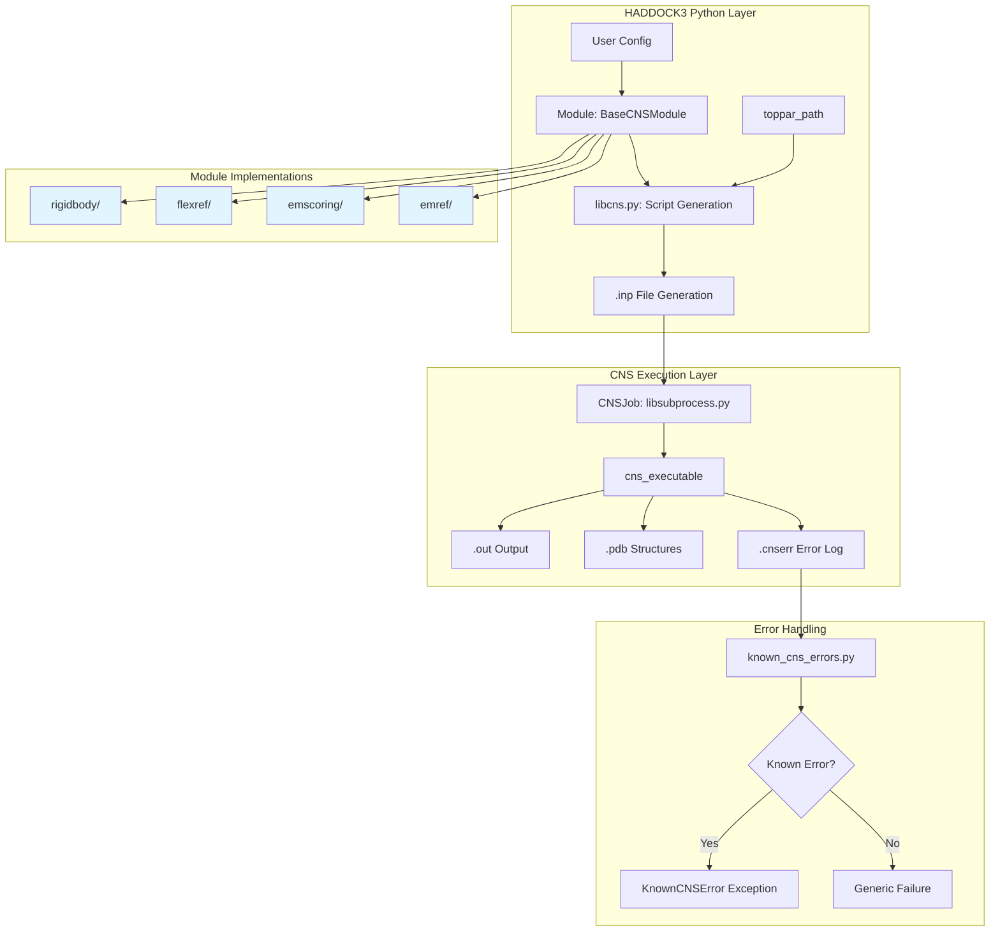

The CNS (Crystallography & NMR System) serves as the computational engine driving HADDOCK3's physics-based sampling and refinement protocols. This integration architecture transforms Python workflow configurations into executable CNS scripts, manages subprocess execution, and handles error detection through a robust abstraction layer. The design enables seamless communication between HADDOCK3's orchestration layer and CNS's molecular mechanics capabilities.

## Architecture Overview

The CNS integration follows a modular architecture where Python components generate, parameterize, and execute CNS scripts for docking, refinement, and scoring operations. This architecture separates concerns between workflow management (Python) and molecular physics (CNS), allowing each layer to evolve independently.



## Core Component Architecture

### CNS Path Management

CNS integration relies on dynamic path resolution for topology and parameter files (`toppar` directory). The `cns_paths` module provides functions to generate path dictionaries dynamically, enabling flexibility when the `cns/` folder is relocated or when custom parameter sets are used.

| Function | Purpose | Returns |
|----------|---------|---------|
| `get_translation_vectors()` | Generates paths for 51 translation vector files | `dict[str, Path]` |
| `get_tensors()` | Generates paths for tensor-related files (PDB/PSF) | `dict[str, Path]` |
| `get_axis()` | Generates paths for axis definition files | `dict[str, Path]` |
| `get_water_box()` | Generates paths for water box definitions | `dict[str, Path]` |

These functions dynamically construct paths to critical CNS resources including axis definitions, tensor files for residual dipolar couplings, translation vectors for initial positioning, and water box templates. The modular design allows for custom toppar directories without hardcoded path dependencies.

Sources: [cns_paths.py](/src/haddock/core/cns_paths.py#L45-L93)

### Script Generation Pipeline

The `libcns.py` module orchestrates CNS input file generation through the `prepare_cns_input()` function, which serves as the central assembly point for all CNS job configurations. This function systematically combines parameter definitions, molecular topology data, and protocol recipes into complete CNS input files.

```python
def prepare_cns_input(
    model_number: int,
    input_element: Union[PDBFile, list[PDBFile]],
    step_path: FilePath,
    recipe_str: str,
    defaults: Any,
    identifier: str,
    ambig_fname: FilePath = "",
    native_segid: bool = False,
    default_params_path: Optional[Path] = None,
    debug: Optional[bool] = False,
    seed: Optional[int] = None,
) -> Union[Path, str]:
```

The generation process follows this assembly sequence:

1. **Default Parameters**: Loads module-specific parameters using `load_workflow_params()`
2. **Ambiguous Restraints**: Adds ambiguous interaction restraint filenames
3. **Input Preparation**: Generates PDB and PSF file specifications for all input molecules
4. **Output Definition**: Specifies output PDB filename and model number
5. **Segment/Chain ID Handling**: Optionally preserves native segment identifiers
6. **Random Seed**: Assigns deterministic random seed for reproducibility (default: 100-99999 range)
7. **Recipe Assembly**: Concatenates all components with the main CNS protocol script

The function returns either the complete input string or writes it to a file when debug mode is enabled.

Sources: [libcns.py](/src/haddock/libs/libcns.py#L321-L425)

### CNS Module Base Class

All CNS-based modules inherit from `BaseCNSModule`, which provides standardized functionality for CNS protocol execution. This base class extends `BaseHaddockModule` with CNS-specific capabilities including script path management, environment variable configuration, and self-contained workflow support.

> [!TIP]
> The BaseCNSModule's constructor accepts a cns_script parameter pointing to the main CNS protocol file (e.g., `rigidbody.cns`). This script is read at initialization and stored as self.recipe_str, which is then combined with parameters during input file generation via the prepare_cns_input() function.

Key responsibilities of BaseCNSModule include:

- **CNS Script Path Management**: Automatically resolves paths to CNS protocol scripts and the cns/ subdirectory containing auxiliary scripts
- **Toppar Path Configuration**: Maintains reference to global topology and parameter directory
- **Environment Variable Setup**: Generates CNS environment variables (CNS_SOLVE, etc.) via `default_envvars()` method
- **Self-Contained Mode**: Optionally copies required files to the module's working directory for portability
- **Ambiguous Restraint Handling**: Manages propagation of ambiguous restraint files between workflow stages

Sources: [base_cns_module.py](/src/haddock/modules/base_cns_module.py#L16-L60)

### CNS Job Execution

The `CNSJob` class in `libsubprocess.py` encapsulates CNS subprocess execution with compression and error detection capabilities. It provides a standardized interface for running CNS with configurable input/output handling.

| Parameter | Purpose | Default |
|-----------|---------|---------|
| `input_file` | Path to .inp input file | Required |
| `output_file` | Path to .out output file | auto-generated |
| `error_file` | Path to .cnserr error file | auto-generated |
| `envvars` | CNS environment variables | `default_envvars()` |
| `cns_exec` | Path to CNS executable | from `core.defaults` |

The `run()` method executes CNS with flexible compression options:

- `compress_inp`: Compress input files (.inp.gz)
- `compress_out`: Compress output files (.out.gz)
- `compress_seed`: Compress seed files
- `compress_err`: Compress error files (.cnserr.gz)

After execution, the method checks stdout for known error patterns using `contains_cns_stdout_error()`, which examines the last 24,000 characters (approximately 300 lines) for error indicators.

Sources: [libsubprocess.py](/src/haddock/libs/libsubprocess.py#L98-L265)

## CNS Script Structure and Organization

Each CNS-based module maintains a dedicated `cns/` subdirectory containing the main protocol script and auxiliary CNS code files. This modular organization allows for protocol-specific optimizations while reusing common utility scripts.

### Rigid-Body Docking Module

The `rigidbody/` module implements classical HADDOCK it0 sampling through the `rigidbody.cns` script. This protocol performs randomization of orientations followed by rigid-body energy minimization using only rotational and translational degrees of freedom.

Key CNS scripts in rigidbody module:

| Script | Purpose |
|--------|---------|
| `rigidbody.cns` | Main protocol - randomization and rigid-body minimization |
| `random_rotations.cns` | Random rotation generation around center of mass |
| `randomairs.cns` | Random ambiguous interaction restraint generation |
| `check-homomers.cns` | Detect homomeric complexes for symmetry handling |
| `symmultimer.cns` | Symmetry restraint enforcement |
| `scale_inter_*.cns` | Inter-molecular energy scaling functions |
| `scale_intra_only.cns` | Intra-molecular energy scaling |

The protocol initializes variables for sampling parameters, energy terms (van der Waals, electrostatics, AIRs), and symmetry restraints before executing the minimization protocol.

Sources: [rigidbody.cns](/src/haddock/modules/sampling/rigidbody/cns/rigidbody.cns#L1-L80), [rigidbody/__init__.py](/src/haddock/modules/sampling/rigidbody/__init__.py#L1-L30)

### Flexible Refinement Module

The `flexref/` module implements semi-flexible simulated annealing refinement (HADDOCK it1) through `flexref.cns`. This protocol treats interface regions as flexible using torsion angle space dynamics.

Key CNS scripts in flexref module:

| Script | Purpose |
|--------|---------|
| `flexref.cns` | Main protocol - simulated annealing refinement |
| `flex_segment.cns` | Flexible segment definition and handling |
| `flex_segment_back.cns` | Backbone flexibility implementation |
| `flex_segment_side.cns` | Side-chain flexibility implementation |
| `flexauto-neighbors.cns` | Automatic interface residue selection |
| `sa_ltad_hightemp.cns` | High-temperature rigid body MD |
| `sa_ltad_cool*.cns` | Cooling stage protocols (3 stages) |
| `protein-ss-restraints-*.cns` | Secondary structure restraints |

The protocol configures temperature schedules, MD steps for each cooling stage, and dihedral restraint activation patterns to control the refinement process.

Sources: [flexref.cns](/src/haddock/modules/refinement/flexref/cns/flexref.cns#L1-L80), [flexref/__init__.py](/src/haddock/modules/refinement/flexref/__init__.py#L1-L22)

### Energy Minimization Scoring Module

The `emscoring/` module performs final energy minimization and scoring without restraints to evaluate model quality. The `emscoring.cns` script generates clean, minimized structures for scoring function evaluation.

This module extends `CNSScoringModule` (rather than `BaseCNSModule`) to incorporate scoring-specific functionality while maintaining the same CNS execution framework.

Sources: [emscoring/__init__.py](/src/haddock/modules/scoring/emscoring/__init__.py#L1-L5)

## Error Detection and Handling

HADDOCK3 implements a comprehensive error detection system for CNS through the `known_cns_errors.py` module. This system parses CNS error logs (`.cnserr` files) to identify known failure modes and provide actionable user feedback.

The `KNOWN_ERRORS` dictionary maps error patterns (as they appear in CNS output) to user-friendly diagnostic messages:

| Error Pattern | Description |
|---------------|-------------|
| "CHAIN LENGTH FOR SYMMETRY RESTRAINTS DOES NOT MATCH" | Mismatched chain lengths in symmetry definitions |
| "exceeded allocation for NOE-restraints" | Too many distance restraints defined |
| "SELRPN error encountered: parsing error" | Syntax errors in restraint files |
| "ALLHP error encountered: not enough memory available" | Memory insufficient for restraint calculations |
| "ROTMAT error encountered: rotation vector has zero length" | Invalid rotation during sampling |

The `find_cns_errors()` function scans error files for known patterns using buffered reading (4KB chunks) to handle large outputs efficiently. The `find_all_cns_errors()` function scans entire directories to batch-process multiple CNS jobs.

Sources: [known_cns_errors.py](/src/haddock/gear/known_cns_errors.py#L14-L65)

## Environment Variable Configuration

CNS execution requires specific environment variables to locate resources and libraries. The `default_envvars()` method in `BaseCNSModule` generates these variables automatically:

```python
envvars = {
    'CNS_SOLVE': '<path-to-cns-solve>',
    'CNS_TOPPAR': '<path-to-toppar>',
    'CNS_MACHINE': '<machine-type>',
}
```

These can be saved to an `envvars` file in the module directory using `save_envvars()`, enabling reproducible execution and debugging.

Sources: [base_cns_module.py](/src/haddock/modules/base_cns_module.py#L65-L77)

## Self-Contained Workflow Support

For portability and reproducibility, CNS modules support a `self_contained` mode that copies all required files to the module's working directory. The `make_self_contained()` method creates local copies of:

- CNS protocol scripts (`cns/` directory)
- Topology and parameter files (toppar directory)
- Auxiliary CNS resources

This enables the entire module workflow to be archived and transferred between compute environments without external dependencies.

Sources: [base_cns_module.py](/src/haddock/modules/base_cns_module.py#L91-L115)

## Module Implementation Patterns

All CNS modules follow a consistent implementation pattern:

1. **Module Class Definition**: Inherits from `BaseCNSModule` or `CNSScoringModule`
2. **Configuration Path**: Sets `RECIPE_PATH` and `DEFAULT_CONFIG` pointing to module directory
3. **Initialization**: Calls parent with `cns_script` parameter pointing to main CNS file
4. **Job Generation**: Implements `make_cns_jobs()` to create `CNSJob` instances
5. **Input Preparation**: Uses `prepare_cns_input()` from `libcns.py`
6. **Execution**: Calls `job.run()` on each job with appropriate parameters

This standardized pattern ensures consistent behavior across all CNS-based modules while allowing protocol-specific customizations.

> [!TIP]
> When implementing custom CNS modules, ensure the main CNS script follows HADDOCK's variable naming conventions (e.g., $w_vdw, $w_elec, $w_air) and uses the standard parameter loading functions from libcns.py to maintain compatibility with the HADDOCK3 infrastructure.

## Integration with Workflow Engine

CNS modules integrate seamlessly with HADDOCK3's workflow engine through the module system. The workflow engine:

1. Passes configuration parameters via `update_params()`
2. Calls module-specific `_run()` method
3. Processes generated output structures
4. Passes results to subsequent modules

The CNS execution layer abstracts all subprocess management, allowing the workflow engine to focus on high-level orchestration while CNS handles molecular mechanics calculations.
