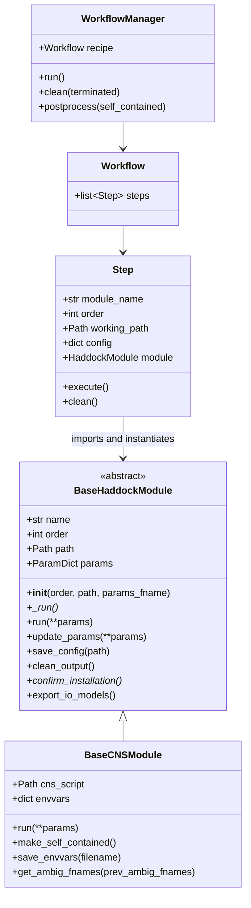
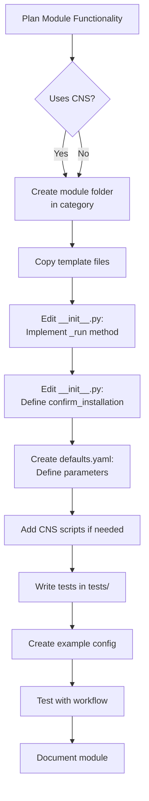
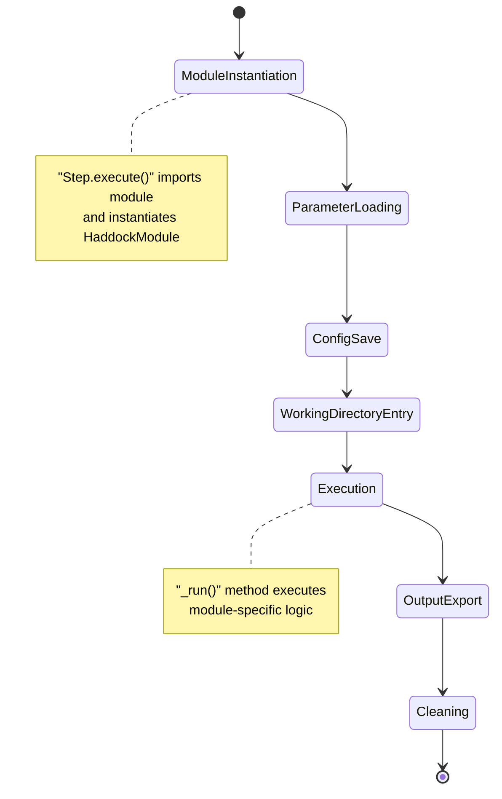

The HADDOCK3 module system provides a flexible, extensible framework for executing complex biomolecular docking workflows. This architecture enables researchers to chain together discrete computational stages—from topology generation through sampling, refinement, scoring, and analysis—into cohesive, reproducible pipelines. The plugin-based design allows both core and custom modules to participate in workflows through a unified interface, supporting straightforward extension and customization of docking protocols.

## Module System Architecture

The module system is built around a hierarchical class structure where all modules inherit from abstract base classes that define the contract for workflow participation. The architecture centers on the `BaseHaddockModule` abstract base class, with a specialized `BaseCNSModule` for modules that interact with the CNS (Crystallography & NMR System) engine. This design separates common workflow concerns (parameter management, input/output handling, logging) from module-specific computational logic.



The workflow execution flow demonstrates how modules are dynamically loaded and executed. When parsing a user configuration file, the `WorkflowManager` creates `Step` objects for each module definition, then dynamically imports the corresponding module class at runtime using Python's `importlib` module. This lazy loading approach means modules are only loaded when needed, and custom modules can be added to the system without modifying the core workflow engine.

Sources: [modules/__init__.py](src/haddock/modules/__init__.py#L115-L270), [modules/base_cns_module.py](src/haddock/modules/base_cns_module.py#L16-L33), [libs/libworkflow.py](src/haddock/libs/libworkflow.py#L109-L191)

## Module Organization and Categories

Modules are organized into functional categories that reflect their role in the docking pipeline. Each module resides in a directory structure that enables automatic discovery and categorization by the workflow system.

| Category | Purpose | Example Modules |
|----------|---------|-----------------|
| **topology** | Generate molecular topologies and parameters | `topoaa`, `topocg` |
| **sampling** | Generate initial docking poses | `rigidbody`, `lightdock`, `gdock` |
| **refinement** | Improve models through energy minimization or MD | `emref`, `mdref`, `flexref` |
| **scoring** | Evaluate model quality using various scoring functions | `emscoring`, `mdscoring`, `sasascore`, `prodigyprotein` |
| **analysis** | Post-process and analyze results | `caprieval`, `clustfcc`, `clustrmsd`, `alascan` |
| **extras** | Utility modules for workflow control | `exit` |

The module discovery mechanism scans the `src/haddock/modules/` directory at runtime, using regex patterns to identify module directories. The system builds a mapping (`modules_category`) from module names to their parent category folders, enabling the workflow engine to import modules by name alone. This automatic discovery is critical for the plugin architecture, as new modules added to the appropriate category directory are immediately available to the workflow system without registration or configuration.

Sources: [modules/__init__.py](src/haddock/modules/__init__.py#L40-L57), [core/defaults.py](src/haddock/core/defaults.py#L39)

## Base Module Interface

The `BaseHaddockModule` abstract class defines the contract that all modules must implement. Understanding this interface is essential for both using existing modules and creating custom ones.

### Initialization and Parameters

Every module receives three critical parameters during initialization:
- `order`: The integer position of the module in the workflow sequence (used for folder naming: `0_topoaa`, `1_rigidbody`, etc.)
- `path`: The working directory path where the module will execute
- `params_fname`: Path to the module's default configuration file (typically `defaults.yaml`)

The module maintains two parameter dictionaries: `_original_params` (the defaults loaded at initialization) and `_params` (the active, potentially modified configuration). This dual storage enables parameter resets and updates throughout execution.

Sources: [modules/__init__.py](src/haddock/modules/__init__.py#L120-L153)

### Abstract Methods

Two abstract methods must be implemented by all concrete modules:

**`_run(self) -> None`**: Contains the module's core execution logic. This method is called within the working directory context and should perform all computational work, loading inputs from `self.previous_io` and saving outputs via `self.output_models`.

**`confirm_installation(cls) -> None`**: A class method that verifies all required dependencies are installed. For modules using only Python dependencies, this can simply return. For modules requiring external software (CNS, OpenMM, etc.), it should check availability and raise an informative error if dependencies are missing.

Sources: [modules/__init__.py](src/haddock/modules/__init__.py#L235-L269)

### Input/Output Handling

The module system uses a standardized I/O mechanism based on the `ModuleIO` class and `io.json` files. Each module loads the previous step's output via `self.previous_io = self._load_previous_io()`, retrieving models through `previous_io.retrieve_models()`. After execution, modules save their output models via `export_io_models()`, which writes an `io.json` file containing metadata about produced structures. This serialized I/O enables workflow restarts and inter-module communication.

The ontology system defines classes like `PDBFile`, `TopologyFile`, and `ModuleIO` that represent HADDOCK3's data model. When creating output models, modules should instantiate `PDBFile` objects with appropriate metadata (topology references, scores, restraint filenames) and append them to `self.output_models`.

Sources: [modules/__init__.py](src/haddock/modules/__init__.py#L271-L314), [modules/sampling/rigidbody/__init__.py](src/haddock/modules/sampling/rigidbody/__init__.py#L50-L80)

### Parameter Management

The `update_params()` method provides flexible parameter modification with recursive dictionary merging. Parameters can be updated from keyword arguments, a dictionary, or a configuration file. The method first merges the non-mandatory general parameters defaults, then applies module-specific updates, ensuring global settings (like `ncores`, `mode`) propagate while module-specific overrides take precedence.

Parameters can reference files using the `_fname` suffix convention (e.g., `ambig_fname`, `unambig_fname`). The system automatically converts these to `pathlib.Path` objects, handling both absolute and relative paths. The `add_parent_to_paths()` method adjusts relative paths to work within the module's directory structure.

Sources: [modules/__init__.py](src/haddock/modules/__init__.py#L154-L208), [gear/config.py](src/haddock/gear/config.py#L239-L283)

## CNS Module Specialization

For modules that execute CNS scripts, the `BaseCNSModule` extends `BaseHaddockModule` with CNS-specific functionality. This specialized class manages CNS environment variables, script generation, and job execution.

The initialization requires a `cns_script` parameter pointing to the main CNS script file (e.g., `rigidbody.cns`, `generate-topology.cns`). The module reads this script into `self.recipe_str` and generates CNS input files by combining recipe templates with parameter values. The `prepare_cns_input()` function from `libcns` handles the template substitution, creating input files that CNS can execute.

CNS modules can operate in different execution modes (local, batch, MPI) controlled by the `mode` parameter. The `get_engine()` function returns the appropriate scheduler class based on this mode, allowing modules to transparently work across different HPC environments. The `make_self_contained()` method copies CNS scripts and executables to the run directory for remote execution or debugging.

Sources: [modules/base_cns_module.py](src/haddock/modules/base_cns_module.py#L23-L67), [modules/__init__.py](src/haddock/modules/__init__.py#L399-L421)

## Configuration System

HADDOCK3 uses a hierarchical configuration system that combines default parameters with user specifications. Each module has a `defaults.yaml` file defining its parameters with metadata including data types, constraints, documentation, and experience level requirements.

### Default Parameter Structure

```yaml
parameter_name:
  default: value
  type: string|integer|float|boolean|file
  min: minimum_value
  max: maximum_value
  choices: [option1, option2]
  title: "Short description"
  short: "Brief explanation"
  long: "Detailed documentation"
  group: "category"
  explevel: easy|medium|expert|guru
  incompatible:
    parameter_name: value
```

General execution parameters (like `ncores`, `mode`, `clean`) are defined in the global `modules/defaults.yaml` and apply to all modules unless overridden. Module-specific parameters are defined in each module's local `defaults.yaml`. The system handles parameter incompatibilities (e.g., `debug: false` cannot be used with `mode: batch`), preventing invalid configurations.

Sources: [modules/defaults.yaml](src/haddock/modules/defaults.yaml), [gear/config.py](src/haddock/gear/config.py#L1-L55)

### User Configuration Format

User workflows are defined in TOML-like configuration files that support repeated module headers. This enables workflows with multiple instances of the same module (e.g., two CAPRI evaluations at different stages).

```toml
[topoaa]
molecules = ["protein1.pdb", "protein2.pdb"]

[rigidbody]
sampling_factor = 1000
ambig_fname = "ambiguous.tbl"

[caprieval]
reference_fname = "native.pdb"

[caprieval.1]  # Second instance of caprieval
reference_fname = "best_model.pdb"
```

The configuration parser handles both quoted headers for repeated modules (`['module_name.number']`) and simple headers for unique modules. Parameters can reference files using string paths, which the system converts to `Path` objects automatically.

Sources: [gear/config.py](src/haddock/gear/config.py#L1-L55)

## Plugin Architecture and Custom Modules

The plugin architecture enables developers to create custom modules that integrate seamlessly with the HADDOCK3 workflow system. The template module provides a comprehensive starting point for development.

### Module Structure

Each module directory must contain:
- `__init__.py`: Module implementation with the `HaddockModule` class
- `defaults.yaml`: Parameter definitions
- Optional: `cns/` directory for CNS scripts (if applicable)

The module's folder name becomes its identifier in configuration files. For CNS modules, place CNS scripts in a `cns/` subdirectory. The `RECIPE_PATH` constant points to the module directory, and `DEFAULT_CONFIG` references the `defaults.yaml` file.

Sources: [modules/_template_cat/README.md](src/haddock/modules/_template_cat/README.md), [modules/_template_cat/_template_mod/__init__.py](src/haddock/modules/_template_cat/_template_mod/__init__.py#L1-L143)

### Custom Module Development Workflow



When creating a custom module, developers should:

1. **Choose the appropriate category** (topology, sampling, refinement, scoring, analysis, extras)
2. **Inherit from the correct base class**: `BaseCNSModule` for CNS-based modules, `BaseHaddockModule` otherwise
3. **Implement required abstract methods**: `_run()` for execution logic and `confirm_installation()` for dependency checking
4. **Define parameters in `defaults.yaml`** with appropriate metadata and constraints
5. **Handle input/output**: Load previous models via `self.previous_io.retrieve_models()`, save outputs via `self.output_models` and `export_io_models()`
6. **Utilize library functions**: The `libs/` directory provides reusable functionality for I/O, subprocess execution, CNS interaction, and more
7. **Write comprehensive tests**: Unit tests should verify parameter validation, execution logic, and edge cases
8. **Document usage**: Include docstrings explaining the module's purpose, parameters, and scientific context

> [!TIP]
> Custom modules should import external dependencies only within the `_run()` method or using lazy imports. This prevents import errors for users who don't use your module and don't have its dependencies installed. The template demonstrates this pattern with clear comments about import placement.

Sources: [modules/_template_cat/_template_mod/__init__.py](src/haddock/modules/_template_cat/_template_mod/__init__.py#L1-L143)

## Module Lifecycle

The module execution lifecycle follows a well-defined sequence managed by the workflow engine:



1. **Instantiation**: The workflow engine imports the module class and instantiates it with `order`, `path`, and initial parameters
2. **Parameter Update**: `module.update_params(**config)` merges global and module-specific parameters
3. **Configuration Save**: The final configuration is written to `params.cfg` in the working directory
4. **Execution**: `module.run()` creates the working directory (if needed) and calls `_run()`
5. **Output Export**: `module.export_io_models()` writes `io.json` with model metadata
6. **Cleaning**: If `clean=true`, `module.clean_output()` compresses or archives intermediate files

The working directory naming follows the pattern `{order}_{module_name}` (e.g., `0_topoaa`, `1_rigidbody`), providing a clear chronological and functional organization in the run directory.

Sources: [libs/libworkflow.py](src/haddock/libs/libworkflow.py#L143-L191)

## Example: Rigid Body Sampling Module

The `rigidbody` module exemplifies a CNS-based sampling module. It inherits from `BaseCNSModule` and implements the full docking workflow including parameter validation, CNS job preparation, and parallel execution.

Key implementation details:
- **Initialization**: Points to `cns/rigidbody.cns` as the main CNS script
- **Restraint validation**: The `restraints_guardrail()` method ensures at least one restraint type (ambiguous, unambiguous, HBond, CM, random AIRs, or surface) is provided, terminating with a clear error message if not
- **Job preparation**: `prepare_cns_input_sequential()` and `prepare_cns_input_parallel()` methods create CNS input files, with the parallel version using `GenericTask` and the engine system for distributed execution
- **Output tracking**: Models are appended to `self.output_models` as `PDBFile` objects with topology references and seed information

This module demonstrates best practices for parameter validation, parallel execution, and proper output handling in CNS-based modules.

Sources: [modules/sampling/rigidbody/__init__.py](src/haddock/modules/sampling/rigidbody/__init__.py#L1-L200)

## Example: CAPRI Evaluation Module

The `caprieval` module shows a non-CNS analysis module that calculates CAPRI quality metrics (FNAT, IRMSD, LRMSD, DOCKQ, ILRMSD) comparing docked models to reference structures.

Implementation highlights:
- **Reference handling**: Supports both user-provided reference structures and automatic selection of the best-scoring model from the previous step
- **Ensemble support**: Can handle multi-model reference files by splitting them into individual structures
- **Nested model checking**: Validates that input models are not nested (lists of lists), which would be incompatible with CAPRI evaluation
- **Output generation**: Creates `capri_ss.tsv` (per-model metrics) and `capri_clt.tsv` (per-cluster metrics if clustering information is available)

This module demonstrates how to implement analysis functionality without CNS integration, handle complex input validation, and generate tabular output for downstream analysis.

Sources: [modules/analysis/caprieval/__init__.py](src/haddock/modules/analysis/caprieval/__init__.py#L1-L200)

## Integration with Workflow Engine

The module system integrates tightly with the workflow execution infrastructure. The `WorkflowManager` coordinates module execution, handles errors, and manages post-processing activities.

The workflow execution pattern includes:
- **Dynamic module loading**: Modules are imported by name using `importlib.import_module("haddock.modules.{category}.{module_name}")`
- **Error handling**: `HaddockTermination` exceptions can be raised by modules (especially the `exit` module) to halt workflow execution gracefully
- **Cleaning orchestration**: The `clean()` method compresses output files according to module configuration
- **Post-processing**: The `postprocess()` method generates analysis reports using `cli_analyse` and `cli_traceback` based on CAPRI evaluation results

This integration ensures modules can focus on their specific computational tasks while the workflow engine handles orchestration, error management, and analysis.

Sources: [libs/libworkflow.py](src/haddock/libs/libworkflow.py#L18-L108)

> [!TIP]
> When developing custom modules that need to halt workflow execution based on specific conditions, use `self.finish_with_error(reason)` instead of raw exceptions. This method logs the error and raises `HaddockTermination` consistently with core modules, enabling proper workflow cleanup and error reporting.

The HADDOCK3 module system and plugin architecture provide a robust foundation for both using the extensive library of built-in modules and developing custom functionality. By understanding the base class interfaces, configuration system, and workflow integration patterns, developers can extend HADDOCK3's capabilities to address specialized docking scenarios while maintaining consistency with the core framework.

For deeper understanding of specific module categories and their roles, readers should explore the related documentation on [Workflow Engine and Execution Model](7-workflow-engine-and-execution-model), [CNS Integration and Script Generation](8-cns-integration-and-script-generation), and specific modules like [Molecule Topology Generation with topoaa](10-molecule-topology-generation-with-topoaa) and [Rigid-Body Docking Fundamentals](13-rigid-body-docking-fundamentals).