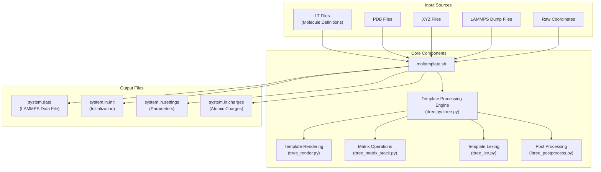
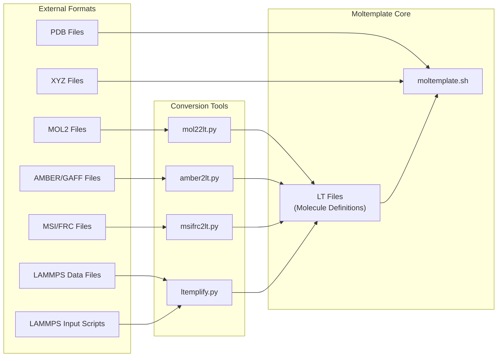
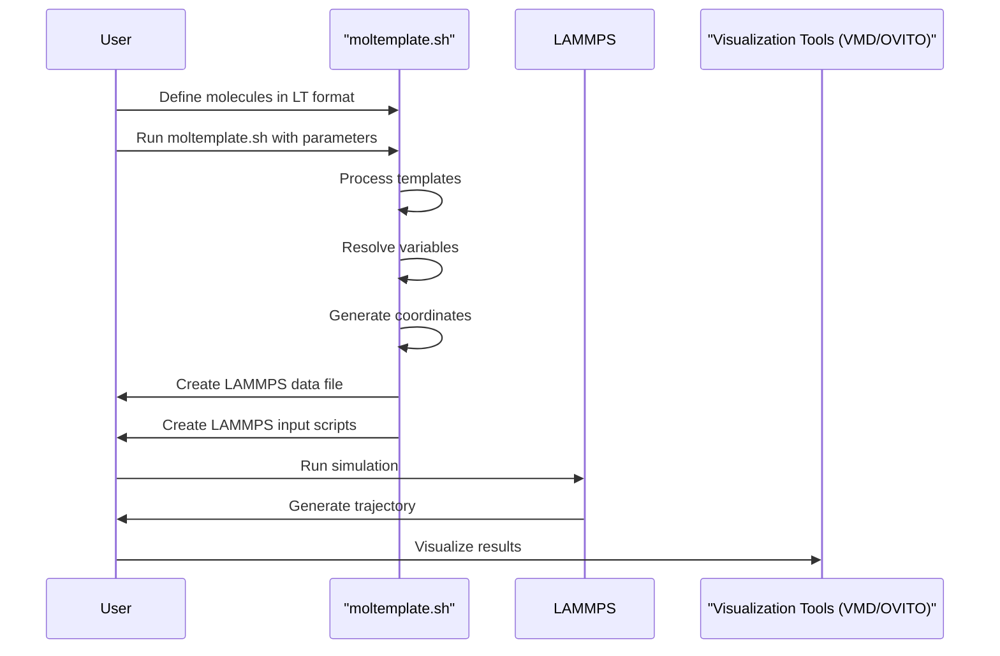
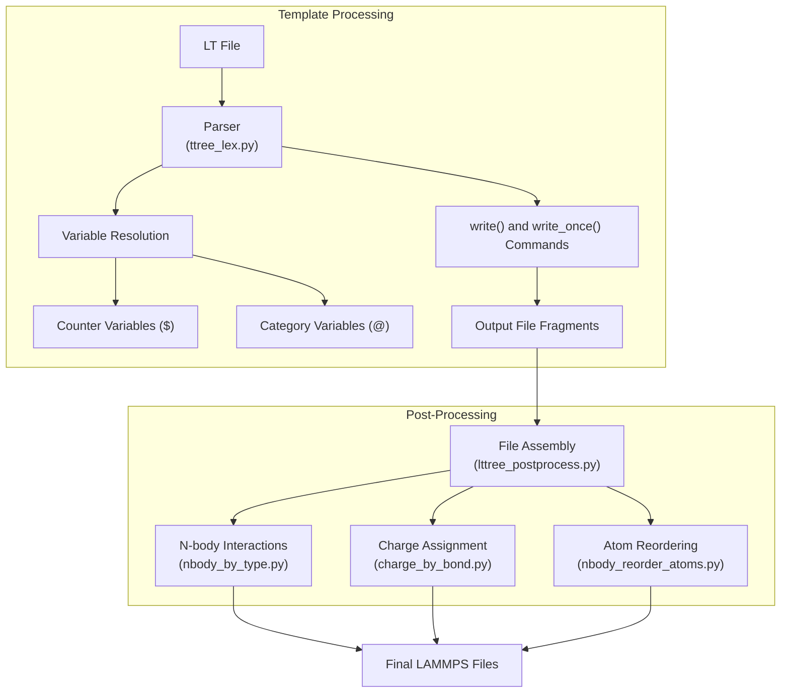
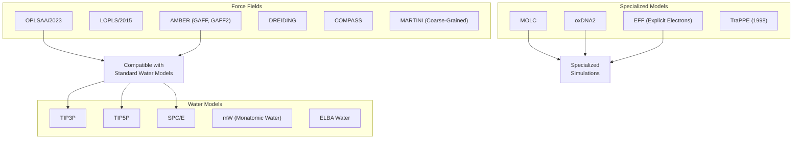
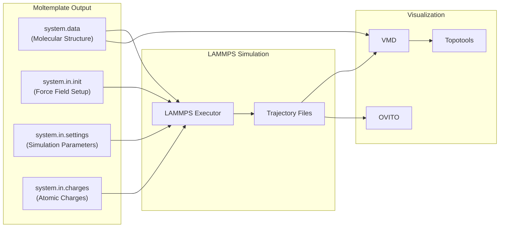

# Overview

<details>
<summary>Relevant source files</summary>

The following files were used as context for generating this wiki page:

- [.circleci/config.yml](.circleci/config.yml)
- [INSTALL.md](INSTALL.md)
- [README.md](README.md)
- [doc/doc_ltemplify.md](doc/doc_ltemplify.md)
- [doc/moltemplate_manual_README.md](doc/moltemplate_manual_README.md)
- [doc/moltemplate_manual_src/moltemplate_manual.tex](doc/moltemplate_manual_src/moltemplate_manual.tex)
- [doc/moltemplate_manual_src/refs.bib](doc/moltemplate_manual_src/refs.bib)
- [examples/all_atom/force_field_AMBER/benzene/run.in.npt](examples/all_atom/force_field_AMBER/benzene/run.in.npt)
- [examples/all_atom/force_field_AMBER/ethylene+benzene/run.in.npt](examples/all_atom/force_field_AMBER/ethylene+benzene/run.in.npt)
- [examples/all_atom/force_field_AMBER/hexadecane/run.in.npt](examples/all_atom/force_field_AMBER/hexadecane/run.in.npt)
- [examples/all_atom/force_field_COMPASS/butane/run.in.npt](examples/all_atom/force_field_COMPASS/butane/run.in.npt)
- [examples/all_atom/force_field_COMPASS/hexadecane/run.in.npt](examples/all_atom/force_field_COMPASS/hexadecane/run.in.npt)
- [examples/all_atom/force_field_DREIDING/furan/run.in.npt](examples/all_atom/force_field_DREIDING/furan/run.in.npt)
- [examples/all_atom/force_field_OPLSAA/benzene+benzoic_acid/run.in.npt](examples/all_atom/force_field_OPLSAA/benzene+benzoic_acid/run.in.npt)
- [examples/all_atom/force_field_OPLSAA/butane/run.in.npt](examples/all_atom/force_field_OPLSAA/butane/run.in.npt)
- [examples/all_atom/force_field_OPLSAA/butane/run.in.nvt](examples/all_atom/force_field_OPLSAA/butane/run.in.nvt)
- [examples/all_atom/force_field_OPLSAA/ethylene+benzene/run.in.npt](examples/all_atom/force_field_OPLSAA/ethylene+benzene/run.in.npt)
- [examples/all_atom/force_field_OPLSAA/ethylene+benzene_PACKMOL/run.in.npt](examples/all_atom/force_field_OPLSAA/ethylene+benzene_PACKMOL/run.in.npt)
- [examples/all_atom/force_field_OPLSAA/functionalized_nanotubes_NH2/run.in.nvt](examples/all_atom/force_field_OPLSAA/functionalized_nanotubes_NH2/run.in.nvt)
- [examples/all_atom/force_field_OPLSAA/hexadecane/run.in.npt](examples/all_atom/force_field_OPLSAA/hexadecane/run.in.npt)
- [examples/all_atom/force_field_OPLSAA/hexadecane/run.in.nvt](examples/all_atom/force_field_OPLSAA/hexadecane/run.in.nvt)
- [examples/all_atom/force_field_OPLSAA/waterTIP5P+ethanol/run.in.npt](examples/all_atom/force_field_OPLSAA/waterTIP5P+ethanol/run.in.npt)
- [moltemplate/force_fields/convert_TINKER_files_to_LT_files/loplsaa_ext.prm](moltemplate/force_fields/convert_TINKER_files_to_LT_files/loplsaa_ext.prm)
- [moltemplate/force_fields/convert_TINKER_files_to_LT_files/tinkerparm2lt.py](moltemplate/force_fields/convert_TINKER_files_to_LT_files/tinkerparm2lt.py)
- [moltemplate/force_fields/loplsaa.lt](moltemplate/force_fields/loplsaa.lt)
- [moltemplate/force_fields/oplsaa.lt](moltemplate/force_fields/oplsaa.lt)
- [moltemplate/ltemplify.py](moltemplate/ltemplify.py)
- [moltemplate/scripts/moltemplate.sh](moltemplate/scripts/moltemplate.sh)
- [setup.py](setup.py)
- [tests/test_compass.sh](tests/test_compass.sh)
- [tests/test_ltemplify.sh](tests/test_ltemplify.sh)
- [tests/test_molc.sh](tests/test_molc.sh)
- [tests/test_molc_files/system.lt](tests/test_molc_files/system.lt)
- [tests/test_molc_files/xxx.lt](tests/test_molc_files/xxx.lt)
- [tests/test_oplsaa.sh](tests/test_oplsaa.sh)
- [tests/test_read_coords_pdb.sh](tests/test_read_coords_pdb.sh)

</details>


Moltemplate is a general cross-platform text-based molecule builder for LAMMPS (Large-scale Atomic/Molecular Massively Parallel Simulator). It provides a template-based system for creating complex molecular models and preparing molecular dynamics simulations. Moltemplate was designed primarily for building custom coarse-grained molecular models but can also be used for realistic all-atom simulations.

This document provides a high-level overview of Moltemplate's architecture, key components, and workflow. It explains how Moltemplate converts molecule definitions in the LT format (LAMMPS-Template) into LAMMPS input scripts and data files that can be used to run molecular dynamics simulations.

Sources: [README.md:18-43](), [setup.py:38-40]()

## Core Architecture

Moltemplate follows a modular design that allows users to build complex molecular systems from simpler components. At the heart of the system is a template processing engine that handles hierarchical molecule definitions.



Sources: [moltemplate/scripts/moltemplate.sh:1-100](), [moltemplate/scripts/moltemplate.sh:127-135](), [setup.py:70-104]()

## Conversion and Import Tools

Moltemplate includes a suite of tools for converting various molecule file formats into the LT format, making it interoperable with many existing molecular modeling tools and databases.



Sources: [README.md:94-118](), [moltemplate/ltemplify.py:1-30](), [setup.py:85-90]()

## Molecule Building Workflow

A typical workflow with Moltemplate involves defining molecules or molecular fragments in LT format, arranging them in space, and generating simulation files for LAMMPS.



Sources: [moltemplate/scripts/moltemplate.sh:127-209](), [README.md:122-126]()

## Template Processing System

The template processing system is the core of Moltemplate's functionality. It handles the interpretation of LT files, resolves variable references, and generates the appropriate LAMMPS files.



Sources: [moltemplate/scripts/moltemplate.sh:127-164](), [setup.py:77-104]()

## LT File Format and Capabilities

The LT (LAMMPS-Template) file format is the native format used by Moltemplate for defining molecules and force fields. It contains all the information relevant to a particular molecule, including coordinates, bond topology, force-field parameters, and constraints.

| Section | Description | Example |
|---------|-------------|---------|
| Molecule Definition | Defines a new molecule type | `Ethane { ... }` |
| Atom Definition | Defines atoms in the molecule | `write("Data Atoms") { $atom:C1 $mol @atom:C 0.0 1.1 2.2 3.3 }` |
| Bond Definition | Defines bonds between atoms | `write("Data Bonds") { $bond:1 @bond:CC $atom:C1 $atom:C2 }` |
| Force Field Parameters | Defines force field parameters | `write_once("In Settings") { pair_coeff @atom:C @atom:C lj/cut 0.066 3.5 }` |
| Hierarchical Structure | Allows molecules to inherit properties | `Ethane inherits OPLSAA { ... }` |
| Coordinate Manipulation | Allows moving, rotating molecules | `move(0.0, 0.0, 5.0)` |

Sources: [doc/moltemplate_manual_src/moltemplate_manual.tex:167-208](), [doc/doc_ltemplify.md:130-162]()

## Force Fields and Models Support

Moltemplate supports a wide range of force fields and molecular models, allowing users to choose appropriate parameters for their specific simulation needs.



Sources: [README.md:25-42](), [moltemplate/force_fields/oplsaa.lt:1-30](), [moltemplate/force_fields/loplsaa.lt:1-30]()

## Utility Tools

Moltemplate includes several utility tools that enhance its functionality and provide additional capabilities for building complex molecular systems.

| Tool | Purpose | Key Features |
|------|---------|--------------|
| `genpoly_lt.py` | Generate polymer structures | Creates chains, helices, and custom shapes |
| `ltemplify.py` | Convert LAMMPS to LT format | Extracts molecule definitions from existing simulations |
| `mol22lt.py` | Convert MOL2 to LT format | Imports molecular structures from MOL2 files |
| `charge_by_bond.py` | Assign charges | Automatically assigns charges based on bond topology |
| `nbody_by_type.py` | Generate N-body interactions | Creates angle, dihedral, and improper interactions |
| `cleanup_moltemplate.sh` | Clean up output files | Removes temporary files |

Sources: [setup.py:77-104](), [moltemplate/ltemplify.py:1-30](), [README.md:60-62]()

## All-Atom and Coarse-Grained Capabilities

Moltemplate can be used for both all-atom simulations with realistic force fields and coarse-grained simulations with simplified molecular models.

### All-Atom Simulations

For all-atom simulations, users typically need to:
1. Select an appropriate force field (e.g., OPLSAA, AMBER, DREIDING)
2. Define atomic structures with correct atom types
3. Assign partial charges (via force field rules or external tools)
4. Define bonded interactions

Moltemplate can use external sources for atom typing and charge assignment:
- ATB database (provides ready-to-use LT format files)
- AmberTools (generates MOL2 files)
- RED-server (calculates partial charges)
- LigParGen (creates LAMMPS data files)

### Coarse-Grained Simulations

For coarse-grained simulations, Moltemplate allows users to:
1. Define custom interaction sites representing groups of atoms
2. Create custom force fields with simplified potentials
3. Build complex multi-scale models combining all-atom and coarse-grained representations

Sources: [README.md:83-118](), [doc/moltemplate_manual_src/moltemplate_manual.tex:79-118]()

## Practical Usage and Installation

Moltemplate requires Python (3.4+), NumPy, and BASH to run. It can run on MacOS, Linux, or Windows (with appropriate shell environment).

Typical usage:
```
moltemplate.sh [-atomstyle style] [-pdb/-xyz coord_file] [-vmd] system.lt
```

Installation options:
1. Using pip: `pip3 install moltemplate`
2. Using conda: `conda install conda-forge::moltemplate`
3. Manual installation from GitHub: Clone repository, then run `pip3 install .`

Memory requirements scale with system size:
- 1,000,000 atoms typically requires 3-12 GB of available memory
- Memory usage depends on number of bonds, molecules, and angular interactions

Sources: [README.md:128-146](), [INSTALL.md:1-62](), [doc/moltemplate_manual_src/moltemplate_manual.tex:137-142]()

## Integration with LAMMPS and Visualization Tools

Moltemplate generates files that can be directly used with LAMMPS for molecular dynamics simulations and is compatible with various visualization tools.



Sources: [doc/moltemplate_manual_src/moltemplate_manual.tex:298-316](), [examples/all_atom/force_field_AMBER/hexadecane/run.in.npt:1-109]()

---