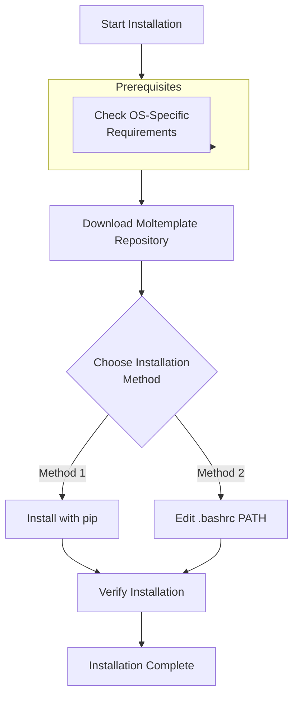
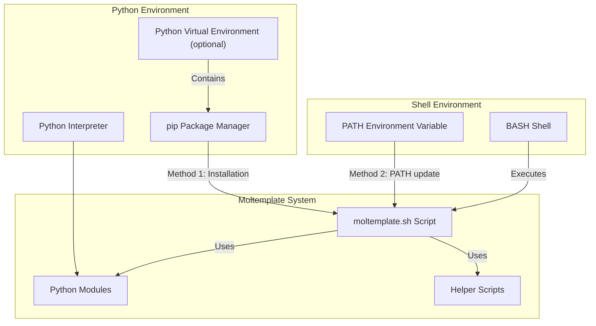
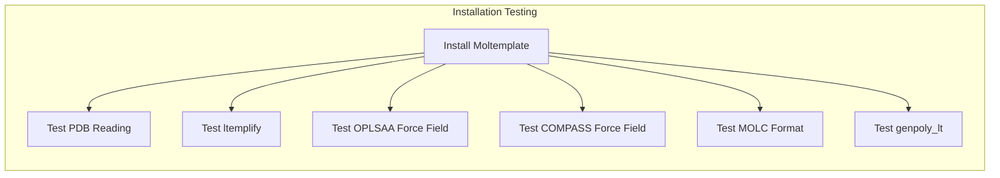

# Installation

<details>
<summary>Relevant source files</summary>

The following files were used as context for generating this wiki page:

- [.circleci/config.yml](.circleci/config.yml)
- [INSTALL.md](INSTALL.md)
- [examples/all_atom/force_field_AMBER/benzene/run.in.npt](examples/all_atom/force_field_AMBER/benzene/run.in.npt)
- [examples/all_atom/force_field_AMBER/ethylene+benzene/run.in.npt](examples/all_atom/force_field_AMBER/ethylene+benzene/run.in.npt)
- [examples/all_atom/force_field_AMBER/hexadecane/run.in.npt](examples/all_atom/force_field_AMBER/hexadecane/run.in.npt)
- [examples/all_atom/force_field_COMPASS/butane/run.in.npt](examples/all_atom/force_field_COMPASS/butane/run.in.npt)
- [examples/all_atom/force_field_COMPASS/hexadecane/run.in.npt](examples/all_atom/force_field_COMPASS/hexadecane/run.in.npt)
- [examples/all_atom/force_field_DREIDING/furan/run.in.npt](examples/all_atom/force_field_DREIDING/furan/run.in.npt)
- [examples/all_atom/force_field_OPLSAA/benzene+benzoic_acid/run.in.npt](examples/all_atom/force_field_OPLSAA/benzene+benzoic_acid/run.in.npt)
- [examples/all_atom/force_field_OPLSAA/butane/run.in.npt](examples/all_atom/force_field_OPLSAA/butane/run.in.npt)
- [examples/all_atom/force_field_OPLSAA/butane/run.in.nvt](examples/all_atom/force_field_OPLSAA/butane/run.in.nvt)
- [examples/all_atom/force_field_OPLSAA/ethylene+benzene/run.in.npt](examples/all_atom/force_field_OPLSAA/ethylene+benzene/run.in.npt)
- [examples/all_atom/force_field_OPLSAA/ethylene+benzene_PACKMOL/run.in.npt](examples/all_atom/force_field_OPLSAA/ethylene+benzene_PACKMOL/run.in.npt)
- [examples/all_atom/force_field_OPLSAA/functionalized_nanotubes_NH2/run.in.nvt](examples/all_atom/force_field_OPLSAA/functionalized_nanotubes_NH2/run.in.nvt)
- [examples/all_atom/force_field_OPLSAA/hexadecane/run.in.npt](examples/all_atom/force_field_OPLSAA/hexadecane/run.in.npt)
- [examples/all_atom/force_field_OPLSAA/hexadecane/run.in.nvt](examples/all_atom/force_field_OPLSAA/hexadecane/run.in.nvt)
- [examples/all_atom/force_field_OPLSAA/waterTIP5P+ethanol/run.in.npt](examples/all_atom/force_field_OPLSAA/waterTIP5P+ethanol/run.in.npt)
- [tests/test_compass.sh](tests/test_compass.sh)
- [tests/test_ltemplify.sh](tests/test_ltemplify.sh)
- [tests/test_molc.sh](tests/test_molc.sh)
- [tests/test_molc_files/system.lt](tests/test_molc_files/system.lt)
- [tests/test_molc_files/xxx.lt](tests/test_molc_files/xxx.lt)
- [tests/test_oplsaa.sh](tests/test_oplsaa.sh)
- [tests/test_read_coords_pdb.sh](tests/test_read_coords_pdb.sh)

</details>


This page provides detailed instructions for installing Moltemplate on different operating systems. Moltemplate is a system designed to simplify the creation of complex molecular simulations for the LAMMPS molecular dynamics software.

## Prerequisites

Before installing Moltemplate, you need to have the following software installed on your system:

- BASH shell
- Python 3
- pip (Python package manager)

Sources: [INSTALL.md:4-6](), [INSTALL.md:61-64]()

## Installation Methods

There are two ways to install Moltemplate:

1. Using pip (recommended)
2. Editing your .bashrc file

It is important to use only one method, not both.

Sources: [INSTALL.md:17-21]()

### Installation Workflow



Sources: [INSTALL.md:7-14](), [INSTALL.md:17-21]()

## Method 1: Installation Using pip

This is the recommended installation method, especially if you plan to use Moltemplate with other Python tools.

### Standard Installation

1. Clone the Moltemplate repository or download the ZIP file:
   ```bash
   git clone https://github.com/jewettaij/moltemplate DESTINATION_DIRECTORY
   ```

2. Navigate to the downloaded directory:
   ```bash
   cd DESTINATION_DIRECTORY
   ```

3. Install using pip:
   ```bash
   pip3 install .              # (or "pip", if pip3 fails)
   ```

4. If the above fails, try installing for a single user:
   ```bash
   pip3 install . --user       # (or "pip", if pip3 fails)
   ```

5. For system-wide installation (on shared computers):
   ```bash
   sudo pip3 install .         # (or "pip", if pip3 fails)
   ```

Sources: [INSTALL.md:24-49](), [.circleci/config.yml:16]()

### Troubleshooting pip Installation

Common issues when installing with pip:

1. **Missing pip**: If pip is not installed, use your system's package manager to install it
2. **Multiple Python versions**: Make sure pip corresponds to the correct Python version
3. **Permission issues**: Use `--user` flag or `sudo` depending on your system

To check which Python and pip versions are installed:
```bash
which python3
which pip3
```

Ensure both commands return paths in the same directory (e.g., both in `/usr/bin/` or both in a path containing `anaconda`).

Sources: [INSTALL.md:52-117]()

### Optional: Using Python Virtual Environment

Using a virtual environment is recommended for clean installation:

```bash
python3 -m venv venv     # (or "virtualenv venv" if that fails)
source venv/bin/activate
pip3 install .           # (or "pip" if that fails)
```

When using a virtual environment, you must activate it before using Moltemplate:
```bash
source /path/to/venv/bin/activate
```

Sources: [INSTALL.md:120-154]()

## Method 2: Editing PATH in Shell Configuration

This method involves manually adding Moltemplate directories to your system's PATH.

### For BASH shell users:

Add these lines to your `~/.bashrc` file:

```bash
export PATH="$PATH:$HOME/moltemplate/moltemplate"
export PATH="$PATH:$HOME/moltemplate/moltemplate/scripts"
```

Alternative locations include `~/.profile` or `~/.bash_profile`.

### For TCSH shell users:

Add these lines to your `~/.cshrc`, `~/.tcshrc`, or `~/.login` file:

```tcsh
setenv PATH "$PATH:$HOME/moltemplate/moltemplate"
setenv PATH "$PATH:$HOME/moltemplate/moltemplate/scripts"
```

After editing, start a new terminal for the changes to take effect.

**Note**: This method is not recommended if you're using software that has Moltemplate as a Python dependency (like "vipster" or "cellpack2moltemplate"), as those programs require Moltemplate to be installed as a Python package.

Sources: [INSTALL.md:158-193]()

## System Integration



Sources: [INSTALL.md:61-64](), [.circleci/config.yml:12-17]()

## OS-Specific Installation Guidelines

### Linux

Most Linux distributions include the necessary prerequisites. If pip is not available, install it using your distribution's package manager:

```bash
# For Ubuntu/Debian
sudo apt install python3-pip

# For Fedora/RHEL/CentOS
sudo dnf install python3-pip
```

Alternatively, you can install Anaconda Python, which includes pip and numpy by default.

Sources: [INSTALL.md:199-212]()

### macOS

You can install the required prerequisites using Homebrew or Xcode:

```bash
# Using Homebrew
brew install python3
```

Anaconda Python is also available for macOS and may provide a more reliable Python environment.

Sources: [INSTALL.md:214-222]()

### Windows

To use Moltemplate on Windows, you'll need to install a BASH shell environment first. Recommended options:

1. **Windows Subsystem for Linux (WSL2)** - Preferred option
2. **VirtualBox with a Linux distribution** (like Xubuntu)
3. **Hyper-V** (for newer Windows versions)
4. **Cygwin** (for older Windows versions)

You will also need a Unix-style text editor, as Word, Wordpad, and Notepad are not suitable. Options include:
- Graphical editors: Atom, Sublime, Notepad++, VSCode
- Terminal-based editors: vim, emacs, nano, ne, jove

When using WSL2, be careful when editing Linux files with Windows applications as this can cause file corruption.

Sources: [INSTALL.md:224-261]()

## Verification of Installation

To verify that Moltemplate has been installed correctly, run the following command:

```bash
moltemplate.sh -h
```

This should display the help information for Moltemplate. If you get a "command not found" error, the installation was not successful.

You can also check if the Python module can be imported:

```bash
python3 -c "import moltemplate; print(moltemplate.__file__)"
```

This should print the path to the installed moltemplate module.

Sources: [.circleci/config.yml:16-22]()

## Installation Validation

The Moltemplate testing system verifies installation by running several tests:



Sources: [.circleci/config.yml:16-22](), [tests/test_read_coords_pdb.sh:1-34](), [tests/test_ltemplify.sh:1-126](), [tests/test_oplsaa.sh:1-23](), [tests/test_compass.sh:1-22](), [tests/test_molc.sh:1-14]()

## Next Steps

After installation, you can begin creating molecular simulation systems. Moltemplate will generate files for LAMMPS simulations, typically including:

- `system.data` - Contains atom coordinates and molecular topology
- `system.in.init` - Contains initialization parameters
- `system.in.settings` - Contains force field parameters
- `system.in.charges` - Contains atom charges (for some force fields)

These files are used to run simulations in LAMMPS as shown in example run files.

Sources: [examples/all_atom/force_field_OPLSAA/ethylene+benzene/run.in.npt:1-7](), [examples/all_atom/force_field_AMBER/benzene/run.in.npt:1-7]()

---