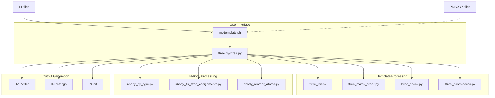
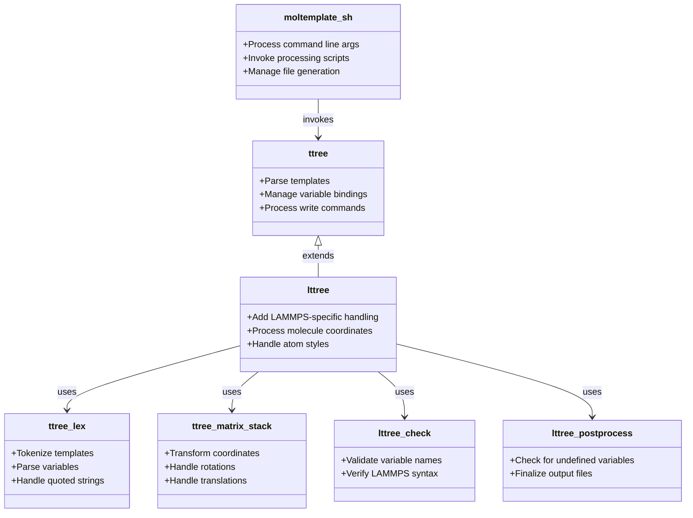
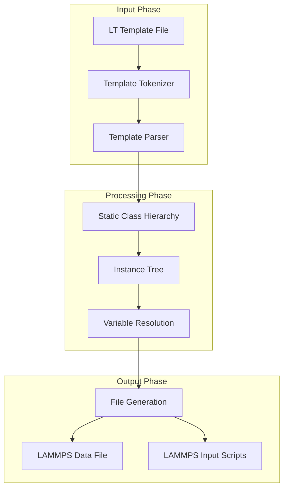
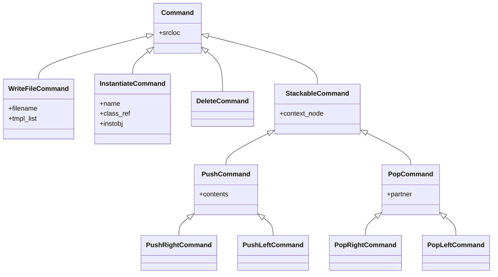
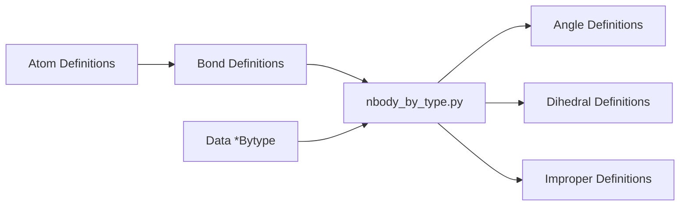
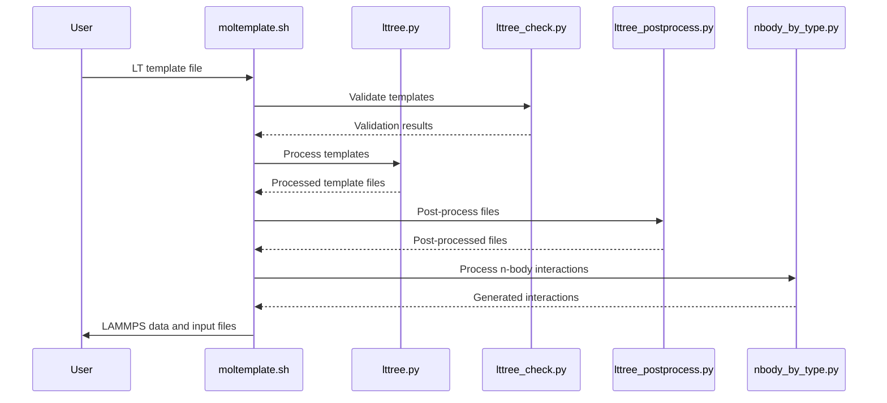
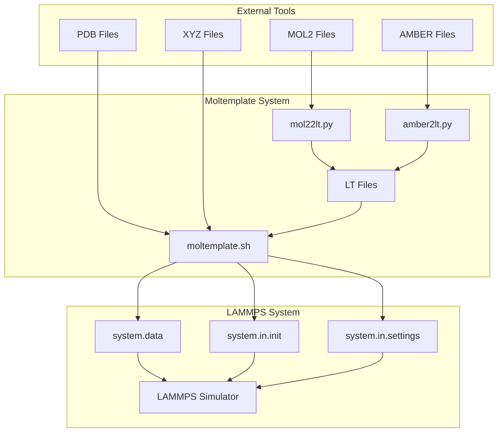

# Core System Architecture

Relevant source files

The following files were used as context for generating this wiki page:

- [README.md](README.md)
- [doc/doc_ltemplify.md](doc/doc_ltemplify.md)
- [doc/moltemplate_manual_README.md](doc/moltemplate_manual_README.md)
- [doc/moltemplate_manual_src/moltemplate_manual.tex](doc/moltemplate_manual_src/moltemplate_manual.tex)
- [doc/moltemplate_manual_src/refs.bib](doc/moltemplate_manual_src/refs.bib)
- [moltemplate/bonds_by_type.py](moltemplate/bonds_by_type.py)
- [moltemplate/charge_by_bond.py](moltemplate/charge_by_bond.py)
- [moltemplate/dump2data.py](moltemplate/dump2data.py)
- [moltemplate/force_fields/convert_TINKER_files_to_LT_files/loplsaa_ext.prm](moltemplate/force_fields/convert_TINKER_files_to_LT_files/loplsaa_ext.prm)
- [moltemplate/force_fields/convert_TINKER_files_to_LT_files/tinkerparm2lt.py](moltemplate/force_fields/convert_TINKER_files_to_LT_files/tinkerparm2lt.py)
- [moltemplate/force_fields/loplsaa.lt](moltemplate/force_fields/loplsaa.lt)
- [moltemplate/force_fields/oplsaa.lt](moltemplate/force_fields/oplsaa.lt)
- [moltemplate/ltemplify.py](moltemplate/ltemplify.py)
- [moltemplate/lttree.py](moltemplate/lttree.py)
- [moltemplate/lttree_check.py](moltemplate/lttree_check.py)
- [moltemplate/lttree_postprocess.py](moltemplate/lttree_postprocess.py)
- [moltemplate/lttree_styles.py](moltemplate/lttree_styles.py)
- [moltemplate/nbody_by_type.py](moltemplate/nbody_by_type.py)
- [moltemplate/nbody_by_type_lib.py](moltemplate/nbody_by_type_lib.py)
- [moltemplate/nbody_fix_ttree_assignments.py](moltemplate/nbody_fix_ttree_assignments.py)
- [moltemplate/raw2data.py](moltemplate/raw2data.py)
- [moltemplate/scripts/moltemplate.sh](moltemplate/scripts/moltemplate.sh)
- [moltemplate/ttree.py](moltemplate/ttree.py)
- [moltemplate/ttree_matrix_stack.py](moltemplate/ttree_matrix_stack.py)
- [moltemplate/ttree_render.py](moltemplate/ttree_render.py)
- [setup.py](setup.py)

This page outlines the core architecture of moltemplate, explaining the key components that make up the system and how they interact. Moltemplate is a general-purpose template-based molecule builder for LAMMPS that recursively processes template files to generate complex molecular structures and simulation inputs.

For information about molecule building tools like `genpoly_lt.py`, see [Molecule Building Tools](#3). For file format converters, see [File Format Converters](#4).

## System Overview

Moltemplate's architecture follows a layered design centered around template processing. The core engine handles recursive text generation and variable substitution, while specialized components add molecular simulation capabilities.

### Architecture Diagram

Sources: [moltemplate/scripts/moltemplate.sh:138-225](), [moltemplate/ttree.py:10-44]()

### Component Relationships

Sources: [moltemplate/scripts/moltemplate.sh:127-139](), [moltemplate/ttree.py:126-262](), [moltemplate/lttree.py:31-60]()

## Key Components

### moltemplate.sh

The main script that users directly interact with. It's a bash script that serves as the entry point for moltemplate, parsing command-line arguments and orchestrating the execution of the underlying Python modules.

Key responsibilities:
- Processes command-line arguments
- Checks for dependencies and necessary files
- Invokes the template processing pipeline
- Consolidates output files

Sources: [moltemplate/scripts/moltemplate.sh:1-46](), [moltemplate/scripts/moltemplate.sh:127-139]()

### ttree.py

The core template processing engine. This module recursively generates text files from template files containing variables and commands.

Key classes:
- `StaticObj`: Stores class definitions and static variables
- `InstanceObj`: Stores instances and their associated variables
- `Command`: Base class for template commands (write, new, etc.)

Key features:
- Variable substitution
- Text template processing
- Command execution

Sources: [moltemplate/ttree.py:10-44](), [moltemplate/ttree.py:109-175]()

### lttree.py

An extension of ttree.py specialized for LAMMPS. Adds molecular simulation specific features like coordinate transformation and atom style handling.

Key additions:
- LAMMPS atom style support
- Coordinate transformation
- Molecular structure handling

Sources: [moltemplate/lttree.py:10-26](), [moltemplate/lttree.py:81-108]()

### ttree_matrix_stack.py

Provides matrix operations for coordinate transformations, supporting operations like rotation and translation of molecular structures.

Key components:
- `AffineTransform`: Performs coordinate transformations
- `MultiAffineStack`: Maintains transformation state
- Matrix multiplication utilities

Sources: [moltemplate/ttree_matrix_stack.py:22-138]()

### lttree_styles.py

Defines LAMMPS-specific styles and data formats, ensuring that the generated output files adhere to LAMMPS conventions.

Key definitions:
- Data file section names
- Input script section names
- Atom style definitions

Sources: [moltemplate/lttree_styles.py:17-61]()

## Template Processing Architecture

The template processing system is the heart of moltemplate, converting high-level molecule descriptions into concrete simulation inputs.

### Template Processing Flow

Sources: [moltemplate/ttree.py:175-399](), [moltemplate/lttree.py:194-388]()

### Template Variables

Moltemplate uses two key types of variables:

1. **Static variables** (`@variable`): Associated with class definitions
   - Example: `@atom:C`, `@bond:CC`
   - Defined in class scope
   - Typically represent atom types, bond types, etc.

2. **Instance variables** (`$variable`): Associated with specific instances
   - Example: `$atom:C1`, `$bond:b1`
   - Specific to each molecule instance
   - Typically represent specific atoms, bonds, etc.

Sources: [moltemplate/ttree.py:109-147](), [moltemplate/lttree_check.py:109-166]()

## Command Execution Framework

Commands in template files are processed and executed to generate the final output files.

### Command Types

Sources: [moltemplate/ttree.py:157-390]()

### Command Processing Workflow

The command processing workflow follows a sequential execution model:

1. Template file is parsed into a series of commands
2. Commands are sorted by type and order
3. Static objects (classes) are created and linked
4. Instance commands create the instance hierarchy
5. Write commands populate output files

Sources: [moltemplate/ttree.py:443-520](), [moltemplate/ttree.py:850-914]()

## File Generation

The final step in the process is generating output files for LAMMPS.

### Output File Structure

| File | Purpose | Content |
|------|---------|---------|
| `.data` | LAMMPS data file | Atom coordinates, topology, force field parameters |
| `.in.init` | Initialization script | Force field styles, simulation settings |
| `.in.settings` | Parameter settings | Force field parameters, constraints |
| `.in.charges` | Charge assignments | Atom charge settings |

Sources: [moltemplate/scripts/moltemplate.sh:144-184](), [moltemplate/lttree_styles.py:17-61]()

### N-body Interaction Processing

Many-body interactions (angles, dihedrals, impropers) can be automatically generated:

Sources: [moltemplate/nbody_by_type.py:10-40](), [moltemplate/scripts/moltemplate.sh:237-252]()

## Processing Pipeline

The entire moltemplate processing pipeline consists of several sequential steps that transform template files into LAMMPS input files.

### Pipeline Flow

Sources: [moltemplate/scripts/moltemplate.sh:901-961]()

## Error Handling

Moltemplate includes a comprehensive error handling system to catch common mistakes:

1. **Syntax validation**: Performed by `lttree_check.py`
2. **Variable verification**: Performed by `lttree_postprocess.py`
3. **Runtime error messages**: Detailed error messages with line numbers

Sources: [moltemplate/scripts/moltemplate.sh:73-89](), [moltemplate/lttree_check.py:89-106]()

## Performance Considerations

The recursive template processing can be memory-intensive for large systems:

- Building a system of 1,000,000 atoms typically requires 3-12GB of memory
- Memory usage depends on the number of bonds, molecules, and interactions
- Performance is primarily limited by memory, not CPU

Sources: [doc/moltemplate_manual_src/moltemplate_manual.tex:136-142]()

## Usage in Larger System

Sources: [README.md:88-96](), [setup.py:70-104]()

This diagram shows how moltemplate fits into the broader molecular simulation workflow, connecting multiple input formats to the LAMMPS simulator.

---