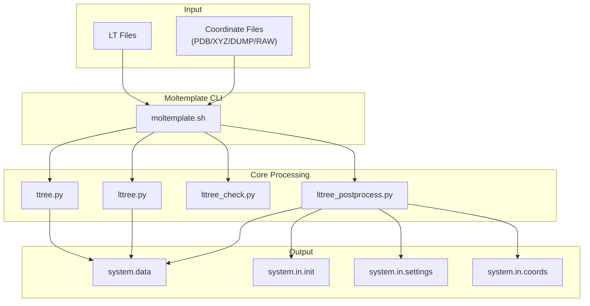
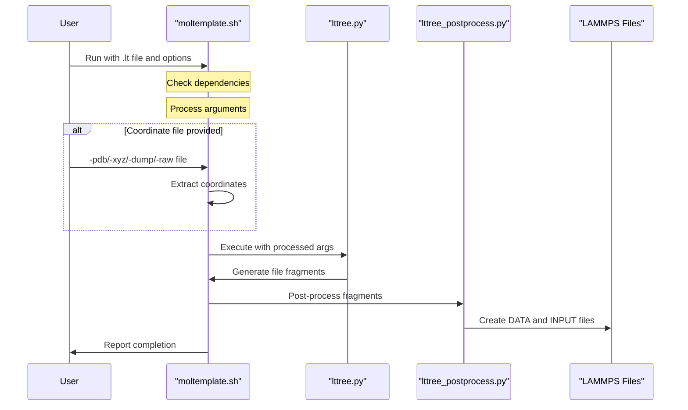
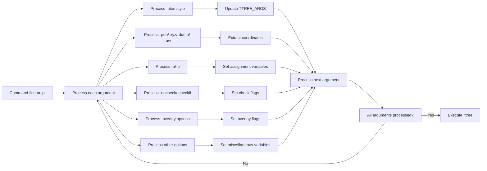

# moltemplate.sh Script

<details>
<summary>Relevant source files</summary>

The following files were used as context for generating this wiki page:

- [README.md](README.md)
- [doc/doc_ltemplify.md](doc/doc_ltemplify.md)
- [doc/moltemplate_manual_README.md](doc/moltemplate_manual_README.md)
- [doc/moltemplate_manual_src/moltemplate_manual.tex](doc/moltemplate_manual_src/moltemplate_manual.tex)
- [doc/moltemplate_manual_src/refs.bib](doc/moltemplate_manual_src/refs.bib)
- [moltemplate/force_fields/convert_TINKER_files_to_LT_files/loplsaa_ext.prm](moltemplate/force_fields/convert_TINKER_files_to_LT_files/loplsaa_ext.prm)
- [moltemplate/force_fields/convert_TINKER_files_to_LT_files/tinkerparm2lt.py](moltemplate/force_fields/convert_TINKER_files_to_LT_files/tinkerparm2lt.py)
- [moltemplate/force_fields/loplsaa.lt](moltemplate/force_fields/loplsaa.lt)
- [moltemplate/force_fields/oplsaa.lt](moltemplate/force_fields/oplsaa.lt)
- [moltemplate/ltemplify.py](moltemplate/ltemplify.py)
- [moltemplate/scripts/moltemplate.sh](moltemplate/scripts/moltemplate.sh)
- [setup.py](setup.py)

</details>


The `moltemplate.sh` script is the primary entry point for the Moltemplate system. This script converts molecule definition files (`.lt` files) into LAMMPS-compatible data and input script files for molecular simulations. It acts as a wrapper that coordinates various Python scripts for template processing and handles different input formats for molecular coordinates.

For information about the template processing system that moltemplate.sh uses, see [Template Processing System](#2.2).

## Purpose and Functionality

The `moltemplate.sh` script serves as the command-line interface for Moltemplate users. Its main functions include:

1. Processing Moltemplate template (`.lt`) files
2. Converting them into LAMMPS-compatible inputs
3. Incorporating coordinates from external files (PDB, XYZ, DUMP, RAW)
4. Handling various command-line options for customizing the conversion process

Sources: [moltemplate/scripts/moltemplate.sh:1-47](), [README.md:123-125]()

## System Architecture

The `moltemplate.sh` script is positioned at the core of the Moltemplate system, orchestrating the conversion of molecular templates into LAMMPS input files.



Sources: [moltemplate/scripts/moltemplate.sh:126-135](), [moltemplate/scripts/moltemplate.sh:946-962]()

## Script Organization

The script follows a logical organization structure:

1. **Initialization**: Sets up environment, checks for Python, and locates necessary script files
2. **Command-line Processing**: Parses user inputs and sets appropriate variables
3. **Coordinate Processing**: Extracts atomic coordinates from input files if specified
4. **Template Processing**: Executes the template processing pipeline
5. **Output Generation**: Creates LAMMPS data and input script files



Sources: [moltemplate/scripts/moltemplate.sh:15-46](), [moltemplate/scripts/moltemplate.sh:456-887](), [moltemplate/scripts/moltemplate.sh:946-962]()

## Command-Line Options

The script supports numerous command-line options for customizing the conversion process:

| Option | Description |
|--------|-------------|
| `-atomstyle style` | Specify LAMMPS atom style (default: "full") |
| `-pdb file` | Use coordinates from a PDB file |
| `-xyz file` | Use coordinates from an XYZ file |
| `-dump file` | Use coordinates from a LAMMPS dump file |
| `-raw file` | Use coordinates from a RAW file (3-column X Y Z format) |
| `-a "var value"` | Customize atom/bond/angle/dihedral/improper type assignments |
| `-b assignments.txt` | Similar to -a but without ensuring unique values |
| `-nocheck` | Bypass syntax and naming convention checks |
| `-checkff` | Check if valid angle/dihedral interactions exist for bonded atoms |
| `-overlay-bonds` | Allow multiple bonds between the same atoms |
| `-overlay-angles` | Allow multiple angles for the same triplet of atoms |
| `-overlay-dihedrals` | Allow multiple dihedrals for the same quartet of atoms |
| `-overlay-impropers` | Allow multiple impropers for the same quartet of atoms |
| `-overlay-all` | Enable all overlay options |
| `-molc` | Additional processing for "In Settings" file |
| `-lammps-script basename` | Specify the base name for LAMMPS execution script |
| `-run-example` | Append example run section to input script |

Sources: [moltemplate/scripts/moltemplate.sh:272-401](), [moltemplate/scripts/moltemplate.sh:472-541]()

## Input Processing

The script can process various types of input files to extract atomic coordinates:

### PDB File Processing
The script extracts atom coordinates and optionally periodic boundary information from PDB files. For triclinic cells, it performs the necessary coordinate transformations.

### XYZ File Processing
For XYZ files, the script extracts the atomic coordinates, ignoring the header information.

### DUMP File Processing
When processing LAMMPS dump files, the script extracts coordinates, velocities, quaternions (for ellipsoid particles), and box dimensions.

### RAW File Processing
RAW files are simple 3-column files containing X Y Z coordinates, which are extracted directly.

Sources: [moltemplate/scripts/moltemplate.sh:622-638](), [moltemplate/scripts/moltemplate.sh:639-676](), [moltemplate/scripts/moltemplate.sh:724-808](), [moltemplate/scripts/moltemplate.sh:547-558]()

## Output Files

The script generates several output files:

1. **system.data**: LAMMPS data file containing atom coordinates, topology, and force field parameters
2. **system.in.init**: LAMMPS input script for initialization
3. **system.in.settings**: LAMMPS input script for force field settings
4. **system.in.coords**: LAMMPS input script for coordinate settings (optional)
5. **run.in.EXAMPLE**: Example LAMMPS execution script (if `-run-example` is specified)

If a custom base name is specified using `-lammps-script`, the output files will use that name instead of "system".

Sources: [moltemplate/scripts/moltemplate.sh:900-905](), [moltemplate/scripts/moltemplate.sh:907-933]()

## Error Handling

The script performs several validations:

1. Checks for the availability of Python
2. Verifies that all required script files exist
3. Validates command-line arguments
4. Checks for the existence and validity of input files
5. Reports errors with descriptive messages

Sources: [moltemplate/scripts/moltemplate.sh:17-46](), [moltemplate/scripts/moltemplate.sh:119-125](), [moltemplate/scripts/moltemplate.sh:83-89]()

## Example Usage

Basic usage with a single LT file:
```
moltemplate.sh system.lt
```

Using coordinates from a PDB file:
```
moltemplate.sh -pdb coordinates.pdb system.lt
```

Specifying a custom atom style:
```
moltemplate.sh -atomstyle "full" system.lt
```

Using coordinates and launching VMD for visualization:
```
moltemplate.sh -xyz coords.xyz -atomstyle "full" -vmd system.lt
```

Sources: [moltemplate/scripts/moltemplate.sh:272-401](), [README.md:123-125]()

## Implementation Details

### Python Version Check

The script first checks for Python 3, falling back to Python 2 with a deprecation warning if necessary:

```mermaid
flowchart TD
    start["Start"] --> checkPython3["Check if python3 is available"]
    checkPython3 -- Yes --> setPython3["Set PYTHON_COMMAND='python3'"]
    checkPython3 -- No --> checkPython["Check if python is available"]
    checkPython -- Yes --> checkVersion["Check Python version"]
    checkVersion -- >= 3 --> setPython["Set PYTHON_COMMAND='python'"]
    checkVersion -- < 3 --> warnPython2["Warn about Python 2.7 deprecation"] --> setPython
    checkPython -- No --> checkPython2["Check if python2 is available"]
    checkPython2 -- Yes --> warnPython2_2["Warn about Python 2.7 deprecation"] --> setPython2["Set PYTHON_COMMAND='python2'"]
    checkPython2 -- No --> error["Exit with error: Python required"]
    setPython3 --> findScripts["Find script directory"]
    setPython --> findScripts
    setPython2 --> findScripts
    error --> end["End"]
    findScripts --> checkDependencies["Check if required scripts exist"]
    checkDependencies -- All found --> continue["Continue execution"]
    checkDependencies -- Missing --> errorDep["Exit with installation error"]
    continue --> end
    errorDep --> end
```

Sources: [moltemplate/scripts/moltemplate.sh:15-46](), [moltemplate/scripts/moltemplate.sh:119-125]()

### Argument Processing

The script processes command-line arguments through a loop that evaluates each argument and sets the appropriate variables:



Sources: [moltemplate/scripts/moltemplate.sh:456-887]()

## Conclusion

The `moltemplate.sh` script is the central component of the Moltemplate system that orchestrates the conversion of molecular templates into LAMMPS-compatible input files. It provides a flexible command-line interface with numerous options for customizing the conversion process and supports various input formats for coordinates. Understanding how to use this script effectively is essential for successfully preparing molecular simulations with Moltemplate.

Sources: [moltemplate/scripts/moltemplate.sh:1-47](), [README.md:123-125]()

---