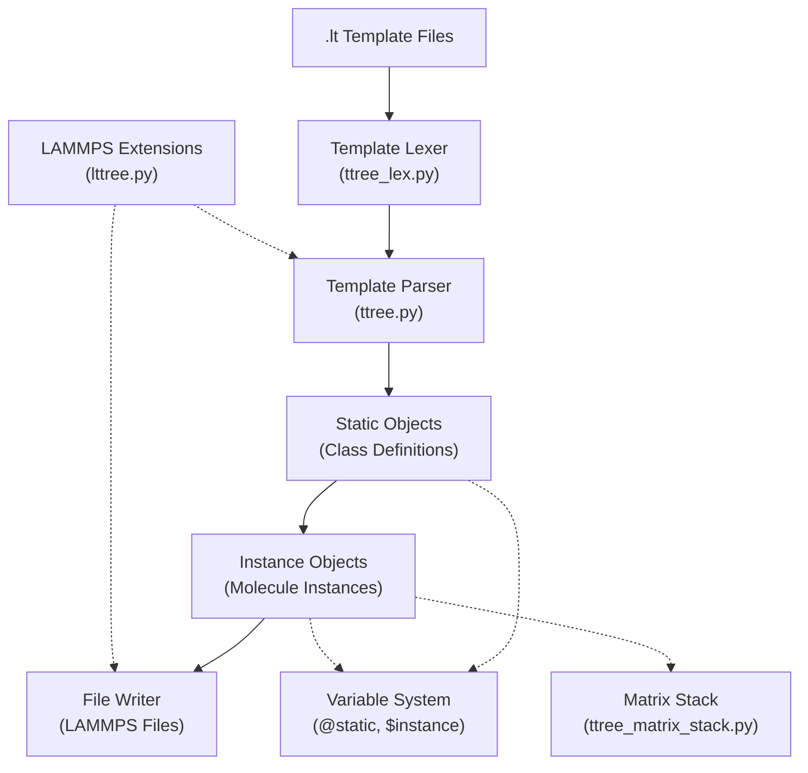
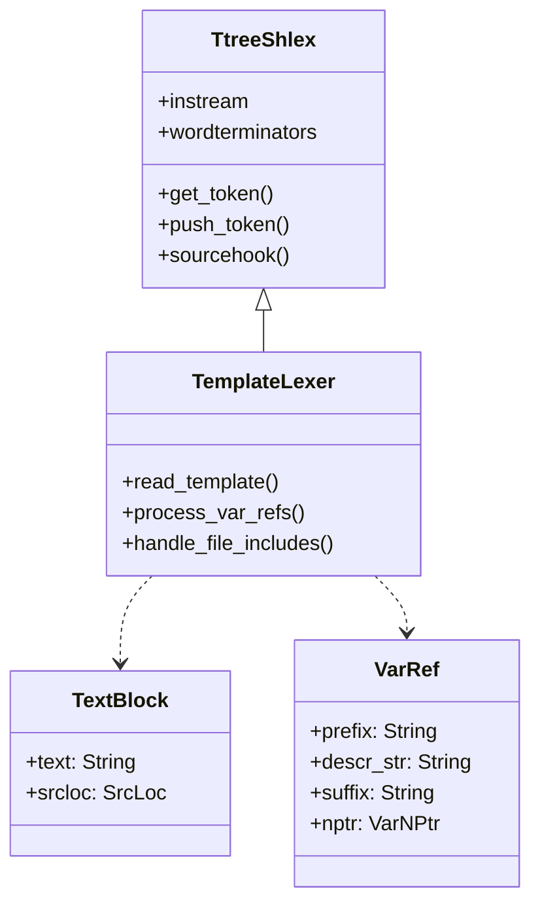
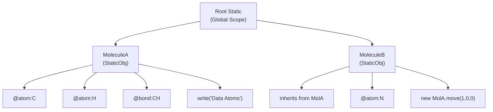
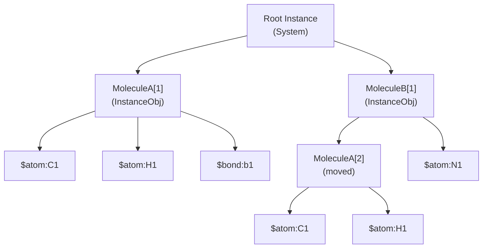
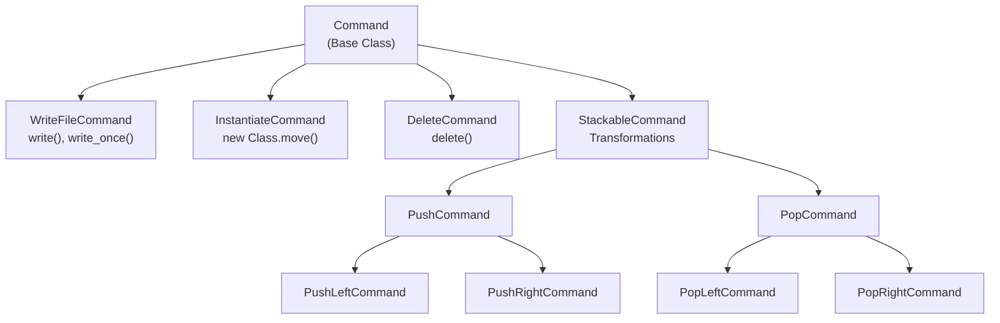
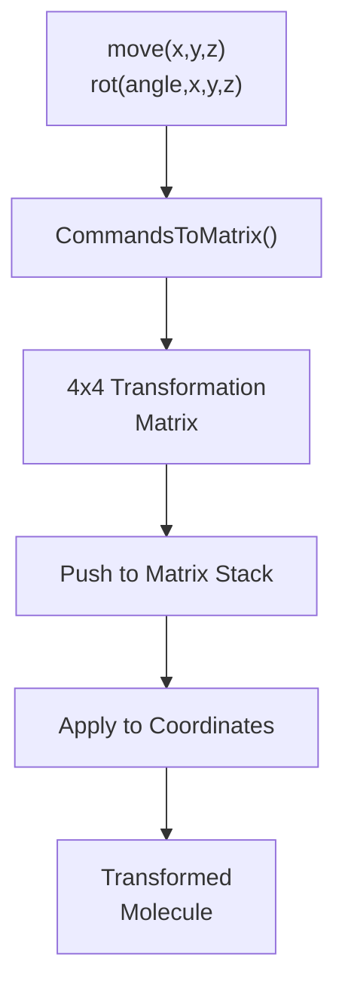
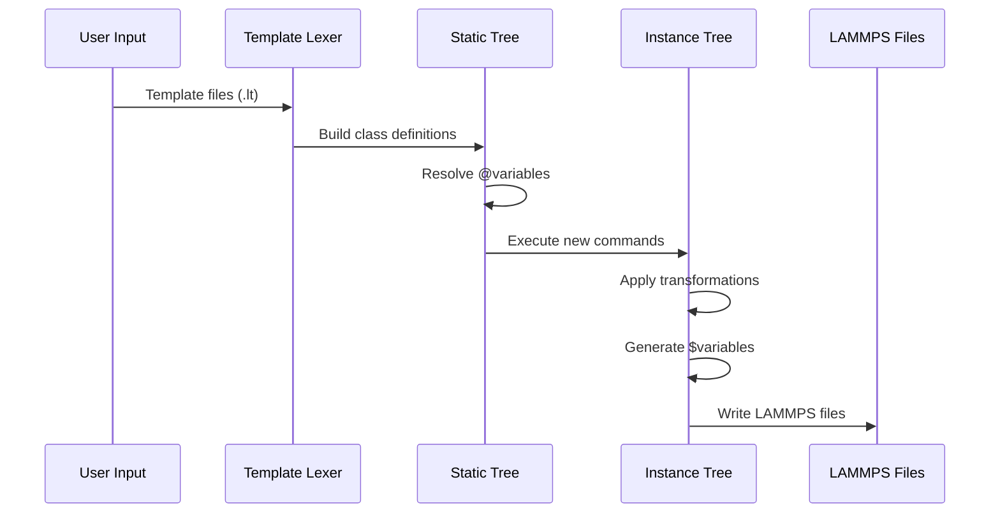
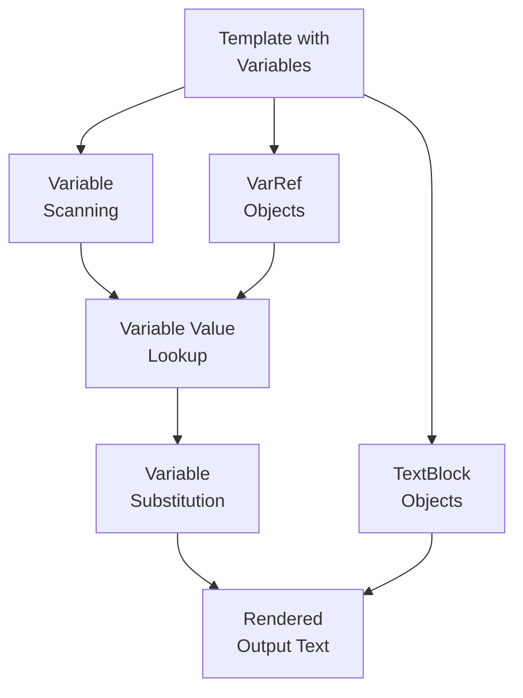

# Template Processing System

Relevant source files

The following files were used as context for generating this wiki page:

- [moltemplate/bonds_by_type.py](moltemplate/bonds_by_type.py)
- [moltemplate/charge_by_bond.py](moltemplate/charge_by_bond.py)
- [moltemplate/dump2data.py](moltemplate/dump2data.py)
- [moltemplate/lttree.py](moltemplate/lttree.py)
- [moltemplate/lttree_check.py](moltemplate/lttree_check.py)
- [moltemplate/lttree_postprocess.py](moltemplate/lttree_postprocess.py)
- [moltemplate/lttree_styles.py](moltemplate/lttree_styles.py)
- [moltemplate/nbody_by_type.py](moltemplate/nbody_by_type.py)
- [moltemplate/nbody_by_type_lib.py](moltemplate/nbody_by_type_lib.py)
- [moltemplate/nbody_fix_ttree_assignments.py](moltemplate/nbody_fix_ttree_assignments.py)
- [moltemplate/postprocess_coeffs.py](moltemplate/postprocess_coeffs.py)
- [moltemplate/postprocess_transitions.py](moltemplate/postprocess_transitions.py)
- [moltemplate/raw2data.py](moltemplate/raw2data.py)
- [moltemplate/ttree.py](moltemplate/ttree.py)
- [moltemplate/ttree_lex.py](moltemplate/ttree_lex.py)
- [moltemplate/ttree_matrix_stack.py](moltemplate/ttree_matrix_stack.py)
- [moltemplate/ttree_render.py](moltemplate/ttree_render.py)

The Template Processing System is the core engine of Moltemplate, responsible for transforming hierarchical molecular definitions into LAMMPS-compatible input files. It provides a powerful framework for building complex molecular systems from reusable components.

This document focuses on the internal architecture and processing flow of the template system. For information about writing templates and using Moltemplate, refer to other sections of the documentation.

## Core Architecture

The Template Processing System consists of several interconnected components that work together to process templates into LAMMPS files:

Sources: [ttree.py:1-107](), [lttree.py:10-34](), [ttree_matrix_stack.py:1-19]()

## Template Lexical Analysis

The system begins by tokenizing template files using two specialized lexers:

1. **TtreeShlex**: An enhanced version of Python's standard `shlex` module that better handles Unicode characters.
2. **TemplateLexer**: Processes templates to extract variables, commands, and text blocks.

### Key Classes for Lexical Analysis

Templates are broken down into alternating `TextBlock` and `VarRef` objects. Variable references (like `@atom:C` or `$bond:b1`) are represented by `VarRef` objects that track their type, name, and location.

Sources: [ttree_lex.py:21-453](), [ttree_lex.py:710-880]()

## Object System

The system builds two tree structures during template processing:

### Static Object Tree

The static tree represents class/template definitions:

The `StaticObj` class represents molecule types/classes and stores:
- Static variables (`@` variables)
- Commands to execute during instantiation
- Inheritance relationships

### Instance Object Tree

The instance tree represents actual molecule instances:

The `InstanceObj` class represents instantiated molecules and stores:
- Instance variables (`$` variables)
- Transformed coordinates
- Hierarchical structure of instances

Sources: [ttree.py:109-151](), [ttree.py:560-896]()

## Command System

Commands control what happens during template processing:

### Key Command Types:

1. **WriteFileCommand**: Outputs content to LAMMPS files
   - Generated by `write()` and `write_once()` in templates
   - Handles template rendering and variable substitution

2. **InstantiateCommand**: Creates new instances
   - Generated by `new` commands in templates
   - Creates InstanceObj nodes in the instance tree

3. **StackableCommand**: Manages transformations
   - Includes PushCommand and PopCommand variants
   - Controls the matrix stack for positioning molecules

Sources: [ttree.py:156-446](), [lttree.py:301-419]()

## Variable System

The template system uses two types of variables:

### Static Variables (@)

- Prefixed with `@` (e.g., `@atom:C`, `@bond:CC`)
- Associated with class definitions (StaticObj)
- Shared across all instances of a class
- Often represent atom types, bond types, etc.

### Instance Variables ($)

- Prefixed with `$` (e.g., `$atom:C1`, `$bond:b1`)
- Associated with specific instances (InstanceObj)
- Unique to each instance
- Often auto-generated during instantiation

Variables are resolved following scoping rules that navigate both the static and instance trees.

Sources: [ttree.py:498-558](), [ttree_lex.py:890-1050]()

## Matrix Stack System

The matrix stack system handles the positioning of molecules in 3D space:

### Key Components:

1. **AffineStack**: Manages the transformation stack
   - Maintains current transformation matrix
   - Handles push/pop operations
   - Composes multiple transformations

2. **Transformation Commands**: User-friendly syntax
   - `move(x,y,z)`: Translation
   - `rot(angle,x,y,z)`: Rotation
   - These are converted to transformation matrices

3. **Coordinate Transformation**: Applies matrices to coordinates
   - Transforms atom positions during instantiation
   - Handles hierarchical transformations

Sources: [ttree_matrix_stack.py:29-57](), [ttree_matrix_stack.py:129-372](), [lttree.py:302-362]()

## Template Processing Flow

The entire template processing flow consists of several phases:

1. **Lexing Phase**:
   - Template files are read and tokenized
   - Variables and commands are identified
   - Basic syntax checking occurs

2. **Static Building Phase**:
   - StaticObj tree is constructed
   - Class hierarchy is established
   - Static variables are assigned
   - Commands are registered

3. **Instantiation Phase**:
   - InstanceObj tree is built
   - Instance variables are generated
   - Transformations are applied
   - Coordinates are calculated

4. **Output Phase**:
   - LAMMPS files are generated
   - Variables are substituted with their values
   - Final files are written to disk

Sources: [ttree.py:606-814](), [lttree.py:606-626]()

## LAMMPS Integration

The `lttree.py` extension adds LAMMPS-specific features to the basic template system:

1. **Atom Style Support**:
   - Understands different LAMMPS atom styles
   - Maps between atom styles and column formats
   - Handles LAMMPS-specific data formats

2. **Coordinate Transformation**:
   - Transforms atomic coordinates and vectors
   - Preserves LAMMPS data structure requirements
   - Handles different atom styles appropriately

3. **Data File Generation**:
   - Creates properly formatted LAMMPS data files
   - Manages sections like "Atoms", "Bonds", "Angles"
   - Generates complete simulation inputs

Sources: [lttree.py:81-111](), [lttree.py:301-362](), [lttree_styles.py:21-81]()

## Template Rendering Process

The rendering process converts template content with variables into final text by substituting variable values:

This process:
1. Identifies variables in the template text
2. Looks up their values in the appropriate scope
3. Substitutes the values into the template
4. Generates the final rendered text

The `Render()` function is the core of this process, taking a template and variable bindings and producing rendered text.

Sources: [ttree.py:2565-2632](), [lttree.py:503-602]()

## Debug and Error Handling

The template system includes robust error handling:

1. **InputError**: Custom exception for user-related errors
2. **Error Leaders**: Functions to generate helpful error messages
3. **Source Location Tracking**: Each element knows its source location

Various checks validate:
- Variable existence
- Command syntax
- Tree structure integrity
- LAMMPS compatibility

Sources: [ttree_lex.py:1320-1380](), [lttree_check.py:109-173]()

## Conclusion

The Template Processing System serves as the foundation of Moltemplate, enabling complex molecular systems to be built from hierarchical templates. Understanding its architecture helps users create more effective templates and troubleshoot issues that may arise.

Sources: [ttree.py:10-45](), [lttree.py:10-34]()

---