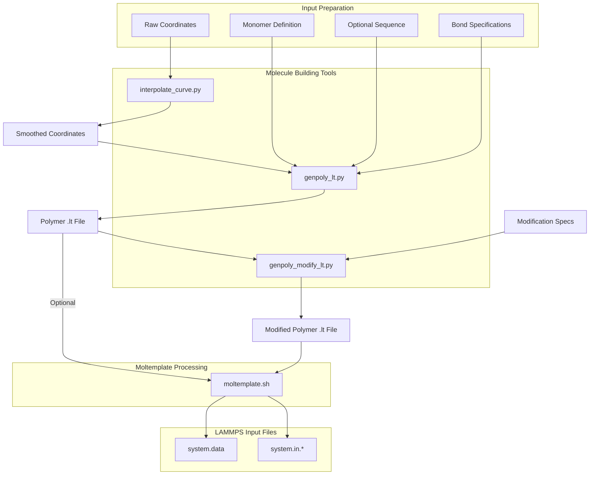
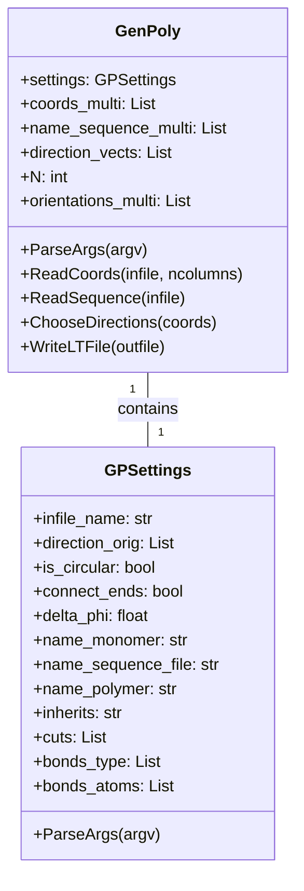
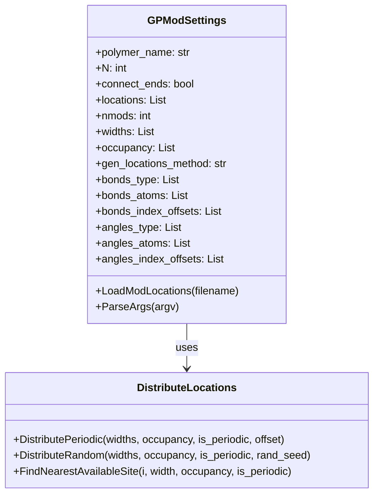
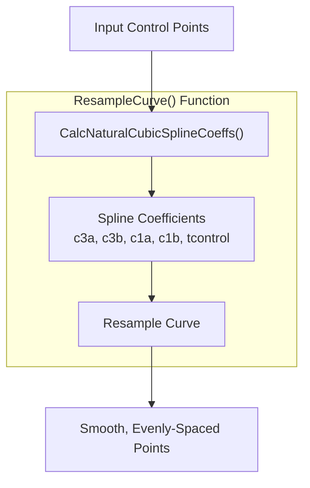

# Molecule Building Tools

<details>
<summary>Relevant source files</summary>

The following files were used as context for generating this wiki page:

- [doc/doc_dump2data.md](doc/doc_dump2data.md)
- [doc/doc_genpoly_lt.md](doc/doc_genpoly_lt.md)
- [doc/doc_genpoly_modify_lt.md](doc/doc_genpoly_modify_lt.md)
- [doc/doc_interpolate_curve.md](doc/doc_interpolate_curve.md)
- [doc/doc_raw2data.md](doc/doc_raw2data.md)
- [examples/coarse_grained/DNA_models/dsDNA_only/2strands/3bp_2particles/confined_viral_DNA/moltemplate_files/wall.lt](examples/coarse_grained/DNA_models/dsDNA_only/2strands/3bp_2particles/confined_viral_DNA/moltemplate_files/wall.lt)
- [moltemplate/genpoly_lt.py](moltemplate/genpoly_lt.py)
- [moltemplate/genpoly_modify_lt.py](moltemplate/genpoly_modify_lt.py)
- [moltemplate/interpolate_curve.py](moltemplate/interpolate_curve.py)
- [moltemplate/pdbsort.py](moltemplate/pdbsort.py)
- [tests/test_genpoly_lt.py](tests/test_genpoly_lt.py)

</details>


This page documents the specialized tools in moltemplate for building complex molecular structures, particularly polymers and multi-unit systems. These tools bridge the gap between basic molecular components (monomers) and complex structures ready for simulation. For information about file format converters, see [File Format Converters](#4).

## Overview of Molecule Building Tools

Moltemplate provides three primary tools for building complex molecular structures:

1. **genpoly_lt.py**: Generates polymer definitions by placing monomers along specified coordinates
2. **genpoly_modify_lt.py**: Modifies existing polymers by adding/changing bonds or other interactions
3. **interpolate_curve.py**: Creates smooth curves for polymer placement

These tools form a pipeline for creating polymer structures from basic spatial coordinates to LAMMPS-ready format.

### Workflow Diagram



Sources: [moltemplate/genpoly_lt.py:1-766](), [moltemplate/genpoly_modify_lt.py:1-306](), [moltemplate/interpolate_curve.py:1-125]()

## genpoly_lt.py

`genpoly_lt.py` is a powerful tool for generating polymer definitions. It reads coordinates from a file and creates a moltemplate (.lt) file containing a polymer molecule with monomers located at those positions. Monomers are rotated to point along the polymer axis with optional helical twist.

### Key Features

- Places monomers at specified 3D coordinates
- Rotates monomers to align with the polymer's direction
- Supports custom monomer sequences (heteropolymers)
- Creates bonds, angles, dihedrals between monomers
- Handles circular polymers and multiple polymer chains
- Allows helical twisting (useful for DNA models)

### Core Components



Sources: [moltemplate/genpoly_lt.py:83-425](), [moltemplate/genpoly_lt.py:484-515]()

### Command Line Usage

Basic usage:
```
genpoly_lt.py [options] < coords.raw > polymer.lt
```

Important options include:
- `-polymer-name NAME`: Name of the moltemplate object (default: "Polymer")
- `-monomer-name NAME`: Name of the monomer to replicate (default: "Monomer")
- `-sequence FILE`: File with list of monomer types for heteropolymers
- `-bond TYPE ATOM1 ATOM2`: Define bonds between successive monomers
- `-angle TYPE ATOM1 ATOM2 ATOM3 I1 I2 I3`: Define angles between monomers
- `-helix ANGLE`: Rotate each monomer around axis by ANGLE degrees
- `-circular yes/no/connected`: Specify if polymer is circular
- `-cuts FILE`: Cut polymer into multiple separate polymers
- `-header TEXT`: Custom text to add at file beginning (typically imports)

Example creating a DNA polymer:
```
genpoly_lt.py -circular yes -helix 34.2857 \
              -header 'import "basepair.lt"' \
              -monomer-name "BasePair" \
              -polymer-name "Plasmid" \
              -bond Backbone O3p_a P_a \
              -bond Backbone P_b O3p_b \
              < dna_basepair_coords.raw \
              > chromosome.lt
```

Sources: [doc/doc_genpoly_lt.md:33-59](), [doc/doc_genpoly_lt.md:439-450]()

### Python API

`genpoly_lt.py` can also be used as a Python module:

```python
import moltemplate
import numpy as np

# Create coordinates for polymer
coords = np.array([[i, 0.5*(i%2), 0.0] for i in range(0,21)])

# Create polymer using genpoly_lt
gp = moltemplate.genpoly_lt.GenPoly()
gp.coords_multi = [coords]
gp.name_sequence_multi = [['AT', 'CG', 'GC', 'TA', 'AT', 'CG', 'GC', 'TA',
                           'AT', 'CG', 'GC', 'TA', 'AT', 'CG', 'GC', 'TA',
                           'AT', 'CG', 'GC', 'TA', 'AT']]

# Parse arguments
gp.ParseArgs(['-helix', '34.2857',
              '-bond', 'Backbone', 'f', 'f',
              '-bond', 'Backbone', 'r', 'r',
              '-polymer-name', 'DNA_snippet'])

# Generate LT file
import sys
gp.WriteLTFile(sys.stdout)
```

Sources: [tests/test_genpoly_lt.py:1-44](), [doc/doc_genpoly_lt.md:494-538]()

## genpoly_modify_lt.py

`genpoly_modify_lt.py` allows you to modify existing polymers by adding or changing bonds, angles, dihedrals, atom types, or adding constraint fixes at specific locations along the polymer.

### Key Features

- Modify polymers at specific locations
- Add or change bonds between atoms
- Add angle, dihedral, and improper interactions
- Change atom types or other attributes
- Add restraint fixes or twist motors
- Distribute modifications periodically or randomly

### Core Components



Sources: [moltemplate/genpoly_modify_lt.py:66-306](), [moltemplate/genpoly_modify_lt.py:334-384]()

### Command Line Usage

Basic usage:
```
genpoly_modify_lt.py [options] >> polymer.lt
```

Important options include:
- `-polymer-name NAME`: Name of the polymer to modify
- `-length NUM`: Total number of monomers in polymer
- `-locations FILE`: File with list of modification locations
- `-locations-periodic NUM OFFSET`: Place NUM modifications at periodic intervals
- `-locations-random NUM SEED`: Place NUM modifications randomly
- `-width WIDTH`: Minimum width of each modification
- `-bond TYPE ATOM1 ATOM2 I1 I2`: Add bond between atoms
- `-angle TYPE ATOM1 ATOM2 ATOM3 I1 I2 I3`: Add angle interaction
- `-set-atoms M FILE ATTR A1...AM I1...IM ATTR1...ATTRM`: Set atom attributes
- `-fix-nbody N FILE FIXNAME FIXID GROUP KW A1...AN I1...IN PARAMS`: Add fix constraint
- `-circular yes/no`: Specify if polymer is circular

Example modifying a DNA polymer:
```
genpoly_modify_lt.py -polymer-name DNA \
                     -length 1000 \
                     -locations-periodic 10 0 \
                     -bond ProteinLink p_attach c_attach 0 1 \
                     >> dna_with_proteins.lt
```

Sources: [doc/doc_genpoly_modify_lt.md:44-60](), [doc/doc_genpoly_modify_lt.md:250-265]()

### Modification Location Methods

`genpoly_modify_lt.py` provides three ways to specify where modifications should be made:

1. **Manual specification**: Provide a file with list of locations
    ```
    genpoly_modify_lt.py -locations locations.txt ...
    ```
   
2. **Periodic placement**: Distribute modifications evenly
    ```
    genpoly_modify_lt.py -locations-periodic 20 5 ...
    ```
   
3. **Random placement**: Distribute modifications randomly
    ```
    genpoly_modify_lt.py -locations-random 15 12345 ...
    ```

When working with multiple types of modifications, care must be taken to prevent overlaps by:
- Using `-write-locations` to save generated locations
- Applying different modification types separately
- Using different seeds for random placement

Sources: [doc/doc_genpoly_modify_lt.md:77-102](), [moltemplate/genpoly_modify_lt.py:456-474]()

## interpolate_curve.py

`interpolate_curve.py` uses cubic spline interpolation to create smooth curves from a set of control points. This is especially useful for creating paths for polymers to follow.

### Key Features

- Smooths jagged coordinate sets
- Resamples to desired number of points
- Maintains general path shape
- Uses centripetal Catmull-Rom spline interpolation
- Can scale the resulting coordinates

### Core Components



Sources: [moltemplate/interpolate_curve.py:65-197](), [moltemplate/interpolate_curve.py:250-277]()

### Command Line Usage

Basic usage:
```
interpolate_curve.py NUM_POINTS [SCALE] [ALPHA] < old_coords.raw > new_coords.raw
```

Where:
- `NUM_POINTS`: Number of points in the output curve
- `SCALE`: Optional scaling factor (default: 1.0)
- `ALPHA`: Interpolation parameter (default: 0.5)

Example:
```
interpolate_curve.py 150000 7.99 < rough_curve.raw > smooth_curve.raw
```

Sources: [doc/doc_interpolate_curve.md:19-31](), [doc/doc_interpolate_curve.md:114-117]()

### Python API

`interpolate_curve.py` can also be used as a Python module:

```python
import moltemplate.interpolate_curve as ic
import numpy as np

# Generate a rough curve
x_orig = np.array([[i, 0.5*(i%2), 0.0] for i in range(0,10)])

# Create a smooth version with 500 points
x_new = ic.ResampleCurve(x_orig, 500, 0.5)

# Scale the curve if needed
x_new *= 0.332
```

Sources: [doc/doc_interpolate_curve.md:145-153](), [tests/test_genpoly_lt.py:7-15]()

## Complete Workflow Example

The following diagram and steps illustrate a typical workflow using these tools to create a polymer that follows a complex path:

```mermaid
flowchart TB
    subgraph "1. Generate Initial Curve"
        ndmansfield["Space-filling Curve\n(e.g., from ndmansfield)"]
        recenter["Center Coordinates\n(recenter_coords.py)"]
    end
    
    subgraph "2. Smooth and Prepare Curve"
        interpolate["Smooth Curve\n(interpolate_curve.py)"]
    end
    
    subgraph "3. Generate Polymer"
        genpoly["Create Polymer Definition\n(genpoly_lt.py)"]
    end
    
    subgraph "4. Modify Polymer (Optional)"
        genpolymod["Add Modifications\n(genpoly_modify_lt.py)"]
    end
    
    subgraph "5. Process with Moltemplate"
        moltemplate["Generate LAMMPS Files\n(moltemplate.sh)"]
    end
    
    ndmansfield --> recenter
    recenter --> interpolate
    interpolate --> genpoly
    genpoly --> genpolymod
    genpolymod --> moltemplate
    
    monomer["Monomer Definition\n(.lt file)"] --> genpoly
    sequence["Sequence Definition\n(optional)"] --> genpoly
    
    modlocs["Modification Locations"] --> genpolymod
    
    moltemplate --> output["LAMMPS Input Files"]
```

### Example Steps:

1. **Generate Initial Curve**:
   ```bash
   ndmansfield -box 53 40 31 -cyclic yes > curve.raw
   recenter_coords.py 0 0 0 < curve.raw > curve_centered.raw
   ```

2. **Smooth Curve**:
   ```bash
   interpolate_curve.py 150000 7.99 < curve_centered.raw > smooth_curve.raw
   ```

3. **Generate Polymer**:
   ```bash
   genpoly_lt.py -monomer-name "Monomer" \
                 -polymer-name "Polymer" \
                 -bond Backbone C C \
                 -header 'import "monomer.lt"' \
                 < smooth_curve.raw > polymer.lt
   ```

4. **Add Modifications** (optional):
   ```bash
   genpoly_modify_lt.py -polymer-name "Polymer" \
                        -length 150000 \
                        -locations-random 100 12345 \
                        -bond SpecialBond A B 0 1 \
                        >> polymer.lt
   ```

5. **Generate LAMMPS Files**:
   ```bash
   moltemplate.sh -atomstyle "full" polymer.lt
   ```

Sources: [doc/doc_interpolate_curve.md:100-131](), [doc/doc_genpoly_lt.md:425-450](), [doc/doc_genpoly_modify_lt.md:44-59]()

## Integration with Other Tools

The molecule building tools integrate with other parts of the moltemplate ecosystem:

```mermaid
flowchart TD
    subgraph "External Tools"
        ndmansfield["Space-filling Curve\n(ndmansfield)"]
        lammps["LAMMPS Simulator"]
    end
    
    subgraph "File Format Converters"
        mol22lt["mol22lt.py"]
        amber2lt["amber2lt.py"]
        oplsaa2lt["oplsaa2lt.py"]
    end
    
    subgraph "Molecule Building Tools"
        interpolate["interpolate_curve.py"]
        genpoly["genpoly_lt.py"]
        genpolymod["genpoly_modify_lt.py"]
    end
    
    subgraph "Core Moltemplate"
        moltemplate["moltemplate.sh"]
    end
    
    ndmansfield --> interpolate
    
    mol22lt --> monomer["Monomer Definitions (.lt)"]
    amber2lt --> monomer
    oplsaa2lt --> monomer
    
    monomer --> genpoly
    interpolate --> genpoly
    genpoly --> polymer["Polymer Definition (.lt)"]
    polymer --> genpolymod
    genpolymod --> modified["Modified Polymer (.lt)"]
    
    polymer --> moltemplate
    modified --> moltemplate
    
    moltemplate --> lammps_files["LAMMPS Input Files"]
    lammps_files --> lammps
```

Sources: [doc/doc_interpolate_curve.md:56-64](), [doc/doc_genpoly_lt.md:13-16]()

## Usage Scenarios

The molecule building tools are particularly useful for:

| Scenario | Recommended Tools |
|----------|-------------------|
| DNA/RNA models | `genpoly_lt.py` with `-helix` option |
| Confined polymers | `interpolate_curve.py` + `genpoly_lt.py` |
| Protein-decorated DNA | `genpoly_lt.py` + `genpoly_modify_lt.py` |
| Branched polymers | `genpoly_lt.py` + `genpoly_modify_lt.py` |
| Heteropolymers | `genpoly_lt.py` with `-sequence` option |
| Circular structures | `genpoly_lt.py` with `-circular yes` |

The tools are especially valuable for coarse-grained models where polymer architecture and topology are essential to the simulation.

Sources: [doc/doc_genpoly_lt.md:3-9](), [doc/doc_genpoly_lt.md:13-30](), [doc/doc_genpoly_modify_lt.md:3-40]()

---