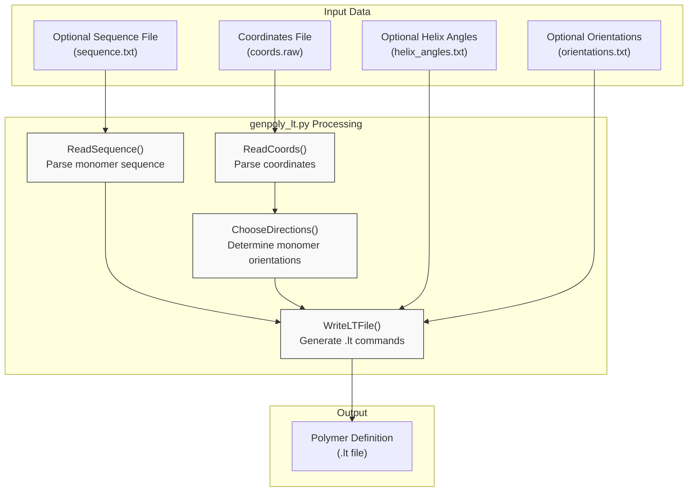
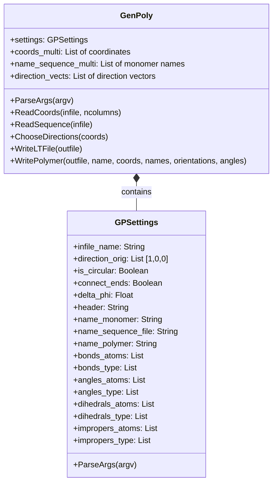
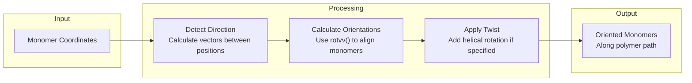
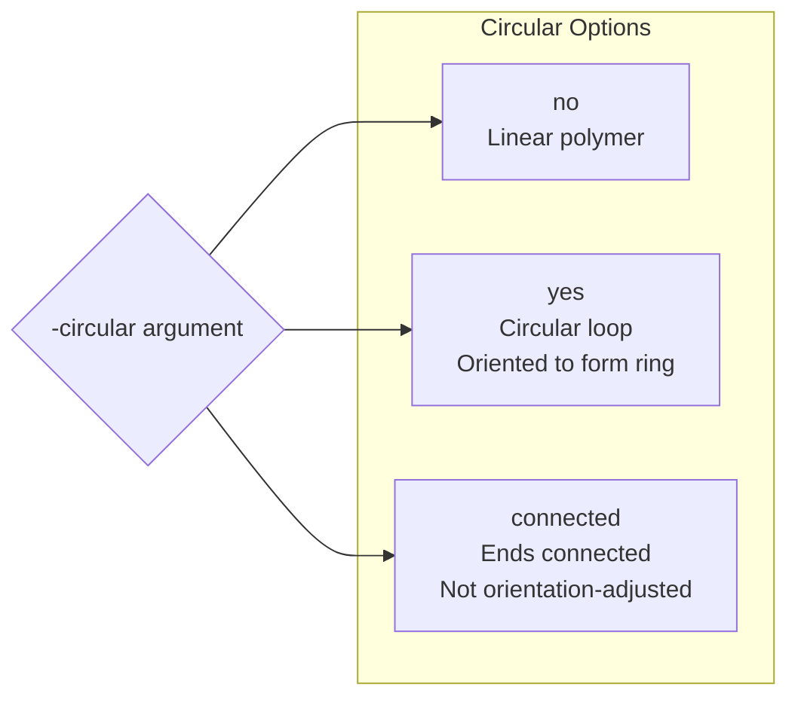
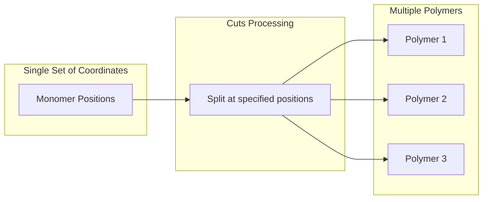
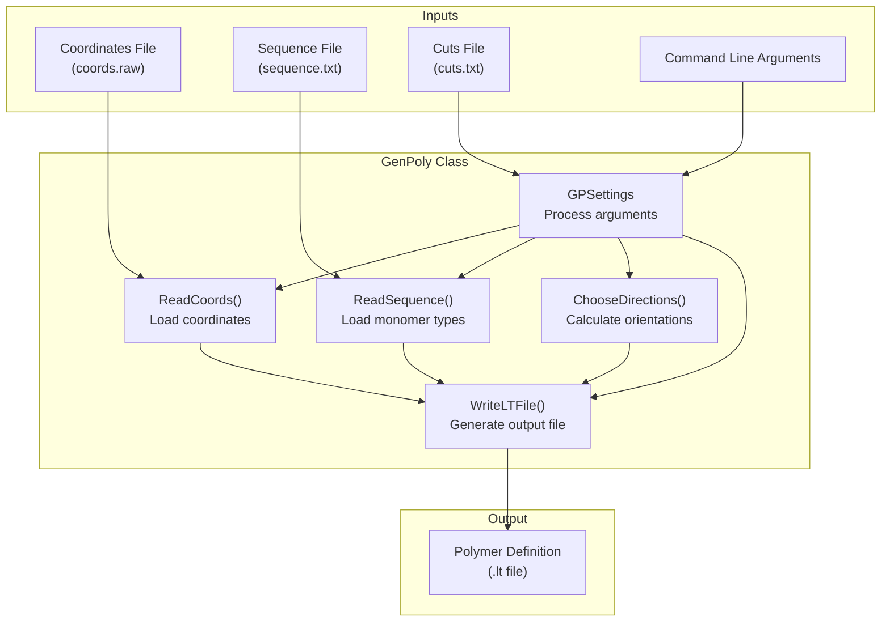

# genpoly_lt.py - Polymer Generation

<details>
<summary>Relevant source files</summary>

The following files were used as context for generating this wiki page:

- [doc/doc_dump2data.md](doc/doc_dump2data.md)
- [doc/doc_genpoly_lt.md](doc/doc_genpoly_lt.md)
- [doc/doc_genpoly_modify_lt.md](doc/doc_genpoly_modify_lt.md)
- [doc/doc_interpolate_curve.md](doc/doc_interpolate_curve.md)
- [doc/doc_raw2data.md](doc/doc_raw2data.md)
- [examples/coarse_grained/DNA_models/dsDNA_only/2strands/3bp_2particles/confined_viral_DNA/moltemplate_files/wall.lt](examples/coarse_grained/DNA_models/dsDNA_only/2strands/3bp_2particles/confined_viral_DNA/moltemplate_files/wall.lt)
- [moltemplate/genpoly_lt.py](moltemplate/genpoly_lt.py)
- [moltemplate/genpoly_modify_lt.py](moltemplate/genpoly_modify_lt.py)
- [moltemplate/interpolate_curve.py](moltemplate/interpolate_curve.py)
- [moltemplate/pdbsort.py](moltemplate/pdbsort.py)
- [tests/test_genpoly_lt.py](tests/test_genpoly_lt.py)

</details>


`genpoly_lt.py` is a powerful utility within the moltemplate ecosystem that generates polymer structures in moltemplate (.lt) format. This tool reads coordinates from an input file and creates a sequence of moltemplate commands to build polymer molecules with monomers positioned at those coordinates, properly oriented along the polymer chain. The resulting output can be used directly with moltemplate.sh to build complex polymer systems for LAMMPS simulations.

For information about modifying existing polymers, see [genpoly_modify_lt.py](#3.2).

## Overview and Workflow

`genpoly_lt.py` serves as a bridge between geometric coordinate data and the moltemplate template system. It takes spatial coordinates that define the path of a polymer and converts them into a structured moltemplate file containing all the necessary commands to instantiate and position monomers along that path, create bonds between them, and properly orient them.



Sources: [moltemplate/genpoly_lt.py:524-595](), [moltemplate/genpoly_lt.py:594-643](), [moltemplate/genpoly_lt.py:646-699](), [moltemplate/genpoly_lt.py:702-756]()

## Core Concepts

### Settings and Parameters

The `GPSettings` class manages all configurable aspects of polymer generation, including:

- Polymer and monomer names
- Bond definitions between monomers
- Angle, dihedral, and improper interactions
- Polymer circularity
- Helical parameters
- File paths for inputs



Sources: [moltemplate/genpoly_lt.py:83-378](), [moltemplate/genpoly_lt.py:404-427]()

## Command Line Usage

The basic usage of `genpoly_lt.py` is:

```
genpoly_lt.py \
    [-polymer-name pname] \
    [-monomer-name mname] \
    [-sequence sequence.txt] \
    [-bond a1 a2] \
    [-bond btype a1 a2] \
    [-angle atype a1 a2 a3 i1 i2 i3] \
    [-dihedral dtype a1 a2 a3 a4 i1 i2 i3 i4] \
    [-improper itype a1 a2 a3 a4 i1 i2 i3 i4] \
    [-inherits ForceFieldObject] \
    [-header "import \"monomer.lt\""] \
    [-helix deltaphi] \
    [-axis x,y,z] \
    [-circular yes/no/connected] \
    [-cuts cuts.txt] \
    [-polymer-directions polarities.txt \
    [-dir-indices ia ib] \
    [-padding paddingX,paddingY,paddingZ] \
    < coords.raw > polymer.lt
```

Sources: [moltemplate/genpoly_lt.py:34-57](), [doc/doc_genpoly_lt.md:35-58]()

### Key Command-Line Arguments

| Argument | Description |
|----------|-------------|
| `-polymer-name name` | Name of the moltemplate object to be created (default: "Polymer") |
| `-monomer-name name` | Name of the monomer to replicate along the polymer (default: "Monomer") |
| `-sequence file.txt` | File containing sequence of monomer types for heteropolymers |
| `-bond a1 a2` | Add a bond between atoms a1 and a2 in successive monomers |
| `-bond btype a1 a2` | Add a typed bond between atoms a1 and a2 in successive monomers |
| `-angle atype a1 a2 a3 i1 i2 i3` | Add angle interactions between atoms in different monomers |
| `-dihedral dtype a1 a2 a3 a4 i1 i2 i3 i4` | Add dihedral interactions between atoms in different monomers |
| `-improper itype a1 a2 a3 a4 i1 i2 i3 i4` | Add improper interactions between atoms in different monomers |
| `-inherits ForceField` | Make polymer inherit from a force field object |
| `-header "text"` | Add text at the beginning of the output file |
| `-helix angle` | Add helical twist (angle in degrees) between monomers |
| `-circular yes/no/connected` | Specify if polymer is circular |
| `-cuts file.txt` | Cut polymer to create multiple polymers |

Sources: [doc/doc_genpoly_lt.md:62-357](), [moltemplate/genpoly_lt.py:125-378]()

## Working with Coordinates

### Input Format

The input coordinates file is a simple 3-column text file containing x, y, z coordinates for each monomer position:

```
x1 y1 z1
x2 y2 z2
x3 y3 z3
...
```

These coordinates define the positions where monomers will be placed. The `ReadCoords()` method parses this file and optionally splits the coordinates to create multiple polymers (if `-cuts` is specified).

Sources: [moltemplate/genpoly_lt.py:524-590]()

### Monomer Orientation

One key feature of `genpoly_lt.py` is that it automatically orients monomers along the path of the polymer. The `ChooseDirections()` method calculates directional vectors for each monomer based on the positions of neighboring monomers:



Sources: [moltemplate/genpoly_lt.py:646-699](), [moltemplate/genpoly_lt.py:766-848]()

## Polymer Structure Features

### Bonds Between Monomers

Bonds between monomers are specified using the `-bond` argument. For example:

```
-bond Backbone c2 c1
```

This creates bonds of type "Backbone" between atom "c2" in each monomer and atom "c1" in the following monomer. Multiple bonds can be added by using the `-bond` argument multiple times.

Sources: [moltemplate/genpoly_lt.py:137-157](), [doc/doc_genpoly_lt.md:134-157]()

### Angles, Dihedrals, and Impropers

Similar to bonds, angles, dihedrals, and impropers can be specified between atoms in different monomers:

```
-angle AngleType a1 a2 a3 i1 i2 i3
```

Here, the atoms a1, a2, a3 are in monomers at relative positions i1, i2, i3 where:
- 0 corresponds to the current monomer
- 1 corresponds to the next monomer
- 2 corresponds to the monomer after that, etc.

Sources: [moltemplate/genpoly_lt.py:158-217](), [doc/doc_genpoly_lt.md:160-210]()

### Circular Polymers

The `-circular` argument controls whether the polymer forms a closed loop:



When using `-circular yes`, the first and last monomers are connected with bonds, and their orientations are adjusted to point toward each other. With `-circular connected`, the ends are joined but orientations aren't adjusted, which is useful for periodic boundary conditions.

Sources: [moltemplate/genpoly_lt.py:317-332](), [doc/doc_genpoly_lt.md:297-317]()

### Helical Structures

The `-helix` argument adds a twist along the polymer chain, rotating each monomer around its axis:

```
-helix 34.2857
```

This value is the angle in degrees that each monomer is rotated relative to the previous one, which is useful for creating helical structures like DNA.

Sources: [moltemplate/genpoly_lt.py:333-338](), [doc/doc_genpoly_lt.md:282-295]()

## Creating Heteropolymers

For heteropolymers with varying monomer types, provide a sequence file with the `-sequence` argument:

```
-sequence sequence.txt
```

The sequence file should contain one monomer name per line, matching the total number of monomers in the polymer. For example:

```
CH3
CH2
CH2
CH3.rot(180,0,0,1)
```

Here, the polymer will have CH3 at both ends and CH2 in the middle, with the final CH3 rotated 180° to point in the opposite direction.

Sources: [moltemplate/genpoly_lt.py:482-490](), [doc/doc_genpoly_lt.md:94-133]()

## Multiple Polymers

### Using Cuts

The `-cuts` argument allows creating multiple polymers from a single coordinate file:

```
-cuts cuts.txt
```

The cuts.txt file contains integers indicating where to cut the polymer. For example, if the cuts file contains "50 100", the coordinates will be split into three polymers: positions 0-49, 50-99, and 100-end.



Sources: [moltemplate/genpoly_lt.py:231-283](), [doc/doc_genpoly_lt.md:244-271]()

## Integration with Other Tools

### Using with interpolate_curve.py

`interpolate_curve.py` can be used to create smooth curves for polymer paths, which can then be fed into `genpoly_lt.py`:

```mermaid
flowchart LR
    startPoints["Initial Control Points"] --> interpolate["interpolate_curve.py\nGenerates smooth curve"]
    interpolate --> smoothCurve["Smoothed Coordinates"]
    smoothCurve --> genpoly["genpoly_lt.py\nGenerates polymer"]
    genpoly --> ltFile["Polymer .lt file"]
    ltFile --> moltemplate["moltemplate.sh\nGenerates LAMMPS files"]
```

This combination is particularly useful for creating polymers that follow complex paths, like DNA wrapping around histones or confined in specific geometries.

Sources: [doc/doc_interpolate_curve.md:36-44](), [tests/test_genpoly_lt.py:1-44]()

### Using with genpoly_modify_lt.py

After creating a polymer with `genpoly_lt.py`, you can use `genpoly_modify_lt.py` to modify specific regions of the polymer:

```
genpoly_modify_lt.py -polymer-name MyPolymer -length 100 -locations locations.txt -bond BondType a1 a2 0 1 >> polymer.lt
```

This allows adding specialized features at specific points along an existing polymer.

Sources: [doc/doc_genpoly_modify_lt.md:6-40](), [moltemplate/genpoly_modify_lt.py:7-57]()

## Python API

`genpoly_lt.py` can also be used as a Python module:

```python
import moltemplate

# Create a GenPoly object
gp = moltemplate.genpoly_lt.GenPoly()

# Set coordinates and monomer sequence
gp.coords_multi = [coordinates_list]
gp.name_sequence_multi = [monomer_names_list]

# Parse arguments for additional settings
gp.ParseArgs(['-helix', '34.2857',
              '-bond', 'Backbone', 'a1', 'a2',
              '-polymer-name', 'MyPolymer'])

# Generate an .LT file
import sys
gp.WriteLTFile(sys.stdout)
```

This approach allows programmatic control of polymer generation and integration with other Python code.

Sources: [doc/doc_genpoly_lt.md:454-539](), [tests/test_genpoly_lt.py:1-44]()

## Data Flow Architecture

The following diagram shows the complete data flow through the `genpoly_lt.py` system:



Sources: [moltemplate/genpoly_lt.py:404-756]()

## Examples

### Simple Linear Polymer

```
genpoly_lt.py -bond Backbone c2 c1 \
               -monomer-name "Monomer" \
               -polymer-name "MyPolymer" \
               -header 'import "monomer.lt"' \
               < coords.raw > polymer.lt
```

### Circular DNA Model

```
genpoly_lt.py -circular yes -helix 34.2857 \
               -header 'import "basepair.lt"' \
               -monomer-name "BasePair" \
               -polymer-name "Plasmid" \
               -bond Backbone O3p_a P_a \
               -bond Backbone P_b O3p_b \
               < dna_basepair_coords.raw \
               > chromosome.lt
```

### Heteropolymer with Sequence

```
genpoly_lt.py -sequence sequence.txt \
               -bond Backbone c c \
               -polymer-name "Protein" \
               -header 'import "amino_acids.lt"' \
               < backbone_coords.raw > protein.lt
```

Sources: [doc/doc_genpoly_lt.md:425-450]()

## Common Use Cases

1. **DNA Simulation**: Creating coarse-grained or all-atom DNA models with helical structure
2. **Protein Folding**: Building protein structures from backbone coordinates
3. **Polymer Melts**: Generating multiple polymer chains for material simulations
4. **Confined Polymers**: Creating polymers that follow specific geometric constraints

`genpoly_lt.py` provides a versatile foundation for creating complex polymer structures that can be used in a wide range of molecular simulations with LAMMPS.

---