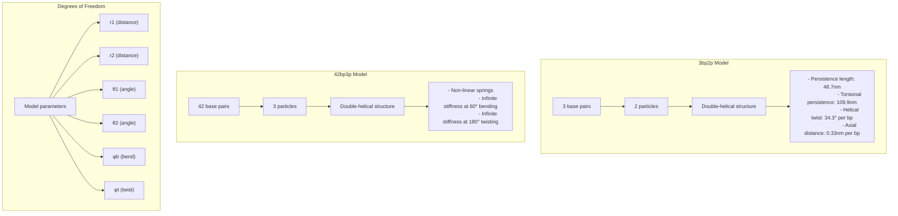
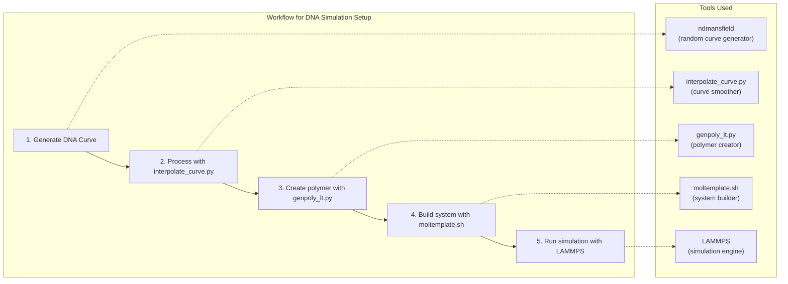
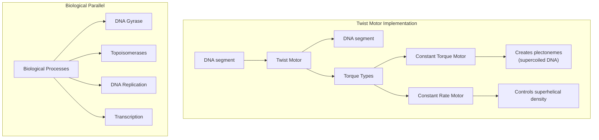
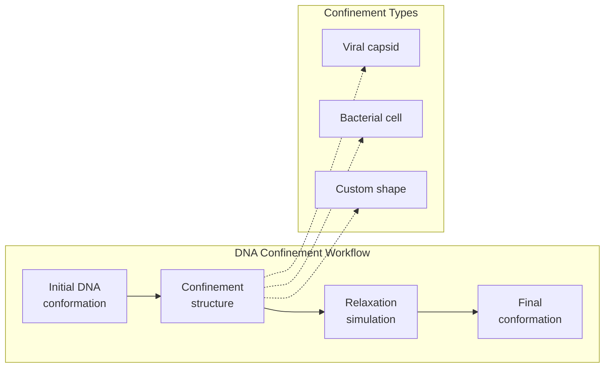
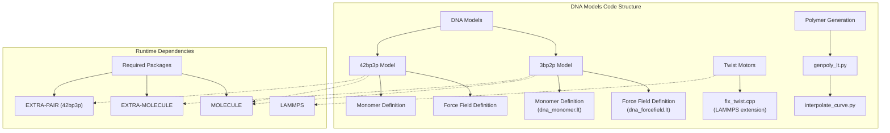

# DNA Models and Simulation

<details>
<summary>Relevant source files</summary>

The following files were used as context for generating this wiki page:

- [examples/README.md](examples/README.md)
- [examples/coarse_grained/DNA_models/dsDNA_only/2strands/3bp_2particles/README.md](examples/coarse_grained/DNA_models/dsDNA_only/2strands/3bp_2particles/README.md)
- [examples/coarse_grained/DNA_models/dsDNA_only/2strands/3bp_2particles/confined_viral_DNA/README.md](examples/coarse_grained/DNA_models/dsDNA_only/2strands/3bp_2particles/confined_viral_DNA/README.md)
- [examples/coarse_grained/DNA_models/dsDNA_only/2strands/3bp_2particles/confined_viral_DNA/images/plus.svg](examples/coarse_grained/DNA_models/dsDNA_only/2strands/3bp_2particles/confined_viral_DNA/images/plus.svg)
- [examples/coarse_grained/DNA_models/dsDNA_only/2strands/3bp_2particles/confined_viral_DNA/images/rightarrow.svg](examples/coarse_grained/DNA_models/dsDNA_only/2strands/3bp_2particles/confined_viral_DNA/images/rightarrow.svg)
- [examples/coarse_grained/DNA_models/dsDNA_only/2strands/3bp_2particles/images/twist_motor_3bp2p_LLR.jpg](examples/coarse_grained/DNA_models/dsDNA_only/2strands/3bp_2particles/images/twist_motor_3bp2p_LLR.jpg)
- [examples/coarse_grained/DNA_models/dsDNA_only/2strands/3bp_2particles/simple_dna_example/README.md](examples/coarse_grained/DNA_models/dsDNA_only/2strands/3bp_2particles/simple_dna_example/README.md)
- [examples/coarse_grained/DNA_models/dsDNA_only/2strands/3bp_2particles/twist_motor_supercoiling/README.md](examples/coarse_grained/DNA_models/dsDNA_only/2strands/3bp_2particles/twist_motor_supercoiling/README.md)
- [examples/coarse_grained/DNA_models/dsDNA_only/twistable_Kratky-Porod/42bp_3particles/nucleoid_Ccrescentus_DNA_only/README.md](examples/coarse_grained/DNA_models/dsDNA_only/twistable_Kratky-Porod/42bp_3particles/nucleoid_Ccrescentus_DNA_only/README.md)
- [examples/coarse_grained/DNA_models/dsDNA_only/twistable_Kratky-Porod/42bp_3particles/twist_motor_supercoiling/README.md](examples/coarse_grained/DNA_models/dsDNA_only/twistable_Kratky-Porod/42bp_3particles/twist_motor_supercoiling/README.md)
- [examples/coarse_grained/DNA_models/dsDNA_only/twistable_Kratky-Porod/images/DNA_models_similar_to_Benedetti++Stasiak_NAR2014.jpg](examples/coarse_grained/DNA_models/dsDNA_only/twistable_Kratky-Porod/images/DNA_models_similar_to_Benedetti++Stasiak_NAR2014.jpg)
- [examples/coarse_grained/DNA_models/dsDNA_only/twistable_Kratky-Porod/images/twist_motor_LLR.jpg](examples/coarse_grained/DNA_models/dsDNA_only/twistable_Kratky-Porod/images/twist_motor_LLR.jpg)
- [examples/coarse_grained/simple_examples/polymer_translocation/README.md](examples/coarse_grained/simple_examples/polymer_translocation/README.md)
- [examples/coarse_grained/solvent_models/ELBAwater+methanol/README.md](examples/coarse_grained/solvent_models/ELBAwater+methanol/README.md)
- [examples/coarse_grained/solvent_models/manybodywaterMW+hydrocarbonsTraPPE/README.md](examples/coarse_grained/solvent_models/manybodywaterMW+hydrocarbonsTraPPE/README.md)

</details>


## Purpose and Scope

This document describes the coarse-grained DNA models available in moltemplate and how to use them for molecular dynamics simulations. It focuses on two primary DNA models (3bp2p and 42bp3p), their properties, setup procedures, and applications in simulating various biological phenomena like DNA supercoiling and confinement. For information about all-atom simulations, see [All-Atom Simulations](#6.1), and for general polymer generation, see [genpoly_lt.py - Polymer Generation](#3.1).

## DNA Model Overview

Moltemplate provides coarse-grained DNA models that balance computational efficiency with biomolecular accuracy. These models accurately reproduce DNA geometry and mechanical properties while reducing computational demands compared to all-atom simulations.

### Types of DNA Models

#### The 3bp2p Model (3 base pairs = 2 particles)

This model represents 3 base pairs of DNA with 2 coarse-grained particles. It features:

- Double-helical conformation with major and minor grooves
- The ability to bend arbitrarily far without kinking
- Stable simulation with relatively large timesteps
- Accurate mechanical properties matching experimental measurements

#### The 42bp3p Model (42 base pairs = 3 particles)

This more aggressive coarse-graining approach represents 42 base pairs with 3 particles:

- Suitable for larger DNA structures (chromosomes, nucleoids)
- Maintains correct mechanical properties despite extreme coarse-graining
- Uses non-linear springs for bending and torsional stiffness
- Especially designed for supercoiling simulations

Sources:
- [examples/coarse_grained/DNA_models/dsDNA_only/2strands/3bp_2particles/simple_dna_example/README.md:1-97]()
- [examples/coarse_grained/DNA_models/dsDNA_only/twistable_Kratky-Porod/42bp_3particles/twist_motor_supercoiling/README.md:1-29]()

## DNA Model Architecture

### Model Structure and Parameters

The DNA models use a system of connected particles with specific force field parameters to accurately represent DNA behavior.



Sources:
- [examples/coarse_grained/DNA_models/dsDNA_only/2strands/3bp_2particles/simple_dna_example/README.md:9-32]()
- [examples/coarse_grained/DNA_models/dsDNA_only/twistable_Kratky-Porod/42bp_3particles/twist_motor_supercoiling/README.md:12-28]()

### Model Properties

The coarse-grained models accurately reproduce experimental DNA properties:

| Property | 3bp2p Model | Experimental | Reference |
|----------|-------------|--------------|-----------|
| Persistence length | 48.7101 nm | 46-48 nm | Kriegel et al. (2017) |
| Torsional persistence length | 109.9752 nm | 100-110 nm | Kriegel et al. (2017) |
| Helical twist per base-pair | 34.2599° | 34.3° | Sinden (1994) |
| Axial distance per base-pair | 0.32764 nm | 0.332 nm | Zwang et al. (2016) |

Sources:
- [examples/coarse_grained/DNA_models/dsDNA_only/2strands/3bp_2particles/simple_dna_example/README.md:22-32]()
- [examples/coarse_grained/DNA_models/dsDNA_only/2strands/3bp_2particles/simple_dna_example/README.md:69-75]()

## Setting Up DNA Simulations

Creating DNA simulations involves several steps to generate the structure, apply the coarse-grained model, and set up the simulation conditions.



Sources:
- [examples/coarse_grained/DNA_models/dsDNA_only/2strands/3bp_2particles/confined_viral_DNA/README.md:24-69]()
- [examples/coarse_grained/DNA_models/dsDNA_only/2strands/3bp_2particles/simple_dna_example/README.md:48-67]()

### Generating DNA Structures

DNA structures are typically created through these steps:

1. **Generate an initial curve** - Using tools like `ndmansfield` for random self-avoiding curves, or custom shapes for specific geometries
2. **Smooth and scale the curve** - Using `interpolate_curve.py` to prepare the curve for polymer generation
3. **Create the DNA polymer** - Using `genpoly_lt.py` to generate a moltemplate file with DNA along the curve
4. **Set up the full system** - Using `moltemplate.sh` to create LAMMPS input files

Example of curve generation and smoothing:

```bash
# Generate curve with ndmansfield
NMONOMERS=3058
B=0.996
Nx=11; Ny=11; Nz=11
./ndmansfield -box $Nx $Ny $Nz -seed 0 -tstart 1 -tsave 1000000 -tstop 1000000 > curve_lattice.txt

# Scale and smooth the curve
SCALE=$(echo "($NMONOMERS*$B)/($Nx*$Ny*$Nz-1)" | bc -l)
interpolate_curve.py $NMONOMERS $SCALE < curve_lattice.txt > curve_smooth.txt
```

Example of polymer generation with `genpoly_lt.py`:

```bash
# Create DNA polymer using the 3bp2p model
genpoly_lt.py -helix 102.7797 \
              -polymer-name 'DNAPolymer' \
              -monomer-name 'DNAMonomer' \
              -inherits 'DNAForceField' \
              -header 'import "dna_monomer.lt"' \
              -bond Backbone a a \
              -bond Backbone b b \
              -dihedral MajorGroove b b a a 0 1 1 2 \
              -dihedral Torsion a a b b 1 0 0 1 \
              -padding 20,20,20 \
              < curve_smooth.txt > dna_polymer.lt
```

Sources:
- [examples/coarse_grained/DNA_models/dsDNA_only/2strands/3bp_2particles/confined_viral_DNA/README.md:34-69]()
- [examples/coarse_grained/DNA_models/dsDNA_only/2strands/3bp_2particles/twist_motor_supercoiling/README.md:58-73]()

## Advanced Simulation Features

### Twist Motors for DNA Supercoiling

Moltemplate supports "twist motors" that apply torque to DNA, simulating processes like DNA supercoiling by topoisomerases and gyrases in biological systems.



Twist motors are implemented using the `fix twist` command in LAMMPS, which needs to be specifically compiled with the LAMMPS source code. There are two types of twist motors:

1. **Constant torque motors** - Apply a fixed torque to DNA, causing supercoiling
2. **Constant rate motors** - Twist DNA at a consistent angular velocity

Sources:
- [examples/coarse_grained/DNA_models/dsDNA_only/2strands/3bp_2particles/twist_motor_supercoiling/README.md:1-26]()
- [examples/coarse_grained/DNA_models/dsDNA_only/twistable_Kratky-Porod/42bp_3particles/twist_motor_supercoiling/README.md:1-46]()

### DNA Confinement Simulations

Moltemplate can simulate DNA confined within arbitrary shapes, such as viral capsids or bacterial cell volumes. The process typically involves:

1. Generating a DNA polymer within a small box
2. Placing that box inside the confinement structure
3. Simulating the relaxation of the DNA within the confined space



Special considerations for confinement simulations:
- For viral capsids, container particles are typically immobilized in the simulation
- Soft potentials are often necessary to allow the polymer to escape kinetic traps
- Wall-DNA interactions must be carefully parameterized

Sources:
- [examples/coarse_grained/DNA_models/dsDNA_only/2strands/3bp_2particles/confined_viral_DNA/README.md:11-42]()
- [examples/coarse_grained/DNA_models/dsDNA_only/2strands/3bp_2particles/confined_viral_DNA/README.md:113-169]()

## Code Structure and Relationships

The DNA models are implemented through several key files and components in the moltemplate codebase.



Sources:
- [examples/coarse_grained/DNA_models/dsDNA_only/2strands/3bp_2particles/README.md:1-24]()
- [examples/coarse_grained/DNA_models/dsDNA_only/2strands/3bp_2particles/twist_motor_supercoiling/README.md:28-48]()
- [examples/coarse_grained/DNA_models/dsDNA_only/twistable_Kratky-Porod/42bp_3particles/twist_motor_supercoiling/README.md:52-65]()

## Example Applications

### Viral DNA Packaging

Simulate DNA confined in viral capsids, such as the HIV viral capsid:

- Demonstrates how to confine a polymer within an arbitrary shaped container
- Uses the 3bp2p model to represent DNA
- Initial DNA conformation is generated with `ndmansfield` and smoothed with `interpolate_curve.py`
- The viral capsid is represented by immobile particles
- Simulates the relaxation of DNA inside the confined space

Sources:
- [examples/coarse_grained/DNA_models/dsDNA_only/2strands/3bp_2particles/confined_viral_DNA/README.md:1-42]()
- [examples/coarse_grained/DNA_models/dsDNA_only/2strands/3bp_2particles/confined_viral_DNA/README.md:124-169]()

### Bacterial Nucleoid Modeling

Simulate the entire bacterial chromosome (nucleoid):

- Uses the 42bp3p model to represent a 4Mbp circular DNA polymer
- Mimics the process of DNA relaxation and supercoiling during DNA replication
- Implements twist motors to create appropriate superhelical density
- Simulates DNA contraction during the replication process

The simulation workflow typically involves:
1. Creating an initially stretched circular DNA polymer
2. Applying twist to achieve proper supercoiling
3. Gradually relaxing tension by shortening the simulation box
4. Allowing the polymer to find its equilibrium conformation

Sources:
- [examples/coarse_grained/DNA_models/dsDNA_only/twistable_Kratky-Porod/42bp_3particles/nucleoid_Ccrescentus_DNA_only/README.md:1-42]()
- [examples/coarse_grained/DNA_models/dsDNA_only/twistable_Kratky-Porod/42bp_3particles/nucleoid_Ccrescentus_DNA_only/README.md:72-119]()

## Prerequisites and Compilation Requirements

To run DNA simulations with these models, LAMMPS must be compiled with specific packages:

| Model | Required LAMMPS Packages | Additional Requirements |
|-------|--------------------------|------------------------|
| 3bp2p | MOLECULE, EXTRA-MOLECULE | None |
| 42bp3p | MOLECULE, EXTRA-PAIR | None |
| Twist Motors | MOLECULE, EXTRA-PAIR/EXTRA-MOLECULE | `fix_twist.cpp` and `fix_twist.h` from GitHub* |

*As of the documentation date, twist motor functionality requires downloading and manually adding the `fix_twist` files from the repository:
https://github.com/jewettaij/lammps/tree/fix_twist/src/USER-MISC

Sources:
- [examples/coarse_grained/DNA_models/dsDNA_only/2strands/3bp_2particles/README.md:17-24]()
- [examples/coarse_grained/DNA_models/dsDNA_only/2strands/3bp_2particles/twist_motor_supercoiling/README.md:28-48]()
- [examples/coarse_grained/DNA_models/dsDNA_only/twistable_Kratky-Porod/42bp_3particles/twist_motor_supercoiling/README.md:52-65]()

---