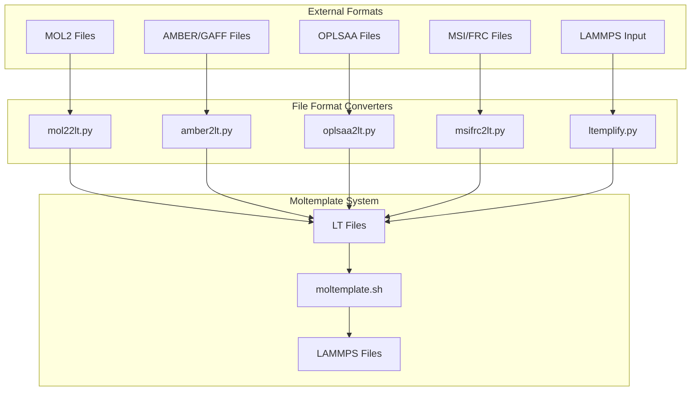
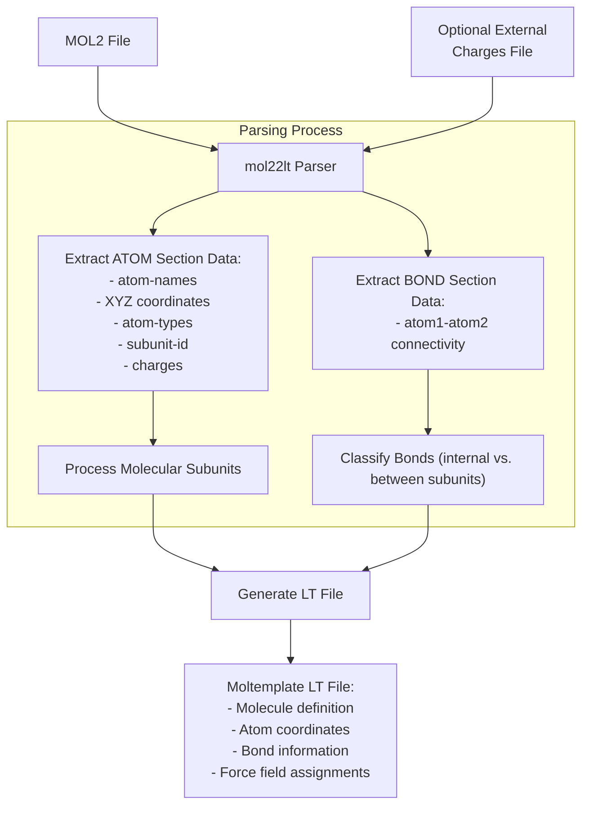
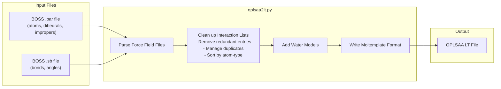
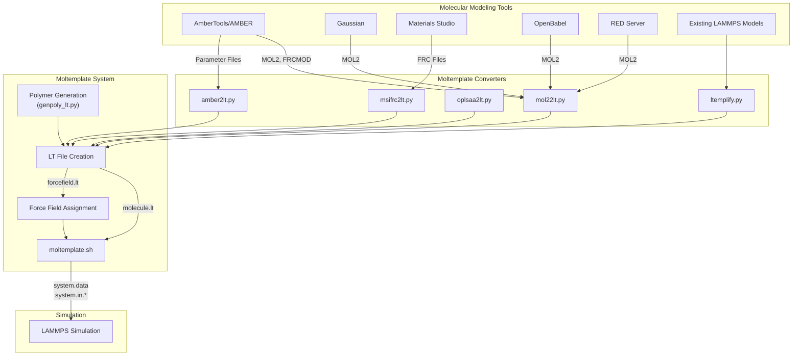

# File Format Converters

<details>
<summary>Relevant source files</summary>

The following files were used as context for generating this wiki page:

- [doc/doc_mol22lt.md](doc/doc_mol22lt.md)
- [examples/all_atom/force_field_AMBER/README.md](examples/all_atom/force_field_AMBER/README.md)
- [examples/all_atom/force_field_COMPASS/README.md](examples/all_atom/force_field_COMPASS/README.md)
- [examples/all_atom/force_field_COMPASS/alkane_chain_single/moltemplate_files/system.lt](examples/all_atom/force_field_COMPASS/alkane_chain_single/moltemplate_files/system.lt)
- [examples/all_atom/force_field_DREIDING/README.md](examples/all_atom/force_field_DREIDING/README.md)
- [moltemplate/__init__.py](moltemplate/__init__.py)
- [moltemplate/force_fields/convert_OPLSAA_to_LT/README.md](moltemplate/force_fields/convert_OPLSAA_to_LT/README.md)
- [moltemplate/force_fields/convert_OPLSAA_to_LT/__init__.py](moltemplate/force_fields/convert_OPLSAA_to_LT/__init__.py)
- [moltemplate/force_fields/convert_OPLSAA_to_LT/oplsaa2lt.py](moltemplate/force_fields/convert_OPLSAA_to_LT/oplsaa2lt.py)
- [moltemplate/force_fields/convert_OPLSAA_to_LT/oplsaa2lt_classes.py](moltemplate/force_fields/convert_OPLSAA_to_LT/oplsaa2lt_classes.py)
- [moltemplate/force_fields/convert_OPLSAA_to_LT/oplsaa2lt_utils.py](moltemplate/force_fields/convert_OPLSAA_to_LT/oplsaa2lt_utils.py)
- [moltemplate/force_fields/oplsaa2008_original_format/AUTHOR.txt](moltemplate/force_fields/oplsaa2008_original_format/AUTHOR.txt)
- [moltemplate/force_fields/oplsaa2008_original_format/README.txt](moltemplate/force_fields/oplsaa2008_original_format/README.txt)
- [moltemplate/mol22lt.py](moltemplate/mol22lt.py)
- [moltemplate/nbody_alt_symmetry/cenKswapIL.py](moltemplate/nbody_alt_symmetry/cenKswapIL.py)

</details>


This page documents the various file format converters in Moltemplate that allow importing external molecular data formats into the Moltemplate LT format. These converters form a crucial bridge between established molecular modeling software and Moltemplate's template-based approach to molecular simulation.

## Overview

Moltemplate supports multiple input pathways to transform external formats into its native LT format. These converters make it easier to integrate moltemplate with existing workflows and data from popular molecular modeling software.



Sources: [moltemplate/__init__.py:41-45](), [moltemplate/mol22lt.py:1-594]()

## Conversion Process

The conversion process generally follows these steps:

1. Read the source file in its native format
2. Parse the molecular structure, atom types, charges, and parameters
3. Map these elements to Moltemplate's LT format
4. Generate an LT file that can be used in Moltemplate simulations

Each converter has specific considerations based on the source format, but they all share this basic workflow.

## Converter Types and Usage

### MOL2 to LT (mol22lt.py)

The `mol22lt.py` converter transforms MOL2 files (generated by tools like AmberTools, Gaussian, OpenBabel, or RED-server) into Moltemplate LT format. It extracts atomic coordinates, names, types, charges, and bonding information.

**Basic Usage:**
```bash
mol22lt.py --in molecule.mol2 --out molecule.lt [--name MOLECULE_NAME] [--ff FORCE_FIELD_NAME] [--ff-file FORCE_FIELD_FILE]
```

**Example:**
```bash
mol22lt.py --in benzene.mol2 --out benzene.lt --name Benzene --ff GAFF2 --ff-file gaff2.lt
```

**Extracted Information:**
- Charge (from MOL2 file or optional external file)
- Atom names and coordinates
- Atom types
- Subunit IDs and names
- Bond connectivity

**Diagram: MOL2 to LT Conversion Process**



Sources: [doc/doc_mol22lt.md:1-322](), [moltemplate/mol22lt.py:75-492]()

**Limitations:**
- Does not work with MOL2 files containing multiple "chains"
- Atom names must be unique within each molecular subunit
- All atom-ID numbers and subunit-ID numbers must be unique and begin at 1

### AMBER/GAFF Conversion (amber2lt.py)

The `amber2lt.py` tool converts AMBER parameter and topology files to Moltemplate LT format. This provides a way to use AMBER and GAFF force fields with Moltemplate.

**Basic Usage:**
```bash
amber2lt.py --in param.frcmod --name MyForceField >> my_force_field.lt
```

**Workflow Example:**
```
# First create force field file from AMBER parameters
amber2lt.py --in benzene.frcmod --name MyForceField >> my_force_field.lt

# Then create molecule using mol22lt.py with this force field
mol22lt.py --in benzene.mol2 --out benzene.lt --name Benzene --ff MyForceField --ff-file my_force_field.lt
```

Sources: [examples/all_atom/force_field_AMBER/README.md:32-65]()

### OPLSAA Conversion (oplsaa2lt.py)

The `oplsaa2lt.py` converter transforms OPLSAA parameter files into Moltemplate LT format. It processes BOSS input files (.par, .sb) that contain the OPLSAA force field parameters.

**Basic Usage:**
```bash
oplsaa2lt.py --name OPLSAA --out oplsaa2024.lt --par oplsaa.par --sb oplsaa.sb
```

The converter handles special cases in OPLSAA typing, such as replacing problematic characters in atom type names and managing various bonded interaction redundancies.

**Implementation Details:**
- Parses atom definitions, charges, and masses
- Handles bond, angle, dihedral, and improper interactions
- Deals with duplicate types and parameters
- Includes water models



Sources: [moltemplate/force_fields/convert_OPLSAA_to_LT/oplsaa2lt.py:1-575](), [moltemplate/force_fields/convert_OPLSAA_to_LT/README.md:1-53](), [moltemplate/force_fields/convert_OPLSAA_to_LT/oplsaa2lt_classes.py:1-308]()

**Key Features:**
- Handles character conversions for OPLSAA types (e.g., "C:" → "C°", "C$" → "C^")
- Includes water models (TIP3P, TIP4P, TIP5P, SPC/E, OPC)
- Supports force field specific symmetry rules for improper interactions

### MSI/BIOSYM Format Conversion (msifrc2lt.py)

The `msifrc2lt.py` tool converts MSI/BIOSYM/DISCOVERY force field files to Moltemplate LT format. This allows integration with these commercial simulation packages.

**Basic Usage:**
```bash
msifrc2lt.py --in forcefield.frc --out forcefield.lt
```

### LAMMPS Input Conversion (ltemplify.py)

The `ltemplify.py` tool converts existing LAMMPS input and data files into Moltemplate LT format. This is useful for converting existing LAMMPS simulations to use Moltemplate's template-based approach.

**Basic Usage:**
```bash
ltemplify.py system.data system.in.settings -name "SystemName" > system.lt
```

## Integration with Moltemplate Workflow

The file format converters integrate with the broader Moltemplate workflow, allowing users to move seamlessly between different molecular modeling tools.



Sources: [examples/all_atom/force_field_AMBER/README.md:17-31](), [moltemplate/__init__.py:41-47]()

## Best Practices

### Choosing the Right Converter

1. **For small molecules with AMBER/GAFF force fields**:
   - Generate MOL2 and FRCMOD files using AmberTools
   - Use `amber2lt.py` to create a force field file
   - Use `mol22lt.py` to convert the molecule structure

2. **For OPLSAA force field parameters**:
   - Use `oplsaa2lt.py` with BOSS parameter files

3. **For existing LAMMPS simulations**:
   - Use `ltemplify.py` to convert LAMMPS files to LT format

### Important Considerations

#### Atomic Charges

- Many converters support extracting charges from the source files
- Some force fields (like COMPASS) have their own charge assignment rules
- User can also provide external charge files for `mol22lt.py`
- Verify charges are reasonable after conversion

#### Force Field Compatibility

- Ensure the force field parameters in the converted files are compatible with LAMMPS
- Some force fields require specific LAMMPS packages (e.g., AMBER requires the EXTRA-MOLECULE package)
- Check for missing parameters after conversion

#### Water Models

- Most force field converters include standard water models
- Special handling may be required for specific water models (TIP3P, TIP4P, SPC/E)

#### Improper Handling

- Different force fields use different improper angle conventions
- Moltemplate provides tools for handling these differences through symmetry rules

Sources: [examples/all_atom/force_field_AMBER/README.md:75-109](), [examples/all_atom/force_field_DREIDING/README.md:10-29](), [examples/all_atom/force_field_COMPASS/README.md:20-76]()

## Summary

The file format converters in Moltemplate provide a critical bridge between established molecular modeling software and Moltemplate's template-based approach. They enable users to leverage existing molecular structures and force field parameters while taking advantage of Moltemplate's powerful molecular building capabilities.

By converting various file formats to LT format, these tools allow users to:
- Import molecules from popular molecular modeling software
- Utilize established force fields (AMBER, GAFF, OPLSAA, DREIDING, COMPASS)
- Convert existing LAMMPS simulations to use Moltemplate's template-based approach
- Create complex molecular systems through Moltemplate's hierarchical molecule definition system

---