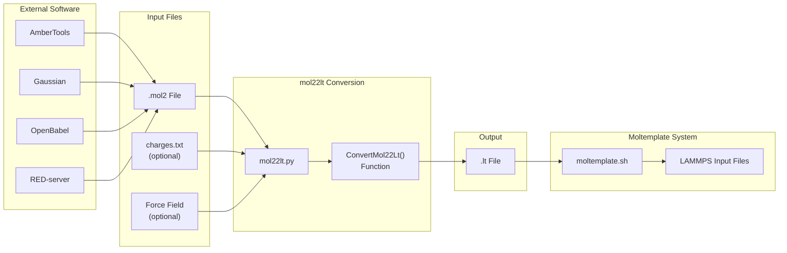
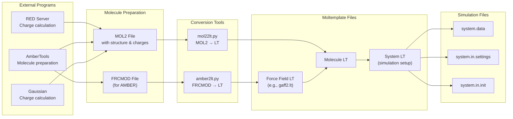

# mol22lt.py - MOL2 to LT Conversion

<details>
<summary>Relevant source files</summary>

The following files were used as context for generating this wiki page:

- [doc/doc_mol22lt.md](doc/doc_mol22lt.md)
- [examples/all_atom/force_field_AMBER/README.md](examples/all_atom/force_field_AMBER/README.md)
- [examples/all_atom/force_field_COMPASS/README.md](examples/all_atom/force_field_COMPASS/README.md)
- [examples/all_atom/force_field_COMPASS/alkane_chain_single/moltemplate_files/system.lt](examples/all_atom/force_field_COMPASS/alkane_chain_single/moltemplate_files/system.lt)
- [examples/all_atom/force_field_DREIDING/README.md](examples/all_atom/force_field_DREIDING/README.md)
- [moltemplate/__init__.py](moltemplate/__init__.py)
- [moltemplate/mol22lt.py](moltemplate/mol22lt.py)

</details>


The `mol22lt.py` program converts molecular structures in MOL2 format to moltemplate's LT format. This tool is part of moltemplate's input conversion subsystem, allowing molecular structures created in various molecular design programs to be used in LAMMPS simulations through moltemplate. For information about other conversion tools, see [File Format Converters](#4).

## Overview and Purpose

`mol22lt.py` creates LT files that define molecules based on the information extracted from MOL2 files (a widely used molecular structure format). This conversion is a critical step when:

1. Importing molecules designed in other software like AmberTools, Gaussian, OpenBabel, or RED-server
2. Converting complex molecules where manual creation of LT files would be impractical
3. Working with force fields like AMBER GAFF/GAFF2 where atom types in MOL2 files correspond to force field parameters

The program extracts coordinates, atom types, charges, bonds, and subunit information, preserving the molecular structure while transforming it into moltemplate's template-based format.

### Conversion Workflow



Sources: [doc/doc_mol22lt.md:3-7](), [doc/doc_mol22lt.md:69-73](), [moltemplate/__init__.py:41-42]()

## Command-Line Usage

The basic syntax for using `mol22lt.py` is:

```
mol22lt.py --in FILE.MOL2 --out FILE.LT [--name MOLECULE_NAME] [--charges charges.txt] [--ff FORCE_FIELD_NAME] [--ff-file FORCE_FIELD_FILE_NAME]
```

### Required Arguments

- `--in FILE.MOL2`: Specifies the MOL2 file to convert
- `--out FILE.LT`: Specifies the output LT file name

### Optional Arguments

- `--name MOLECULE_NAME`: Defines a name for the entire molecule (especially useful for multi-subunit molecules)
- `--charges charges.txt`: Provides custom charges from an external file
- `--ff FORCE_FIELD_NAME`: Specifies the force field name (e.g., GAFF2)
- `--ff-file FORCE_FIELD_FILE_NAME`: Specifies the force field file (e.g., gaff2.lt)
- `--upper-case-types`/`--lower-case-types`: Forces atom types to use upper/lowercase letters
- `--upper-case-names`/`--lower-case-names`: Forces atom names to use upper/lowercase letters

Sources: [doc/doc_mol22lt.md:10-19](), [moltemplate/mol22lt.py:503-551]()

## Example Usage

Here's an example that converts a polyphenylene sulfide (PPS) polymer into moltemplate format:

```
mol22lt.py --in PPS_5mer.mol2 --out PPS_5mer.lt --name PPS5 --ff GAFF2 --ff-file "gaff2.lt"
```

After conversion, you can use the molecule in a moltemplate system file:

```
import "PPS_5mer.lt"
pps5_copy = new PPS5  # Create a single copy of the PPS5 polymer
```

Sources: [doc/doc_mol22lt.md:22-35](), [doc/doc_mol22lt.md:414-431]()

## Data Extraction from MOL2 Files

The following information is extracted from the MOL2 file during conversion:

| MOL2 Section | Data Extracted | LT File Placement |
|--------------|----------------|-------------------|
| ATOM | Atom names (column 2) | `$atom:name` identifiers |
| ATOM | XYZ coordinates (columns 3,4,5) | Coordinates in Data Atoms section |
| ATOM | Atom types (column 6) | `@atom:type` references |
| ATOM | Subunit IDs (column 7) | Molecule organization |
| ATOM | Subunit names (column 8) | Molecule naming |
| ATOM | Charges (column 9) | Charge values in Data Atoms |
| BOND | Bond connections (columns 2,3) | Bond definitions |

The program ignores other sections of the MOL2 file and status information.

```mermaid
flowchart TD
    subgraph "MOL2 Format"
        MOL2_ATOM["@<TRIPOS>ATOM\nID name x y z type subID subName charge"]
        MOL2_BOND["@<TRIPOS>BOND\nID atom1 atom2 type"]
        MOL2_OTHER["Other MOL2 Sections\n(ignored)"]
    end
    
    subgraph "ConvertMol22Lt Function"
        READ["Read MOL2 sections"]
        EXTRACT["Extract atom and bond data"]
        PROCESS["Process subunits"]
        CONVERT["Generate LT format"]
    end
    
    subgraph "LT Format Output"
        LT_HEADER["import statements\nMolecule definition"]
        LT_ATOMS["write(\"Data Atoms\") {\n  $atom:name $mol:id @atom:type charge x y z\n}"]
        LT_BONDS["write(\"Data Bond List\") {\n  $bond:id $atom:name1 $atom:name2\n}"]
        LT_USAGE["Usage instructions"]
    end
    
    MOL2_ATOM --> READ
    MOL2_BOND --> READ
    MOL2_OTHER --> READ
    
    READ --> EXTRACT
    EXTRACT --> PROCESS
    PROCESS --> CONVERT
    
    CONVERT --> LT_HEADER
    CONVERT --> LT_ATOMS
    CONVERT --> LT_BONDS
    CONVERT --> LT_USAGE
```

Sources: [doc/doc_mol22lt.md:75-94](), [moltemplate/mol22lt.py:114-212]()

## Handling Molecular Subunits

MOL2 files often contain multiple molecular subunits (designated by the subunit ID in column 7 of the ATOM section). `mol22lt.py` handles these in two ways:

1. **Default behavior**: Each subunit becomes a separate molecule definition in the LT file
2. **Using --name argument**: All subunits are grouped into a single molecule with the specified name

When creating multiple molecule definitions, the program ensures each has a unique name by adding suffixes if necessary.

Sources: [doc/doc_mol22lt.md:123-131](), [moltemplate/mol22lt.py:222-281]()

## Force Field Integration

The atom type names in MOL2 files often correspond to force field types (like AMBER GAFF2). To use these force fields in your simulations:

1. Specify the force field name with `--ff` (e.g., `--ff GAFF2`)
2. Specify the force field file with `--ff-file` (e.g., `--ff-file gaff2.lt`)

This adds an import statement at the beginning of the generated LT file and makes the molecule inherit from the force field:

```
import "gaff2.lt"
PPS5 inherits GAFF2 {
  # Molecule definition
}
```

Sources: [doc/doc_mol22lt.md:112-120](), [moltemplate/mol22lt.py:304-305]()

## Charges in Converted Molecules

By default, `mol22lt.py` reads charges from the MOL2 file (column 9 of the ATOM section). 

If the MOL2 file lacks charge information or you need to use different charges, you can provide a file containing the correct charges using the `--charges` argument. This file should contain one charge value per line, in the same order as atoms appear in the MOL2 file.

Sources: [doc/doc_mol22lt.md:190-199](), [moltemplate/mol22lt.py:45-70](), [moltemplate/mol22lt.py:94-97](), [moltemplate/mol22lt.py:147-155]()

## Molecular Positioning

After conversion, you may need to adjust the position of the molecule. While `mol22lt.py` preserves the original coordinates, you can use moltemplate's `.move()` and `.rot()` commands to reposition the molecule:

```
PPS5.move(-24.7, -3.9, -4.3)  # Center the molecule at the origin
```

These commands can be added to the end of the LT file or used when instantiating the molecule in your system file.

Sources: [doc/doc_mol22lt.md:152-168]()

## Working with Multiple Chains

`mol22lt.py` does not directly support MOL2 files containing multiple chains. However, you can use this workaround:

1. Split the MOL2 file into separate files, one per chain
2. Convert each file separately
3. Create a new LT file that combines the chains into a single complex

```
# Convert individual chain files
mol22lt.py --in chainA.mol2 --out chainA.lt --name ChainA --ff GAFF2 --ff-file "gaff2.lt"
mol22lt.py --in chainB.mol2 --out chainB.lt --name ChainB --ff GAFF2 --ff-file "gaff2.lt"

# Then create a file (protein_with_2_chains.lt) containing:
import "chainA.lt"  # Defines "ChainA"
import "chainB.lt"  # Defines "ChainB"
ProteinWith2Chains {
  a = ChainA
  b = ChainB
}
```

Sources: [doc/doc_mol22lt.md:272-303]()

## Python API

You can use the `mol22lt.py` functionality directly within Python scripts:

```python
from moltemplate import ConvertMol22Lt

# Open the files
fMol2 = open('PPS_5mer.mol2', 'r')
fLT = open('PPS_5mer.lt', 'w')

# Perform the conversion
ConvertMol22Lt(fMol2,
               fLT,
               ff_name = 'GAFF2',        # Optional force field name
               ff_filename = 'gaff2.lt', # Optional force field file  
               object_name = 'PPS5')     # Optional molecule name
```

Sources: [doc/doc_mol22lt.md:305-322](), [moltemplate/__init__.py:41]()

## Integration with Workflow



Sources: [examples/all_atom/force_field_AMBER/README.md:25-30](), [examples/all_atom/force_field_AMBER/README.md:32-43]()

## Limitations and Considerations

1. **Multiple Chains**: As noted above, MOL2 files with multiple chains require special handling.

2. **Atomic Charges**: Ensure your MOL2 file contains reasonable charges or provide them separately. For accurate simulations, charges should be calculated using appropriate methods (like those from RED-server, AmberTools, or Gaussian).

3. **Force Field Compatibility**: Ensure atom types in the MOL2 file match the force field you're using. This is especially important for AMBER/GAFF force fields.

4. **Bond Types**: By default, the tool does not include explicit bond types in the output, using a "Bond List" format instead. Bond type information from the MOL2 file is ignored.

5. **Experimental Status**: The documentation notes this software is experimental (as of 2024-12-05).

Sources: [doc/doc_mol22lt.md:7](), [doc/doc_mol22lt.md:60-65](), [examples/all_atom/force_field_AMBER/README.md:76-97](), [moltemplate/mol22lt.py:500]()

## Recommendations for Best Practice

1. **Charge Calculation**: Use dedicated tools like RED-server, AmberTools, or quantum chemistry software to calculate appropriate partial charges for your molecules.

2. **Force Field Selection**: Choose the appropriate force field for your simulation and ensure your MOL2 file uses compatible atom types.

3. **Molecule Inspection**: After conversion, inspect the generated LT file to ensure it properly represents your molecule.

4. **Multiple Chains**: For complex structures with multiple chains, follow the workaround described in the "Working with Multiple Chains" section.

5. **Position Adjustment**: Consider using `.move()` and `.rot()` commands to position your molecule appropriately in the simulation box.

Sources: [examples/all_atom/force_field_AMBER/README.md:15-30](), [examples/all_atom/force_field_DREIDING/README.md:10-25]()

---