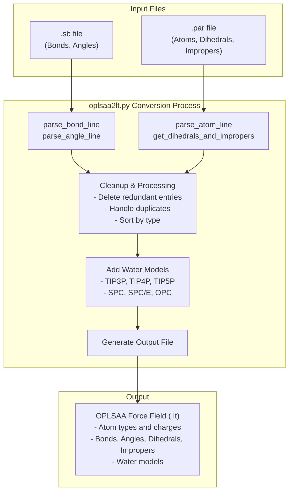
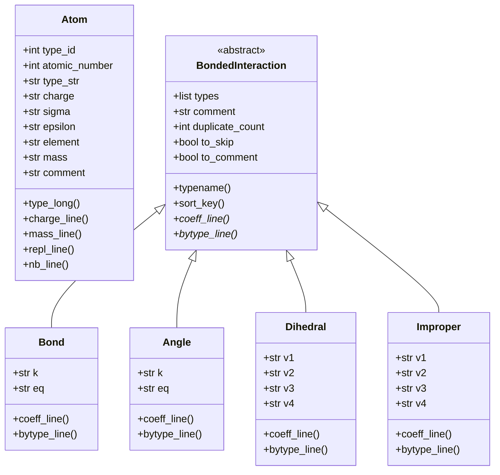
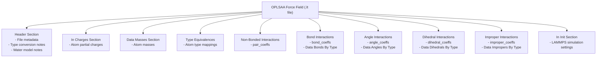
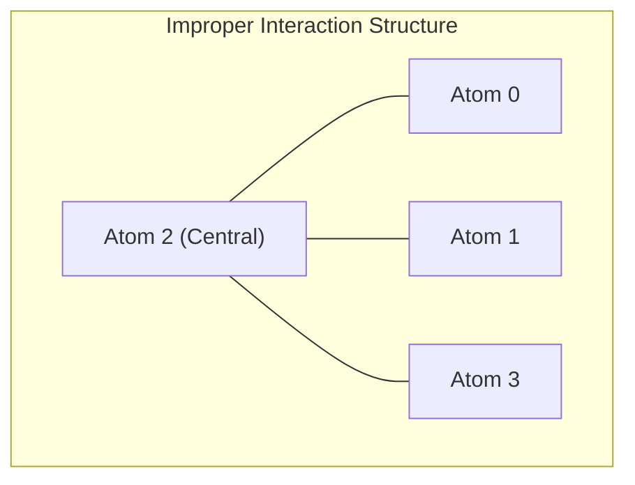
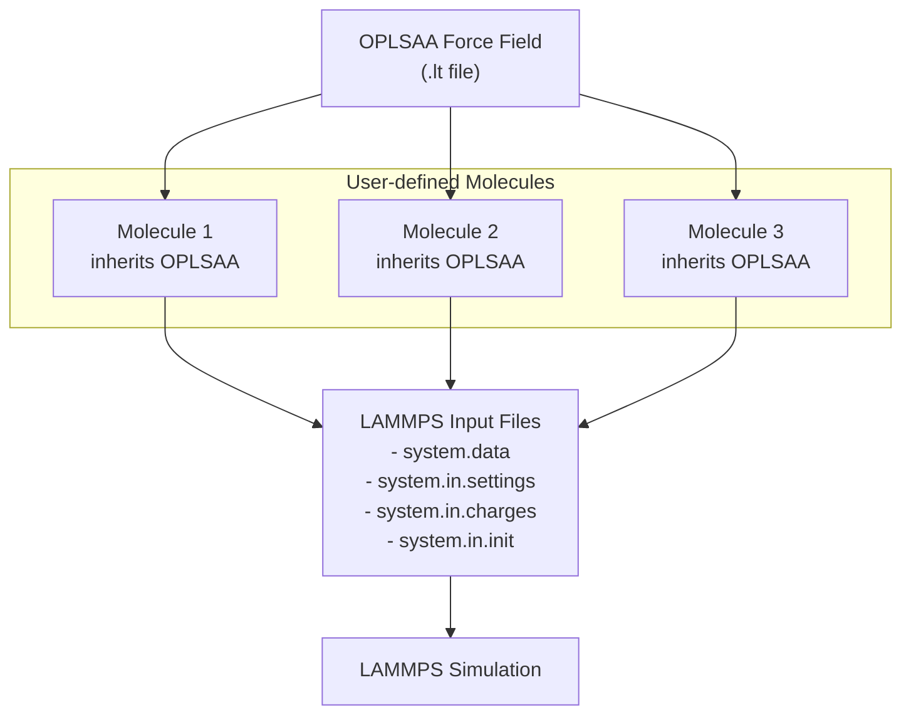

# OPLSAA Conversion

<details>
<summary>Relevant source files</summary>

The following files were used as context for generating this wiki page:

- [moltemplate/force_fields/convert_OPLSAA_to_LT/README.md](moltemplate/force_fields/convert_OPLSAA_to_LT/README.md)
- [moltemplate/force_fields/convert_OPLSAA_to_LT/__init__.py](moltemplate/force_fields/convert_OPLSAA_to_LT/__init__.py)
- [moltemplate/force_fields/convert_OPLSAA_to_LT/oplsaa2lt.py](moltemplate/force_fields/convert_OPLSAA_to_LT/oplsaa2lt.py)
- [moltemplate/force_fields/convert_OPLSAA_to_LT/oplsaa2lt_classes.py](moltemplate/force_fields/convert_OPLSAA_to_LT/oplsaa2lt_classes.py)
- [moltemplate/force_fields/convert_OPLSAA_to_LT/oplsaa2lt_utils.py](moltemplate/force_fields/convert_OPLSAA_to_LT/oplsaa2lt_utils.py)
- [moltemplate/force_fields/oplsaa2008_original_format/AUTHOR.txt](moltemplate/force_fields/oplsaa2008_original_format/AUTHOR.txt)
- [moltemplate/force_fields/oplsaa2008_original_format/README.txt](moltemplate/force_fields/oplsaa2008_original_format/README.txt)
- [moltemplate/nbody_alt_symmetry/cenKswapIL.py](moltemplate/nbody_alt_symmetry/cenKswapIL.py)

</details>


## Purpose and Scope

This document describes the `oplsaa2lt.py` system, which converts OPLSAA (Optimized Potentials for Liquid Simulations All-Atom) force field files from BOSS format (`.par` and `.sb` files) to moltemplate format (`.lt` files). The converted force field can then be used with the moltemplate system to define molecules for LAMMPS molecular dynamics simulations. For information about using the resulting force field in simulations, see [Force Fields](#5) and [OPLSAA Force Field](#5.1).

Sources: [moltemplate/force_fields/convert_OPLSAA_to_LT/README.md:1-32](), [moltemplate/force_fields/convert_OPLSAA_to_LT/oplsaa2lt.py:1-22]()

## System Overview

The OPLSAA conversion tool takes BOSS parameter files as input and generates a moltemplate-compatible file that defines the OPLSAA force field for use in LAMMPS simulations. The conversion process handles atom types, bonded interactions (bonds, angles, dihedrals, and impropers), and adds additional water models.

### OPLSAA Conversion Workflow



Sources: [moltemplate/force_fields/convert_OPLSAA_to_LT/oplsaa2lt.py:319-572](), [moltemplate/force_fields/convert_OPLSAA_to_LT/README.md:1-53]()

## Key Components

The OPLSAA conversion system consists of three main Python files that work together to handle the conversion process:

1. `oplsaa2lt.py` - Main script that coordinates the conversion process
2. `oplsaa2lt_classes.py` - Defines the data structures used in the conversion
3. `oplsaa2lt_utils.py` - Provides utility functions and constants

### Class Hierarchy and Data Model



Sources: [moltemplate/force_fields/convert_OPLSAA_to_LT/oplsaa2lt_classes.py:1-308]()

## Command Line Usage

The `oplsaa2lt.py` script requires command line arguments to specify the input and output files:

```
./oplsaa2lt.py --name OPLSAA --out oplsaa2024.lt \
  --par oplsaa.par \
  --sb  oplsaa.sb
```

Where:
- `--name` specifies the name of the moltemplate object to create (default: "OPLSAA")
- `--out` specifies the name of the output .lt file
- `--par` specifies the BOSS .par file containing atom, dihedral, and improper information
- `--sb` specifies the BOSS .sb file containing bond and angle information

Sources: [moltemplate/force_fields/convert_OPLSAA_to_LT/README.md:6-26](), [moltemplate/force_fields/convert_OPLSAA_to_LT/oplsaa2lt.py:320-350]()

## Detailed Conversion Process

### Type Conversion

The OPLSAA format contains atom type names with characters that are problematic for moltemplate. The system converts these characters to compatible alternatives:

```
C:  → C°   # moltemplate doesn't like :
C$  → C^   # $ is used by moltemplate
N$  → N^   # $ is used by moltemplate
O$  → O^   # $ is used by moltemplate
C#  → C|   # moltemplate doesn't like #
N*  → N§   # N* would create problems in bonded interactions
C(O) → C⟮  # moltemplate doesn't like "(" or ")", but "⟮" is okay
```

The wildcards "X", "Y", "Z" in BOSS files are converted to "??" for moltemplate, and single-character types are padded to ensure they are 2 characters long (e.g., "C" → "C~").

Sources: [moltemplate/force_fields/convert_OPLSAA_to_LT/oplsaa2lt.py:26-58]()

### Parsing Input Files

The system parses the BOSS input files using dedicated functions:

1. `.sb` file parsing:
   - `parse_bond_line()` - Extracts bond parameters
   - `parse_angle_line()` - Extracts angle parameters
   - `get_bonds_and_angles()` - Processes the entire file

2. `.par` file parsing:
   - `parse_atom_line()` - Extracts atom type information
   - `get_dihedrals_and_impropers()` - Extracts dihedral and improper parameters

Sources: [moltemplate/force_fields/convert_OPLSAA_to_LT/oplsaa2lt.py:61-168]()

### Handling Duplicates and Redundancy

OPLSAA files often contain redundant entries and duplicates that need special handling:

1. `delete_redundant_duplicates()` - Removes truly redundant entries
2. `count_nonredundant_duplicates()` - Identifies and counts duplicate entries that have different parameters
3. `sort_duplicates()` - Sorts duplicate interactions to ensure the most general ones appear last (giving them higher priority in moltemplate)

Sources: [moltemplate/force_fields/convert_OPLSAA_to_LT/oplsaa2lt.py:171-316]()

### Water Models

The system adds several water models that are not fully specified in the original OPLSAA files:

- TIP3P
- TIP4P
- TIP5P
- SPC/SPC-E
- OPC

For each model, it defines the atom types with appropriate charges, sigma, and epsilon values, as well as the necessary bond and angle parameters.

Sources: [moltemplate/force_fields/convert_OPLSAA_to_LT/oplsaa2lt.py:389-457]()

## Output File Structure

The generated .lt file contains the following sections:



Sources: [moltemplate/force_fields/convert_OPLSAA_to_LT/oplsaa2lt.py:460-571](), [moltemplate/force_fields/convert_OPLSAA_to_LT/oplsaa2lt_utils.py:3-132]()

## Improper Handling

Improper interactions in OPLSAA require special treatment. The system follows the OPLS convention where the central atom is the third atom in the interaction. The `cenKswapIL.py` file in the `nbody_alt_symmetry` directory provides the rules for generating improper interactions in the OPLS force field.



The canonical ordering of atoms in an improper interaction is important to avoid redundancy. The system implements a canonical ordering that ensures consistent representation of improper interactions.

Sources: [moltemplate/nbody_alt_symmetry/cenKswapIL.py:1-77](), [moltemplate/force_fields/convert_OPLSAA_to_LT/oplsaa2lt.py:143-168]()

## Usage Example

After conversion, the resulting .lt file can be used to define molecules in moltemplate:

```
import "oplsaa2024.lt"

Ethylene inherits OPLSAA {
  # atom-id mol-id atom-type charge   X       Y       Z     # comment
  write('Data Atoms') {
    $atom:c1  $mol @atom:143  0.00 -0.6695   0.00000  0.000  #143<->"alkene C (H2-C=)"
    $atom:h11 $mol @atom:144  0.00 -1.23422 -0.85446  0.000  #144<->"alkene H (H-C=)"
    # Additional atoms...
  }
  # BondID     AtomID1  AtomID2
  write('Data Bond List') {
    $bond:c1h1 $atom:c1 $atom:h11
    # Additional bonds...
  }
} # Ethylene
```

Sources: [moltemplate/force_fields/convert_OPLSAA_to_LT/README.md:26-44](), [moltemplate/force_fields/convert_OPLSAA_to_LT/oplsaa2lt_utils.py:3-43]()

## Integration with Moltemplate

The generated OPLSAA force field integrates with the rest of moltemplate through the inheritance mechanism. The force field object defines atom types, charges, and interaction parameters, while user-defined molecule objects inherit these properties and add specific geometries.



The moltemplate system uses the OPLSAA force field parameters to generate the necessary LAMMPS input files for simulation.

Sources: [moltemplate/force_fields/convert_OPLSAA_to_LT/oplsaa2lt_utils.py:107-132]()

---