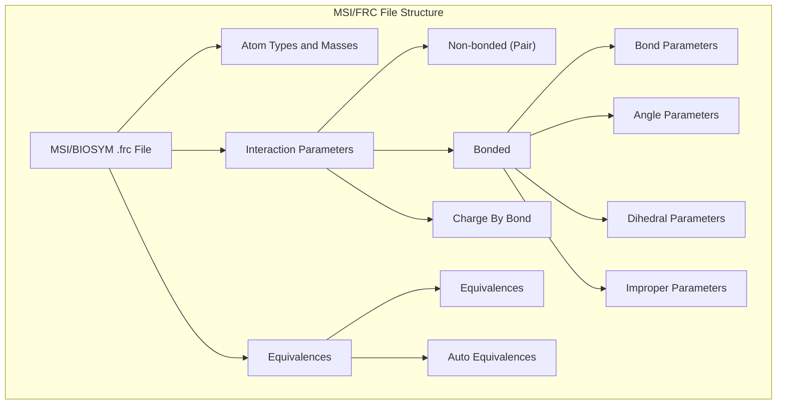
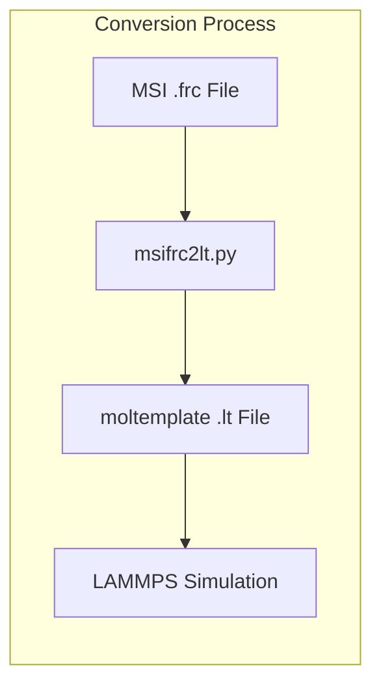
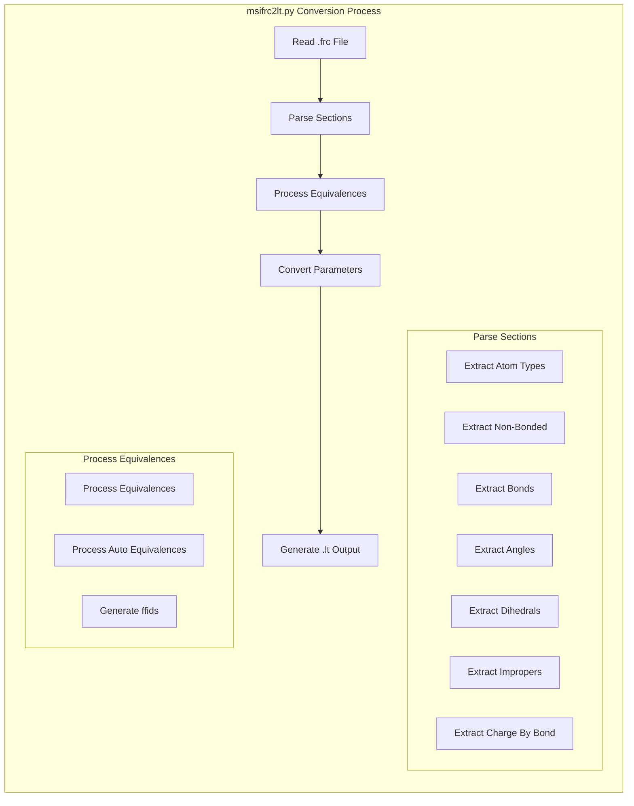
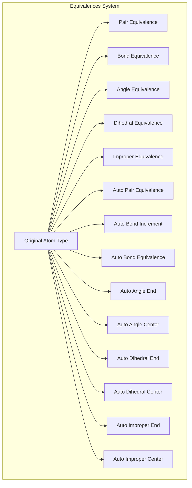
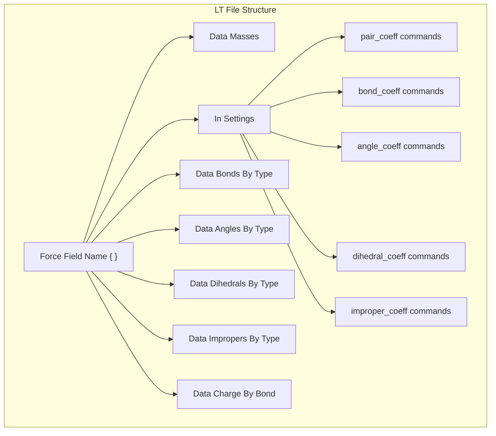
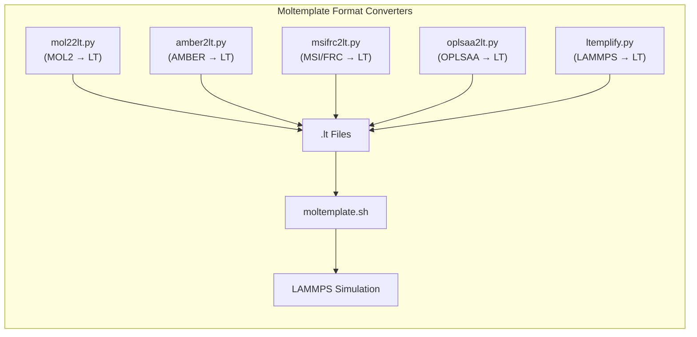

# MSI/BIOSYM Format Conversion

<details>
<summary>Relevant source files</summary>

The following files were used as context for generating this wiki page:

- [doc/DREIDING_Label_Manual.pdf](doc/DREIDING_Label_Manual.pdf)
- [moltemplate/force_fields/compass_published.lt](moltemplate/force_fields/compass_published.lt)
- [moltemplate/force_fields/convert_MSI_files_to_LT_files/msifrc2lt.py](moltemplate/force_fields/convert_MSI_files_to_LT_files/msifrc2lt.py)
- [moltemplate/force_fields/dreiding.lt](moltemplate/force_fields/dreiding.lt)
- [moltemplate/force_fields/martini.lt](moltemplate/force_fields/martini.lt)

</details>


## Purpose and Scope

This document explains how to convert MSI/BIOSYM/DISCOVERY/Accelrys force field files (`.frc` format) to moltemplate's `.lt` format using the `msifrc2lt.py` conversion tool. The purpose of this conversion is to enable the use of commercial force fields that are available in MSI format with moltemplate for LAMMPS simulations. This is particularly valuable for researchers who need to transition between different molecular dynamics software packages or want to utilize existing force field parameters in the moltemplate ecosystem.

For information about other format conversions such as MOL2 or AMBER/GAFF, please see [MOL2 to LT Conversion](#4.1) and [AMBER/GAFF Conversion](#4.2) respectively.

## Overview of MSI/BIOSYM Format

MSI/BIOSYM files (`.frc` extension) are force field parameter files historically used by commercial simulation packages like DISCOVERY, BIOSYM, and Accelrys (now BIOVIA). These files contain complete force field information including:

- Atom types and masses
- Bonded interactions (bonds, angles, dihedrals, impropers)
- Non-bonded interactions
- Equivalences for parameter lookups
- Charge increment parameters



Sources: [moltemplate/force_fields/convert_MSI_files_to_LT_files/msifrc2lt.py:7-32]()

## The msifrc2lt.py Conversion Tool

### Location and Purpose

The conversion tool is located at `moltemplate/force_fields/convert_MSI_files_to_LT_files/msifrc2lt.py`. It reads MSI force field files and converts them to moltemplate's `.lt` format, enabling the use of these force fields in LAMMPS simulations via moltemplate.



Sources: [moltemplate/force_fields/convert_MSI_files_to_LT_files/msifrc2lt.py:1-39]()

### Usage

The conversion tool can be run from the command line with various options:

```
msifrc2lt.py -name FORCEFIELDNAME < input.frc > output.lt
```

#### Common Command-Line Arguments

| Argument | Description |
|----------|-------------|
| `-name FORCEFIELDNAME` | Name to give the force field (used in moltemplate) |
| `-file FILE_NAME` | Read force field parameters from a file |
| `-url URL` | Read force field parameters from a file on the web |
| `-atoms "QUOTED LIST"` | Restrict output to a subset of atom types |
| `-hybrid` | Enable LAMMPS "hybrid" style (default) |
| `-no-hybrid` | Disable LAMMPS "hybrid" style compatibility |
| `-pair-style "PAIRSTYLE ARGS"` | Specify LAMMPS pair style and cutoff arguments |
| `-bond-style BONDSTYLE` | Specify LAMMPS bond style |
| `-angle-style ANGLESTYLE` | Specify LAMMPS angle style |
| `-dihedral-style DIHEDRALSTYLE` | Specify LAMMPS dihedral style |
| `-improper-style IMPROPERSTYLE` | Specify LAMMPS improper style |
| `-hbond-style "HBONDTYLE ARGS"` | Specify LAMMPS hydrogen-bond style and arguments |

Sources: [moltemplate/force_fields/convert_MSI_files_to_LT_files/msifrc2lt.py:51-72]()

### Example Usage

Converting the COMPASS force field:

```
msifrc2lt.py -name COMPASS < compass_published.frc > compass_published.lt
```

Converting the DREIDING force field with specific styles:

```
msifrc2lt.py -name DREIDING -pair-style "hybrid/overlay hbond/dreiding/lj 4 6 6.5 90 lj/cut/coul/long 10.0" < dreiding.frc > dreiding.lt
```

Sources: [moltemplate/force_fields/compass_published.lt:1-3]()

## Conversion Process Details

The conversion process involves several key steps:



Sources: [moltemplate/force_fields/convert_MSI_files_to_LT_files/msifrc2lt.py:662-839]()

### Handling Equivalences

One of the key complexities in MSI files is the "equivalences" and "auto_equivalences" system. These define how atom types are matched for different interactions:

1. **Equivalences**: Define atom type substitutions for different interaction types
2. **Auto Equivalences**: Lower priority fallback equivalences used when regular equivalences don't find matches

The conversion tool processes these equivalences and creates a comprehensive system for looking up parameters in the moltemplate format.



Sources: [moltemplate/force_fields/convert_MSI_files_to_LT_files/msifrc2lt.py:662-838]()

### Handling Wildcards and Priorities

MSI files use wildcards (often denoted with `*`) to represent generic atom types, and these wildcards often include numeric priorities to determine which match takes precedence when multiple matches are possible.

The converter handles these wildcards by:
1. Encoding wildcards appropriately for moltemplate
2. Calculating priorities for interaction patterns
3. Converting priority-based matching to moltemplate's pattern matching system

Sources: [moltemplate/force_fields/convert_MSI_files_to_LT_files/msifrc2lt.py:242-293](), [moltemplate/force_fields/convert_MSI_files_to_LT_files/msifrc2lt.py:410-505]()

## Generated LT File Structure

The output `.lt` file produced by the conversion tool has a specific structure that follows moltemplate conventions:



Sources: [moltemplate/force_fields/compass_published.lt:86-446](), [moltemplate/force_fields/dreiding.lt:20-606]()

## Example Files

### COMPASS Force Field

The COMPASS (Condensed-phase Optimized Molecular Potentials for Atomistic Simulation Studies) force field is a commercial force field developed for materials simulations. A published version has been converted to moltemplate format.

Example snippet from the compass_published.lt file:

```
COMPASS {

  #        AtomType    Mass

  write_once("Data Masses") {
    @atom:ar 39.944  # ar
    @atom:c3a 12.01115  # c3a
    @atom:c1o 12.01115  # c1o
    ...
  }
  
  # Equivalence categories
  replace{ @atom:ar @atom:ar~par~bar~aar~dar~iar }
  replace{ @atom:c3a @atom:c3a~pc3a~bc3a~ac3a~dc3a~ic3a }
  ...
  
  write_once("In Settings") {
    pair_coeff @atom:*~pc3a~b*~a*~d*~i* @atom:*~pc3a~b*~a*~d*~i*    0.0680 3.9150
    ...
  }
}
```

Sources: [moltemplate/force_fields/compass_published.lt:86-136](), [moltemplate/force_fields/compass_published.lt:150-193]()

### DREIDING Force Field

The DREIDING force field is another force field that has been converted to moltemplate format:

```
DREIDING {

  # DREIDING LAMMPS Settings:
  # Variants are possible, however this data is setup for these conditions

  write_once("In Init") {
    units           real
    atom_style      full
    bond_style      harmonic
    angle_style     harmonic
    dihedral_style  charmm
    improper_style  umbrella
    special_bonds   dreiding

    # Coefficients in non-bonding are just as an example
    pair_style      hybrid/overlay hbond/dreiding/lj 4 6 6.5 90 lj/cut/coul/long 10.0
    kspace_style    ewald 0.0001

    dielectric      1.0
   
  } # End of init
  
  # Masses Data by Type
  write_once("Data Masses") {
    @atom:H	1.008
    @atom:H_HB	1.008
    ...
  }
```

Sources: [moltemplate/force_fields/dreiding.lt:20-42](), [moltemplate/force_fields/dreiding.lt:43-150]()

## Using Converted Force Fields in Moltemplate

Once you've converted a force field to the `.lt` format, you can use it in your moltemplate files by inheriting from it:

```
MyMolecule inherits COMPASS {
  # atom-id  mol-id atom-type charge    X        Y        Z
  write('Data Atoms') {
    $atom:C1  $mol @atom:c4  0.00  -0.6695    0.000000  0.000000
    $atom:H11 $mol @atom:h1  0.00  -1.234217 -0.854458  0.000000
         :              :     :      :         :         :
  }
}
```

Note that you must carefully select atom types based on the descriptions in the force field file. The partial charges can be omitted in your molecule definition, as they will be assigned according to the force field's "Charge By Bond" rules.

Sources: [moltemplate/force_fields/compass_published.lt:14-32]()

## Limitations

The current version of the conversion tool has some limitations:

1. **Template Information**: It currently ignores the "template" information in `.FRC` files, which means the user must carefully choose the complete atom type for each atom in the molecule.

2. **Context-Dependent Types**: The converter does not attempt to determine from local context whether an atom is, for example, an SP3 carbon or an aromatic carbon - this must be specified manually.

3. **Force Field Completeness**: Some converted force fields (like the published COMPASS version) may be incomplete versions based on available public sources and might lack parameters for some atom types or interactions.

Sources: [moltemplate/force_fields/convert_MSI_files_to_LT_files/msifrc2lt.py:18-31](), [moltemplate/force_fields/compass_published.lt:5-11]()

## Related Tools

The MSI/BIOSYM conversion tool is part of a broader ecosystem of format converters in moltemplate:



Sources: [moltemplate/force_fields/convert_MSI_files_to_LT_files/msifrc2lt.py:1-39]()

---