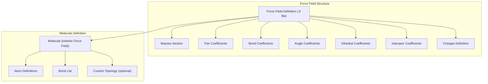
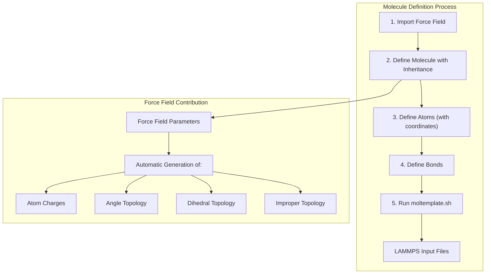
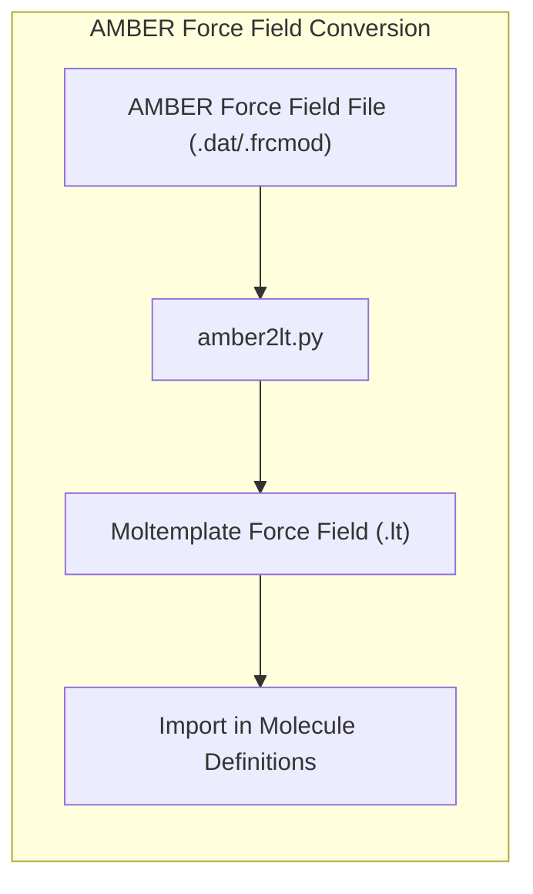

# Force Fields

<details>
<summary>Relevant source files</summary>

The following files were used as context for generating this wiki page:

- [doc/doc_amber2lt.md](doc/doc_amber2lt.md)
- [examples/all_atom/force_field_OPLSAA/README.md](examples/all_atom/force_field_OPLSAA/README.md)
- [examples/all_atom/force_field_OPLSAA/alkane_chain_single/README.md](examples/all_atom/force_field_OPLSAA/alkane_chain_single/README.md)
- [examples/all_atom/force_field_OPLSAA/butane/README.md](examples/all_atom/force_field_OPLSAA/butane/README.md)
- [examples/all_atom/force_field_OPLSAA/ethylene+benzene/README.md](examples/all_atom/force_field_OPLSAA/ethylene+benzene/README.md)
- [examples/all_atom/force_field_OPLSAA/ethylene+benzene_PACKMOL/README.md](examples/all_atom/force_field_OPLSAA/ethylene+benzene_PACKMOL/README.md)
- [examples/all_atom/force_field_OPLSAA/functionalized_nanotubes_NH2/README.md](examples/all_atom/force_field_OPLSAA/functionalized_nanotubes_NH2/README.md)
- [examples/all_atom/force_field_OPLSAA/hexadecane/README.md](examples/all_atom/force_field_OPLSAA/hexadecane/README.md)
- [examples/all_atom/force_field_OPLSAA/star_polymer/README.md](examples/all_atom/force_field_OPLSAA/star_polymer/README.md)
- [examples/all_atom/force_field_OPLSAA/waterSPCE+methane/README.md](examples/all_atom/force_field_OPLSAA/waterSPCE+methane/README.md)
- [examples/all_atom/force_field_OPLSAA/waterTIP5P+ethanol/README.md](examples/all_atom/force_field_OPLSAA/waterTIP5P+ethanol/README.md)
- [moltemplate/amber2lt.py](moltemplate/amber2lt.py)
- [moltemplate/force_fields/convert_AMBER_files_to_LT_files/README.txt](moltemplate/force_fields/convert_AMBER_files_to_LT_files/README.txt)
- [moltemplate/force_fields/gaff.lt](moltemplate/force_fields/gaff.lt)
- [moltemplate/force_fields/gaff2.lt](moltemplate/force_fields/gaff2.lt)

</details>


Force fields are collections of empirical parameters and equations that define the interactions between atoms and molecules in a simulation. Moltemplate supports multiple force fields for molecular simulations, allowing users to choose the most appropriate one for their specific system. This page provides an overview of the different force fields available in moltemplate and explains how to use them effectively.

For information on force field file format conversion tools, see [File Format Converters](#4).

## Supported Force Fields

Moltemplate includes several widely-used force fields for all-atom simulations:

| Force Field | Description | Typical Applications |
|-------------|-------------|----------------------|
| OPLSAA      | Optimized Potentials for Liquid Simulations All-Atom | Organic molecules, proteins, small molecules |
| LOPLSAA     | OPLSAA variant optimized for long alkane chains | Long hydrocarbon chains, polymers |
| GAFF        | General AMBER Force Field | Small molecules, pharmaceutical compounds |
| GAFF2       | General AMBER Force Field (version 2) | Updated parameters for small molecules |
| DREIDING    | General purpose force field | Organic, biological, and main-group inorganic compounds |
| COMPASS     | Condensed-phase Optimized Molecular Potentials for Atomistic Simulation Studies | Condensed phases, polymers, materials |
| MARTINI     | Coarse-grained force field | Biomolecular simulations at longer time scales |

Sources: [moltemplate/force_fields/gaff.lt:56-312](), [moltemplate/force_fields/gaff2.lt:56-356](), [examples/all_atom/force_field_OPLSAA/README.md:13-20]()

## Water Models

Moltemplate also includes several water models that can be used with these force fields:

| Water Model | Description | Features |
|-------------|-------------|----------|
| TIP3P       | 3-site model | Compatible with OPLSAA; commonly used in biomolecular simulations |
| TIP5P       | 5-site model | Better reproduction of water's thermodynamic properties |
| SPC/E       | Extended Simple Point Charge | Good balance between accuracy and computational efficiency |

Sources: [examples/all_atom/force_field_OPLSAA/waterSPCE+methane/README.md:42-56](), [examples/all_atom/force_field_OPLSAA/waterTIP5P+ethanol/README.md:3-8]()

## Force Field Architecture

The diagram below shows how force fields are organized in moltemplate:



Sources: [moltemplate/force_fields/gaff.lt:142-226](), [moltemplate/force_fields/gaff.lt:228-356]()

## Using Force Fields in Moltemplate

To use a force field in moltemplate, you need to:

1. Import the force field file using the `import` statement
2. Define your molecule to inherit from the force field
3. Specify atom types, coordinates, and bonds in your molecule definition

Here's how this process works:



### Basic Usage Example

Here's a basic example of how to use the OPLSAA force field for a simple molecule:

```
import "oplsaa2024.lt"  # Import the force field

Benzene inherits OPLSAA {   # Define molecule, inheriting from OPLSAA
  # Define atom coordinates
  write('Data Atoms') {
    $atom:C1  $mol  @atom:ca  0.0   0.739   1.189  0.00
    $atom:C2  $mol  @atom:ca  0.0  -0.739   1.189  0.00
    # ... more atoms
  }
  
  # Define bonds
  write("Data Bond List") {
    $bond:b1 $atom:C1 $atom:C2
    # ... more bonds
  }
}
```

Sources: [examples/all_atom/force_field_OPLSAA/butane/README.md:26-33](), [examples/all_atom/force_field_OPLSAA/alkane_chain_single/README.md:32-41]()

## Force Field Parameters and Automatic Topology Generation

When you use force fields like OPLSAA or GAFF, moltemplate automatically generates:

1. **Atomic charges** - based on atom types
2. **Angle topology** - creates angles based on bonded atoms
3. **Dihedral topology** - creates dihedral interactions based on connected atoms
4. **Improper topology** - creates improper interactions where necessary

The force field files contain all the parameters needed for these interactions, including:

- Mass definitions
- Pair coefficients (Lennard-Jones parameters)
- Bond coefficients
- Angle coefficients
- Dihedral coefficients
- Improper coefficients

Sources: [moltemplate/force_fields/gaff.lt:142-356](), [examples/all_atom/force_field_OPLSAA/README.md:13-20]()

## Customizing Force Fields

### Customizing Atomic Charges

There are two primary ways to specify atomic charges in LAMMPS:

1. **In the DATA file** (system.data) - This is the standard approach for non-OPLSAA atoms
2. **Using "set" commands** - This is how OPLSAA atom charges are specified

For OPLSAA molecules, charges are determined by atom type according to a lookup table in the force field file. These charges can be overridden in two ways:

1. By explicitly setting charges in the "Data Atoms" section and removing the "include system.in.charges" line from your LAMMPS input script
2. By adding an "In Charges" section to your LT file for specific atoms you want to modify

Example of customizing charges in an "In Charges" section:

```
write_once("In Charges") {
  set atom $atom:c1 charge -0.115
}
```

Sources: [examples/all_atom/force_field_OPLSAA/README.md:11-66](), [examples/all_atom/force_field_OPLSAA/functionalized_nanotubes_NH2/README.md:44-83]()

### Customizing Bonds, Angles, and Dihedrals

Force fields like OPLSAA often have multiple parameter choices for dihedrals, angles, and bonds. By default, moltemplate makes reasonable guesses when choosing parameters, but you can override these choices:

1. Run moltemplate with the `-report-duplicates bytype __` flag to detect ambiguous parameters
2. Check the generated warning files (e.g., "warning_duplicate_dihedrals.txt")
3. Add custom topology sections to override the default choices

Example of custom dihedral specification:

```
write("Data Dihedrals") {
  $dihedral:d1 @dihedral:ct-ct-ct-ct $atom:c1 $atom:c2 $atom:c3 $atom:c4
}
```

Sources: [examples/all_atom/force_field_OPLSAA/README.md:85-136](), [examples/all_atom/force_field_OPLSAA/butane/README.md:48-51]()

## Converting Force Fields from Other Formats

Moltemplate provides tools to convert force fields from other formats, such as AMBER:



The `amber2lt.py` tool converts AMBER force field files (FRCMOD or DAT files) to moltemplate format:

```
amber2lt.py --in gaff.dat --out gaff.lt --name GAFF
```

You can then import the converted force field into your molecule definitions:

```
import "gaff.lt"
Benzene inherits GAFF {
  # Molecule definition...
}
```

Sources: [moltemplate/amber2lt.py:1-14](), [doc/doc_amber2lt.md:1-168]()

## Mixing Force Fields in the Same Simulation

Moltemplate allows you to use different force fields for different molecules in the same simulation. For example, you can use:

- OPLSAA for organic molecules
- SPC/E for water
- GAFF for drug molecules

When mixing force fields, be careful about:

1. **Charge definitions** - Different molecules may use different methods to specify charges
2. **Cross-interactions** - Ensure proper parameters for interactions between atoms from different force fields
3. **Simulation settings** - Make sure your LAMMPS script handles all force field components correctly

Example of mixing OPLSAA and SPC/E water:

```
import "oplsaa2024.lt"
import "spce.lt"

# OPLSAA molecule
Methane inherits OPLSAA {
  # Definition...
}

# System with both molecules
write("Data Boundary") {
  0.0 50.0 xlo xhi
  0.0 50.0 ylo yhi
  0.0 50.0 zlo zhi
}

# Create methane molecules
methane = new Methane [8].move(0.0, 0.0, 10.0)
                       [8].move(0.0, 10.0, 0.0)
                       [8].move(10.0, 0.0, 0.0)

# Create water molecules (not using OPLSAA)
water = new SPCE [10].move(0.0, 0.0, 8.0)
                 [10].move(0.0, 8.0, 0.0)
                 [10].move(8.0, 0.0, 0.0)
```

Sources: [examples/all_atom/force_field_OPLSAA/waterSPCE+methane/README.md:8-14](), [examples/all_atom/force_field_OPLSAA/waterTIP5P+ethanol/README.md:3-8]()

## LOPLSAA: OPLSAA Variant for Long Alkane Chains

LOPLSAA is a variant of OPLSAA optimized for long alkane chains. It includes additional atom types and dihedral interactions that improve simulation accuracy for polymers and long hydrocarbon chains.

Key points about LOPLSAA:

- It extends the existing OPLSAA force field with additional parameters
- The parameters are in the `loplsaa2024.lt` file
- It uses the same inheritance mechanism as regular OPLSAA
- You can mix LOPLSAA and OPLSAA atoms in the same molecule

Usage example:

```
import "loplsaa2024.lt"
CH2 inherits OPLSAA { ... }
CH3 inherits OPLSAA { ... }
Polyethylene inherits OPLSAA { ... }
```

Sources: [examples/all_atom/force_field_OPLSAA/alkane_chain_single/README.md:32-46](), [examples/all_atom/force_field_OPLSAA/hexadecane/README.md:31-42](), [examples/all_atom/force_field_OPLSAA/star_polymer/README.md:28-41]()

## Common Issues and Troubleshooting

### Bloated LAMMPS Input Scripts

By default, LAMMPS input scripts prepared using moltemplate with OPLSAA contain the entire contents of the force field, even for small systems with few atom types. To reduce the size of these files:

1. Follow instructions in README_remove_irrelevant_info.sh files present in examples
2. This removes unused force field parameters, making the files more manageable

Sources: [examples/all_atom/force_field_OPLSAA/README.md:73-81]()

### Dealing with Duplicate Dihedral/Angle/Bond Types

When running moltemplate with OPLSAA or other force fields, you might encounter ambiguous parameter choices. To address this:

1. Run moltemplate with `-report-duplicates bytype __`
2. Check the warning files generated (warning_duplicate_dihedrals.txt, etc.)
3. Add explicit parameter choices to your molecule definition
4. Re-run moltemplate until the warnings are resolved

Sources: [examples/all_atom/force_field_OPLSAA/README.md:85-136]()

### Mixing Force Fields and Charge Assignment

When mixing molecules that use different force fields:

1. Be aware that OPLSAA molecules get charges from the force field definition
2. Non-OPLSAA molecules need charges explicitly defined in their "Data Atoms" section
3. Make sure your LAMMPS script includes the appropriate files for all force fields:
   - system.in.charges (for OPLSAA)
   - system.data (for explicit charges in non-OPLSAA molecules)

Sources: [examples/all_atom/force_field_OPLSAA/waterSPCE+methane/README.md:32-59](), [examples/all_atom/force_field_OPLSAA/functionalized_nanotubes_NH2/README.md:44-83]()

---