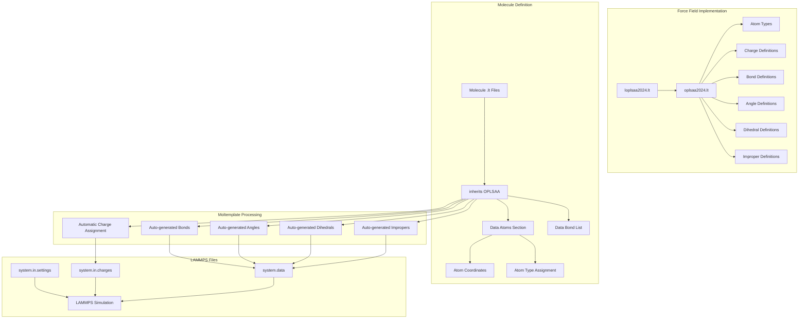
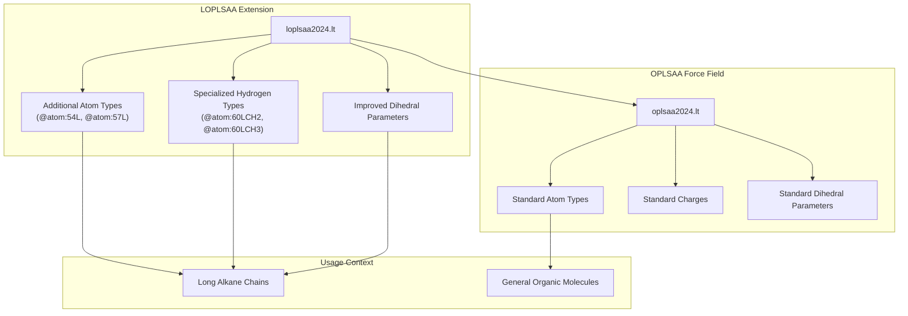
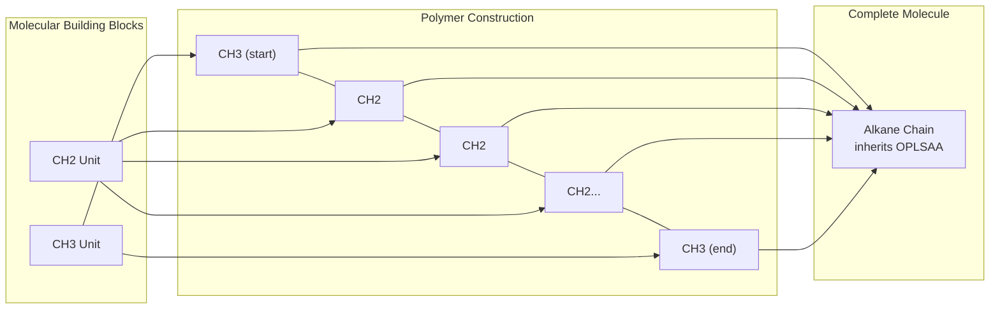
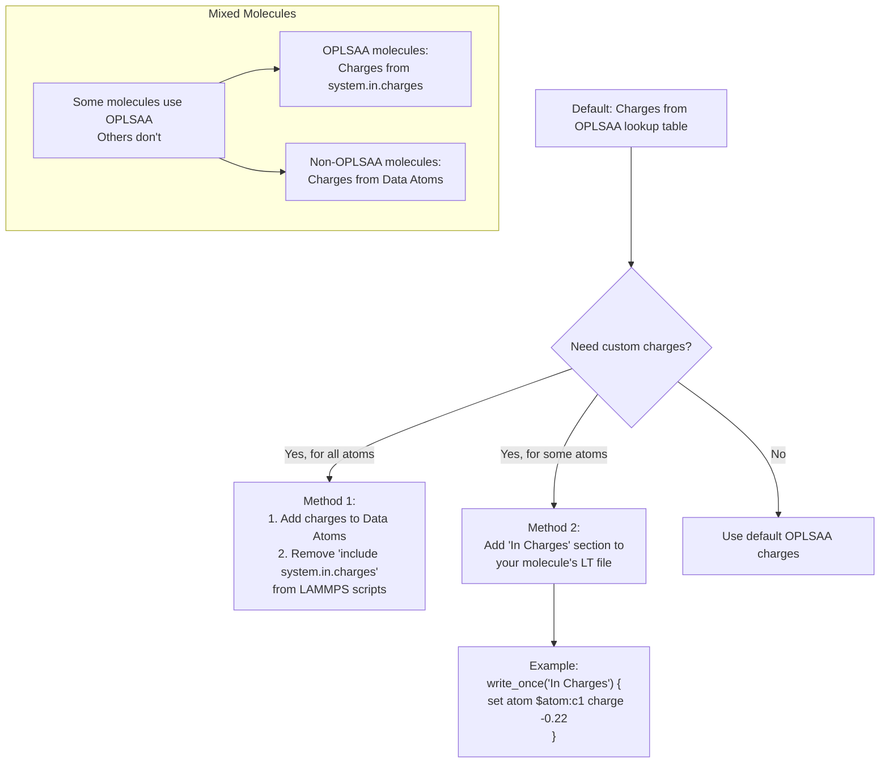
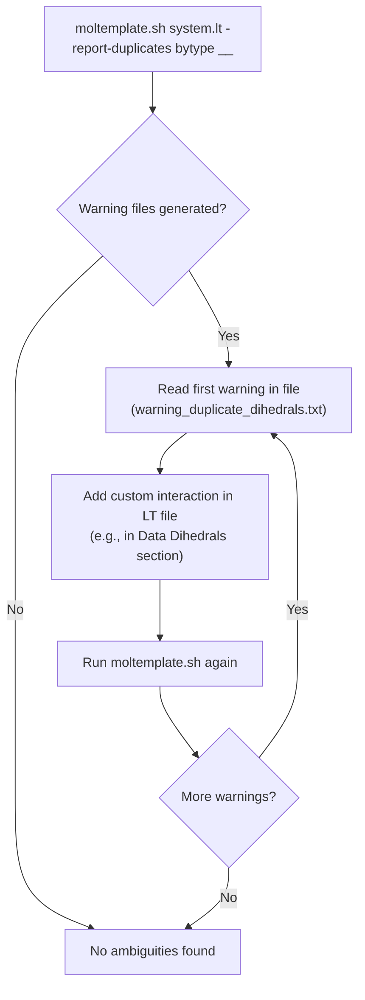
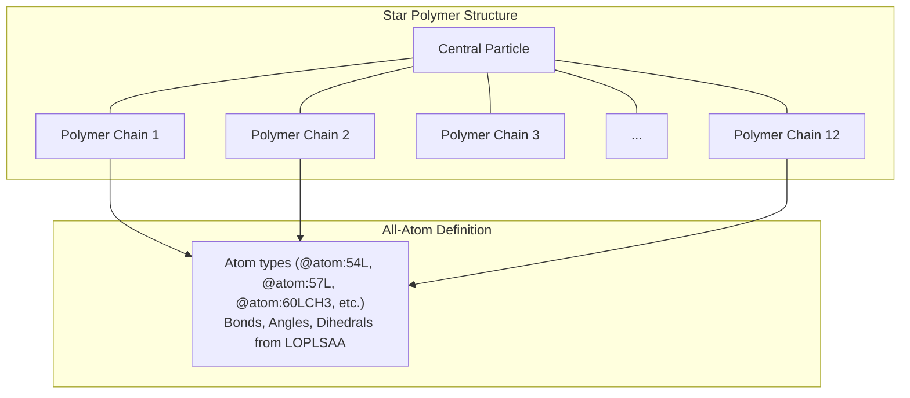

# OPLSAA Force Field

<details>
<summary>Relevant source files</summary>

The following files were used as context for generating this wiki page:

- [examples/all_atom/force_field_OPLSAA/README.md](examples/all_atom/force_field_OPLSAA/README.md)
- [examples/all_atom/force_field_OPLSAA/alkane_chain_single/README.md](examples/all_atom/force_field_OPLSAA/alkane_chain_single/README.md)
- [examples/all_atom/force_field_OPLSAA/alkane_chain_single/moltemplate_files/ch2.lt](examples/all_atom/force_field_OPLSAA/alkane_chain_single/moltemplate_files/ch2.lt)
- [examples/all_atom/force_field_OPLSAA/alkane_chain_single/moltemplate_files/ch3.lt](examples/all_atom/force_field_OPLSAA/alkane_chain_single/moltemplate_files/ch3.lt)
- [examples/all_atom/force_field_OPLSAA/butane/README.md](examples/all_atom/force_field_OPLSAA/butane/README.md)
- [examples/all_atom/force_field_OPLSAA/butane/moltemplate_files/ch2.lt](examples/all_atom/force_field_OPLSAA/butane/moltemplate_files/ch2.lt)
- [examples/all_atom/force_field_OPLSAA/butane/moltemplate_files/ch3.lt](examples/all_atom/force_field_OPLSAA/butane/moltemplate_files/ch3.lt)
- [examples/all_atom/force_field_OPLSAA/ethylene+benzene/README.md](examples/all_atom/force_field_OPLSAA/ethylene+benzene/README.md)
- [examples/all_atom/force_field_OPLSAA/ethylene+benzene_PACKMOL/README.md](examples/all_atom/force_field_OPLSAA/ethylene+benzene_PACKMOL/README.md)
- [examples/all_atom/force_field_OPLSAA/functionalized_nanotubes_NH2/README.md](examples/all_atom/force_field_OPLSAA/functionalized_nanotubes_NH2/README.md)
- [examples/all_atom/force_field_OPLSAA/hexadecane/README.md](examples/all_atom/force_field_OPLSAA/hexadecane/README.md)
- [examples/all_atom/force_field_OPLSAA/star_polymer/README.md](examples/all_atom/force_field_OPLSAA/star_polymer/README.md)
- [examples/all_atom/force_field_OPLSAA/waterSPCE+methane/README.md](examples/all_atom/force_field_OPLSAA/waterSPCE+methane/README.md)
- [examples/all_atom/force_field_OPLSAA/waterTIP5P+ethanol/README.md](examples/all_atom/force_field_OPLSAA/waterTIP5P+ethanol/README.md)
- [moltemplate/force_fields/build_your_own_force_field/oplsaa_simple.lt](moltemplate/force_fields/build_your_own_force_field/oplsaa_simple.lt)
- [moltemplate/force_fields/build_your_own_force_field/usage_example/alkane50.lt](moltemplate/force_fields/build_your_own_force_field/usage_example/alkane50.lt)
- [moltemplate/force_fields/build_your_own_force_field/usage_example/ch2.lt](moltemplate/force_fields/build_your_own_force_field/usage_example/ch2.lt)
- [moltemplate/force_fields/build_your_own_force_field/usage_example/ch3.lt](moltemplate/force_fields/build_your_own_force_field/usage_example/ch3.lt)

</details>


The OPLSAA Force Field is a comprehensive all-atom force field implemented in moltemplate for molecular dynamics simulations with LAMMPS. This document explains how the OPLSAA force field is structured, implemented, and used within moltemplate, focusing on its parameters, atomic charge handling, and customization options.

## Overview

The Optimized Potentials for Liquid Simulations All-Atom (OPLSAA) force field provides parameters for organic molecules and biomolecules. In moltemplate, the OPLSAA force field is primarily implemented through the `oplsaa2024.lt` file, with an extended variant for long alkane chains called "LOPLSAA" implemented in `loplsaa2024.lt`.

### OPLSAA in Moltemplate System Architecture



Sources: [examples/all_atom/force_field_OPLSAA/README.md:1-136](), [moltemplate/force_fields/build_your_own_force_field/oplsaa_simple.lt:1-272]()

## Force Field Structure

The OPLSAA force field defines parameters for:

1. **Atom types and masses**
2. **Non-bonded interactions** (Lennard-Jones parameters)
3. **Bonded interactions**:
   - Bond parameters
   - Angle parameters
   - Dihedral parameters
   - Improper parameters
4. **Atomic charges** based on atom types

### OPLSAA vs LOPLSAA

LOPLSAA is a variant of OPLSAA specifically optimized for long alkane chains:



Sources: [examples/all_atom/force_field_OPLSAA/alkane_chain_single/README.md:31-47](), [examples/all_atom/force_field_OPLSAA/hexadecane/README.md:31-42]()

## Using OPLSAA in Moltemplate

To use the OPLSAA force field in moltemplate:

1. Import the force field file
2. Define your molecule to inherit from OPLSAA
3. Specify atoms with their coordinates and OPLSAA atom types
4. Define bonds between atoms

### Example: Basic Molecule Definition

```
import "oplsaa2024.lt"

MyMolecule inherits OPLSAA {
  write("Data Atoms") {
    $atom:C1 $mol @atom:57 0.0 0.000 0.000 0.000
    $atom:H1 $mol @atom:60 0.0 0.000 0.631 0.892
    # Additional atoms...
  }
  
  write("Data Bond List") {
    $bond:CH1 $atom:C1 $atom:H1
    # Additional bonds...
  }
}
```

Sources: [examples/all_atom/force_field_OPLSAA/butane/moltemplate_files/ch2.lt:1-66](), [examples/all_atom/force_field_OPLSAA/butane/moltemplate_files/ch3.lt:1-68]()

### Building Complex Molecules

More complex molecules can be built by combining simpler molecular building blocks:



Sources: [examples/all_atom/force_field_OPLSAA/alkane_chain_single/README.md:1-66](), [moltemplate/force_fields/build_your_own_force_field/usage_example/alkane50.lt:1-138]()

## Atomic Charges in OPLSAA

A key feature of OPLSAA in moltemplate is how atomic charges are handled:

1. **Default Behavior**: Charges are assigned based on atom types defined in the `oplsaa2024.lt` file
2. **Implementation**: Charges are set using LAMMPS `set` commands in the `system.in.charges` file
3. **Effect**: Any charges specified in the "Data Atoms" section of molecule definitions are ignored by default

### Customizing Atomic Charges



Sources: [examples/all_atom/force_field_OPLSAA/README.md:11-68](), [examples/all_atom/force_field_OPLSAA/functionalized_nanotubes_NH2/README.md:42-83](), [examples/all_atom/force_field_OPLSAA/waterSPCE+methane/README.md:30-59]()

## Bonded Interactions

OPLSAA automatically generates bonded interactions (angles, dihedrals, impropers) based on atom types. It uses a sophisticated pattern matching system to identify the correct interaction parameters.

### Handling Ambiguous Interactions

In some cases, OPLSAA may find multiple possible parameter sets for a particular bonded interaction. You can handle these cases by:

1. Running moltemplate with `-report-duplicates bytype __` to identify ambiguous interactions
2. Adding custom sections to override the default parameter selection



Sources: [examples/all_atom/force_field_OPLSAA/README.md:85-135]()

## Common Usage Patterns

### Homogeneous Systems with Pure OPLSAA

For systems using only OPLSAA, molecules inherit from OPLSAA and get their charges from the force field:

```
import "oplsaa2024.lt"
Benzene inherits OPLSAA { ... }
```

Sources: [examples/all_atom/force_field_OPLSAA/ethylene+benzene/README.md:1-32]()

### Heterogeneous Systems with Mixed Force Fields

For systems with both OPLSAA and non-OPLSAA molecules:

```
import "oplsaa2024.lt"
Methane inherits OPLSAA { ... }  # Uses OPLSAA charges
SPCE { ... }  # Non-OPLSAA, charges defined in Data Atoms
```

Sources: [examples/all_atom/force_field_OPLSAA/waterSPCE+methane/README.md:8-14]()

### Using LOPLSAA for Long Alkane Chains

For long alkane chains, use the LOPLSAA variant:

```
import "loplsaa2024.lt"
CH2 inherits OPLSAA { 
  write("Data Atoms") {
    $atom:c  $mol:... @atom:57L    0.0  0.000000  0.000000  0.000000
    $atom:H1 $mol:... @atom:60LCH2 0.0  0.000000  0.631044  0.892431
    # ...
  }
}
```

Sources: [examples/all_atom/force_field_OPLSAA/alkane_chain_single/moltemplate_files/ch2.lt:1-85](), [examples/all_atom/force_field_OPLSAA/alkane_chain_single/moltemplate_files/ch3.lt:1-87]()

## Special Use Cases

### Functionalized Molecules with Custom Charges

For molecules with functional groups requiring custom charges:

```
import "oplsaa2024.lt"
Graphene_NH2 inherits OPLSAA { 
  # Molecule definition ...
  
  # Custom charge for a specific atom
  write_once("In Charges") {
    set atom $atom:c1 charge -0.22
  }
}
```

Sources: [examples/all_atom/force_field_OPLSAA/functionalized_nanotubes_NH2/README.md:42-83]()

### Star Polymers and Complex Structures

OPLSAA can be used to build complex structures like star polymers by combining multiple polymer chains:



Sources: [examples/all_atom/force_field_OPLSAA/star_polymer/README.md:1-59]()

## Practical Tips

1. **Force Field Parameters**: The OPLSAA force field parameters are defined in `oplsaa2024.lt`. For long alkane chains, use `loplsaa2024.lt`.

2. **Bloated LAMMPS Scripts**: By default, the entire OPLSAA force field is included in LAMMPS input scripts, even for small systems. You can remove irrelevant information by following the instructions in the README_remove_irrelevant_info.sh files in the examples.

3. **Compatible Water Models**: OPLSAA works well with various water models including TIP3P, TIP5P, and SPC/E.

4. **Mixing Force Fields**: You can mix OPLSAA molecules with molecules using other force fields in the same simulation.

Sources: [examples/all_atom/force_field_OPLSAA/README.md:73-81](), [examples/all_atom/force_field_OPLSAA/waterTIP5P+ethanol/README.md:1-32]()

## Force Field Parameter Examples

OPLSAA defines various types of parameters for molecular simulations:

### Atom Types and Charges

| Atom Type | Description | Default Charge |
|-----------|-------------|---------------|
| @atom:54  | CH₃ C: alkane | -0.18 |
| @atom:57  | CH₂ C: alkanes | -0.12 |
| @atom:60  | H: alkanes | 0.06 |
| @atom:54L | CH₃ C: alkane (LOPLS) | -0.222 |
| @atom:57L | CH₂ C: alkanes (LOPLS) | -0.148 |

Sources: [moltemplate/force_fields/build_your_own_force_field/oplsaa_simple.lt:31-39]()

### Bond Parameters

| Bond Type | Force Constant (kcal/mol/Ų) | Equilibrium Distance (Å) |
|-----------|-----------------|--------------|
| @bond:CT_CT | 268.0 | 1.529 |
| @bond:CT_HC | 340.0 | 1.09 |
| @bond:CT_CM | 317.0 | 1.51 |

Sources: [moltemplate/force_fields/build_your_own_force_field/oplsaa_simple.lt:104-110]()

### Angle Parameters

| Angle Type | Force Constant (kcal/mol/rad²) | Equilibrium Angle (°) |
|------------|-----------------|--------------|
| @angle:CT_CT_CT | 58.35 | 112.7 |
| @angle:CT_CT_HC | 37.5 | 110.7 |
| @angle:HC_CT_HC | 33.0 | 107.8 |

Sources: [moltemplate/force_fields/build_your_own_force_field/oplsaa_simple.lt:131-143]()

## Conclusion

The OPLSAA force field in moltemplate provides a comprehensive set of parameters for all-atom molecular simulations. Its implementation in moltemplate allows for easy molecule building, automatic generation of bonded interactions, and customization options for special cases. The LOPLSAA variant extends these capabilities to long alkane chains with improved accuracy.

By understanding how charges are handled and how to customize interactions when needed, users can effectively leverage OPLSAA for a wide range of simulation systems, from simple organic molecules to complex polymers and heterogeneous mixtures.

---