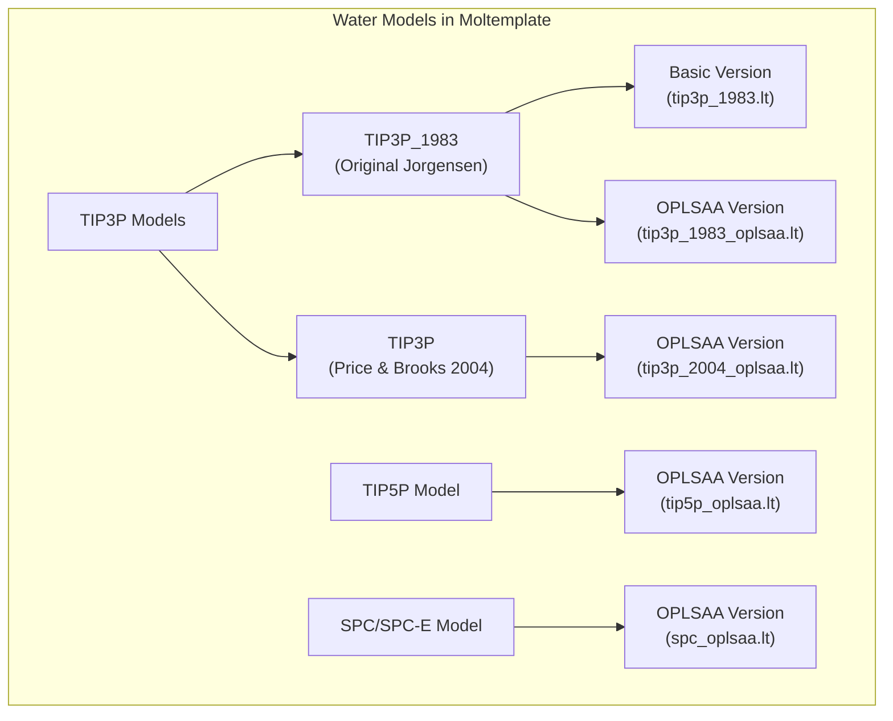
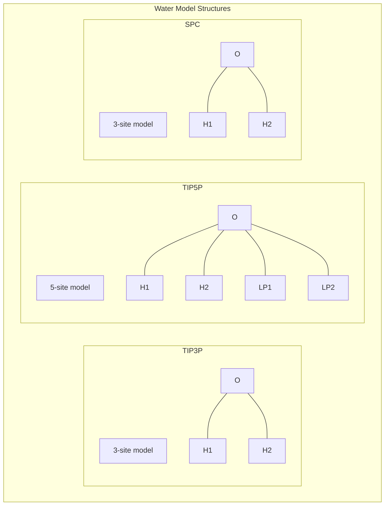
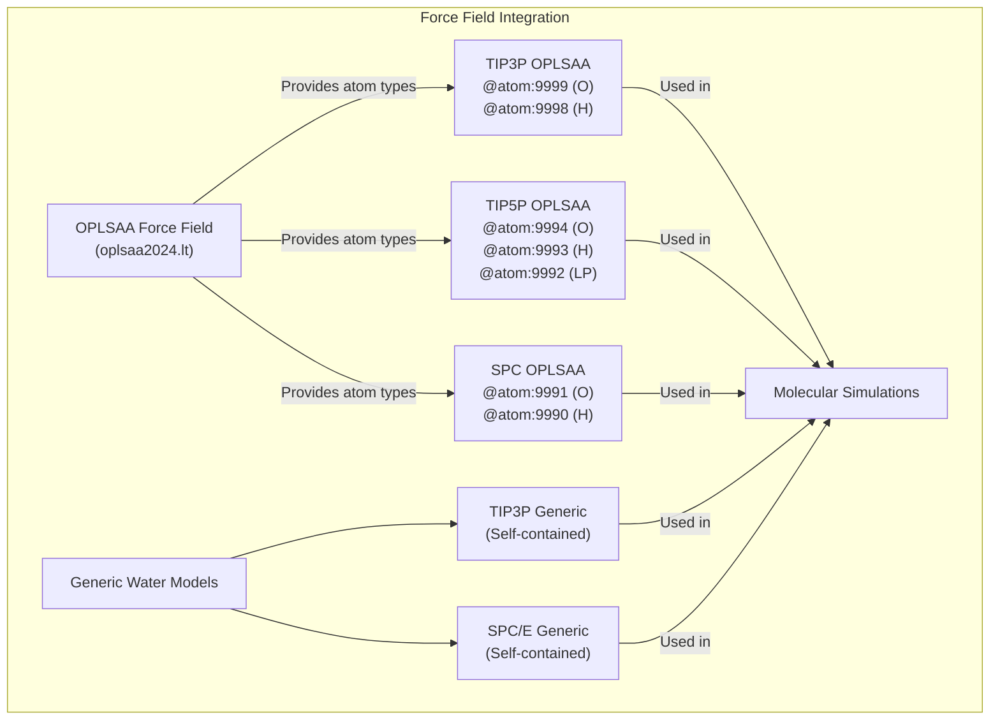

# Water Models

<details>
<summary>Relevant source files</summary>

The following files were used as context for generating this wiki page:

- [examples/all_atom/force_field_OPLSAA/waterTIP3P+methane/README.md](examples/all_atom/force_field_OPLSAA/waterTIP3P+methane/README.md)
- [moltemplate/force_fields/spc_oplsaa.lt](moltemplate/force_fields/spc_oplsaa.lt)
- [moltemplate/force_fields/tip3p_1983.lt](moltemplate/force_fields/tip3p_1983.lt)
- [moltemplate/force_fields/tip3p_1983_oplsaa.lt](moltemplate/force_fields/tip3p_1983_oplsaa.lt)
- [moltemplate/force_fields/tip3p_1983_oplsaa2008.lt](moltemplate/force_fields/tip3p_1983_oplsaa2008.lt)
- [moltemplate/force_fields/tip3p_2004_oplsaa.lt](moltemplate/force_fields/tip3p_2004_oplsaa.lt)
- [moltemplate/force_fields/tip5p_oplsaa.lt](moltemplate/force_fields/tip5p_oplsaa.lt)

</details>


## Purpose and Scope

This page documents the water models available in the Moltemplate system and explains how to use them in molecular simulations. Water models are essential for accurately representing water molecules in molecular dynamics simulations, with different models suitable for different simulation requirements. This documentation covers the implementation details, parameters, and usage patterns for TIP3P, TIP5P, and SPC water models in Moltemplate, with special attention to their integration with the OPLSAA force field.

For information about other force fields available in Moltemplate, see [Force Fields](#5).

Sources: [moltemplate/force_fields/tip3p_1983.lt](), [moltemplate/force_fields/tip3p_2004_oplsaa.lt](), [moltemplate/force_fields/tip5p_oplsaa.lt](), [moltemplate/force_fields/spc_oplsaa.lt]()

## Water Model Overview

Moltemplate supports several widely-used water models that differ in their molecular geometry, charge distribution, and interaction parameters:

1. **TIP3P** (Transferable Intermolecular Potential with 3 Points) - Available in two versions:
   - 1983 Jorgensen version (original)
   - 2004 Price & Brooks version (improved)

2. **TIP5P** (Transferable Intermolecular Potential with 5 Points) - Includes lone pair sites for better tetrahedrality

3. **SPC/SPC-E** (Simple Point Charge) - Popular alternatives to TIP models

The following diagram illustrates the available water models and their components:

### Water Models in Moltemplate



Sources: [moltemplate/force_fields/tip3p_1983.lt](), [moltemplate/force_fields/tip3p_1983_oplsaa.lt](), [moltemplate/force_fields/tip3p_2004_oplsaa.lt](), [moltemplate/force_fields/tip5p_oplsaa.lt](), [moltemplate/force_fields/spc_oplsaa.lt]()

## Molecular Structures and Parameters

The following diagram shows the structural differences between the water models:



### Parameters Comparison

| Water Model | Oxygen Charge | Hydrogen Charge | LP Charge | Bond Length (Å) | HOH Angle (°) | Notes |
|-------------|---------------|-----------------|-----------|----------------|--------------|-------|
| TIP3P (1983) | -0.834 | 0.417 | N/A | 0.9572 | 104.52 | Original Jorgensen model |
| TIP3P (2004) | -0.834 | 0.417 | N/A | 0.9572 | 104.52 | Uses long-range coulombics |
| TIP5P | 0.0 | 0.241 | -0.241 | see file | see file | Has lone pair sites |
| SPC | -0.82 | 0.41 | N/A | 1.0 | 109.47 | Simple Point Charge model |

Sources: [moltemplate/force_fields/tip3p_1983.lt:29-33](), [moltemplate/force_fields/tip3p_2004_oplsaa.lt:44-47](), [moltemplate/force_fields/tip5p_oplsaa.lt:35-40](), [moltemplate/force_fields/spc_oplsaa.lt:32-35]()

## TIP3P Water Models

### TIP3P 1983 Version

The 1983 Jorgensen TIP3P model is the original implementation, often used in CHARMM and AMBER simulations. It features:

- Three interaction sites (O and 2 H atoms)
- Partial charges of -0.834 on O and +0.417 on each H
- SHAKE constraints typically used to maintain rigid geometry
- Different implementations for O-H and H-H interactions (depending on force field)

**Implementation in Moltemplate**:
- Basic version: `tip3p_1983.lt`
- OPLSAA-compatible version: `tip3p_1983_oplsaa.lt`

The implementation includes SHAKE constraints to maintain rigid geometry:

```
fix fShakeTIP3P tip3p shake 0.0001 10 100 b @bond:OH a @angle:HOH
```

Sources: [moltemplate/force_fields/tip3p_1983.lt:89-96](), [moltemplate/force_fields/tip3p_1983_oplsaa.lt:52-71]()

### TIP3P 2004 Version

The 2004 Price & Brooks TIP3P model is an improved version with long-range coulombic interactions:

- Uses the same basic geometry as the 1983 version
- Explicitly includes long-range coulombic interactions
- Recommended for most modern simulations
- Available in an OPLSAA-compatible version: `tip3p_2004_oplsaa.lt`

Implementation example:
```
pair_style   lj/charmm/coul/long 10.0 10.5 10.5
```

Sources: [moltemplate/force_fields/tip3p_2004_oplsaa.lt:1-11](), [moltemplate/force_fields/tip3p_2004_oplsaa.lt:77-78]()

## TIP5P Water Model

The TIP5P model is a more sophisticated five-site water model that better reproduces water's tetrahedral structure:

- Has five interaction sites: O, 2 H atoms, and 2 lone pair (LP) sites
- Oxygen carries no charge (0.0)
- H atoms have +0.241 charge each
- LP sites have -0.241 charge each
- Requires a rigid-body integrator to maintain geometry

Implementation in Moltemplate:
- Available in OPLSAA-compatible version: `tip5p_oplsaa.lt`

The TIP5P implementation includes the following molecular structure:

```
write("Data Atoms") {
  $atom:o   $mol:w @atom:9994  0.0000    0.00000 0.00000 0.00000
  $atom:h1  $mol:w @atom:9993  0.2410    0.00000 0.81649 0.57736
  $atom:h2  $mol:w @atom:9993  0.2410    0.00000 -0.81649 0.57736
  $atom:LP1 $mol:w @atom:9992 -0.2410    0.57154 0.00000 -0.404151
  $atom:LP2 $mol:w @atom:9992 -0.2410   -0.57154 0.00000 -0.404151
}
```

TIP5P molecules must be treated as rigid bodies to prevent deformation, typically using LAMMPS `fix rigid`:

```
group gH2O type @atom:9994 @atom:9993 @atom:9992
```

Sources: [moltemplate/force_fields/tip5p_oplsaa.lt:35-41](), [moltemplate/force_fields/tip5p_oplsaa.lt:53-57]()

## SPC/SPC-E Water Model

The Simple Point Charge (SPC) model is another widely-used three-site water model:

- Three interaction sites (O and 2 H atoms)
- Different charge distribution compared to TIP3P: -0.82 on O and +0.41 on each H
- Bond length of 1.0 Å (longer than TIP3P)
- HOH angle of 109.47° (wider than TIP3P)
- SHAKE constraints typically used to maintain rigid geometry

Implementation in Moltemplate:
- Available in OPLSAA-compatible version: `spc_oplsaa.lt`

The SPC implementation includes SHAKE constraints:

```
fix fShakeSPC spc shake 0.0001 10 100 b @bond:spcO_spcH a @angle:spcH_spcO_spcH
```

Sources: [moltemplate/force_fields/spc_oplsaa.lt:32-36](), [moltemplate/force_fields/spc_oplsaa.lt:47-59]()

## Integration with Force Fields

Water models in Moltemplate are designed to integrate with various force fields, with special attention to OPLSAA compatibility. The following diagram illustrates how water models interact with force fields in the Moltemplate system:



### OPLSAA-Compatible Models

OPLSAA-compatible water models use atom types defined in the OPLSAA force field:

| Water Model | File | Atom Types |
|-------------|------|------------|
| TIP3P | tip3p_2004_oplsaa.lt | @atom:9999 (O), @atom:9998 (H) |
| TIP5P | tip5p_oplsaa.lt | @atom:9994 (O), @atom:9993 (H), @atom:9992 (LP) |
| SPC | spc_oplsaa.lt | @atom:9991 (O), @atom:9990 (H) |

These models inherit from the OPLSAA class and use the atom types and parameters defined in the OPLSAA force field:

```
import "oplsaa2024.lt"  # Import OPLSAA definitions

TIP3P inherits OPLSAA {
  # Model implementation
}
```

Sources: [moltemplate/force_fields/tip3p_2004_oplsaa.lt:35-38](), [moltemplate/force_fields/tip5p_oplsaa.lt:25-27](), [moltemplate/force_fields/spc_oplsaa.lt:24-26]()

## Usage Guidelines

### Choosing a Water Model

- For general-purpose simulations with OPLSAA: Use TIP3P 2004 version (`tip3p_2004_oplsaa.lt`)
- For more accurate simulation of water structure: Use TIP5P (`tip5p_oplsaa.lt`)
- For compatibility with older CHARMM or AMBER simulations: Use TIP3P 1983 version
- For simulations requiring simple water models: Use SPC (`spc_oplsaa.lt`)

### Implementation Notes

1. **SHAKE Constraints**: All water models use SHAKE constraints to maintain rigid geometry:
   ```
   fix fShake[ModelName] [group] shake 0.0001 10 100 b [bond-type] a [angle-type]
   ```

2. **TIP5P Special Requirements**: TIP5P requires a rigid-body integrator:
   ```
   fix rigid [group] rigid molecule
   ```

3. **File Naming**: Newer files use version numbers (e.g., `oplsaa2024.lt` instead of `oplsaa.lt`) to prevent compatibility issues with future updates.

4. **Importing Models**: Include the appropriate water model in your `.lt` file:
   ```
   import "tip3p_2004_oplsaa.lt"  # For TIP3P with OPLSAA
   ```

### Example Usage

For a mixture of water and methane using OPLSAA force field, water molecules might use different models:

```
import "oplsaa2024.lt"      # OPLSAA force field
import "tip3p_2004_oplsaa.lt"  # TIP3P water model
```

See the example at [examples/all_atom/force_field_OPLSAA/waterTIP3P+methane/README.md]() for a complete demonstration.

Sources: [examples/all_atom/force_field_OPLSAA/waterTIP3P+methane/README.md:1-60](), [moltemplate/force_fields/tip5p_oplsaa.lt:65-76](), [moltemplate/force_fields/spc_oplsaa.lt:69-80](), [moltemplate/force_fields/tip3p_2004_oplsaa.lt:93-104]()

---