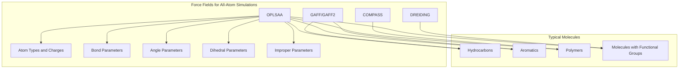
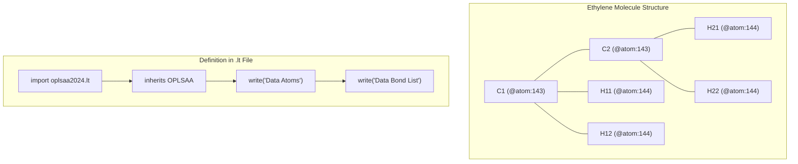
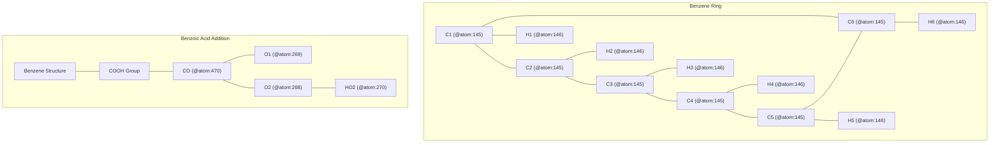
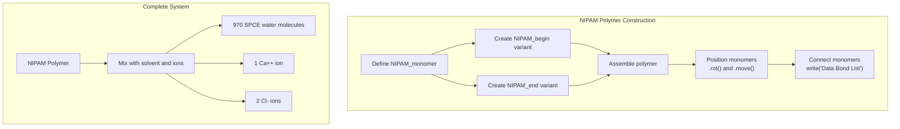
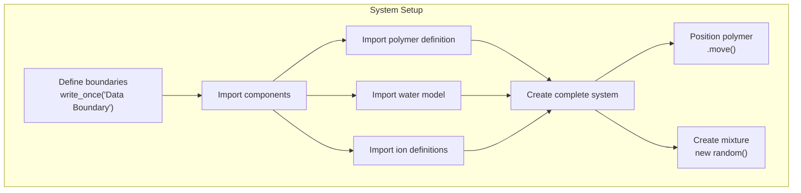
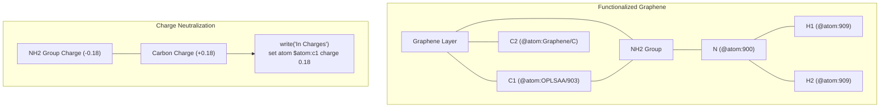
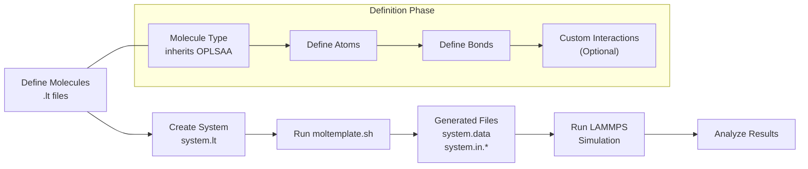

# All-Atom Simulations

<details>
<summary>Relevant source files</summary>

The following files were used as context for generating this wiki page:

- [examples/all_atom/force_field_OPLSAA/NIPAM_polymer+water+ions/README.md](examples/all_atom/force_field_OPLSAA/NIPAM_polymer+water+ions/README.md)
- [examples/all_atom/force_field_OPLSAA/NIPAM_polymer+water+ions/moltemplate_files/NIPAM.lt](examples/all_atom/force_field_OPLSAA/NIPAM_polymer+water+ions/moltemplate_files/NIPAM.lt)
- [examples/all_atom/force_field_OPLSAA/NIPAM_polymer+water+ions/moltemplate_files/NIPAM_polymer_10mer.lt](examples/all_atom/force_field_OPLSAA/NIPAM_polymer+water+ions/moltemplate_files/NIPAM_polymer_10mer.lt)
- [examples/all_atom/force_field_OPLSAA/NIPAM_polymer+water+ions/moltemplate_files/ca++.lt](examples/all_atom/force_field_OPLSAA/NIPAM_polymer+water+ions/moltemplate_files/ca++.lt)
- [examples/all_atom/force_field_OPLSAA/NIPAM_polymer+water+ions/moltemplate_files/cl-.lt](examples/all_atom/force_field_OPLSAA/NIPAM_polymer+water+ions/moltemplate_files/cl-.lt)
- [examples/all_atom/force_field_OPLSAA/NIPAM_polymer+water+ions/moltemplate_files/system.lt](examples/all_atom/force_field_OPLSAA/NIPAM_polymer+water+ions/moltemplate_files/system.lt)
- [examples/all_atom/force_field_OPLSAA/benzene+benzoic_acid/moltemplate_files/benzene.lt](examples/all_atom/force_field_OPLSAA/benzene+benzoic_acid/moltemplate_files/benzene.lt)
- [examples/all_atom/force_field_OPLSAA/benzene+benzoic_acid/moltemplate_files/benzoic_acid.lt](examples/all_atom/force_field_OPLSAA/benzene+benzoic_acid/moltemplate_files/benzoic_acid.lt)
- [examples/all_atom/force_field_OPLSAA/benzene+benzoic_acid/moltemplate_files/optimized_version_using_custom_dihedrals/benzoic_acid_optimizations.lt](examples/all_atom/force_field_OPLSAA/benzene+benzoic_acid/moltemplate_files/optimized_version_using_custom_dihedrals/benzoic_acid_optimizations.lt)
- [examples/all_atom/force_field_OPLSAA/butane/moltemplate_files/butane.lt](examples/all_atom/force_field_OPLSAA/butane/moltemplate_files/butane.lt)
- [examples/all_atom/force_field_OPLSAA/ethylene+benzene/moltemplate_files/benzene.lt](examples/all_atom/force_field_OPLSAA/ethylene+benzene/moltemplate_files/benzene.lt)
- [examples/all_atom/force_field_OPLSAA/ethylene+benzene/moltemplate_files/ethylene.lt](examples/all_atom/force_field_OPLSAA/ethylene+benzene/moltemplate_files/ethylene.lt)
- [examples/all_atom/force_field_OPLSAA/ethylene+benzene_PACKMOL/moltemplate_files/benzene.lt](examples/all_atom/force_field_OPLSAA/ethylene+benzene_PACKMOL/moltemplate_files/benzene.lt)
- [examples/all_atom/force_field_OPLSAA/ethylene+benzene_PACKMOL/moltemplate_files/ethylene.lt](examples/all_atom/force_field_OPLSAA/ethylene+benzene_PACKMOL/moltemplate_files/ethylene.lt)
- [examples/all_atom/force_field_OPLSAA/functionalized_nanotubes_NH2/moltemplate_files/graphene_nh2.lt](examples/all_atom/force_field_OPLSAA/functionalized_nanotubes_NH2/moltemplate_files/graphene_nh2.lt)
- [examples/all_atom/force_field_OPLSAA/functionalized_nanotubes_NH2/moltemplate_files/nh2.lt](examples/all_atom/force_field_OPLSAA/functionalized_nanotubes_NH2/moltemplate_files/nh2.lt)
- [examples/all_atom/force_field_OPLSAA/star_polymer/moltemplate_files/polyethylene16.lt](examples/all_atom/force_field_OPLSAA/star_polymer/moltemplate_files/polyethylene16.lt)
- [examples/all_atom/force_field_OPLSAA/waterSPCE+methane/moltemplate_files/methane.lt](examples/all_atom/force_field_OPLSAA/waterSPCE+methane/moltemplate_files/methane.lt)

</details>


This page describes how to set up and run all-atom simulations using moltemplate, focusing on the structure, organization, and use of force fields for representing molecules at the atomic level. All-atom simulations explicitly model every atom in the system, providing high resolution at the expense of computational cost. For coarse-grained simulations where groups of atoms are treated as single particles, see [Coarse-Grained Simulations](#6.2).

## All-Atom Force Fields in Moltemplate

Moltemplate supports several all-atom force fields, with OPLSAA (Optimized Potential for Liquid Simulations - All Atom) being the most commonly used in the examples. The force field definitions include parameters for atom types, bonds, angles, dihedrals, and impropers.



Sources: [examples/all_atom/force_field_OPLSAA/NIPAM_polymer+water+ions/README.md:1-70](), [examples/all_atom/force_field_OPLSAA/NIPAM_polymer+water+ions/moltemplate_files/NIPAM.lt:1-129]()

## Creating Simple Molecules

Simple molecules are defined by listing their atoms and bonds. The OPLSAA force field automatically assigns appropriate charges and parameters based on atom types.

### Example: Ethylene Definition



The basic structure for defining a simple molecule like ethylene:

1. Import the force field definition
2. Define the molecule that inherits from OPLSAA
3. List all atoms with their coordinates
4. List all bonds between atoms

Sources: [examples/all_atom/force_field_OPLSAA/ethylene+benzene/moltemplate_files/ethylene.lt:1-46](), [examples/all_atom/force_field_OPLSAA/ethylene+benzene/moltemplate_files/benzene.lt:1-60]()

### Atoms and Bonds Definition

For ethylene, atoms are defined with:
- Atom ID (e.g., `$atom:c1`)
- Molecule ID (e.g., `$mol`)
- Atom type from OPLSAA (e.g., `@atom:143`)
- Charge (typically left as 0.0 since OPLSAA assigns charges)
- X, Y, Z coordinates

Bonds are defined with:
- Bond ID (e.g., `$bond:c12`)
- Atom IDs of the two bonded atoms (e.g., `$atom:c1 $atom:c2`)

The OPLSAA force field automatically determines the appropriate bond type based on the atom types.

Sources: [examples/all_atom/force_field_OPLSAA/ethylene+benzene/moltemplate_files/ethylene.lt:1-46](), [examples/all_atom/force_field_OPLSAA/ethylene+benzene_PACKMOL/moltemplate_files/ethylene.lt:1-46]()

## Building Complex Molecules

For more complex molecules like benzene or benzoic acid, the approach is similar but with more atoms and bonds.

### Example: Benzene Definition



Sources: [examples/all_atom/force_field_OPLSAA/benzene+benzoic_acid/moltemplate_files/benzene.lt:1-60](), [examples/all_atom/force_field_OPLSAA/benzene+benzoic_acid/moltemplate_files/benzoic_acid.lt:1-71]()

## Creating Polymers

Polymers are built by connecting multiple monomers. Moltemplate provides a convenient way to create and connect monomers.

### Example: NIPAM Polymer

The NIPAM polymer example demonstrates:
1. Defining a monomer unit (`NIPAM_monomer`)
2. Creating special variants for the polymer ends (`NIPAM_begin`, `NIPAM_end`)
3. Arranging multiple monomers in space with rotation and translation
4. Adding bonds between monomers



Sources: [examples/all_atom/force_field_OPLSAA/NIPAM_polymer+water+ions/moltemplate_files/NIPAM_polymer_10mer.lt:1-58](), [examples/all_atom/force_field_OPLSAA/NIPAM_polymer+water+ions/moltemplate_files/NIPAM.lt:1-129]()

## System Setup and Boundary Conditions

For simulating molecules in a box, you need to define the boundary conditions and arrange the molecules.

### Example: System with Multiple Molecules



Example from NIPAM polymer system:
- Define simulation box boundaries (32.5 × 32.5 × 32.5 Å)
- Position the polymer to avoid overlap with other molecules
- Create a random mixture of water and ions using `new random()`

Sources: [examples/all_atom/force_field_OPLSAA/NIPAM_polymer+water+ions/moltemplate_files/system.lt:1-39]()

## Customizing Interactions

The default parameters provided by the force field might not always be optimal for specific molecules. Moltemplate allows customization of interactions.

### Example: Customizing Dihedrals

For butane, the dihedral interaction between the four carbon atoms can be customized:

```
write("Data Dihedrals") {
  $dihedral:c1_c2_c3_c4 @dihedral:CT_CT_CT_CT__2 $atom:monomer1/c $atom:monomer2/c $atom:monomer3/c $atom:monomer4/c
}
```

Similarly, for benzoic acid:

```
write("Data Dihedrals") {
  $dihedral:o1_co_o2_ho2 @dihedral:O~_C~_OH_HO__2 $atom:o1 $atom:co $atom:o2 $atom:ho2
}
```

Sources: [examples/all_atom/force_field_OPLSAA/butane/moltemplate_files/butane.lt:1-98](), [examples/all_atom/force_field_OPLSAA/benzene+benzoic_acid/moltemplate_files/optimized_version_using_custom_dihedrals/benzoic_acid_optimizations.lt:1-81]()

## Functionalized Systems

Moltemplate can also model more complex systems like functionalized surfaces.

### Example: NH2-Functionalized Graphene



Sources: [examples/all_atom/force_field_OPLSAA/functionalized_nanotubes_NH2/moltemplate_files/nh2.lt:1-49](), [examples/all_atom/force_field_OPLSAA/functionalized_nanotubes_NH2/moltemplate_files/graphene_nh2.lt:1-66]()

## All-Atom Simulation Workflow

The complete workflow for setting up and running all-atom simulations with moltemplate:



Sources: [examples/all_atom/force_field_OPLSAA/NIPAM_polymer+water+ions/README.md:41-49]()

## Common Example Systems

The moltemplate repository includes several all-atom simulation examples:

| Example System | Description | Key Components |
|----------------|-------------|----------------|
| Ethylene+Benzene | Simple aromatics and alkenes | Ethylene (`@atom:143`, `@atom:144`)<br>Benzene (`@atom:145`, `@atom:146`) |
| NIPAM Polymer+Water+Ions | Polymer in solution | NIPAM polymer (10-mer)<br>970 SPC/E water molecules<br>Ca++ and Cl- ions |
| Functionalized Nanotubes | Surface chemistry | Graphene layer<br>NH2 functional group (`@atom:900`, `@atom:909`) |
| Butane | Simple alkane | CH3 and CH2 units<br>Custom dihedral (`@dihedral:CT_CT_CT_CT__2`) |
| Benzene+Benzoic Acid | Mixed aromatics | Benzene<br>Benzoic acid with COOH group |
| Water+Methane | Simple hydrophobic system | SPC/E water<br>Methane (`@atom:138`, `@atom:140`) |

Sources: [examples/all_atom/force_field_OPLSAA/ethylene+benzene/moltemplate_files/ethylene.lt:1-46](), [examples/all_atom/force_field_OPLSAA/NIPAM_polymer+water+ions/README.md:1-70](), [examples/all_atom/force_field_OPLSAA/waterSPCE+methane/moltemplate_files/methane.lt:1-36]()

## Best Practices for All-Atom Simulations

1. **Force Field Selection**: Choose the appropriate force field for your system. OPLSAA works well for organic molecules and common solvents.

2. **Atom Type Assignment**: Ensure correct atom type assignments from the force field. Review atom types in `oplsaa2024.lt` for proper chemical functionality.

3. **Charge Balance**: Ensure the total system charge is neutral or compensated with counterions.

4. **Custom Interactions**: When using specialized molecules, consider customizing dihedral or angle parameters using:
   ```
   moltemplate.sh system.lt -report-duplicates bytype __
   ```
   This will generate warning files identifying ambiguous interaction parameters.

5. **System Size**: Balance system size with computational resources. All-atom simulations can be computationally expensive.

Sources: [examples/all_atom/force_field_OPLSAA/butane/moltemplate_files/butane.lt:50-94](), [examples/all_atom/force_field_OPLSAA/benzene+benzoic_acid/moltemplate_files/optimized_version_using_custom_dihedrals/benzoic_acid_optimizations.lt:35-80]()

---