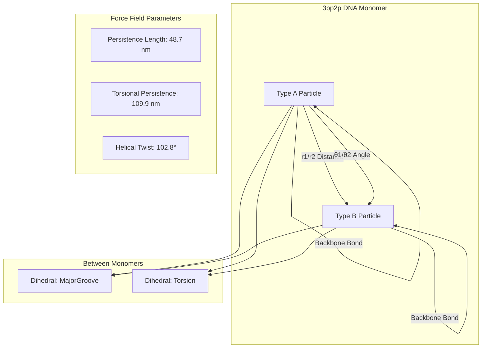
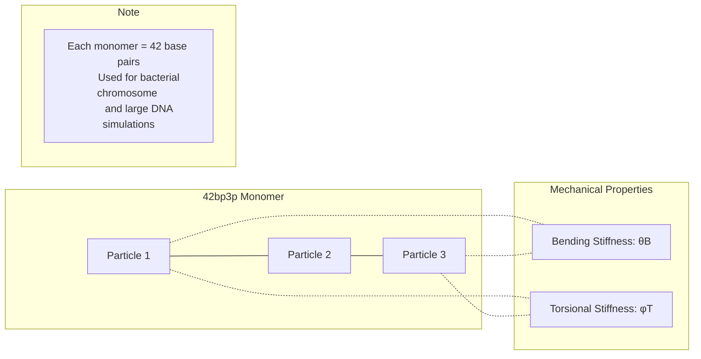
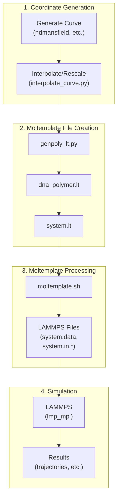
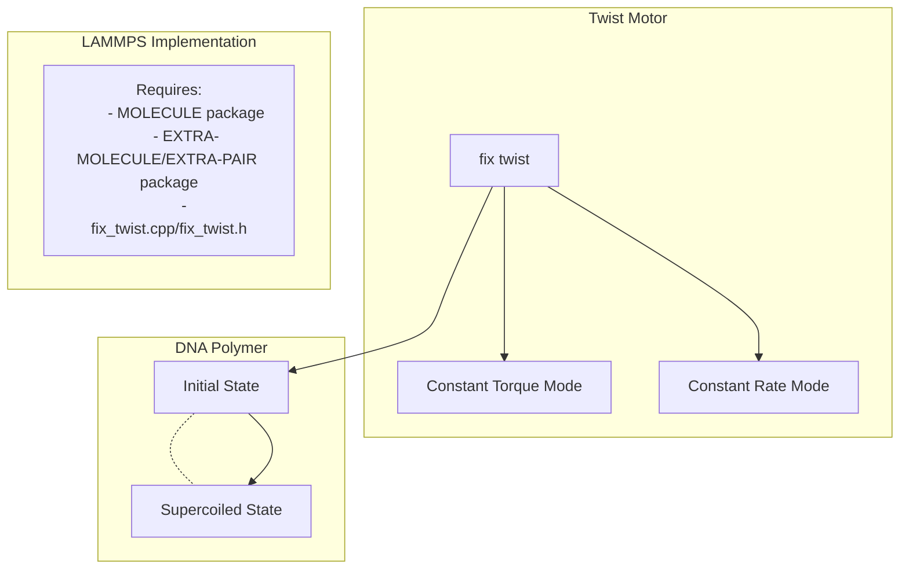
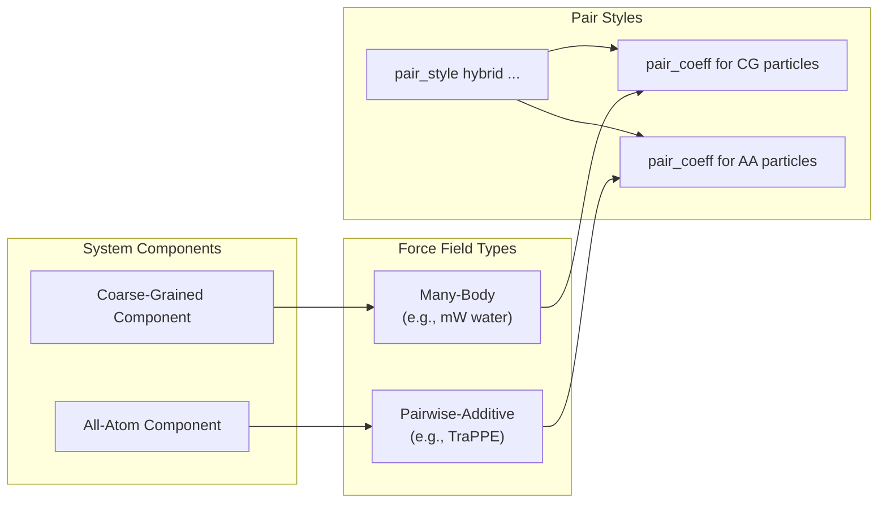

# Coarse-Grained Simulations

<details>
<summary>Relevant source files</summary>

The following files were used as context for generating this wiki page:

- [examples/README.md](examples/README.md)
- [examples/coarse_grained/DNA_models/dsDNA_only/2strands/3bp_2particles/README.md](examples/coarse_grained/DNA_models/dsDNA_only/2strands/3bp_2particles/README.md)
- [examples/coarse_grained/DNA_models/dsDNA_only/2strands/3bp_2particles/confined_viral_DNA/README.md](examples/coarse_grained/DNA_models/dsDNA_only/2strands/3bp_2particles/confined_viral_DNA/README.md)
- [examples/coarse_grained/DNA_models/dsDNA_only/2strands/3bp_2particles/confined_viral_DNA/images/plus.svg](examples/coarse_grained/DNA_models/dsDNA_only/2strands/3bp_2particles/confined_viral_DNA/images/plus.svg)
- [examples/coarse_grained/DNA_models/dsDNA_only/2strands/3bp_2particles/confined_viral_DNA/images/rightarrow.svg](examples/coarse_grained/DNA_models/dsDNA_only/2strands/3bp_2particles/confined_viral_DNA/images/rightarrow.svg)
- [examples/coarse_grained/DNA_models/dsDNA_only/2strands/3bp_2particles/images/twist_motor_3bp2p_LLR.jpg](examples/coarse_grained/DNA_models/dsDNA_only/2strands/3bp_2particles/images/twist_motor_3bp2p_LLR.jpg)
- [examples/coarse_grained/DNA_models/dsDNA_only/2strands/3bp_2particles/simple_dna_example/README.md](examples/coarse_grained/DNA_models/dsDNA_only/2strands/3bp_2particles/simple_dna_example/README.md)
- [examples/coarse_grained/DNA_models/dsDNA_only/2strands/3bp_2particles/twist_motor_supercoiling/README.md](examples/coarse_grained/DNA_models/dsDNA_only/2strands/3bp_2particles/twist_motor_supercoiling/README.md)
- [examples/coarse_grained/DNA_models/dsDNA_only/twistable_Kratky-Porod/42bp_3particles/nucleoid_Ccrescentus_DNA_only/README.md](examples/coarse_grained/DNA_models/dsDNA_only/twistable_Kratky-Porod/42bp_3particles/nucleoid_Ccrescentus_DNA_only/README.md)
- [examples/coarse_grained/DNA_models/dsDNA_only/twistable_Kratky-Porod/42bp_3particles/twist_motor_supercoiling/README.md](examples/coarse_grained/DNA_models/dsDNA_only/twistable_Kratky-Porod/42bp_3particles/twist_motor_supercoiling/README.md)
- [examples/coarse_grained/DNA_models/dsDNA_only/twistable_Kratky-Porod/images/DNA_models_similar_to_Benedetti++Stasiak_NAR2014.jpg](examples/coarse_grained/DNA_models/dsDNA_only/twistable_Kratky-Porod/images/DNA_models_similar_to_Benedetti++Stasiak_NAR2014.jpg)
- [examples/coarse_grained/DNA_models/dsDNA_only/twistable_Kratky-Porod/images/twist_motor_LLR.jpg](examples/coarse_grained/DNA_models/dsDNA_only/twistable_Kratky-Porod/images/twist_motor_LLR.jpg)
- [examples/coarse_grained/simple_examples/polymer_translocation/README.md](examples/coarse_grained/simple_examples/polymer_translocation/README.md)
- [examples/coarse_grained/solvent_models/ELBAwater+methanol/README.md](examples/coarse_grained/solvent_models/ELBAwater+methanol/README.md)
- [examples/coarse_grained/solvent_models/manybodywaterMW+hydrocarbonsTraPPE/README.md](examples/coarse_grained/solvent_models/manybodywaterMW+hydrocarbonsTraPPE/README.md)

</details>


## Introduction

This page documents the coarse-grained simulation capabilities in moltemplate, focusing on how to prepare and run molecular simulations where groups of atoms are represented by single interaction sites. Coarse-grained models enable simulations of larger molecular systems and longer time scales than all-atom models by reducing the number of particles and degrees of freedom. For information about all-atom simulations, see [All-Atom Simulations](#6.1).

Moltemplate supports several coarse-grained models, with particular emphasis on DNA models, but also includes examples for polymer systems, solvents, and mixed all-atom/coarse-grained systems.

Sources: `examples/coarse_grained/DNA_models/dsDNA_only/2strands/3bp_2particles/simple_dna_example/README.md`, `examples/coarse_grained/DNA_models/dsDNA_only/twistable_Kratky-Porod/42bp_3particles/nucleoid_Ccrescentus_DNA_only/README.md`

## Coarse-Grained Models Overview

Moltemplate includes several coarse-grained models designed for different simulation needs:

### DNA Models

DNA models are extensively represented in the moltemplate examples, with two main model types:

#### 3bp2p Model

The 3bp2p (3 base pairs = 2 particles) model represents DNA with explicit double-helical shape. Each monomer consists of 2 particles and represents 3 base pairs of DNA.

Key properties of the 3bp2p model:
- Double-helical conformation with major and minor grooves
- Can be bent without kinking or numerical instability
- Adjusted masses to allow for timestep of 1.0
- Parameterized to match experimental values:

| Property | 3bp2p Model | Experimental | Reference |
|----------|-------------|--------------|-----------|
| Persistence length | 48.7101 nm | 46-48 nm | [1] |
| Torsional persistence length | 109.9752 nm | 100-110 nm | [1] |
| Helical twist angle (per 3bp) | 102.7797 deg | - | - |
| Helical twist angle (per bp) | 34.2599 deg | 34.3 deg | [2] |
| Distance along axis (per 3bp) | 0.98293 nm | - | - |
| Distance along axis (per bp) | 0.32764 nm | 0.332 nm | [3] |

#### 42bp3p Model

The 42bp3p (42 base pairs = 3 particles) model is used for simulations of longer DNA molecules such as bacterial chromosomes. Each monomer consists of 3 particles and represents 42 base pairs of DNA.

### Other Coarse-Grained Models

- **MARTINI** - A popular coarse-grained force field that maps approximately 4 heavy atoms to one coarse-grained bead
- **Many-body water (mW)** - A water model that doesn't require explicit hydrogen atoms
- **ELBA water** - A coarse-grained water model that can be combined with all-atom solutes

Sources: `examples/coarse_grained/DNA_models/dsDNA_only/2strands/3bp_2particles/simple_dna_example/README.md`, `examples/coarse_grained/DNA_models/dsDNA_only/twistable_Kratky-Porod/42bp_3particles/nucleoid_Ccrescentus_DNA_only/README.md`, `examples/coarse_grained/DNA_models/dsDNA_only/2strands/3bp_2particles/README.md`

## DNA Model Implementation

The DNA models in moltemplate are implemented with a focus on reproducing key physical properties of DNA through carefully parameterized force fields.

### 3bp2p Model Structure

The 3bp2p model uses specialized bond, angle, and dihedral terms to represent the complex mechanical properties of DNA.

Diagram: 3bp2p Model Structure and Interactions



Sources: `examples/coarse_grained/DNA_models/dsDNA_only/2strands/3bp_2particles/simple_dna_example/README.md`

### 42bp3p Model Structure

The 42bp3p model follows a similar approach but represents a larger segment of DNA per monomer.

Diagram: 42bp3p Model for Simulating Longer DNA



Sources: `examples/coarse_grained/DNA_models/dsDNA_only/twistable_Kratky-Porod/42bp_3particles/nucleoid_Ccrescentus_DNA_only/README.md`, `examples/coarse_grained/DNA_models/dsDNA_only/twistable_Kratky-Porod/42bp_3particles/twist_motor_supercoiling/README.md`

## Setting Up a Coarse-Grained Simulation

Setting up a coarse-grained simulation in moltemplate typically follows these steps:

### 1. Generate Initial Coordinates

For DNA and polymer simulations, you first need to generate a curve representing the polymer's initial path. Moltemplate examples use tools like:
- Simple geometric shapes (circles, straight lines)
- Random space-filling curves using `ndmansfield`
- Interpolation and rescaling with `interpolate_curve.py`

### 2. Convert Coordinates to Moltemplate Files

The `genpoly_lt.py` tool converts the curve into a moltemplate file defining the polymer:

```
genpoly_lt.py -helix 102.7797 \
              -polymer-name 'DNAPolymer' \
              -monomer-name 'DNAMonomer' \
              -inherits 'DNAForceField' \
              -header 'import "dna_monomer.lt"' \
              -bond Backbone a a \
              -bond Backbone b b \
              -dihedral MajorGroove b b a a 0 1 1 2 \
              -dihedral Torsion a a b b 1 0 0 1 \
              -padding 20,20,20 \
              < curve_smooth.txt > dna_polymer.lt
```

### 3. Run Moltemplate

Use moltemplate to generate LAMMPS input files:

```
moltemplate.sh system.lt
```

This generates:
- `system.data` (LAMMPS data file with coordinates and topology)
- `system.in.init` (LAMMPS commands for initialization)
- `system.in.settings` (LAMMPS commands for force field parameters)
- Additional files as needed (like `system.in.charges`)

### 4. Run LAMMPS Simulation

Run the simulation with LAMMPS using the generated files.

Diagram: Coarse-Grained Simulation Workflow



Sources: `examples/coarse_grained/DNA_models/dsDNA_only/2strands/3bp_2particles/confined_viral_DNA/README.md`, `examples/README.md`

## Example Applications

### Confined Viral DNA

This example demonstrates how to confine a coarse-grained DNA polymer within an arbitrary shaped container, specifically the HIV viral capsid.

Workflow:
1. Generate a random self-avoiding curve with `ndmansfield`
2. Smooth the curve with `interpolate_curve.py`
3. Create polymer along this curve with `genpoly_lt.py`
4. Confine within a viral capsid container

This example illustrates how to:
- Create confined polymers
- Work with arbitrary container geometries
- Simulate DNA in a biologically relevant environment

Sources: `examples/coarse_grained/DNA_models/dsDNA_only/2strands/3bp_2particles/confined_viral_DNA/README.md`

### Twist Motors and DNA Supercoiling

These examples demonstrate how to apply torsional forces to DNA, causing it to supercoil. Two approaches are implemented:

1. Motors that apply a constant torque to the polymer
2. Motors that twist at a constant rate

Diagram: DNA Twist Motor Implementation



These models are useful for studying:
- DNA supercoiling mechanisms
- Effects of topological constraints on DNA
- Biological processes involving DNA twisting

Sources: `examples/coarse_grained/DNA_models/dsDNA_only/2strands/3bp_2particles/twist_motor_supercoiling/README.md`, `examples/coarse_grained/DNA_models/dsDNA_only/twistable_Kratky-Porod/42bp_3particles/twist_motor_supercoiling/README.md`

### Bacterial Nucleoid Model

This example models an entire bacterial chromosome (4Mbp in length) using the 42bp3p model.

Key features:
- Circular DNA polymer representing a bacterial chromosome
- Distributed twist motors to maintain superhelical density
- Simulation of DNA relaxation after replication
- Realistic cell confinement

This model demonstrates how coarse-grained simulations can approach biologically relevant length scales.

Sources: `examples/coarse_grained/DNA_models/dsDNA_only/twistable_Kratky-Porod/42bp_3particles/nucleoid_Ccrescentus_DNA_only/README.md`

### Mixed Coarse-Grained/All-Atom Systems

Moltemplate can combine different types of models in the same simulation:

1. **Many-body water + hydrocarbons**: Combines non-pairwise-additive mW water model with pairwise-additive TraPPE force field for hydrocarbons
2. **ELBA water + all-atom solutes**: Mixes coarse-grained ELBA water with all-atom solute molecules

Diagram: Mixing Force Field Types in Moltemplate



These examples demonstrate moltemplate's flexibility in handling heterogeneous simulation systems.

Sources: `examples/coarse_grained/solvent_models/manybodywaterMW+hydrocarbonsTraPPE/README.md`, `examples/coarse_grained/solvent_models/ELBAwater+methanol/README.md`

## Prerequisites and Technical Requirements

### LAMMPS Packages

Most coarse-grained simulations in moltemplate require specific LAMMPS packages:

- **MOLECULE** package: Required for most molecular simulations
- **EXTRA-MOLECULE** or **EXTRA-PAIR** package: Needed for specialized bond and dihedral styles
- **MANYBODY** package: Required for many-body potentials like the mW water model
- **DIPOLE** package: Required for the ELBA water model
- **RIGID** package: Needed for some constant pressure simulations

### Specialized Features

Some examples require additional features not in the standard LAMMPS distribution:

- **fix twist**: Required for twist motor simulations, must be added manually:
  - Download `fix_twist.cpp` and `fix_twist.h` from https://github.com/jewettaij/lammps/tree/fix_twist/src/USER-MISC
  - Copy to LAMMPS `src/` directory
  - Recompile LAMMPS

If you receive errors like "Unknown dihedral style" or "Unknown fix", it typically means you need to enable additional LAMMPS packages or features.

Sources: `examples/coarse_grained/DNA_models/dsDNA_only/twistable_Kratky-Porod/42bp_3particles/twist_motor_supercoiling/README.md`, `examples/coarse_grained/DNA_models/dsDNA_only/2strands/3bp_2particles/simple_dna_example/README.md`

## References

1. Kriegel, F., Ermann, N., Forbes, R., Dulin, D., Dekker, N.H. and Lipfert, J., Nucleic Acids Research (2017), Vol. 45, No. 10, pp.5920-5929
2. Sinden, Richard R. (1994-01-15). "DNA structure and function" (1st ed.). Academic Press. p. 398. ISBN 0-12-645750-6
3. Theodore J. Zwang, Sylvia Hurlimann, Michael G. Hill, and Jacque-line K. Barton, J Am Chem Soc (2016), 138(48):15551-15554
4. F. Benedetti, J. Dorier, Y. Burnier, and A. Stasiak, Nucleic Acids Research (2014) Vol. 42, No. 5, 2848-2855
5. Molinero, V. and Moore, E.B., J. Phys. Chem. B 2009, 113, 4008-4016 (mW water model)
6. Orsi, Mario, Wei Ding, and Michail Palaiokostas. "Direct mixing of atomistic solutes and coarse-grained water." Journal of chemical theory and computation 10.10 (2014): 4684-4693 (ELBA water model)

---