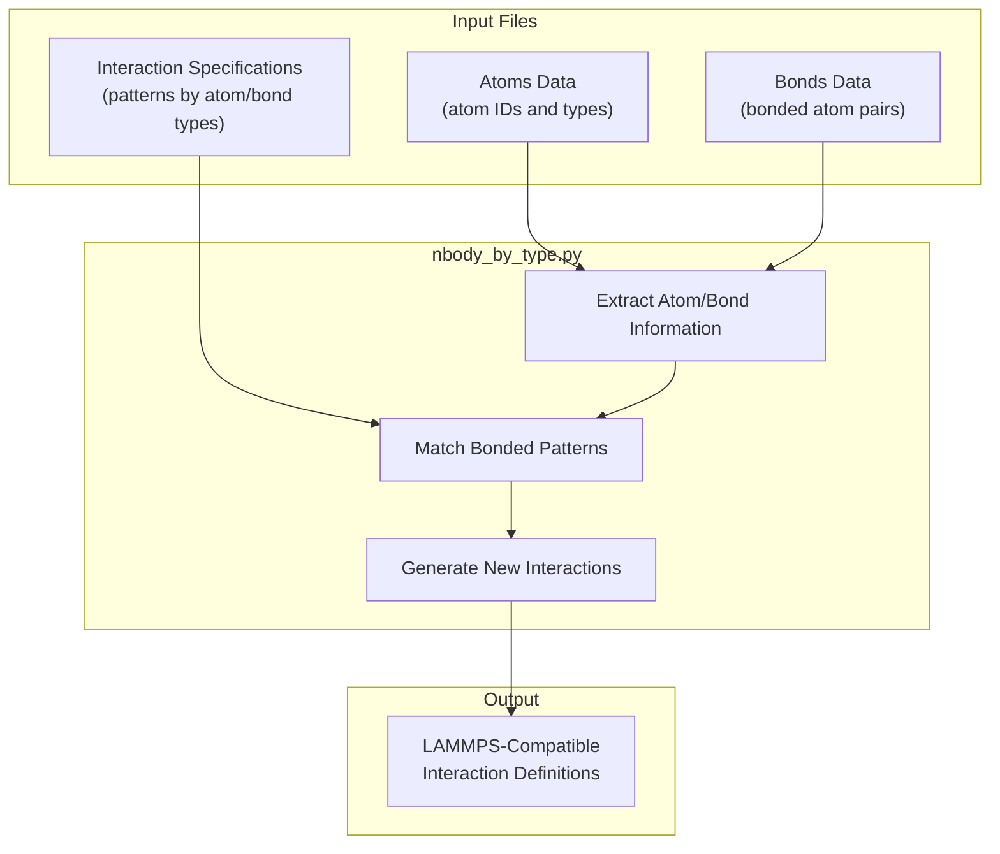
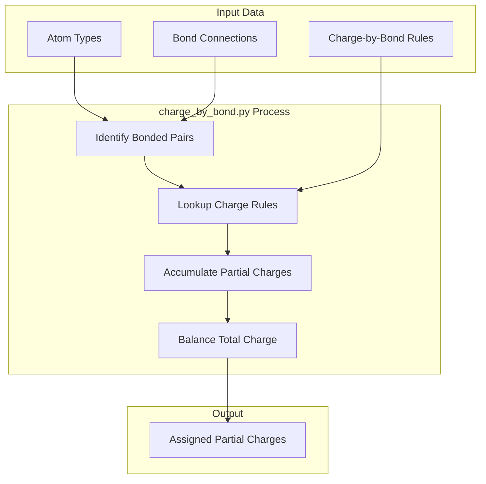
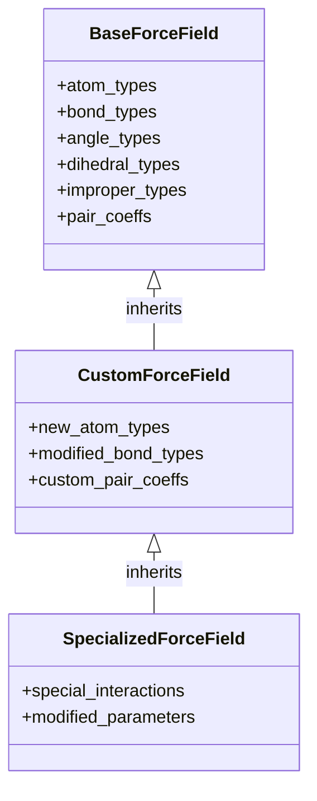
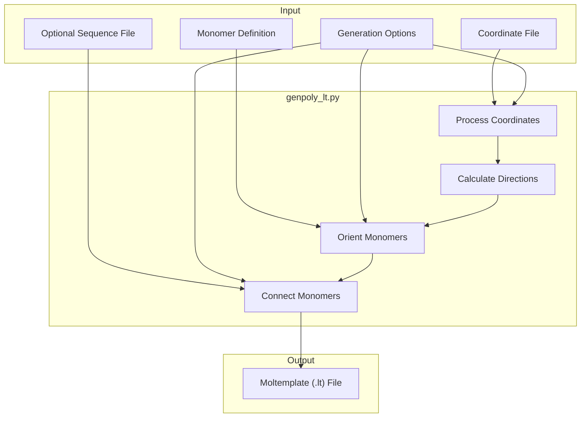
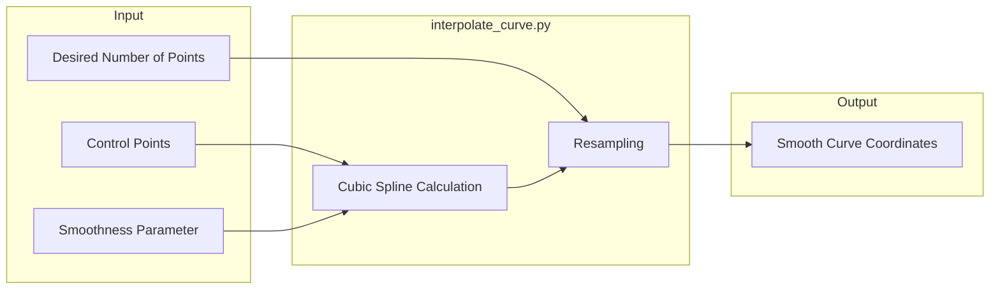
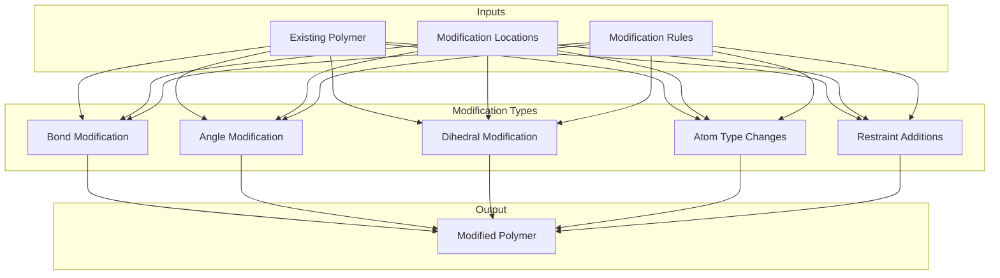
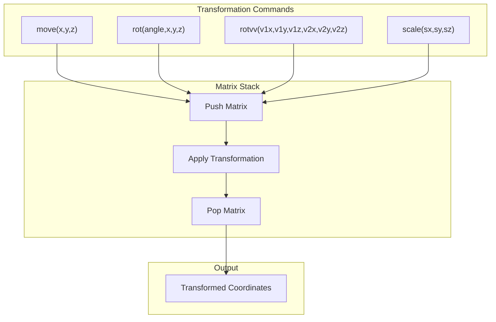

# Advanced Topics

<details>
<summary>Relevant source files</summary>

The following files were used as context for generating this wiki page:

- [doc/doc_dump2data.md](doc/doc_dump2data.md)
- [doc/doc_genpoly_lt.md](doc/doc_genpoly_lt.md)
- [doc/doc_genpoly_modify_lt.md](doc/doc_genpoly_modify_lt.md)
- [doc/doc_interpolate_curve.md](doc/doc_interpolate_curve.md)
- [doc/doc_raw2data.md](doc/doc_raw2data.md)
- [examples/coarse_grained/DNA_models/dsDNA_only/2strands/3bp_2particles/confined_viral_DNA/moltemplate_files/wall.lt](examples/coarse_grained/DNA_models/dsDNA_only/2strands/3bp_2particles/confined_viral_DNA/moltemplate_files/wall.lt)
- [moltemplate/bonds_by_type.py](moltemplate/bonds_by_type.py)
- [moltemplate/charge_by_bond.py](moltemplate/charge_by_bond.py)
- [moltemplate/dump2data.py](moltemplate/dump2data.py)
- [moltemplate/genpoly_lt.py](moltemplate/genpoly_lt.py)
- [moltemplate/genpoly_modify_lt.py](moltemplate/genpoly_modify_lt.py)
- [moltemplate/interpolate_curve.py](moltemplate/interpolate_curve.py)
- [moltemplate/lttree.py](moltemplate/lttree.py)
- [moltemplate/lttree_check.py](moltemplate/lttree_check.py)
- [moltemplate/lttree_postprocess.py](moltemplate/lttree_postprocess.py)
- [moltemplate/lttree_styles.py](moltemplate/lttree_styles.py)
- [moltemplate/nbody_by_type.py](moltemplate/nbody_by_type.py)
- [moltemplate/nbody_by_type_lib.py](moltemplate/nbody_by_type_lib.py)
- [moltemplate/nbody_fix_ttree_assignments.py](moltemplate/nbody_fix_ttree_assignments.py)
- [moltemplate/pdbsort.py](moltemplate/pdbsort.py)
- [moltemplate/raw2data.py](moltemplate/raw2data.py)
- [moltemplate/ttree.py](moltemplate/ttree.py)
- [moltemplate/ttree_matrix_stack.py](moltemplate/ttree_matrix_stack.py)
- [moltemplate/ttree_render.py](moltemplate/ttree_render.py)
- [tests/test_genpoly_lt.py](tests/test_genpoly_lt.py)

</details>


This page covers advanced features and techniques in Moltemplate that extend beyond basic molecule construction. These topics are particularly useful for researchers creating complex molecular systems, custom force fields, or specialized simulations.

The advanced capabilities discussed here include N-body interaction generation, automatic charge assignment, and techniques for customizing force fields. For basic usage information, see [Overview](#1), and for force field information, see [Force Fields](#5).

## N-body Interactions

Moltemplate provides powerful tools for automatically generating many-body interactions (angles, dihedrals, impropers) based on atom and bond types rather than requiring manual specification of each interaction. This approach dramatically simplifies the creation of complex molecular systems with consistent bonded interactions.

### Automated Interaction Generation with nbody_by_type.py

The `nbody_by_type.py` tool reads information about atoms and bonds and automatically generates N-body interactions according to specified patterns. It works alongside Moltemplate to generate LAMMPS-compatible interaction definitions.



Sources: [moltemplate/nbody_by_type.py:127-172](), [moltemplate/nbody_by_type.py:180-223]()

#### Specifying Interaction Patterns

Interaction patterns are defined in sections like "Angles By Type", "Dihedrals By Type", or "Impropers By Type". The syntax for these patterns allows you to specify which atom and bond types should create specific interaction types.

For example, an Angle By Type specification might look like:

```
Angle By Type
7 1 2 1 * *
8 2 2 * * *
9 3 4 3 * *
```

Where:
- First column: interaction type ID
- Next columns: atom type patterns (three for angles)
- Final columns: bond type patterns (two for angles)
- `*` serves as a wildcard matching any type

Sources: [moltemplate/nbody_by_type.py:40-56](), [moltemplate/nbody_by_type_lib.py:41-57]()

### Advanced Pattern Matching

Beyond simple wildcards, the system supports regular expressions for sophisticated pattern matching. To use a regular expression, enclose the pattern in forward slashes:

```
Angle By Type
10 /1|2/ 3 /1|2/ * *  # Match atom types 1 OR 2 on both ends
```

This flexibility allows for complex rule sets that can handle polymers, proteins, and other intricate molecular structures with minimal manual intervention.

Sources: [moltemplate/nbody_by_type.py:53-56](), [moltemplate/nbody_by_type_lib.py:98-120]()

## Automatic Charge Assignment

For force fields that use partial charges, Moltemplate provides tools to automatically assign charges based on bond patterns, eliminating the need to manually specify charges for each atom.

### Charge-by-Bond Mechanism

The `charge_by_bond.py` utility assigns partial charges to atoms based on the types of bonds they participate in. This approach is particularly useful for organic molecules where charge distributions follow predictable patterns based on connectivity.



Sources: [moltemplate/charge_by_bond.py:28-53](), [moltemplate/charge_by_bond.py:90-120]()

### Charge-by-Bond Syntax

Charge rules are specified in a "Charge By Bond" section with the following format:

```
Charge By Bond
# atom_type1 atom_type2  charge1  charge2
C H 0.1 -0.1
O C 0.2 -0.2
```

Each line specifies:
1. Two atom types involved in a bond
2. The partial charge to add to the first atom type
3. The partial charge to add to the second atom type

The total charge accumulated on each atom is the sum of all charge contributions from its bonds.

Sources: [moltemplate/charge_by_bond.py:145-175]()

## Customizing Force Fields

Moltemplate's template-based approach makes it straightforward to customize existing force fields or create entirely new ones.

### Force Field Inheritance

One of the most powerful features of Moltemplate is the ability to inherit and extend existing force fields through the template system.



To inherit from an existing force field, use the `inherits` keyword:

```
CustomForceField inherits OPLSAA {
   # Override or add new parameters here
   write_once("Data Pair Coeffs") {
     @atom:NewType  epsilon  sigma  # New atom type
   }
}
```

Sources: [moltemplate/ttree.py:621-641](), [moltemplate/lttree.py:290-301]()

### Modifying Existing Parameters

You can override parameters from parent force fields by redefining them in your custom force field. For example:

```
CustomForceField inherits OPLSAA {
   # Override epsilon parameter for atom type C
   write_once("Data Pair Coeffs") {
     @atom:C  0.07  3.55  # modified epsilon value
   }
}
```

This allows selective customization while maintaining compatibility with the base force field.

Sources: [moltemplate/lttree_check.py:296-312]()

## Polymer Generation and Modification

Moltemplate includes sophisticated tools for creating and modifying polymers along arbitrary paths.

### Advanced Polymer Generation

The `genpoly_lt.py` utility creates polymers whose monomers follow specified coordinates with proper orientation. This allows for complex structures like circular DNA, proteins with specific secondary structures, or polymers following arbitrary curves.



Key features include:
- Placement of monomers along an arbitrary curve
- Proper orientation of each monomer along the polymer axis
- Optional helical twist between monomers
- Support for heteropolymers with different monomer types
- Automatic bond, angle, and dihedral generation

Sources: [moltemplate/genpoly_lt.py:400-415](), [moltemplate/genpoly_lt.py:766-797]()

### Curve Interpolation for Smooth Paths

For creating polymers that follow smooth paths, the `interpolate_curve.py` utility provides cubic spline interpolation to generate evenly spaced points along a curve.



This allows creation of polymers that follow complex but smooth paths, such as space-filling curves or specific geometric shapes.

Sources: [moltemplate/interpolate_curve.py:30-66](), [doc/doc_interpolate_curve.md:10-33]()

### Selective Polymer Modification

The `genpoly_modify_lt.py` utility allows you to modify specific locations along an existing polymer, which is valuable for introducing defects, functional groups, or special interaction sites.



You can specify modification locations:
- Explicitly in a file
- Periodically along the polymer
- Randomly distributed with a specified seed

Sources: [moltemplate/genpoly_modify_lt.py:33-58](), [moltemplate/genpoly_modify_lt.py:165-170](), [doc/doc_genpoly_modify_lt.md:9-33]()

## Advanced Template Features

Moltemplate's templating system is both powerful and flexible, allowing for sophisticated constructions beyond simple molecule definitions.

### Matrix Transformations

The template system supports matrix operations for rotating, translating, and otherwise transforming molecular structures.



These transformations can be composed to create complex molecular arrangements or to orient molecules in specific ways.

Sources: [moltemplate/ttree_matrix_stack.py:129-152](), [moltemplate/ttree_matrix_stack.py:250-334]()

### Nested Templates and Hierarchical Structures

Moltemplate's template system allows for nested definitions, making it possible to build complex hierarchical structures:

```
Polymer {
  Monomer {
    # Monomer definition
  }
  
  # Create polymer from monomers
  monomers[0] = new Monomer
  monomers[1] = new Monomer.move(1,0,0)
  # ...and so on
}

# Create multiple polymers
polymer1 = new Polymer
polymer2 = new Polymer.move(0,10,0)
```

This hierarchical approach allows for reuse of components at multiple levels of organization.

Sources: [moltemplate/ttree.py:109-147](), [moltemplate/lttree.py:720-756]()

## Summary

The advanced features of Moltemplate provide powerful tools for tackling complex molecular simulations. By leveraging automated N-body interaction generation, charge assignment, template inheritance, and sophisticated polymer generation capabilities, researchers can efficiently create highly customized molecular systems while maintaining consistency and flexibility.

These advanced topics build upon the core concepts of Moltemplate to enable more sophisticated molecular modeling workflows, custom force field development, and specialized simulation setups.

---