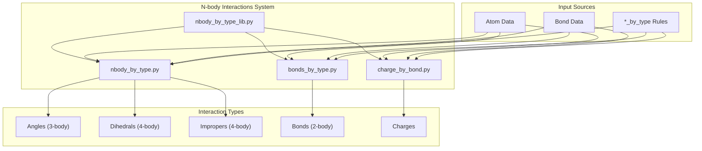
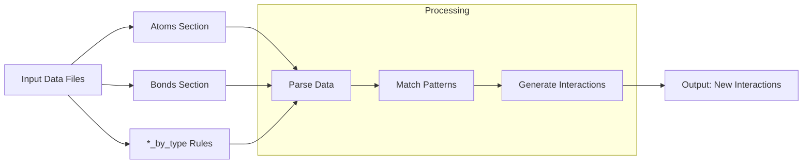
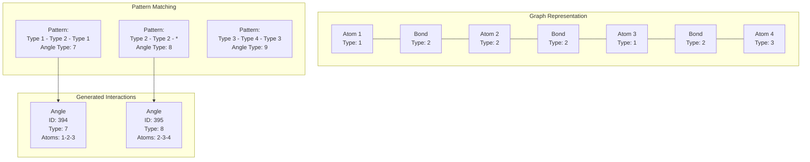
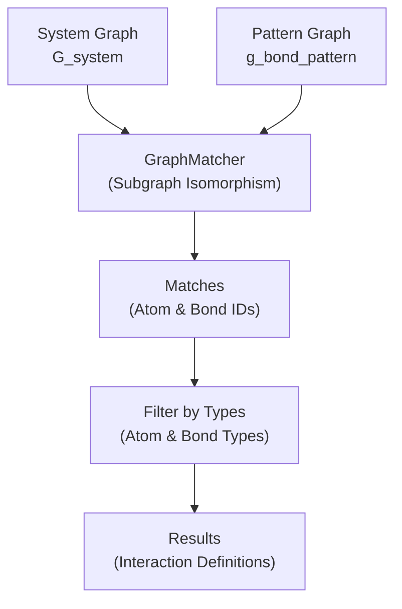

# N-body Interactions

<details>
<summary>Relevant source files</summary>

The following files were used as context for generating this wiki page:

- [moltemplate/bonds_by_type.py](moltemplate/bonds_by_type.py)
- [moltemplate/charge_by_bond.py](moltemplate/charge_by_bond.py)
- [moltemplate/dump2data.py](moltemplate/dump2data.py)
- [moltemplate/lttree.py](moltemplate/lttree.py)
- [moltemplate/lttree_check.py](moltemplate/lttree_check.py)
- [moltemplate/lttree_postprocess.py](moltemplate/lttree_postprocess.py)
- [moltemplate/lttree_styles.py](moltemplate/lttree_styles.py)
- [moltemplate/nbody_by_type.py](moltemplate/nbody_by_type.py)
- [moltemplate/nbody_by_type_lib.py](moltemplate/nbody_by_type_lib.py)
- [moltemplate/nbody_fix_ttree_assignments.py](moltemplate/nbody_fix_ttree_assignments.py)
- [moltemplate/raw2data.py](moltemplate/raw2data.py)
- [moltemplate/ttree.py](moltemplate/ttree.py)
- [moltemplate/ttree_matrix_stack.py](moltemplate/ttree_matrix_stack.py)
- [moltemplate/ttree_render.py](moltemplate/ttree_render.py)

</details>


## Purpose and Scope

This page documents the N-body interactions system in Moltemplate, which automatically generates many-body interactions (angles, dihedrals, impropers) based on atom types and connectivity patterns. This system is essential for constructing complete molecular topologies without manually defining all interactions. For information about customizing force fields, see [Customizing Force Fields](#7.2).

## Overview

N-body interactions refer to the bonded interactions involving three or more atoms in molecular simulations. The N-body interactions system in Moltemplate provides tools to automatically generate these interactions based on atom types and bond patterns, which simplifies the creation of complex molecular structures.



Sources: [moltemplate/nbody_by_type.py:1-138](), [moltemplate/nbody_by_type_lib.py:1-40](), [moltemplate/bonds_by_type.py:1-22](), [moltemplate/charge_by_bond.py:1-26]()

## Components and Workflow

The N-body interactions system consists of several Python modules that work together to process atom and bond data and generate many-body interactions based on defined patterns.

### Main Components

```mermaid
classDiagram
    class nbody_by_type {
        +GenInteractions_lines()
        +GenInteractions_files()
        +ParseArgs()
        +main()
    }
    
    class nbody_by_type_lib {
        +GenInteractions_int()
        +GenInteractions_str()
    }
    
    class charge_by_bond {
        +LookupChargePairs()
        +main()
    }
    
    class bonds_by_type {
        +LookupBondTypes()
        +main()
    }
    
    nbody_by_type --> nbody_by_type_lib: uses
    nbody_by_type --> "nbody_Angles.py": imports
    nbody_by_type --> "nbody_Dihedrals.py": imports
    nbody_by_type --> "nbody_Impropers.py": imports
    bonds_by_type --> nbody_by_type_lib: shares patterns
    charge_by_bond --> nbody_by_type_lib: shares patterns
```

Sources: [moltemplate/nbody_by_type.py:38-151](), [moltemplate/nbody_by_type_lib.py:41-193](), [moltemplate/bonds_by_type.py:28-75](), [moltemplate/charge_by_bond.py:13-40]()

### Data Flow



Sources: [moltemplate/nbody_by_type.py:181-287](), [moltemplate/nbody_by_type_lib.py:41-193]()

## How It Works

### Pattern Matching and Graph Searching

The N-body interaction system uses graph pattern matching to identify sets of atoms that should participate in multi-body interactions. The core algorithm is implemented in `nbody_by_type_lib.py`.

1. **System Representation**: The molecular system is represented as a graph where:
   - Atoms are vertices with atom types as attributes
   - Bonds are edges with bond types as attributes

2. **Pattern Definition**: The user defines patterns for interactions in the form of:
   - Atom type patterns (e.g., `1 2 1` for a 3-body angle interaction)
   - Bond type patterns (optional)

3. **Pattern Matching**: The system searches for subgraphs that match the defined patterns using a graph matching algorithm.

4. **Interaction Generation**: When matches are found, new interaction definitions are generated.



Sources: [moltemplate/nbody_by_type_lib.py:41-193](), [moltemplate/nbody_by_type.py:240-268]()

### Rule Definition Format

Rules for N-body interactions are defined in specific sections of the input files. For example, for angle interactions:

```
Angle By Type

7 1 2 1 * *
8 2 2 * * *
9 3 4 3 * *
```

Where:
- First column: Interaction type ID
- Next columns: Atom type patterns
- Last columns: Bond type patterns (optional, `*` indicates wildcard)

Sources: [moltemplate/nbody_by_type.py:44-49]()

## Usage Examples

### Example 1: Basic Usage

To generate angle interactions based on atom types and bond connectivity:

```
nbody_by_type.py Angles < original.data > new.data
```

This reads the entire LAMMPS data file (`original.data`), looks for the "Angles By Type" section to define patterns, and generates new angle interactions in the output file (`new.data`).

### Example 2: Component-based Usage

For more control, you can specify individual data sections:

```
nbody_by_type.py Angles \
                 -atoms atoms.data \
                 -bonds bonds.data \
                 -nbody angles.data \
                 -nbodybytype angles_by_type.data \
                 > new_Angles.data
```

This approach processes only the specified files rather than a complete LAMMPS data file.

Sources: [moltemplate/nbody_by_type.py:16-36](), [moltemplate/nbody_by_type.py:90-106]()

## Support for Different Interaction Types

The system supports various types of N-body interactions:

| Interaction Type | Description | N-body | Module |
|------------------|-------------|--------|--------|
| Angles | 3-atom interactions defining bond angles | 3-body | nbody_Angles.py |
| Dihedrals | 4-atom interactions defining torsional angles | 4-body | nbody_Dihedrals.py |
| Impropers | 4-atom interactions maintaining planarity | 4-body | nbody_Impropers.py |
| Bonds | 2-atom interactions | 2-body | bonds_by_type.py |
| Charges | Partial charges assigned by bond patterns | - | charge_by_bond.py |

The implementation for each interaction type is contained in a separate module that defines the bond pattern topology.

Sources: [moltemplate/nbody_by_type.py:119-126](), [moltemplate/bonds_by_type.py:40-142](), [moltemplate/charge_by_bond.py:28-214]()

## Technical Details

### Graph Matching Algorithm

The system uses a subgraph isomorphism algorithm implemented in `GraphMatcher` class to find all possible matches of a bond pattern within the molecular system.



Sources: [moltemplate/nbody_by_type_lib.py:128-151]()

### Canonical Ordering

To prevent redundant interactions (e.g., angle 1-2-3 is the same as 3-2-1), the system uses a canonical ordering function that sorts atoms and bonds consistently:

```python
# Example of canonical ordering for an angle
def canonical_order(atom_ids, bond_ids):
    # Sort endpoints (atoms 1 and 3) but keep central atom (atom 2) fixed
    if atom_ids[0] > atom_ids[2]:
        atom_ids = [atom_ids[2], atom_ids[1], atom_ids[0]]
        bond_ids = list(reversed(bond_ids))
    return atom_ids, bond_ids
```

Sources: [moltemplate/nbody_by_type_lib.py:92-113]()

### Integration with LAMMPS Data Format

The generated interactions follow the LAMMPS data file format, where each interaction is defined by:
- Interaction ID
- Interaction type
- Atom IDs participating in the interaction

For example, generated angle interactions would look like:
```
394 7 5983 5894 5895
395 7 5984 5895 5896
396 7 5985 5896 5897
```

Sources: [moltemplate/nbody_by_type.py:280-285]()

## Performance Considerations

For large molecular systems, the subgraph isomorphism search can be computationally expensive. The system includes progress reporting and adopts several strategies to optimize performance:

1. **Type Filtering**: Interactions are organized by atom and bond types to reduce redundant pattern matching
2. **Canonical Ordering**: Prevents redundant matching of the same interaction in different orientations
3. **Progress Reporting**: For long-running searches, progress is reported to the user

Sources: [moltemplate/nbody_by_type_lib.py:118-182](), [moltemplate/nbody_by_type.py:188-191]()

## Related Tools

The N-body interactions system includes specialized tools:

1. **nbody_fix_ttree_assignments.py**: Fixes variable assignments in ttree_assignments.txt files after generating new interactions
2. **ttree_render.py**: Renders templates with variable assignments, useful for processing the outputs of nbody_by_type.py

Sources: [moltemplate/nbody_fix_ttree_assignments.py:8-46](), [moltemplate/ttree_render.py:8-21]()

## Command-Line Interface

The main script `nbody_by_type.py` provides several command-line options:

| Option | Description |
|--------|-------------|
| `-atoms <file>` | File containing atom definitions |
| `-bonds <file>` | File containing bond definitions |
| `-nbody <file>` | File containing existing N-body interactions |
| `-nbodybytype <file>` | File containing N-body interaction type rules |
| `-prefix <str>` | String to prepend to interaction IDs |
| `-suffix <str>` | String to append to interaction IDs |

Sources: [moltemplate/nbody_by_type.py:90-106](), [moltemplate/nbody_by_type.py:289-360]()

---