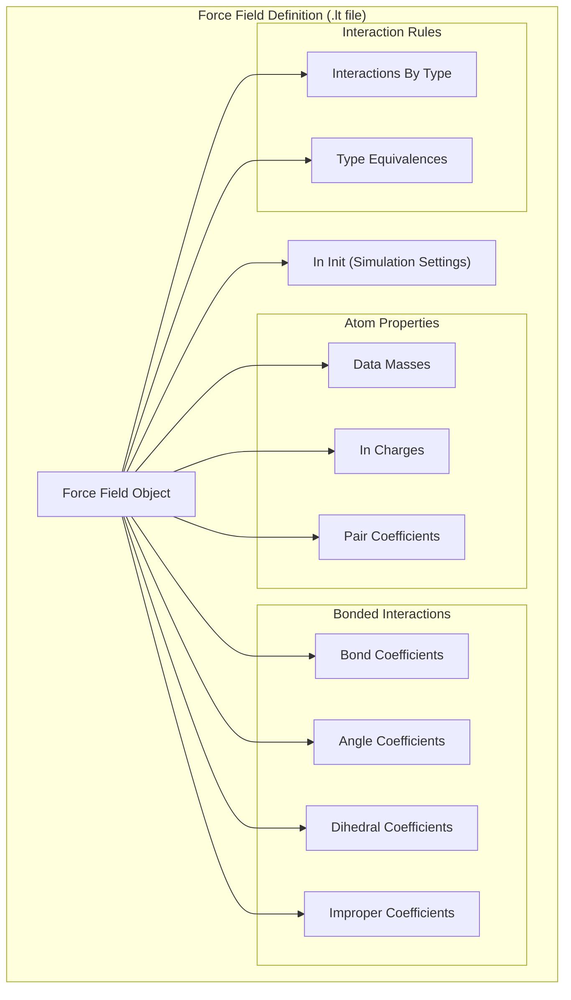
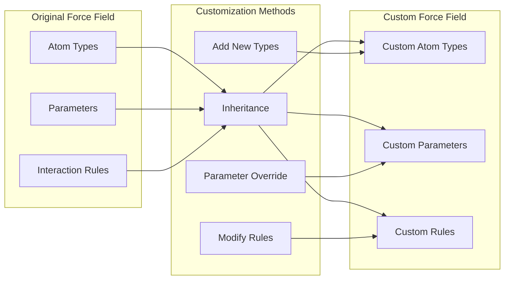
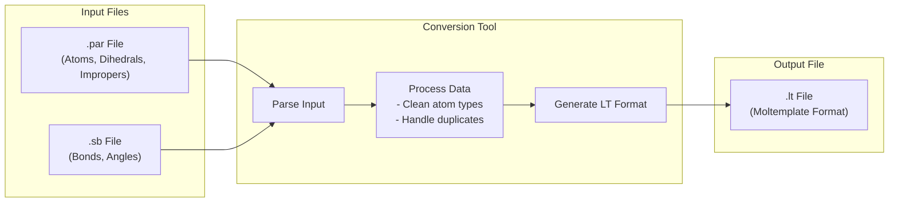

# Customizing Force Fields

<details>
<summary>Relevant source files</summary>

The following files were used as context for generating this wiki page:

- [examples/all_atom/force_field_OPLSAA/alkane_chain_single/moltemplate_files/ch2.lt](examples/all_atom/force_field_OPLSAA/alkane_chain_single/moltemplate_files/ch2.lt)
- [examples/all_atom/force_field_OPLSAA/alkane_chain_single/moltemplate_files/ch3.lt](examples/all_atom/force_field_OPLSAA/alkane_chain_single/moltemplate_files/ch3.lt)
- [examples/all_atom/force_field_OPLSAA/butane/moltemplate_files/ch2.lt](examples/all_atom/force_field_OPLSAA/butane/moltemplate_files/ch2.lt)
- [examples/all_atom/force_field_OPLSAA/butane/moltemplate_files/ch3.lt](examples/all_atom/force_field_OPLSAA/butane/moltemplate_files/ch3.lt)
- [moltemplate/force_fields/build_your_own_force_field/oplsaa_simple.lt](moltemplate/force_fields/build_your_own_force_field/oplsaa_simple.lt)
- [moltemplate/force_fields/build_your_own_force_field/usage_example/alkane50.lt](moltemplate/force_fields/build_your_own_force_field/usage_example/alkane50.lt)
- [moltemplate/force_fields/build_your_own_force_field/usage_example/ch2.lt](moltemplate/force_fields/build_your_own_force_field/usage_example/ch2.lt)
- [moltemplate/force_fields/build_your_own_force_field/usage_example/ch3.lt](moltemplate/force_fields/build_your_own_force_field/usage_example/ch3.lt)
- [moltemplate/force_fields/convert_OPLSAA_to_LT/README.md](moltemplate/force_fields/convert_OPLSAA_to_LT/README.md)
- [moltemplate/force_fields/convert_OPLSAA_to_LT/__init__.py](moltemplate/force_fields/convert_OPLSAA_to_LT/__init__.py)
- [moltemplate/force_fields/convert_OPLSAA_to_LT/oplsaa2lt.py](moltemplate/force_fields/convert_OPLSAA_to_LT/oplsaa2lt.py)
- [moltemplate/force_fields/convert_OPLSAA_to_LT/oplsaa2lt_classes.py](moltemplate/force_fields/convert_OPLSAA_to_LT/oplsaa2lt_classes.py)
- [moltemplate/force_fields/convert_OPLSAA_to_LT/oplsaa2lt_utils.py](moltemplate/force_fields/convert_OPLSAA_to_LT/oplsaa2lt_utils.py)
- [moltemplate/force_fields/oplsaa2008_original_format/AUTHOR.txt](moltemplate/force_fields/oplsaa2008_original_format/AUTHOR.txt)
- [moltemplate/force_fields/oplsaa2008_original_format/README.txt](moltemplate/force_fields/oplsaa2008_original_format/README.txt)
- [moltemplate/nbody_alt_symmetry/cenKswapIL.py](moltemplate/nbody_alt_symmetry/cenKswapIL.py)

</details>


## Introduction

This page explains how to customize force fields in moltemplate, or create entirely new ones from scratch. It covers the structure of force field files, techniques for modifying existing force fields, and how to convert external force field formats into moltemplate's format. This knowledge is essential for researchers who need specialized force fields for their molecular simulations.

For information about the available pre-defined force fields in moltemplate, see [Force Fields](#5).

Sources: [moltemplate/force_fields/build_your_own_force_field/oplsaa_simple.lt:1-43]()

## Force Field Structure in Moltemplate

Force fields in moltemplate are defined in `.lt` files, which contain parameters for atoms, bonds, angles, dihedrals, and impropers. A complete force field definition includes:

1. **Atom Properties**: Masses, charges, and Lennard-Jones parameters
2. **Bonded Interactions**: Parameters for bonds, angles, dihedrals, and impropers
3. **Atom Type Categories**: Types used for various interactions
4. **Simulation Settings**: LAMMPS settings required by the force field

### Diagram: Force Field Structure



Sources: [moltemplate/force_fields/build_your_own_force_field/oplsaa_simple.lt:25-270]()

## Methods for Customizing Force Fields

### Inheriting from Existing Force Fields

The most common approach to customize a force field is to inherit from an existing one:

```
MyCustomFF inherits OPLSAA {
  # Customizations here
}
```

This allows you to use all parameters from the original force field while overriding specific ones.

### Force Field Components to Customize

| Component | Purpose | Customization Method |
|-----------|---------|----------------------|
| Atom Types | Define atom properties | Add new atom types or modify existing ones |
| Charges | Electrostatic interactions | Override charges with `write_once("In Charges")` |
| Masses | Atom mass for dynamics | Override with `write_once("Data Masses")` |
| Pair Coefficients | Non-bonded interactions | Override with `write_once("In Settings")` |
| Bond Parameters | Bonded interactions | Override with `write_once("In Settings")` |
| Angle Parameters | 3-body interactions | Override with `write_once("In Settings")` |
| Dihedral Parameters | 4-body torsion | Override with `write_once("In Settings")` |
| Improper Parameters | Out-of-plane bending | Override with `write_once("In Settings")` |

### Diagram: Force Field Customization Process



Sources: [moltemplate/force_fields/build_your_own_force_field/oplsaa_simple.lt:25-270](), [examples/all_atom/force_field_OPLSAA/butane/moltemplate_files/ch2.lt:15-30](), [examples/all_atom/force_field_OPLSAA/butane/moltemplate_files/ch3.lt:15-32]()

## Atom Type Equivalence Categories

A key concept in moltemplate force fields is the use of "equivalence categories" for atom types. Each atom has different interaction types for different contexts:

```
replace{ @atom:CT2H @atom:CT2H_bCT_aCT_dCT_iCT }
```

This format encodes:
- `CT2H`: Base atom type
- `bCT`: Bond interaction type
- `aCT`: Angle interaction type
- `dCT`: Dihedral interaction type
- `iCT`: Improper interaction type

This system allows defining wildcards in interaction patterns, like:

```
@bond:CT_HC @atom:*_bCT_a*_d*_i* @atom:*_bHC_a*_d*_i*
```

Sources: [moltemplate/force_fields/build_your_own_force_field/oplsaa_simple.lt:62-79](), [moltemplate/force_fields/build_your_own_force_field/oplsaa_simple.lt:113-122]()

## Converting External Force Fields

Moltemplate provides tools to convert force fields from other formats. The `oplsaa2lt.py` utility converts OPLSAA force field files (.par and .sb files) to moltemplate format.

### Conversion Process

1. Parse atom definitions, bond parameters, angle parameters, dihedral parameters, and improper parameters
2. Process and clean up the data (handling duplicates, wildcards, etc.)
3. Add water models if needed
4. Generate the .lt file with proper formatting

### Diagram: Force Field Conversion Workflow



Sources: [moltemplate/force_fields/convert_OPLSAA_to_LT/oplsaa2lt.py:319-574](), [moltemplate/force_fields/convert_OPLSAA_to_LT/README.md:1-53]()

## Example: Creating a Custom Force Field

### Basic Structure of a Force Field File

```
MyForceField {
  # Atom masses
  write_once("Data Masses") {
    @atom:TYPE1  MASS1
    @atom:TYPE2  MASS2
    # ...
  }

  # Atom charges
  write_once("In Charges") {
    set type @atom:TYPE1 charge CHARGE1
    set type @atom:TYPE2 charge CHARGE2
    # ...
  }

  # Non-bonded parameters
  write_once("In Settings") {
    pair_coeff @atom:TYPE1 @atom:TYPE1 EPSILON SIGMA
    # ...
  }

  # Bond parameters
  write_once("In Settings") {
    bond_coeff @bond:TYPE1_TYPE2 K R0
    # ...
  }

  # Rules for creating bonds
  write_once("Data Bonds By Type") {
    @bond:TYPE1_TYPE2 @atom:*_bTYPE1_a*_d*_i* @atom:*_bTYPE2_a*_d*_i*
    # ...
  }

  # Initialize force field styles
  write_once("In Init") {
    units real
    atom_style full
    bond_style harmonic
    angle_style harmonic
    # ...
  }
}
```

Sources: [moltemplate/force_fields/build_your_own_force_field/oplsaa_simple.lt:25-270]()

### Creating a Simplified Force Field

For simple systems, you can create a minimal force field with just the parameters you need. Here's an example of a simplified alkane force field:

1. Define atom types and their properties
2. Define bonded interaction parameters
3. Define rules for generating interactions
4. Specify simulation settings

This approach is demonstrated in `oplsaa_simple.lt`, which provides a minimal set of parameters for alkanes and alkenes.

Sources: [moltemplate/force_fields/build_your_own_force_field/oplsaa_simple.lt:1-272]()

## Special Considerations for Improper Interactions

Improper interactions require special handling in moltemplate. The way atoms are ordered in improper interactions can vary between force fields.

### Customizing Improper Atom Ordering

Moltemplate provides a mechanism to customize how improper interactions are defined:

```
write_once("Data Impropers By Type (cenIsortJKL.py)") {
  @improper:CM_X_X_X @atom:* @atom:* @atom:*_b*_a*_d*_iCM @atom:*
}
```

The `(cenIsortJKL.py)` directive tells moltemplate to use a specific module for processing improper interactions. Different force fields may require different atom ordering schemes.

### Common Improper Processing Modules

- `cenIsortJKL.py`: Central atom is third, first atom has lowest ID
- `cenKswapIL.py`: Central atom is third, swap outer atoms if needed

Sources: [moltemplate/force_fields/build_your_own_force_field/oplsaa_simple.lt:228-249](), [moltemplate/nbody_alt_symmetry/cenKswapIL.py:1-76]()

## Force Field Parameter Handling

Working with force field parameters requires careful attention to:

1. **Units**: Ensure consistent units throughout the force field
2. **Wildcards**: Use wildcards (`*` or `?`) to create general interaction patterns
3. **Duplicates**: Handle duplicate interaction definitions appropriately

### Parameter Cleanup

When converting or modifying force fields, it's often necessary to clean up parameters:

- Renaming problematic atom types
- Removing redundant parameters
- Handling special cases like water models
- Resolving conflicts between parameters

Sources: [moltemplate/force_fields/convert_OPLSAA_to_LT/oplsaa2lt.py:170-268](), [moltemplate/force_fields/convert_OPLSAA_to_LT/oplsaa2lt_classes.py:130-135]()

## Applying Custom Force Fields

To use a custom force field in a molecule definition:

```
import "mycustom_ff.lt"

MyMolecule inherits MyCustomFF {
  # Molecule definition here
  write("Data Atoms") {
    $atom:C1 $mol @atom:MyType 0.0 0.0 0.0 0.0
    # ...
  }
  
  write("Data Bond List") {
    $bond:b1 $atom:C1 $atom:C2
    # ...
  }
}
```

The charges specified in the molecule definition (0.0 in this example) will be replaced by the charges defined in the force field unless you explicitly override them.

Sources: [examples/all_atom/force_field_OPLSAA/butane/moltemplate_files/ch2.lt:15-30](), [examples/all_atom/force_field_OPLSAA/butane/moltemplate_files/ch3.lt:15-32]()

## Best Practices

1. **Documentation**: Comment your force field extensively, especially custom parameters
2. **Validation**: Test the force field on simple systems before using it in production
3. **Incremental Changes**: When customizing, make small changes and test frequently
4. **Naming Conventions**: Use clear, consistent names for atom types and interactions
5. **Avoid Special Characters**: Some characters like `$`, `#`, `:` can cause problems in moltemplate
6. **Parameter Sources**: Document the source of any parameters you add or modify

Sources: [moltemplate/force_fields/convert_OPLSAA_to_LT/oplsaa2lt.py:26-34](), [moltemplate/force_fields/build_your_own_force_field/oplsaa_simple.lt:4-22]()

## Advanced: Customizing Water Models

Force fields often include parameters for various water models. When customizing a force field, you might need to add or modify water model parameters.

### Common Water Models

| Model | Description | Characteristics |
|-------|-------------|-----------------|
| TIP3P | 3-point model | 1 oxygen, 2 hydrogens |
| TIP4P | 4-point model | Adds virtual site for charge distribution |
| TIP5P | 5-point model | Adds two lone pair sites |
| SPC/E | Extended Simple Point Charge | Modified charges from SPC |
| OPC | Optimal Point Charge | Higher accuracy water model |

Sources: [moltemplate/force_fields/convert_OPLSAA_to_LT/oplsaa2lt.py:390-457]()

## Converting OPLSAA Force Field: Example

To convert OPLSAA force field files to moltemplate format:

```bash
./oplsaa2lt.py --name OPLSAA --out oplsaa2024.lt \
  --par oplsaa.par \
  --sb  oplsaa.sb
```

Where:
- `oplsaa.par` contains atom definitions, dihedral and improper parameters
- `oplsaa.sb` contains bond and angle parameters

The resulting `oplsaa2024.lt` file can be imported into your molecule definitions.

Sources: [moltemplate/force_fields/convert_OPLSAA_to_LT/README.md:6-18]()