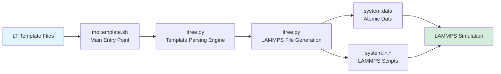
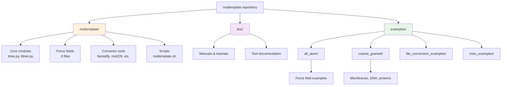

Moltemplate is a **general cross-platform text-based molecule builder** for LAMMPS (Large-scale Atomic/Molecular Massively Parallel Simulator). While originally designed for building **custom coarse-grained molecular models**, it has evolved to support realistic all-atom simulations as well. Moltemplate simplifies the complex process of preparing LAMMPS input files by providing a **template-based system** that handles atom definitions, force field parameters, and molecular topology through declarative LT (LAMMPS Template) files.


## Core Architecture

Moltemplate operates on a **text template engine** architecture where users define molecules using LT files, which are then processed to generate standard LAMMPS input files (`.data` and `.in` files). The system consists of three primary processing stages: template parsing, variable substitution, and LAMMPS file generation.

Sources: [README.md](README.md#L14-L28), [moltemplate/__init__.py](moltemplate/__init__.py#L1-L72)

### Processing Pipeline



The main entry point is `moltemplate.sh`, which orchestrates multiple Python modules including the template engine (`ttree.py`), LAMMPS file generator (`lttree.py`), and various utility scripts for force field processing and coordinate manipulation.

Sources: [moltemplate/scripts/moltemplate.sh](moltemplate/scripts/moltemplate.sh#L1-L50), [setup.py](setup.py#L51-L112)

## Key Capabilities

### Force Field Integration

Moltemplate provides **extensive force field support** through both pre-packaged templates and conversion tools. This enables researchers to use established molecular mechanics force fields without manually parameterizing interactions.

| Force Field | Type | Format | Examples Location |
|-------------|------|--------|------------------|
| OPLSAA (2023, 2008) | All-atom | `.lt` | `examples/all_atom/force_field_OPLSAA/` |
| AMBER (GAFF, GAFF2) | All-atom | `.lt` | `examples/all_atom/force_field_AMBER/` |
| DREIDING | All-atom | `.lt` | `examples/all_atom/force_field_DREIDING/` |
| COMPASS | All-atom | `.lt` | `examples/all_atom/force_field_COMPASS/` |
| TraPPE (1998) | Coarse-grained | `.lt` | `examples/coarse_grained/solvent_models/` |
| MARTINI | Coarse-grained | `.lt` | `examples/coarse_grained/membrane_examples/MARTINI_examples/` |
| MOLC, mW, ELBA | Coarse-grained | `.lt` | Various CG directories |

Sources: [README.md](README.md#L16-L23), [moltemplate/force_fields/README.txt](moltemplate/force_fields/README.txt#L1-L14)

### File Conversion Tools

Moltemplate includes specialized conversion utilities that bridge different molecular file formats, making it interoperable with external tools:

| Tool | Input Format | Output Format | Purpose |
|------|-------------|---------------|---------|
| `ltemplify.py` | LAMMPS DATA | LT files | Convert existing LAMMPS systems |
| `mol22lt.py` | MOL2 | LT files | Import from molecule databases |
| `amber2lt.py` | AMBER | LT files | Convert AMBER force fields |
| `genpoly_lt.py` | - | Polymer LT files | Generate polymer topologies |
| `dump2data.py` | LAMMPS dump | DATA files | Extract coordinates from trajectories |

Sources: [setup.py](setup.py#L61-L93), [README.md](README.md#L31-L45)

## Repository Structure

The repository is organized into three main directories that separate source code, documentation, and examples for clarity and ease of navigation.



Sources: [README.md](README.md#L51-L53), [examples/README.md](examples/README.md#L1-L10)

### Example Gallery

The `examples/` directory contains approximately **50 working examples** organized by simulation type and force field. Each example follows a consistent structure:

- `moltemplate_files/`: LT template definitions
- `README_setup.sh`: Instructions for generating LAMMPS files
- `README_run.sh`: Instructions for running LAMMPS
- `README_visualize.txt`: Visualization guidance
- `run.in.*`: LAMMPS input scripts
- `images/`: Visual representations of the system

Sources: [examples/README.md](examples/README.md#L11-L37)

## Typical Workflow

The moltemplate workflow follows a clear progression from template definition to simulation execution. This example shows how to build a coarse-grained polymer system.

**1. Define Force Field Parameters** (`forcefield.lt`):
```
ForceField {
  write_once("In Init") {
    units real
    atom_style full
    pair_style lj/cut 11.0
  }
  write_once("Data Masses") {
    @atom:CA 13.0
    @atom:R  50.0
  }
}
```

**2. Define Molecular Building Blocks** (`monomer.lt`):
```
Monomer inherits ForceField {
  write("Data Atoms") {
    $atom:ca $mol:... @atom:CA 0.0 0.0 1.0 0.0
    $atom:r  $mol:... @atom:R  0.0 0.0 4.4 0.0
  }
}
```

**3. Assemble System** (`system.lt`):
```
import "polymer.lt"
polymers = new Polymer [3].move(0, 0, 30.0)
                       [3].move(0, 30.0, 0)
```

**4. Generate LAMMPS Files**:
```bash
moltemplate.sh system.lt
mv system.in* system.data ../
```

**5. Run Simulation**:
```bash
lmp_mpi -i run.in.nvt
```

Sources: [examples/coarse_grained/simple_examples/2bead_polymer/moltemplate_files/system.lt](examples/coarse_grained/simple_examples/2bead_polymer/moltemplate_files/system.lt#L1-L30), [examples/coarse_grained/simple_examples/2bead_polymer/README_setup.sh](examples/coarse_grained/simple_examples/2bead_polymer/README_setup.sh#L1-L24), [examples/coarse_grained/simple_examples/2bead_polymer/run.in.nvt](examples/coarse_grained/simple_examples/2bead_polymer/run.in.nvt#L1-L33)

## System Requirements

Moltemplate has minimal dependencies and runs on multiple platforms:

- **Python**: Version 3.4 or higher (Python 2.7 support is deprecated)
- **Operating Systems**: Linux, macOS, Windows (via WSL)
- **Required Python Package**: numpy
- **Optional**: LaTeX (for building manual, pdflatex)

The installation process provides flexibility for users preferring **pip** or **conda** package managers, with detailed troubleshooting available in the installation documentation.

Sources: [setup.py](setup.py#L98-L112), [README.md](README.md#L60-L88), [INSTALL.md](INSTALL.md#L1-L150)

## Installation and Quick Start

Installation can be completed in minutes using either conda or pip:

```bash
# Conda users
conda install conda-forge::moltemplate

# Pip users (after cloning repository)
pip3 install .
```

Once installed, the typical usage pattern is:
```bash
moltemplate.sh [-atomstyle style] [-pdb/-xyz coord_file] [-vmd] system.lt
```

For immediate hands-on experience, explore the example directories which provide complete working systems ready for modification and execution.

Sources: [README.md](README.md#L48-L50), [README.md](README.md#L60-L88), [INSTALL.md](INSTALL.md#L1-L40)

## Learning Path

> [!TIP]
> The most effective way to learn moltemplate is to **modify existing examples** rather than starting from scratch. The reference manual's Chapter 4 provides essential concepts that all users should read.

1. **Begin**: Review the [Installation Guide](3-installation-guide) to set up your environment
2. **Explore**: Study the [Quick Start](2-quick-start) guide with simple examples
3. **Practice**: Work through [Your First Moltemplate Simulation](5-your-first-moltemplate-simulation) 
4. **Deepen**: Understand [Moltemplate LT File Syntax](6-moltemplate-lt-file-syntax) for advanced features
5. **Master**: Explore the [Core Template System Architecture](7-core-template-system-architecture) for complex systems
