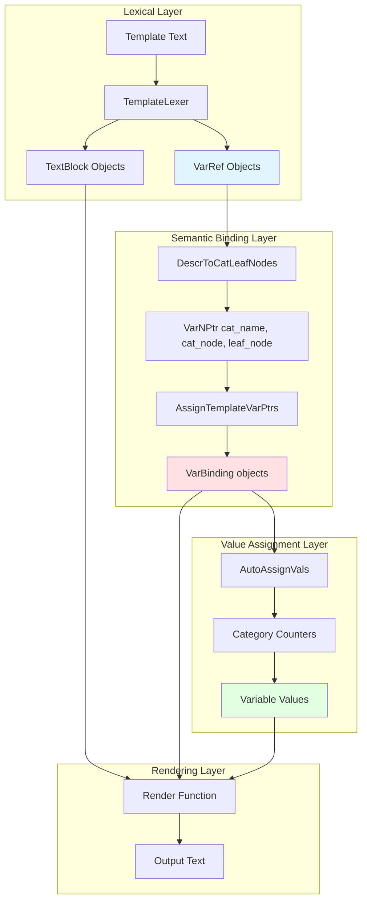

The variable substitution and binding system in moltemplate provides a sophisticated mechanism for managing template parameters, enabling automatic value assignment, lookup resolution, and dynamic text generation. This system forms the core of how moltemplate transforms abstract template definitions into concrete LAMMPS input files with properly substituted atom types, IDs, and other simulation parameters.

## Architectural Overview

The substitution system operates on a three-tier architecture comprising lexical analysis, semantic binding, and final rendering. Variables flow through this pipeline as abstract references that get progressively resolved into concrete values.



This architecture enables **lazy evaluation**—variables exist as symbolic references until rendering time, allowing complex dependency resolution and hierarchical scoping.

## Core Data Structures

### Variable Reference (VarRef)

The `VarRef` class encapsulates a single variable reference encountered in template text. It stores both the lexical information (how the variable appears) and semantic information (what it resolves to) [ttree_lex.py#L1143-L1180](moltemplate/ttree_lex.py#L1143-L1180).

```python
class VarRef(object):
    __slots__ = ["prefix", "descr_str", "suffix", "srcloc", "binding", "nptr"]
```

- **prefix**: `$` for instance variables, `@` for static variables
- **descr_str**: The variable descriptor (e.g., `"atom:CA"` or `"/mol/bond:type1"`)
- **suffix**: Formatting directives (e.g., `.ljust(8)}`)
- **nptr**: Pointer to `VarNPtr` containing semantic resolution
- **binding**: Pointer to `VarBinding` containing the value

The dual-pointer system (`nptr` and `binding`) enables efficient **two-way navigation**: from reference to binding for value retrieval, and from binding to all references for consistency updates.

### Variable Name Pointer (VarNPtr)

`VarNPtr` represents the semantic resolution of a variable descriptor into its three components [ttree_lex.py#L1179-L1209](moltemplate/ttree_lex.py#L1179-L1209).

```python
class VarNPtr(object):
    __slots__ = ["cat_name", "cat_node", "leaf_node"]
```

| Component | Purpose | Example |
|-----------|---------|---------|
| `cat_name` | Variable type/category | `"atom"`, `"bond"`, `"molecule"` |
| `cat_node` | Tree node defining category scope | Root `/` for global, `/Water` for molecule-specific |
| `leaf_node` | Tree node representing specific variable instance | Node named `"CA"` or `"H1"` |

### Variable Binding (VarBinding)

`VarBinding` serves as the central registry for each unique variable, storing its value and all references to it [ttree_lex.py#L1220-L1258](moltemplate/ttree_lex.py#L1220-L1258).

```python
class VarBinding(object):
    __slots__ = ["full_name", "nptr", "value", "refs", "order", "category"]
```

- **full_name**: Canonical string identifier (e.g., `$atom:water[1423]/O`)
- **value**: The assigned value (typically a string)
- **refs**: List of all `VarRef` objects referencing this binding
- **category**: Back-reference to containing `Category` object

The **reference tracking** capability enables efficient variable replacement operations—when one variable is aliased to another, all references can be updated by modifying a single binding.

## Variable Descriptor Syntax

Variable descriptors provide a hierarchical naming system that encodes both variable identity and scoping information.

### Basic Syntax Patterns

```mermaid
flowchart LR
    A[Descriptor String] --> B{Contains Colon?}
    B -->|Yes| C[Category:Leaf Format]
    B -->|No| D[Slash Format]
    
    C --> E[category_name:leaf_name]
    C --> F[/category_path/category_name:leaf_path]
    
    D --> G[/parent_path/variable_name]
    D --> H[variable_name]
    
    style C fill:#e1f5ff
    style D fill:#ffe1e1
```

The parsing occurs in `DescrToCatLeafPtkns()` which splits descriptors into three components [ttree.py#L1215-L1268](moltemplate/ttree.py#L1215-L1268):

| Descriptor Format | Category Name | Category Path | Leaf Path |
|------------------|---------------|---------------|-----------|
| `"atom:CA"` | `"atom"` | `[]` | `["CA"]` |
| `"atom:/Water/O"` | `"atom"` | `["", "Water"]` | `["O"]` |
| `"AtomID:../res[25]"` | `"AtomID"` | `[]` | `["..", "res[25]"]` |
| `"mol:"` | `"mol"` | `[]` | `[]` |

### Path Resolution

Path tokens follow Unix-style conventions with extensions for array indexing:
- `/` - Absolute path (root)
- `..` - Parent node
- `.` - Current node
- `[N]` - Array indexing for multiple instances

The `DescrToCatLeafNodes()` function performs **path traversal** through the tree, supporting relative paths and automatic creation of missing nodes when `create_missing_nodes=True` [ttree.py#L1310-L1759](moltemplate/ttree.py#L1310-L1759).

> [!TIP]
> The descriptor parser supports both colon syntax (`$atom:CA`) and slash syntax (`$atom/CA`), but the colon syntax is preferred for clarity as it explicitly separates category from variable name. The colon-less form is primarily for backward compatibility.

## Binding Assignment Process

The transformation from raw template text to bound variables occurs through a multi-stage pipeline.

### Stage 1: Template Parsing

`TemplateLexer.ReadTemplate()` reads raw text and produces an alternating list of `TextBlock` and `VarRef` objects [ttree_lex.py#L1669-L2245](moltemplate/ttree_lex.py#L1669-L2245).

```
Input:  "coords($x,$y,$z) = ($x/10.0, $y/10.0, $z/10.0)"
Output: [TextBlock("coords("), VarRef("x"), TextBlock(","), 
         VarRef("y"), TextBlock(","), VarRef("z"), TextBlock(") = ("),
         VarRef("x"), TextBlock("/10.0, "), ...]
```

### Stage 2: Pointer Assignment

`AssignTemplateVarPtrs()` resolves each `VarRef.descr_str` to its corresponding `VarNPtr` by traversing the tree [ttree.py#L4196-L4288](moltemplate/ttree.py#L4196-L4288).

```python
# For each VarRef in template:
var_ref.nptr.cat_name, var_ref.nptr.cat_node, var_ref.nptr.leaf_node = \
    DescrToCatLeafNodes(var_ref.descr_str, context_node, var_ref.srcloc, True)
```

This creates **bidirectional bindings**: the `VarRef` gains an `nptr`, and the `Category.bindings` dictionary gains an entry mapping `leaf_node → VarBinding`.

### Stage 3: Value Assignment

`AutoAssignVals()` iterates through categories and assigns values using category counters [ttree.py#L4406-L4503](moltemplate/ttree.py#L4406-L4503).

```python
for leaf_node, var_binding in var_bind_iter:
    if var_binding.value is None:
        cat.counter.incr()
        value = str(cat.counter.query())
        var_binding.value = value
```

The counter-based system provides **automatic unique numbering** for atom types, atom IDs, and other sequentially-indexed parameters.

> [!TIP]
> Variables can be manually assigned values by setting `var_binding.value` directly before rendering. The `ignore_prior_values` parameter in `AutoAssignVals()` allows selective reassignment when needed.

## Variable Lookup and Resolution

### Descriptor-to-Binding Resolution

`LookupVar()` provides the primary API for resolving variable descriptors to their bindings [ttree.py#L1793-L1805](moltemplate/ttree.py#L1793-L1805).

```python
def LookupVar(descr_str, context_node, dbg_loc):
    """ Returns VarBinding for a given descriptor from a specific context """
    return DescrToVarBinding(descr_str, context_node, dbg_loc)
```

The lookup process is **context-sensitive**: the same descriptor can resolve to different bindings depending on the `context_node`, enabling hierarchical scoping.

### Path Following

`FollowPath()` and `PtknsToNode()` implement tree traversal for path resolution [ttree.py#L645-L965](moltemplate/ttree.py#L645-L965). The traversal supports:

- Absolute paths starting with `/`
- Relative paths with `..` and `.`
- Array indexing with `[N]` syntax
- Error raising for undefined paths

### Counter Variables

A special query mechanism exists for reading category counters without incrementing them:

```python
# Variables named with "__query__" prefix access counter state
var_binding.value = str(cat.counter.query())  # No increment
```

This enables **counter introspection** without side effects [ttree.py#L4446-L4449](moltemplate/ttree.py#L4446-L4449).

## Template Rendering

### Value Substitution

The `Render()` function converts template lists to final output strings by substituting `VarRef` objects with their bound values [ttree.py#L4525-L4581](moltemplate/ttree.py#L4525-L4581).

```python
def Render(tmpl_list, substitute_vars=True):
    for entry in tmpl_list:
        if isinstance(entry, VarRef):
            if substitute_vars:
                value = var_bindings[var_ref.nptr.leaf_node].value
                # Apply formatting if specified
                format_fname, args = ExtractFormattingCommands(var_ref.suffix)
                if format_fname == 'ljust':
                    value = value.ljust(int(args[0]))
                out_str_list.append(value)
            else:
                # Output full variable name instead of value
                out_str_list.append(var_bindings[...].full_name[1:])
```

### Formatting Commands

Variable suffixes support **inline formatting** for output control:

| Suffix | Function | Example | Result |
|--------|----------|---------|--------|
| `.ljust(8)` | Left-justify | `$atom:ljust(8)` | `"CA      "` |
| `.rjust(4)` | Right-justify | `$id:rjust(4)` | `"  42"` |

Formatting is extracted by `ExtractFormattingCommands()` and applied during rendering [ttree.py#L4506-L4524](moltemplate/ttree.py#L4506-L4524).

## Variable Replacement

The system supports **runtime variable aliasing** through `ReplaceVarsInTmpl()` [ttree.py#L4670-L4738](moltemplate/ttree.py#L4670-L4738).

```python
def ReplaceVarsInTmpl(tmpl_list, replace_var_pairs):
    # replace_var_pairs maps (old_cat_name, old_cat_node, old_leaf_node)
    #                      -> (new_cat_name, new_cat_node, new_leaf_node)
    for var_ref in tmpl_list:
        if var_ref.nptr tuple in replace_var_pairs:
            # Update all references to point to new variable
            var_ref.nptr = new_nptr
            var_ref.descr_str = CanonicalDescrStr(...)
```

This mechanism enables **force field merging** where atom types from different force fields get unified under a single binding.

## Category Management

### Category Structure

Each node maintains a `categories` dictionary mapping category names to `Category` objects [ttree.py#L1849-L1903](moltemplate/ttree.py#L1849-L1903).

```python
class Category(object):
    __slots__ = ["name", "bindings", "counter", 
                 "manual_assignments", "reserved_values"]
```

| Component | Purpose |
|-----------|---------|
| `bindings` | OrderedDict of `leaf_node → VarBinding` |
| `counter` | `SimpleCounter` for automatic value generation |
| `manual_assignments` | User-specified value overrides |
| `reserved_values` | Values excluded from auto-assignment |

### Counter Customization

Counters support custom starting values and increments:

```python
class SimpleCounter(object):
    def __init__(self, n0=None, nincr=None):
        self.n = n0 - nincr  # Initialize so first query() returns n0
        self.nincr = nincr
    
    def incr(self):
        self.n += self.nincr
```

Default behavior starts at 1 and increments by 1, but this can be overridden per-category for different numbering schemes.

## Static vs Instance Variables

The dual-prefix system separates compile-time from runtime parameters:

| Prefix | Variable Type | Tree | Use Case |
|--------|---------------|------|----------|
| `@` | Static | StaticObj | Atom types, force field parameters |
| `$` | Instance | InstanceObj | Atom IDs, coordinates, molecule instances |

`AssignTemplateVarPtrs()` validates prefix consistency—`@` references only resolve in `StaticObj` contexts, `$` references only in `InstanceObj` contexts [ttree.py#L4196-L4288](moltemplate/ttree.py#L4196-L4288).

## Error Handling and Validation

### Undefined Variables

The rendering process raises `InputError` for references to deleted or undefined variables:

```python
if var_ref.nptr.leaf_node.IsDeleted():
    raise InputError('The variable you referred to does not exist:\n'
                     '  ' + var_ref.prefix + var_ref.descr_str + '\n')
```

### Source Location Tracking

Every `VarRef` carries an `OSrcLoc` recording the original file and line number for precise error reporting [ttree_lex.py#L1097-L1106](moltemplate/ttree_lex.py#L1097-L1106).

## Performance Considerations

The binding system optimizes for large-scale molecular simulations:

- **Lazy evaluation**: Values assigned only at render time
- **Shared bindings**: Multiple references share one `VarBinding`
- **OrderedDict**: Maintains definition order for reproducibility
- **Tree-scoped categories**: Reduces lookup namespace size

For systems with millions of atoms, the depth-first counter assignment ensures deterministic atom ID generation regardless of parallel instantiation order.

## Integration Points

The variable binding system interfaces with several other moltemplate subsystems:

- **Force Fields**: Atom type categories defined in force field files get merged into the main binding tree
- **Coordinate Files**: PDB reading creates instance variable bindings for atomic coordinates
- **N-Body Generation**: Bond/angle detection uses variable references to establish topological relationships

Understanding these interfaces is essential for [Force Field Parameter Management](15-force-field-parameter-management) and custom tool development.

## Next Steps

The variable substitution system provides the foundation for moltemplate's dynamic content generation. To explore how these mechanisms are applied in practice:

- Continue to [Command Processing Pipeline](11-command-processing-pipeline) to see how bindings flow through the execution engine
- Review [Atom Styles and Coordinate Systems](13-atom-styles-and-coordinate-systems) for coordinate variable usage
- Examine [Force Field Parameter Management](15-force-field-parameter-management) for category organization patterns in real force fields
