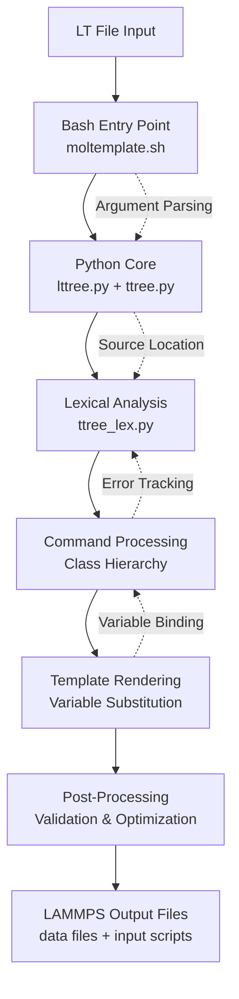
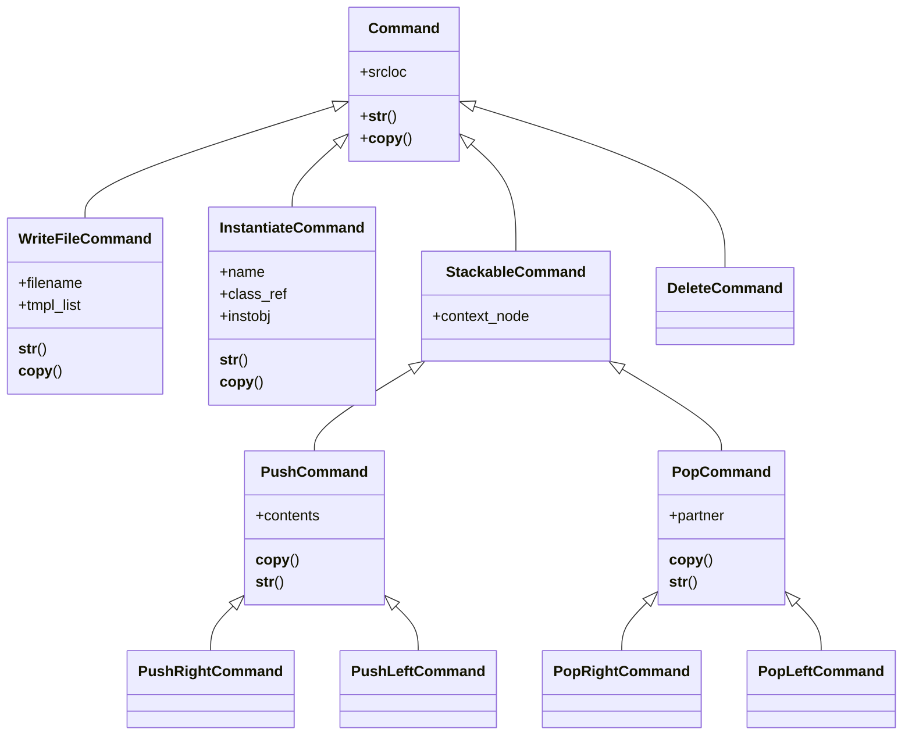

The command processing pipeline serves as moltemplate's execution backbone, transforming declarative LT syntax into executable molecular simulation inputs through a multi-stage architecture. This pipeline coordinates parsing, lexical analysis, command interpretation, template rendering, and post-processing into a unified workflow that bridges human-readable template definitions with LAMMPS-ready simulation files.

Understanding this pipeline provides critical insight into how moltemplate achieves its hierarchical template system, manages variable scoping across nested object definitions, and maintains precise source location tracking for error reporting throughout complex molecular system specifications.

## Pipeline Architecture Overview

The command processing pipeline implements a **six-stage transformation architecture** that progressively converts LT file contents into LAMMPS-compatible outputs:



This architecture prioritizes **maintainability through separation of concerns**: bash handles system integration and file orchestration, Python modules implement the core template engine, lexical analysis provides token-level parsing, and specialized post-processors handle domain-specific validation for molecular simulations.

Sources: [moltemplate.sh](moltemplate/scripts/moltemplate.sh#L1-L50), [ttree.py](moltemplate/ttree.py#L1-L50)

## Entry Point: Bash Orchestration Layer

The pipeline begins with **moltemplate.sh**, a 2843-line bash script serving as both the user interface and orchestration controller. This script performs seven critical orchestration functions:

1. **Python Environment Detection**: Validates Python version compatibility (preferring python3 over python2) and locates the moltemplate script directory [moltemplate.sh](moltemplate/scripts/moltemplate.sh#L15-L50)
2. **File System Validation**: Ensures all required Python modules are present before execution begins [moltemplate.sh](moltemplate/scripts/moltemplate.sh#L60-L90)
3. **Command-Line Argument Parsing**: Processes user flags for atom styles, coordinate files, symmetry rules, and overlay options [moltemplate.sh](moltemplate/scripts/moltemplate.sh#L400-L600)
4. **Temporary File Management**: Establishes and cleans up temporary file structures for intermediate processing stages [moltemplate.sh](moltemplate/scripts/moltemplate.sh#L100-L180)
5. **Module Invocation**: Sequentially executes the Python pipeline components (lttree.py, lttree_check.py, lttree_postprocess.py) with appropriately constructed arguments [moltemplate.sh](moltemplate/scripts/moltemplate.sh#L1000-L1100)
6. **Post-Processing Coordination**: Manages duplicate removal, atom reordering, and coefficient processing through specialized Python modules [moltemplate.sh](moltemplate/scripts/moltemplate.sh#L1500-L1700)
7. **Output File Assembly**: Combines generated fragments into final LAMMPS data files and input scripts [moltemplate.sh](moltemplate/scripts/moltemplate.sh#L2000-L2500)

> [!TIP]
> The bash layer deliberately handles all file I/O and system interactions, keeping the Python modules pure and testable. This separation enables rapid development of Python template logic while maintaining robust cross-platform compatibility through shell scripting.

Sources: [moltemplate.sh](moltemplate/scripts/moltemplate.sh#L1-L50), [moltemplate.sh](moltemplate/scripts/moltemplate.sh#L400-L600)

## Lexical Analysis Phase

The **ttree_lex.py** module provides a sophisticated lexical analyzer that extends Python's standard shlex module with moltemplate-specific enhancements. This 2258-line module implements the **TemplateLexer class**, which performs token-level parsing of LT file contents with precise source location tracking.

### Core Lexical Components

The lexical analyzer consists of several key data structures:

| Component | Purpose | Key Methods |
|-----------|---------|-------------|
| **TtreeShlex** | Extended shell-like lexer with unicode support | `get_token()`, `push_token()`, `read_char()` |
| **LineLex** | Line-oriented processing with comment stripping | `_ReadLine()`, `ReadLine()`, `_StripComments()` |
| **TemplateLexer** | Template block parsing with variable extraction | `ReadTemplate()`, `GetParenExpr()` |
| **VarRef** | Variable reference storage with source tracking | Stores prefix, descriptor, suffix, source location |
| **TextBlock** | Literal text block storage | Text content with OSrcLoc for error reporting |

### Variable Recognition Pattern

The lexer recognizes **two variable syntax patterns** through regex-based tokenization:

- **Simple syntax**: `$atom:CA` or `@bond:type`
- **Braced syntax**: `${/path/to/atom:CA}` or `@{/bond:type}`

The `GetVarName()` function implements the pattern matching logic, extracting the variable name and separating it from surrounding text for subsequent processing [ttree_lex.py](moltemplate/ttree_lex.py#L593-L682).

### Source Location Tracking

Every parsed element includes an **OSrcLoc object** that stores the file name and line number of its origin. This tracking enables precise error reporting even in complex nested template structures:

```python
class OSrcLoc(object):
    __slots__ = ["infile", "lineno", "order"]
    count = 0
```

The `order` attribute provides a global counter that maintains the original sequence of variable definitions, critical for preserving variable assignment order during rendering [ttree_lex.py](moltemplate/ttree_lex.py#L1097-L1120).

Sources: [ttree_lex.py](moltemplate/ttree_lex.py#L76-L90), [ttree_lex.py](moltemplate/ttree_lex.py#L593-L682), [ttree_lex.py](moltemplate/ttree_lex.py#L1143-L1172)

## Command Classification System

The **ttree.py** module implements a hierarchical command classification system that structures the interpretation of parsed LT file contents. This 5468-line module defines nine command classes that form the backbone of moltemplate's execution model.

### Command Class Hierarchy

The command system implements an **object-oriented command pattern** with a three-level inheritance hierarchy:



### Command Type Taxonomy

Each command class encapsulates specific functionality:

| Command | Purpose | Key Attributes |
|---------|---------|----------------|
| **WriteFileCommand** | Generates output files from templates | `filename`, `tmpl_list` |
| **InstantiateCommand** | Creates object instances from class definitions | `name`, `class_ref`, `instobj` |
| **DeleteCommand** | Removes nodes from the template tree | Minimal footprint for deletion operations |
| **PushCommand** | Manages context stack for nested scopes | `contents`, `context_node` |
| **PopCommand** | Restores previous context from stack | `partner` references matching push operation |
| **ScopeCommand/ScopeBegin/ScopeEnd** | Marks command boundaries for class definitions | Delimiter markers for parsing |

The **InstantiateCommand** class is particularly significant, storing both the target name and a `ClassReference` object that resolves to a `StaticObj` during execution [ttree.py](moltemplate/ttree.py#L214-L244). This design enables lazy evaluation and circular dependency resolution.

Sources: [ttree.py](moltemplate/ttree.py#L157-L157), [ttree.py](moltemplate/ttree.py#L214-L244), [ttree.py](moltemplate/ttree.py#L264-L390)

## Template Rendering Pipeline

Template rendering represents the **transformation core** of the pipeline, converting variable-referenced templates into concrete numeric values. The `Render()` function in ttree.py implements this transformation through recursive list processing.

### Rendering Algorithm

The rendering process operates on **alternating lists** of `TextBlock` and `VarRef` objects:

```python
def Render(tmpl_list, substitute_vars=True):
    """
    This function converts a TextBlock,VarRef list into a string.
    It is invoked by WriteTemplatesValue() in order to print
    out the templates stored at each node of the tree.
    """
```

The algorithm processes each element sequentially:

1. **TextBlock elements**: Concatenate literal text strings directly
2. **VarRef elements**: Resolve variable bindings through the `binding` pointer
3. **Nested structures**: Recursively process nested template lists

Variable resolution occurs through the `VarBinding` objects that store the final assigned value after all counter assignments have been processed [ttree.py](moltemplate/ttree.py#L4525-L4580).

### Variable Binding Resolution

Variable binding follows a **three-phase resolution process**:

1. **Static Variable Assignment**: Counter variables like `@atom:C` are assigned integer values starting from 1, incrementing for each new type [ttree.py](moltemplate/ttree.py#L4406-L4504)
2. **Instance Variable Binding**: Instance variables like `$atom:CA` are bound to their corresponding static variables or counter values
3. **Template Substitution**: During rendering, variable references are replaced with their bound values

The `AutoAssignVals()` function handles the automatic assignment of counter variables, ensuring no conflicts occur between different variable categories [ttree.py](moltemplate/ttree.py#L4406-L4504).

Sources: [ttree.py](moltemplate/ttree.py#L4525-L4580), [ttree.py](moltemplate/ttree.py#L4406-L4504)

## Post-Processing and Validation

The pipeline concludes with **domain-specific post-processing** that validates and optimizes molecular simulation inputs. These stages occur after template rendering but before final file generation.

### Duplicate Detection and Removal

The bash script orchestrates **four duplicate removal processes** for bonded interactions:

```bash
# Bonds processing
$PYTHON_COMMAND "${PY_SCR_DIR}/nbody_reorder_atoms.py" \
    Bonds "$SUBGRAPH_SCRIPT" < "${data_bonds}" > "${data_bonds}.tmp"
$PYTHON_COMMAND "${PY_SCR_DIR}/remove_duplicates_nbody.py" 2 \
    < "${data_bonds}" > "${data_bonds}.tmp"
```

The `nbody_reorder_atoms.py` module reorders atom indices according to symmetry rules defined in `nbody_alt_symmetry/` subdirectory, ensuring canonical ordering for consistent duplicate detection [moltemplate.sh](moltemplate/scripts/moltemplate.sh#L1560-L1590).

### Wildcard Expansion in Coefficient Commands

The `postprocess_coeffs.py` module expands wildcard characters (`*`, `?`) in coefficient commands before final rendering. This enables flexible force field specification:

```bash
awk '{if (match($1,/'_coeff/') && match($0,/'[*,?]/')) exit 1}' < "$file_name"
```

When wildcards are detected, the script expands them to explicit variable references using the `ttree_assignments_static.txt` file [moltemplate.sh](moltemplate/scripts/moltemplate.sh#L1500-L1560).

### Symmetry Rule Application

User can **override default symmetry rules** through command-line arguments:

- `-bond-symmetry file.py`: Custom bond atom ordering rules
- `-angle-symmetry file.py`: Custom angle atom ordering rules  
- `-dihedral-symmetry file.py`: Custom dihedral atom ordering rules
- `-improper-symmetry file.py`: Custom improper atom ordering rules

Setting any argument to `"NONE"` disables automatic reordering for that interaction type [moltemplate.sh](moltemplate/scripts/moltemplate.sh#L500-L600).

> [!TIP]
> The symmetry rule system enables moltemplate to handle mixed force field systems where different force fields use incompatible atom ordering conventions. By providing custom symmetry scripts, users can force atom ordering to match specific LAMMPS pair_style requirements.

Sources: [moltemplate.sh](moltemplate/scripts/moltemplate.sh#L1560-L1590), [moltemplate.sh](moltemplate/scripts/moltemplate.sh#L1500-L1560)

## Error Handling and Source Location Tracking

The command processing pipeline implements **comprehensive error handling** through the `SrcLoc` and `OSrcLoc` classes that propagate source location information throughout all processing stages.

### Error Reporting Infrastructure

The `ErrorLeader()` function generates **compiler-style error messages** that integrate with text editors and IDEs:

```python
def ErrorLeader(infile, lineno):
    return '%s:%d:' % (infile, lineno)
```

This format matches the standard pattern expected by Emacs, vim, and other development tools, enabling automatic navigation to error locations [ttree_lex.py](moltemplate/ttree_lex.py#L496-L499).

### Exception Handling Strategy

The `InputError` exception class provides **structured error reporting** with contextual information:

```python
class InputError(Exception):
    """ A generic exception object containing a string for error reporting.
        (Raising this exception implies that the caller has provided
         a faulty input file or argument.)
    """
```

All syntax errors raise this exception with detailed messages including source file and line number information [ttree_lex.py](moltemplate/ttree_lex.py#L479-L493).

### Validation Layers

The pipeline implements **three validation layers**:

1. **Lexical Validation**: During parsing, the lexer checks for malformed variable syntax and unclosed delimiters
2. **Semantic Validation**: `lttree_check.py` validates variable scoping, undefined references, and circular dependencies
3. **Domain Validation**: Post-processors validate molecular topology consistency (e.g., proper atom type counts, bond connectivity)

Users can bypass validation layers with the `-nocheck` flag for advanced use cases requiring non-standard LT syntax [moltemplate.sh](moltemplate/scripts/moltemplate.sh#L420-L440).

Sources: [ttree_lex.py](moltemplate/ttree_lex.py#L496-L499), [ttree_lex.py](moltemplate/ttree_lex.py#L479-L493), [moltemplate.sh](moltemplate/scripts/moltemplate.sh#L420-L440)

## Performance Optimization Strategies

The command processing pipeline incorporates several **performance optimizations** for handling large molecular systems:

### Selective Rendering

The bash script implements **conditional rendering logic** to minimize unnecessary variable substitution:

```bash
if grep '\$' < "$file_name" > /dev/null; then
    # Use full ttree_assignments.txt for files with $ variables
    $PYTHON_COMMAND "${PY_SCR_DIR}/ttree_render.py" \
        ttree_assignments.txt < "$file_name" > "$bn"
else
    # Use optimized static assignments file for files without $ variables
    $PYTHON_COMMAND "${PY_SCR_DIR}/ttree_render.py" \
        ttree_assignments_static.txt < "$file_name" > "$bn"
fi
```

This optimization avoids parsing the large `ttree_assignments.txt` file when only static (`@`) variables are present [moltemplate.sh](moltemplate/scripts/moltemplate.sh#L1520-L1560).

### Command Merging

The `MergeWriteCommands()` function combines consecutive write operations to the same file, reducing I/O overhead:

```python
def MergeWriteCommands(command_list):
    """ Write commands are typically to the same file.
    We can improve performance by appending all of
    commands that write to the same file together before
    carrying out the write operation.
    """
```

This optimization is particularly effective for molecular systems with many small molecule definitions writing to the same output files [ttree.py](moltemplate/ttree.py#L4737-L4743).

Sources: [moltemplate.sh](moltemplate/scripts/moltemplate.sh#L1520-L1560), [ttree.py](moltemplate/ttree.py#L4737-L4743)

## Integration with Template System Architecture

The command processing pipeline operates as the **execution engine** for the template system architecture described in [Core Template System Architecture](7-core-template-system-architecture). While that page covers the static object definitions and instantiation hierarchies, this pipeline provides the runtime machinery that executes those definitions.

The pipeline coordinates closely with:

- **Static Objects**: Command processing reads and interprets class definitions stored as `StaticObj` instances
- **Instance Objects**: `InstantiateCommand` creates the runtime object hierarchy from static definitions  
- **Variable Binding**: The rendering phase resolves variable bindings across the static and instance hierarchies

The pipeline's separation of concerns enables modular development: template authors focus on LT syntax while engine developers optimize the processing stages independently.
